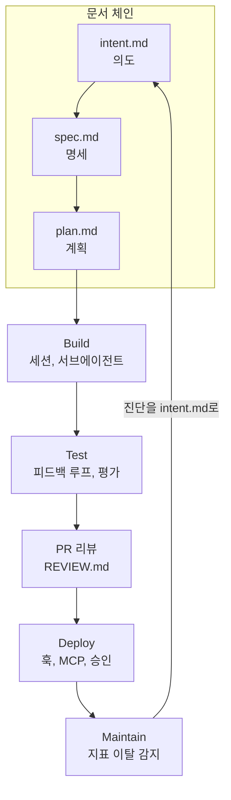

---

title: "[Claude Academy 4편] AI 네이티브 SDLC 12개 플레이 (의도 문서, 평가, 승인 게이트, 폐쇄 루프)"
date: 2026-10-29
categories: [AI, Claude]
tags: [AI, SDLC, ClaudeCode, Hooks, CI/CD]
layout: post
toc: true
math: false
mermaid: true
series: claude-academy
series_order: 4

---

## 참고자료

- [Claude Academy - 엔지니어링 과정 목록](https://academy.claude.com/ko/all?department=engineering)
- Claude Academy 강좌: The AI-Native SDLC Playbook
- [Claude Code Docs - Hooks](https://code.claude.com/docs/en/hooks)

---

## 배경

[3편](/posts/claude-academy-claude-code-in-action/)은 한 사람이 Claude Code를 오래, 안전하게 쓰는 방법이었다. 이 강좌는 범위를 팀과 조직으로 넓힌다. 코드는 빨리 만들어지는데 승인 게이트, 리뷰, 인수인계가 여전히 사람 속도로 돌아가는 문제를 다룬다.

강좌는 소프트웨어 개발 수명주기(SDLC, Software Development Lifecycle)의 여섯 단계를 12개 플레이(play, 한 번에 하나씩 도입하는 실행 단위)로 나눈다. 각 플레이는 변화 내용, 시작 방법, 실행 단계, 거버넌스, 측정 지표 순서다. 판단이 필요한 결정의 책임은 끝까지 사람에게 있다.

정리하면서 확인하고 싶었던 것들이다.

- 여섯 단계에서 전통 방식과 AI 네이티브 방식은 무엇이 다른가?
- 아이디어에서 코드까지 어떤 문서 체인을 남기는가?
- 팀 지식과 정책은 어떻게 파일로 바꾸고, 어떻게 강제하는가?
- 리뷰와 평가는 어떻게 자동화하는가?
- 배포와 운영은 어떻게 폐쇄 루프로 연결하는가?

---

## 큰 그림

여섯 단계는 Plan, Design, Build, Test, Deploy, Maintain이다. 12개 플레이는 의존 관계가 있고, 선행 조건이 없는 6개 중에서 첫 플레이를 고른다.

1절은 문서 체인, 2절은 팀 지식의 파일화, 3절은 피드백 루프와 평가, 4절은 리뷰와 승인 게이트, 5절은 배포와 폐쇄 루프, 6절은 12개 플레이 요약이다.

---

## 1. 의도, 명세, 계획

첫 질문이다.

아이디어를 낸 사람이 Claude와 브레인스토밍해 `intent.md` 원안을 쓰고, 제품 책임자가 고쳐서 공유 저장소에 커밋한다. 측정은 첫 대화부터 커밋까지의 시간과 제품 책임자의 수락 비율이다.

승인된 `intent.md`에 조직의 브랜드, 보안, 컴플라이언스, UX 스킬(작업 절차를 묶은 Claude Code 폴더)을 얹으면 Claude가 `spec.md`를 만든다. 정책이 서로 충돌하는 지점은 우려 사항으로 표시해 담당자에게 넘긴다.

엔지니어는 플랜 모드에서 `spec.md`를 주고 인터뷰하며 계획을 다듬은 뒤 `plan.md`로 커밋한다. 각 변경에 세 문서를 남기면 **Git 이력이 감사 기록이 된다.** 자동 모드와 기존 Jira 같은 레거시 시스템이 같이 있을 때는 어느 쪽이 기준 기록인지 먼저 정한다.

대가는 문서 유지 비용이다. 문서가 코드와 어긋나면 체인 전체가 신뢰를 잃으므로 변경마다 갱신하는 규칙이 필요하다.

---

## 2. 팀 지식의 파일화

두 번째 질문이다.

`CLAUDE.md`는 `/init`으로 초안을 만들고, 신규 입사자에게 필요한 명령, 규칙, 자주 틀리는 점만 남겨 한 쪽 이내로 유지한다. Claude가 같은 실수를 두 번 하면 교정 내용을 파일에 추가한다.

일관되게 적용할 정책은 `SKILL.md`로 써서 `.claude/skills/`에 두고 코드와 함께 배포한다. **스킬은 권고 수준의 통제이므로 반드시 지킬 정책은 훅(Hook, 정해진 시점에 자동 실행되는 셸 명령)으로 뒷받침한다.** 같은 검사를 스킬과 훅, PR 머지 조건에 이중으로 둔다.

작업마다 별도 worktree에서 세션을 돌리고, 반복 작업은 `.claude/agents/`의 서브에이전트(별도 컨텍스트에서 일을 맡는 보조 에이전트)로 정의한다. 세션은 2~3개에서 시작해 리뷰가 따라가는 만큼만 늘린다. 세션을 늘리면 병목이 코드 작성에서 리뷰로 옮겨 가기 때문이다.

---

## 3. 피드백 루프와 평가

세 번째 질문이다.

### 3.1 피드백 루프

Claude가 테스트, 빌드, 스크린샷 비교로 자기 작업을 확인하고 고친 뒤에 사람이 본다. 버그 수정은 실패하는 테스트를 먼저 쓰고, 훅으로 테스트 파일 편집을 막는다. 테스트를 고쳐서 통과시키는 길을 닫기 위해서다.

### 3.2 CI의 반복 평가

평가(eval, 정해진 작업으로 품질을 반복 측정하는 시험)는 실제 작업 20~50개로 만든다. `CLAUDE.md`, 스킬, 훅이 바뀔 때 CI에서 실행하고 통과율을 병합 조건으로 둔다. 운영 사고가 나면 평가 케이스 하나를 추가해 회귀 테스트로 유지한다.

대가는 평가 세트를 만들고 갱신하는 비용이다. 20~50개는 강좌가 제시한 규모이고, 팀 업무에 맞는 기준은 직접 정해야 한다.

---

## 4. 리뷰와 승인 게이트

네 번째 질문이다.

PR 리뷰에는 Claude가 정책 기준으로 PR을 리뷰하고 `@claude` 댓글에 수정을 푸시한다. 리뷰 정책은 `REVIEW.md`에 쓴다. 승인은 코드 소유자가 분기 보호 규칙으로 그대로 맡는다.

훅은 동작을 허용, 확인 요청, 차단하며 환경별로 다르게 적용한다. 관리형 설정(managed settings, 관리자가 내려보내 개인이 바꾸지 못하는 설정)으로 권한 거부 목록, 샌드박스, 승인된 플러그인 마켓플레이스만 허용하는 정책을 건다.

| 수단 | 맡는 일 | 강제력 |
|---|---|---|
| 스킬 | 정책을 설명한다. | 권고다. |
| 훅 | 실행 시점에 허용, 확인, 차단한다. | 있다. |
| 관리형 설정 | 조직 전체에 거부 목록과 샌드박스를 건다. | 개인이 못 바꾼다. |
| 분기 보호 | 병합 승인을 코드 소유자에게 둔다. | 있다. |

---

## 5. 배포와 폐쇄 루프

다섯 번째 질문이다.

### 5.1 CI/CD 연동

`claude -p`로 읽기 전용 판단 단계부터 시작하고, 쓰기 단계는 기존 게이트 뒤에 추가한다. 배포는 환경별 MCP(Model Context Protocol, AI 앱과 외부 도구를 잇는 표준 프로토콜) 서버로 노출한다. 운영 배포는 변경 티켓 승인이 있어야 통과하고, 롤백 경로는 미리 연습한다. 운영 배포 훅은 승인 기록을 읽기만 하고, 에이전트(Agent, 도구를 골라 쓰며 스스로 다음 행동을 정하는 반복 구조)가 승인 기록에 쓰지 못하게 설계한다.

### 5.2 지표 기반 폐쇄 루프

결정론적 스크립트가 지표의 1σ, 2σ, 3σ 이탈을 감지하면 단계별로 기록, 진단, PR 제안을 한다. 여기서 σ(시그마)는 표준편차이고, 평소 변동 범위(통제 구간)를 벗어난 정도를 뜻한다. Claude가 진단 결과를 `intent.md`로 써서 다시 파이프라인에 넣는다. Slack의 Claude Tag로 사고 대응에도 연결한다([8편](/posts/claude-academy-tag-and-enterprise/)).

감지는 모델이 아니라 스크립트가 맡는다. 모델이 감지를 맡으면 같은 지표에도 판단이 달라지기 때문이다.

### 5.3 대가

자동화 범위가 넓을수록 승인 기록의 쓰기 권한, 롤백 연습, 평가 유지 비용이 같이 늘어난다. 강좌는 선행 조건이 없는 플레이(`CLAUDE.md`, 피드백 루프, 훅 등) 하나를 한 저장소에서 먼저 시도하라고 한다.

---

## 6. 12개 플레이 요약

다섯 번째까지의 내용을 플레이 단위로 다시 보면 다음과 같다. 선행 조건이 없는 6개 중에서 첫 플레이를 고른다.

| 단계 | 플레이 | 핵심 |
|---|---|---|
| Plan | 의도 기록 | 아이디어를 `intent.md`로 쓰고 제품 책임자가 고쳐 커밋한다. 측정은 첫 대화부터 커밋까지의 시간과 수락 비율이다. |
| Design | 요구사항과 설계 | 승인된 `intent.md`와 조직 정책 스킬로 `spec.md`를 만든다. 정책 충돌은 우려 사항으로 표시한다. |
| Design | 플랜 모드 | `spec.md`를 주고 인터뷰하며 `plan.md`를 확정한다. 자동 모드와 Jira 같은 레거시 시스템 사이에서 기준 기록을 정한다. |
| Build | CLAUDE.md | `/init` 초안에서 신규 입사자에게 필요한 것만 남겨 한 쪽 이내로 유지한다. |
| Build | 제도적 지식으로서의 스킬 | 정책을 `SKILL.md`로 써서 `.claude/skills/`에 둔다. 훅으로 뒷받침한다. |
| Build | 병렬 세션과 서브에이전트 | worktree별 세션과 `.claude/agents/` 서브에이전트다. 2~3개에서 시작한다. |
| Test | 피드백 루프 | 테스트, 빌드, 스크린샷 비교로 자기 작업을 확인한다. |
| Test | CI의 반복 평가 | 실제 작업 20~50개로 만든 평가를 병합 조건으로 둔다. |
| Test | PR 리뷰 루프의 AI | `REVIEW.md` 정책으로 리뷰하고 `@claude` 댓글에 수정을 푸시한다. |
| Deploy | 승인 게이트로서의 훅 | 허용, 확인, 차단을 환경별로 적용하고 관리형 설정으로 개인이 바꾸지 못하게 한다. |
| Deploy | CI/CD 연동 | `claude -p`로 읽기 전용 단계부터 시작한다. 환경별 MCP로 배포를 노출한다. |
| Maintain | 지표 기반 폐쇄 루프 | 1σ, 2σ, 3σ 이탈을 스크립트가 감지하고 단계별로 기록, 진단, PR 제안을 한다. 진단을 `intent.md`로 쓴다. |

강좌는 계획부터 유지보수까지 여섯 단계(Plan, Design, Build, Test, Deploy, Maintain)에서 전통 방식과 AI 네이티브 방식이 어떻게 다른지를 비교하고, 맺음말에서 모델과 하네스가 발전해 코드 생성뿐 아니라 전체 수명주기를 바꿀 수 있지만 사람의 판단은 중심에 둔다고 정리한다.

---

## 내 자산에 적용

점검 대상은 팀 공통 설정, 리뷰 자동화, CI 파이프라인, 배포 훅이다. 1인 운영이라 챔피언이나 조직 롤아웃은 해당 없음으로 두고, 선행 조건이 없는 플레이부터 고른다.

| 점검 | 개선 |
|---|---|
| 변경의 의도와 계획이 남지 않는가? | 큰 변경마다 `intent.md`, `spec.md`, `plan.md`를 커밋해 Git 이력을 감사 기록으로 쓴다. |
| 스킬로 쓴 정책이 훅으로 뒷받침되지 않는가? | 같은 검사를 스킬, 훅, 머지 조건에 이중으로 둔다. |
| 버그 수정에서 테스트를 고쳐 통과시킬 수 있는가? | 실패하는 테스트를 먼저 쓰고 훅으로 테스트 파일 편집을 막는다. |
| 설정이 바뀔 때 품질을 재지 않는가? | 실제 작업 20~50개를 평가로 만들어 `CLAUDE.md`, 스킬, 훅 변경 때 돌린다. 사고마다 케이스를 추가한다. |
| 리뷰 기준이 암묵적인가? | `REVIEW.md`에 리뷰 정책을 쓰고 승인은 기존 분기 보호에 맡긴다. |
| 운영 배포를 에이전트가 직접 하는가? | 읽기 전용 판단부터 시작하고, 운영 배포는 변경 티켓 승인이 있어야 통과하게 한다. 승인 기록은 에이전트가 쓰지 못하게 한다. 롤백 경로를 미리 연습한다. |
| 지표 이탈을 모델이 감지하는가? | 감지는 결정론적 스크립트가, 진단과 제안은 Claude가 맡게 나눈다. |

연습할 것은 한 번에 플레이 하나만 한 저장소에서 시도하는 습관이다. 고른 플레이의 측정 지표(예: 첫 대화부터 커밋까지 시간)를 먼저 적고 시작한다.

전수 점검의 순서와 지시문은 [11편](/posts/claude-academy-improvement-guide/)에 있다.

---

## 정리하며

처음 던진 질문들에 대한 답이다.

**전통 방식과 AI 네이티브 방식의 차이.** 코드 생성 속도가 아니라 승인, 리뷰, 인수인계가 사람 속도로 도는 지점을 바꾼다. 여섯 단계 모두에서 사람의 판단은 중심에 둔다.

**문서 체인.** `intent.md`, `spec.md`, `plan.md`를 순서대로 커밋하고 Git 이력을 감사 기록으로 쓴다.

**팀 지식과 강제.** `CLAUDE.md`와 스킬로 파일화하고, 반드시 지킬 정책은 훅과 머지 조건으로 이중화한다.

**리뷰와 평가.** 정책 기반 PR 리뷰는 `REVIEW.md`로, 품질은 CI의 반복 평가 통과율로 관리한다.

**배포와 폐쇄 루프.** 읽기 전용 단계부터 붙이고, 운영 배포는 티켓 승인과 롤백 연습을 요구한다. 지표 이탈은 스크립트가 감지하고 진단은 `intent.md`로 되돌린다.

정리하고 나서 가장 크게 바뀐 인식은 **강제가 필요한 정책은 문서가 아니라 훅과 머지 조건에 있어야 한다**는 점이었다. 그래서 스킬을 쓸 때마다 같은 검사를 어디서 강제하는지를 함께 적는다.
