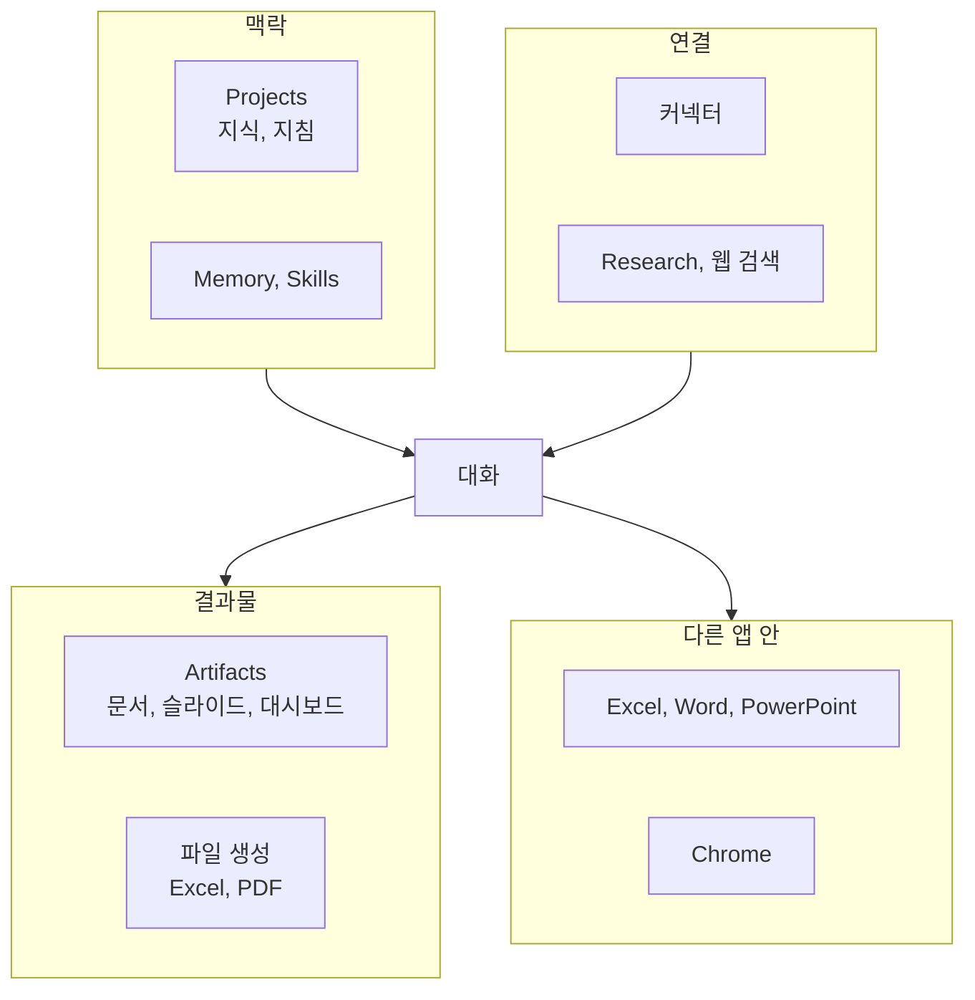

---

title: "[Claude Academy 6편] Claude 앱 기능 (Projects, Artifacts, 커넥터, Research, Office 연동)"
date: 2026-10-29
categories: [AI, Claude]
tags: [AI, Claude, Projects, Artifacts, Connectors]
layout: post
toc: true
math: false
mermaid: true
series: claude-academy
series_order: 6

---

## 참고자료

- [Claude Academy - 엔지니어링 과정 목록](https://academy.claude.com/ko/all?department=engineering)
- Claude Academy 강좌: Claude 101
- Claude Academy 튜토리얼: Getting started with Claude, Navigating the Claude Desktop App, Intro to Projects, Meet Claude Slides, Claude Design and Claude Docs, Using Claude Design for Presentations and Slide Decks, Build Custom Artifacts with Claude
- Claude Academy 튜토리얼: Getting started with connectors, Connect your tools to unlock a smarter, more capable AI companion, Using Research, Using LSEG for financial market data analysis
- Claude Academy 튜토리얼: How to choose between voice mode and dictation, Choosing the right Claude model, How to select the right effort setting for Claude Cowork and Chat
- Claude Academy 튜토리얼: Simplify your browsing experience with Claude for Chrome, Create and edit files with Claude to eliminate hours of busy work, Getting started with Claude in Excel, Claude for Word: Turn a draft into a finished document
- Claude Academy 튜토리얼: Working smarter with Claude in PowerPoint, Building a PowerPoint with Claude, Refining a PowerPoint with Claude, Imagine with Claude Student Guide

---

## 배경

앞의 편은 API와 Claude Code 같은 개발 쪽이었다. 이 글은 claude.ai 앱의 기능을 다룬다. 엔지니어링 업무에서도 문서를 쓰고, 자료를 조사하고, 보고서를 만드는 일이 많아서 앱 기능을 알아 두면 코드 밖의 일에서 시간이 줄어든다.

Claude 101은 첫 대화에서 Projects, Artifacts, Skills(지침, 스크립트, 리소스가 담긴 폴더로 Claude가 필요할 때 불러온다), 커넥터, Research를 거쳐 데스크톱 앱의 Chat, Cowork, Code 구분까지 이어진다. 튜토리얼 스무 편 가까이가 기능별로 세부를 채운다. 스킬은 [5편](/posts/claude-academy-skills/)에서, Cowork는 [7편](/posts/claude-academy-cowork/)에서 따로 다룬다.

정리하면서 확인하고 싶었던 것들이다.

- 첫 대화에서 모델, 맥락, 결과 개선은 어떻게 다루는가?
- Projects와 Artifacts는 각각 무엇을 위한 기능인가?
- 커넥터, Research, 웹 검색은 어떻게 나눠 쓰는가?
- 데스크톱 앱, 음성, Chrome은 어떤 작업에 맞는가?
- Excel, Word, PowerPoint, 파일 생성은 무엇을 대신해 주는가?
- 기억 기능(Projects, Instructions, Memory)은 어떻게 다른가?

---

## 큰 그림

앱 기능은 맥락을 쌓는 쪽, 결과물을 만드는 쪽, 바깥과 연결하는 쪽, 다른 앱 안으로 들어가는 쪽으로 나뉜다.

1절은 첫 대화, 2절은 Projects와 Artifacts, 3절은 연결 기능, 4절은 데스크톱과 입력 방식, 5절은 다른 앱 안에서 쓰는 방법, 6절은 기억 기능, 7절은 입문 강좌와 튜토리얼의 나머지다.

---

## 1. 첫 대화

첫 질문이다.

Claude는 Anthropic이 만든 AI 어시스턴트이고 문서 읽기, 초안 작성과 편집, 도구 간 작업, 어려운 문제 추론을 한다. 입문 과정은 글쓰기, 분석, 코딩, 추론을 돕는 사고 파트너로 소개한다. 웹, 데스크톱, 모바일에서 쓰고 대화가 기기 간에 동기화된다.

프롬프트는 평이한 말로 동료에게 말하듯 자연스럽고 간결하게 쓴다. 갖출 것은 세 가지다. 상황 설정, 작업 정의, 규칙 지정이다.

요청이 모호하면 Claude에게 먼저 질문하게 할 수 있고, 문서를 첨부해 판단 자료를 더 줄 수 있다. 맥락은 파일 업로드, 모델 선택, 메모리, 스킬로 더한다.

결과가 어긋나면 그렇게 말해 조정시킨다. 응답이 너무 일반적이거나 길이, 형식, 어조가 맞지 않을 때는 맥락과 예시를 구체화한다. 첫 응답은 초안으로 보고 반복한다.

모델을 바꾸면 새 대화가 시작된다. 확장 사고(extended thinking, 답하기 전에 추론 과정을 거치는 기능)는 지연을 늘리므로 단순 질문에는 끄고 Sonnet으로 시작한다.

한도 소모량은 Haiku가 가장 적고 Sonnet이 보통, Opus가 많고 Fable이 가장 많다. 단순 작업에 큰 모델을 쓰면 토큰(Token, 언어 모델이 텍스트를 처리하는 단위)만 더 쓰고 응답도 느려진다.

| 모델 | 한도 소모 | 맞는 작업 | 요금제 |
|---|---|---|---|
| Haiku 5.5 | 가장 적음 | 가장 빠른 모델이다. 짧은 답변, 요약, 정보 추출, 분류에 맞다. | Free 포함 |
| Sonnet 5.5 | 보통 | 기본 모델이다. 코딩, 글쓰기, 분석, 다단계 작업, 컴퓨터 사용, 문서와 스프레드시트 생성을 다룬다. | Free 포함 |
| Opus 5.5 | 많음 | 오래 생각해야 하는 복잡한 추론에 쓴다. 다단계 재무 분석이 예다. | Pro 이상 |
| Fable 5.1 | 가장 많음 | 가장 큰 모델이다. 결과만 설명하면 단계를 계획하고 스스로 점검한다. 응답이 느리다. | 유료 요금제 |

모르면 Sonnet으로 시작하고, 가벼운 모델 결과가 부족할 때 위 단계로 올린다. 작업별 선택 예는 기사 요약은 Haiku, 코드 디버깅은 Sonnet, 연구 논문 분석은 Opus, 아이디어에서 프로젝트 구축은 Fable이다.

비교 연습은 직접 읽은 보고서로 Haiku와 Sonnet에 같은 요약 프롬프트를 실행하고, 답변 길이가 아니라 빠뜨린 내용을 비교하는 것이다. 새 모델이 나오면 이전에 한계가 있던 작업을 다시 시도한다.

일부 생물학과 보안 주제에서는 선택한 모델과 다른 모델로 전환될 수 있고 Claude가 알려 준다. 사용 가능한 모델과 한도는 요금제에 따라 다르며, 앱에서는 Free가 Haiku와 Sonnet, Pro와 Max가 Opus와 Fable을 더한다. 계층별 용도는 [2편](/posts/claude-academy-platform-and-cloud/)에 있다.

Effort는 Claude가 답을 주기 전에 혼자 얼마나 철저히 작업하는지 정하는 설정이고 모델 선택기에서 조절한다. 높이면 오래 생각하고 도구 호출과 자체 점검이 늘며, 낮추면 빠르고 직접적으로 답하며 한도를 덜 쓴다. 기본값이 일상 작업에 권장되는 균형이고 가장 높은 설정은 어려운 문제용이다.

사용 한도는 토큰으로 계산되므로 Effort가 높을수록 작업당 한도 소모가 커진다. Effort는 모델 선택과 다르다. 모델 전환은 능력과 비용을 함께 바꾸고, Effort는 판단력과 추론 능력은 두고 계획, 탐색, 재확인에 쓰는 시간만 바꾼다.

한도 때문에 작은 모델로 바꾸려면 새 모델의 Effort를 먼저 낮춘다. 최신 모델의 중간이나 낮은 Effort가 이전 모델의 높은 Effort보다 나은 경우가 많다고 안내된다.

중요한 것은 토큰당 비용이 아니라 **작업 완료당 비용**이다. 상위 모델이 판단이 좋아 한 번에 풀면 후속 질문이 줄어 더 쌀 수 있다.

예로 고객 이탈 분석에서 작은 모델은 분기 중 가격 변경을 놓쳐 추가 설명이 필요했다. 상위 모델은 중간 Effort로 이를 자동 인식해 한 번에 끝냈다.

| 신호 | 조치 |
|---|---|
| 지시를 빠뜨리거나 긴 작업이 끝나지 않는다. | Effort를 올려 다시 요청한다. |
| 품질 향상 없이 장황하고 요청 범위를 넘는다. 정답 뒤에 계속 확인하다 답을 뒤집는다. | Effort를 낮춘다. |
| 한두 번의 대화로 작업이 끝나고 응답 시간이 작업 크기에 비례한다. | 적절한 설정이다. |

적정 설정은 자주 하는 작업을 기본 Effort로 실행해 소요 시간, 완성도, 수정량을 기록하고, 한 단계 낮춰 다시 실행하며 작업 유형 3가지로 비교해 찾는다. Claude Code의 같은 설정은 `/effort` 명령과 별도 문서에서 다룬다.

신뢰 확인은 4D(위임, 설명, 분별, 성실) 프레임워크와 과거 분석을 재현해 보는 간단한 평가(eval, 결과를 정해진 기준으로 점검하는 방식)가 구체적이다. 영상은 프로그램 책임자가 지난 분기 데이터로 분석을 재현해 AI 결과와 대조하는, 위임과 성실의 반복 과정을 보였다.

재현에 실패하는 작업은 위임하지 않는다. 이 판단 틀은 [AI 8편](/posts/ai-fluency-4d-claude-code/)의 4D와 같다.

---

## 2. Projects와 Artifacts

두 번째 질문이다.

### 2.1 Projects

Projects는 자체 대화 기록, 지식 파일(지식 베이스), 맞춤 설정인 지침을 가진 독립 작업 공간이다. 프로젝트 지식과 지침은 프로젝트 안의 모든 채팅에서 프롬프트와 함께 자동으로 고려된다.

같은 파일이나 규칙을 반복해서 설명하게 되면 만드는 시점이다. 생성은 New project 선택, 이름과 목표 입력, Create project 선택의 세 단계다.

지침은 어조, 전문 수준, 응답 방식, 목표를 지정하며 저장하면 모든 채팅에 적용된다. 사용자 선호와 선택한 스타일과 함께 작동한다.

| 항목 | 내용 |
|---|---|
| 지식 | 오른쪽 파일 메뉴의 플러스 버튼으로 PDF, 문서, CSV, 텍스트를 올리거나 Google Drive를 연결한다. 지식이 컨텍스트(context, 모델이 한 번에 볼 수 있는 내용) 한도에 가까워지면 검색 증강 생성(RAG, Retrieval-Augmented Generation, 질문과 관련된 부분을 찾아 쓰는 방식) 모드가 자동으로 켜져 용량이 최대 10배 늘어난다. |
| 범위 | 지식에 추가하지 않은 정보는 같은 프로젝트의 다른 채팅과 공유되지 않는다. 대화 중 올린 파일은 지식과 분리된다. |
| 공개 범위 | private은 개인용, public은 팀 협업용이다. 프로젝트에 별표를 달거나 보관, 삭제할 수 있다. |
| 권한 | 업무용 플랜에서 조직 구성원과 공유하며 세 단계다. Can view는 열람, 지식 접근, 채팅이 되고, Can edit는 지침, 지식, 구성원 관리까지 된다. 생성자는 전체 권한과 공개 범위를 정한다. 입문 과정의 레슨 요약은 최상위 단계를 소유자, 튜토리얼과 영상은 생성자로 적어 확인이 필요하다. |
| 협업 | Shared with me 탭에서 공유받은 프로젝트를 찾고, 공유 시 이메일 알림이 온다. 생성자가 권한을 바꾸거나 회수한다. |
| 사용 예 | 신제품 출시 관리, 교육 과정 설계, 개인 재무 계획, 주택 리모델링 관리가 소개된다. 영상은 신제품 기획, 콘텐츠 제작, 강의 설계를 든다. |

### 2.2 Artifacts

아티팩트(artifact)는 대화 옆 패널에 열리는 문서, 슬라이드, 디자인, 대시보드, 애니메이션 결과물이다. 고유 페이지와 링크가 있어서 파일 다운로드나 PowerPoint, Google Docs 내보내기와는 다르게 팀이 함께 편집한다. 사이드바 Artifacts 페이지에 저장되고 웹, 데스크톱, 모바일, Claude Code에서 다시 연다.

종류를 직접 지정하거나 작업만 설명하면 Claude가 고르고, 맞는 종류가 없으면 트래커나 퀴즈 같은 맞춤 아티팩트를 만든다. 입력 재료는 대화 내용, 첨부 파일, 연결한 도구(드라이브, 캘린더, 팀 채팅)다.

최신 수치가 필요하면 문서가 아니라 연결 도구에서 읽는 대시보드나 맞춤 아티팩트를 요청한다.

| 요금제 | 사용 가능한 종류 |
|---|---|
| 모든 요금제 | Docs, Slides, Design |
| 유료 요금제 | Dashboards(베타), 항목 저장, 도구 연결이 추가된다. |
| Team, Enterprise | Motion(베타)이 추가된다. |

수정은 크기에 따라 고른다. 작은 수정은 직접 클릭해 입력하고, 일부 수정은 Comment와 Send to Claude로, 전체 수정은 대화로 요청한다. 큰 변경 전에는 제목 메뉴의 Duplicate로 복사본을 만들어 원본과 비교하고 복사본에서 실험한다.

첫 결과를 좋게 만들려면 대상과 목적을 밝히고, 예시를 붙이고, 디자인 시스템을 쓰고, 반복되는 문체와 레이아웃 습관은 스킬로 저장한다. 스킬은 자료 출처, 아티팩트 종류, 독자, 보내기 전 확인 항목을 대화로 설명하면 Claude가 작성한다.

공유는 우측 상단 Share에서 권한을 정하며 초대받는 사람도 Claude 계정이 필요하다. 문서, 슬라이드, 디자인은 동시 편집이 가능하다.

내보내기는 Share나 제목 메뉴의 Export에서 PowerPoint, Google Slides, Word, Google Docs, MP4 형식을 고른다. 입문 과정은 pptx, pdf, docx 등으로 내보낸다고 소개한다.

슬라이드는 모든 플랜에서 대화 중 요청하면 열린다. 차트는 요청 시점의 데이터를 그리므로 숫자가 바뀌면 다시 요청한다. 자료에 없는 사실은 질문하거나 눈에 띄는 자리표시자로 남기고 답변에 알린다.

| 슬라이드 항목 | 내용 |
|---|---|
| 시작 | 웹, 데스크톱, 모바일, Claude Code의 어느 대화에서나 요청하거나 사이드바 Artifacts의 Make something new에서 시작한다. Team과 Enterprise는 소유자가 Organization settings, Artifacts에서 켠다. |
| 요청 전 | 덱의 용도와 독자를 밝히고 자료(메모, 회의록, 연결된 도구)와 디자인(과거 덱 또는 디자인 시스템)을 준다. 파일 없이 메모 붙여넣기나 음성 입력으로 시작해 개요부터 받는 방법도 있다. |
| 브랜드 | 조직 기본 디자인 시스템을 쓰고 없으면 선택을 묻는다. 독립형 Claude Design에 있는 시스템은 Artifacts 페이지에서 먼저 옮겨야 한다. 시스템이 없으면 덱이나 브랜드 파일을 붙여 모양을 맞추게 한다. |
| 직접 편집 | PowerPoint나 Keynote와 비슷하고 변경은 자동 저장된다. 슬라이드 썸네일로 추가, 순서 변경, 복제를 하고 Skip slide로 발표와 다운로드에서 제외한다. |
| 댓글 | 한 부분만 바꿀 때 쓴다. Send to Claude를 켜고 편집 권한이 있어야 한다. 여러 슬라이드나 전체 모양은 번호나 제목을 지정해 대화로 요청한다. |
| 이미지 | 직접 첨부해야 하며 Claude가 사진을 찾거나 만들지 못할 수 있다. |
| 발표 | 발표자 노트는 Claude가 대본으로 써 준다. Present with speaker notes는 노트, 시계, 현재와 다음 슬라이드가 보이는 두 번째 창을 연다. |
| 공유와 내보내기 | 공유는 보기, 댓글, 편집 권한을 고르고 동시 편집이 가능하다. 내보내기는 PDF, HTML, PowerPoint를 지원한다. |

PowerPoint로 내려받으면 텍스트 상자, 표, 그림, 배경, 노트는 편집되지만 차트, 아이콘, 도형은 그림으로 바뀌고 전환 효과와 건너뛴 슬라이드는 빠진다.

맞춤 아티팩트는 문서, 슬라이드, 디자인, 대시보드(베타, 유료), 모션(베타, Team과 Enterprise)에 맞지 않는 작업을 위해 처음부터 만든 대화형 페이지다. 예는 트래커, 퀴즈, 플래너, 입력을 저장하는 도구, 접수 양식이다.

입력값 저장, 연결 도구 읽기와 쓰기, 안에 Claude 추가, 파일 내려받기와 올리기를 요청으로 붙인다. 저장과 연결 도구는 유료 플랜이 필요하다.

| 맞춤 아티팩트 항목 | 내용 |
|---|---|
| 만들기 | 하려는 일과 막히는 문제를 설명하고, Claude의 질문에 답하고, "Build this as an artifact"처럼 직접 요청한다. 결과는 사이드바 Artifacts 페이지에 저장된다. |
| 수정 | 대화로 전체를 바꾸거나 Comment로 한 부분을 지정한다. |
| 입력 저장 | Claude에게 무엇을 보관할지 알려 준다. 저장값은 Claude가 아티팩트를 바꿔도 유지되고 아티팩트마다 저장 한도가 있다. 저장된 입력은 대화에서 요약, 일괄 입력, 삭제를 요청할 수 있다. |
| 연결 도구 | Asana, Google Calendar, Slack 같은 도구를 읽고 변경한다. 사용자마다 자기 연결을 쓰므로 접근 권한이 없는 사람에게는 오류가 표시된다. |
| Claude 추가 | 아티팩트 안에 Claude를 넣을 수 있고 각 사용자의 사용량은 본인 플랜에 집계된다. |
| 공유 | Share에서 이메일 또는 조직 전체로 한다. 처음 초대한 사람은 댓글 권한이다. |

### 2.3 대가

공유 전에는 다른 사람이 열 수 없고, 공유 페이지에는 아티팩트와 댓글만 보이고 Claude와의 대화는 보이지 않는다. Enterprise 요금제에서는 조직 Owner가 아티팩트 종류별로 켜고 끌지 정한다.

링크 공개(Anyone with the link)로 외부에 공유하면 외부인과 비로그인 사용자도 열 수 있으나 연결 도구 부분은 동작하지 않는다. HTML로 내보내면 저장, Claude 사용, 연결 도구 기능이 멈추며, 전체 기능은 Claude Code에서 코드를 받아 직접 구축한다.

2026년 9월 16일 이전에 만든 아티팩트와 게시 링크는 계속 작동한다. 손으로 편집한 슬라이드나 디자인을 Claude에게 다시 맡길 때는 유지할 부분을 알려야 한다.

슬라이드의 가정 부분을 보고 숫자는 발표 전에 원본과 대조한다. 덱이 일반적이면 자료가 부족한 것이므로 메모나 원본 파일을 주고 다시 요청한다.

슬라이드가 안 보이면 Team과 Enterprise 소유자의 설정을 확인하고, 브랜드가 다르면 + 메뉴에서 Design system 선택을 확인한다.

---

## 3. 커넥터, Research, 웹 검색

세 번째 질문이다.

채팅 창의 + 메뉴 항목은 Connectors(이메일, 캘린더, 드라이브, 채팅, CRM), Web search, Research(수 분 걸리는 인용 보고서), Skills(반복 작업 지침), Add folder(데스크톱 앱)다.

| 기능 | 내용 | 맞는 작업 |
|---|---|---|
| 커넥터 | MCP(Model Context Protocol, AI 앱과 외부 도구를 잇는 표준 프로토콜) 기반으로 Slack, Notion, Google Drive, Linear 같은 서비스를 연결한다. 연결이 없으면 일반 지식과 텍스트 출력에 머물러 복사와 붙여넣기가 필요하다. | 실제 프로젝트 데이터 조회, 흩어진 정보 연결, 도구 안의 작업 실행이다. |
| 웹 검색 | Free, Pro, Max는 기본으로 켜지고 Team과 Enterprise는 기본 꺼짐이며 관리자가 켠다. | 최신 정보 확인이다. |
| Research | 계획을 세우고 여러 검색을 이어 실행해 인용 보고서를 만든다. 웹 검색이 켜져 있어야 하고, 대부분 5분에서 15분, 복잡하면 최대 45분이다. | 시장 분석, 기술 문서 종합, 제품 개발 로드맵처럼 여러 출처를 모으고 연결하는 데 몇 시간이 걸리는 작업이다. |
| 엔터프라이즈 검색 | Team과 Enterprise 요금제에서 사이드바에 "Ask 조직명" 프로젝트를 추가해 사내 도구 전반을 검색하고 출처를 인용한다. 소유자가 먼저 설정하고 사용자가 각자 계정으로 인증한다. | 사내 지식 질의다. |

커넥터와 웹 검색이 켜져 있으면 Claude가 소스 사용 유무를 판단하며, 프롬프트에서 어느 쪽을 쓸지 지정할 수 있다.

커넥터는 채팅 창 왼쪽 아래 검색 및 도구 버튼(Search and tools)의 Add connectors에서 추가하고 관리한다. 디렉터리는 생산성, 커뮤니케이션, 개발, 비즈니스, 자동화, 데스크톱 확장 분류이고 목록은 claude.ai/directory에서 확인한다. 1st party 연동과 MCP 연동이 함께 제공되는데, 1st party는 추측으로 Anthropic이 직접 만든 연동을 뜻한다. 설정은 MCP로 자동 처리되고 커스텀 MCP 서버는 별도 문서를 참고해야 한다.

디렉터리의 범주는 두 가지다. Web은 Google Drive, Gmail, Asana, Notion, Canva 같은 원격 서비스이고, 데스크톱 확장(앱 전용)은 메모, 메시지, 코드 파일 같은 로컬 자료다.

첫 연결은 앱을 고르고 connect를 누른 뒤, Web 커넥터는 계정에 로그인한다. 연결한 뒤에는 Claude에게 그 도구에 접근할 수 있는지 물어 확인한다. Claude는 사용자가 접근할 수 있는 데이터만 보고, 커넥터를 누르면 부여된 권한이 보이며 항목별로 켜고 끈다.

잘 쓰는 방법은 네 가지다. 도구를 구체적으로 지정하고("Google Drive의 Finance 폴더에서 Q3 예산 시트 검색"), 복잡한 작업은 단계로 나누고, 여러 도구를 조합하고, 여러 출처의 맥락을 더한다.

| 사용 사례 | 내용 |
|---|---|
| 릴리스 노트 | Linear에서 이번 주 완료 티켓(최근 스프린트, sprint, 짧게 반복하는 개발 주기)을 읽고 Notion이나 파일의 표준 템플릿과 스타일 가이드를 더해 쓴다. 초안이 몇 분에 완성된다. |
| 회의 메모 | Apple Notes와 Asana로 회의 메모를 읽고 현실적인 마감일과 담당자가 있는 Asana 작업을 만든다. |
| 디자인 | 문서와 Canva로 작성한 블로그나 제품 문서를 읽고 Canva 디자인을 만든다. |
| 확장 | 회의록을 프로젝트 작업으로, 프로젝트 업데이트를 임원 요약으로 바꾼다. |

Research는 채팅 창 왼쪽 아래 버튼으로 켜고 프롬프트를 제출하면 백그라운드에서 독립적으로 조사한다. 프롬프트에는 보고서에 넣을 항목, 선호 출처 유형, 배경을 적고, 예시는 팀 워크숍 장소 비교다.

정보가 부족하면 조사 전에 후속 질문으로 과제를 구체화한다. 서로 이어지는 여러 검색을 하고 다음 조사 대상을 스스로 정하며 질문의 여러 측면과 관련 질문을 동시에 다룬다.

조사가 백그라운드에서 돌아가므로 다른 일을 하다가 돌아와 결과를 받는다. 확장 사고가 자동으로 켜져 타이머가 있는 사고 표시기, 응답 위의 펼침 영역, 클릭해서 보는 사고 과정이 나타나고, 두 기능을 함께 쓰면 Claude가 접근 방식을 계획하고 폭넓게 정보를 수집한다.

대가는 시간이다. 영상은 수백 개 출처를 탐색해 5분에서 45분 안에 인용 보고서를 낸다고 설명한다. 한도 소모량은 원문 요약에 언급이 없어 확인이 필요하다. 결과의 인용은 확인 가능하므로 중요한 수치는 원문을 열어 대조한다.

LSEG(London Stock Exchange Group, 시장 데이터 제공 기업) 연동은 원격 커넥터로 시장 데이터와 분석 도구를 Claude 대화에서 쓰게 한다. 주식, 채권, 외환, 원자재 등 여러 자산군을 다룬다. 접속하려면 LSEG의 MCP 서버 접근 권한이 필요하며 LSEG에 문의해야 한다.

| LSEG 항목 | 내용 |
|---|---|
| 기능 | FX(외환) 현물 가격, FX 선도(forward, 미래 시점의 거래 가격을 지금 정해 두는 계약) 가격과 선도 포인트(현물과 선도 가격의 차이), 금리 곡선 분석, 평가일을 지정한 FX 선도 곡선 포인트, ISIN(국제 증권 식별 번호) 기반 채권 가격(수익률과 스프레드 포함)이다. |
| 쓰임 | 환율 분석, 수익률 곡선 구성, 채권 가치 평가, 자산 간 상관 분석, 헤지 전략 설계, 시세와 포지션 대조다. 현물과 선도 가격을 비교하면 시장이 기대하는 통화 움직임을 파악한다. |
| 설정 | 조직 소유자가 Admin settings의 Connectors에서 Add custom connector를 눌러 URL `https://api.analytics.lseg.com/lfa/mcp`와 이름(예: "LSEG MCP")을 입력하고 Add를 누른다. 개별 사용자는 도구 찾기와 연결 문서를 따른다. |
| 예시 프롬프트 | USD/EUR 현물과 3개월, 6개월 선도 포인트, USD SOFR 스왑 곡선의 변곡점, 두 국채의 ISIN 가격 비교, AUD/USD 선도 곡선, USD SOFR와 EUR ESTR 곡선 비교, 통화 스왑 평가용 시장 데이터다. |
| 요령 | USD/EUR 같은 통화쌍 표기, 3M와 6M와 1Y 같은 만기 명시, 채권은 ISIN으로 지정, 선도 곡선은 평가일 지정, 통화별 곡선 관행(SOFR, ESTR, AONIA) 이해다. |
| 주의 | 해외 채권은 통화 환산을 확인하고 분석 결과는 다른 도구 데이터와 교차 확인하라고 안내한다. LSEG MCP 서버 문서는 LSEG 포털에 곧 공개될 예정이라고 안내된다. |

원문은 통화별 곡선 관행으로 SOFR, ESTR, AONIA를 이름만 나열한다. 각각 미국 달러, 유로, 호주 달러의 익일물(하루짜리 대출) 기준금리라는 풀이는 원문 밖의 보충이다.

---

## 4. 데스크톱 앱, 음성, Chrome

네 번째 질문이다.

데스크톱 앱은 질문과 수정을 주고받는 턴 단위 대화는 Chat, 여러 단계 결과물을 맡기는 일은 Cowork, 코드베이스 작업은 Code 탭이 맡는다. Cowork는 폴더 접근, 예약 작업, 서브에이전트를 지원한다.

데스크톱 앱은 단축키로 어느 앱에서나 Claude를 열고 내 컴퓨터의 폴더, 앱, 웹사이트에서 직접 작업하게 한다. 작업을 시작해 두고 자리를 비워도 계속 실행되며 웹이나 모바일 앱에서 확인할 수 있다.

| 기능 | 내용 | 조건과 주의 |
|---|---|---|
| 빠른 입력 | 다른 앱 위에 뜨는 작은 창이다. Mac은 Option 두 번, Windows와 Linux(베타)는 설정한 단축키로 연다. Mac은 Caps Lock으로 음성 입력도 된다. 창 위에 마우스를 올려 스크린샷을 보내거나 화면 일부를 드래그해 캡처한다. | 스크린샷과 Caps Lock 음성은 Mac 전용이다. |
| 폴더 접근 | 메시지 창 아래에서 추가하고 편집 권한을 주면 Claude가 파일을 읽고 완성본을 저장한다. 예는 PDF 송장 취합, 다운로드 폴더 정리다. | 모든 유료 플랜이다. |
| 확장 | 커넥터에 더해 Mac의 Apple Notes나 Messages 같은 확장을 Extensions에서 추가한다. | |
| 내장 브라우저 | 앱 안의 별도 브라우저 패널이다. 사이트 열기, 읽기, 클릭, 입력, 양식 작성을 단계마다 본다. 사이트별로 한 번 허용, 항상 허용, 거부를 고른다. | Pro 이상이다. |
| 컴퓨터 사용 | 커넥터와 내장 브라우저로 안 되는 설치형 프로그램을 화면, 마우스, 키보드로 조작한다. 한 단계씩 클릭하므로 셋 중 가장 느려서 마지막 수단이다. | Mac, Windows의 Pro와 Max이고 베타다. Claude가 화면을 보므로 민감한 내용은 먼저 닫는다. 기본값은 앱 사용 전 확인이며 언제든 멈출 수 있다. |
| 스킬 녹화 | 플러스 메뉴에서 시작해 작업을 한 번 시연하고 Done을 누르면 Claude가 스킬로 변환한다. | Mac의 Pro, Max, Team이다. 녹화 중 비밀번호, 비밀 정보, 개인 대화를 입력하거나 보이지 않게 한다. |

일부 웹페이지에는 AI를 속이려는 숨은 문장이 있다. 안전 장치는 위험을 줄일 뿐 없애지 못해서 은행과 건강 기록 같은 민감한 작업은 직접 한다. 자리를 비울 때는 Keep computer awake로 절전을 막는데, 노트북 덮개를 닫으면 절전된다.

음성은 두 가지다. 받아쓰기(dictation)는 키보드를 목소리로 바꾸는 방식이고 Claude의 답은 평소처럼 텍스트로 온다. 음성 모드(voice mode)는 키보드 없이 말로 주고받는 대화이고 Claude가 말하는 도중에 끼어들거나 다음 질문을 바로 할 수 있다.

하고 싶은 말이나 할 일이 정해져 있으면 받아쓰기, 생각을 정리하거나 연습하려면 음성 모드다. 한쪽에서 시작해 다른 쪽으로 이어 갈 수 있고 대화는 일반 채팅처럼 저장된다.

| 항목 | 받아쓰기 | 음성 모드 |
|---|---|---|
| 입력 | 데스크톱은 마이크를 누르고 말한 뒤 전송한다. 휴대폰은 마이크를 누른 채 말하다 놓으면 전송된다. | 키보드 없이 말로 대화한다. 대화 중 마이크를 음소거할 수 있다. |
| 용도 | 길고 정리되지 않은 요청, 전송 전 프롬프트 확인과 수정, 계획과 표 같은 텍스트 응답 수신이다. | 결정 고민 정리, 회의 내용 구술, 면접과 협상 연습, 언어 연습, 긴 문서 질의, 고객 통화 준비다. |
| 제공 | Cowork의 마이크 버튼은 받아쓰기이다. | 모든 요금제에서 쓰며 휴대폰(iOS, Android)이 우선이고 웹과 데스크톱도 지원한다. Cowork에서는 현재 제공되지 않는다. |

음성 모드는 유료 요금제에서 Opus와 Sonnet을 쓰고 대화 중 모델을 전환하며, 이메일, 캘린더, 문서, Slack 같은 연결 앱을 조회한다. 유료 요금제만 상위 모델과 도구 연결이 가능하다.

영어 외 다수 언어를 지원하며 영어 외는 베타이다. 자동 감지가 없어서 언어는 설정에서 직접 고르거나 요청해야 한다.

음성 대화는 저장되고 메모리와 이전 대화를 참조한다. 설정 항목은 듣기 모드(핸즈프리 또는 누르고 말하기), 언어, Claude의 목소리, 대화 모델(유료)이다.

이어 쓰는 순서 예는 산책 중 음성 모드로 생각을 정리하고 요약을 요청한 뒤 책상에서 받아쓰기로 후속 작업하는 것이다.

Claude in Chrome은 사용자의 권한, 로그인, 맥락으로 브라우저 안에서 클릭과 입력을 대신하는 확장이다. 유료 요금제의 Chrome 브라우저에서 쓴다.

Claude는 화면의 버튼, 양식, 메뉴를 사람처럼 인식하고 Gmail의 "Archive" 같은 버튼 의미도 이해한다. 같은 탭 그룹의 모든 탭을 보고 조율하며, 탭을 전환해도 작업을 이어 가고 알림을 켜면 완료나 권한 요청을 알려 준다.

| 맞는 작업 | 안 맞는 작업 |
|---|---|
| 지정한 사이트의 양식 작성과 클릭, 정의된 워크플로우 반복, 로그인이 필요한 정보 수집이다. | 출처를 모르는 탐색형 조사, 수십 개 자료를 종합하는 보고서는 Claude 앱이 낫다. 클릭 한 번 같은 일회성 작업, 미묘한 판단이 필요한 주관적 결정, 직접 해 보며 배우는 작업은 직접 한다. |

반복 작업은 단축키(shortcut)로 저장한다. 만드는 방법은 세 가지다. Record workflow로 화면과 음성을 시연하고, 대화 헤더의 Convert to task를 쓰고, 보낸 프롬프트를 단축키로 저장한다.

`/`를 입력해 단축키를 실행하고, Schedule을 켜면 빈도, 날짜와 시간, 모델을 정해 자동 실행한다. 예약 후보는 이메일 정리, 내보내기가 없는 대시보드의 주간 지표 추출, 다음 주 회의 준비 정리다.

예시 프롬프트는 공급업체 신청서 작성(제출 전 중단), 받은편지함 정리, 경쟁사 사이트 변경 확인, 회신 초안 작성(발송 없이 보관), 회의 참석자 조사다.

영상은 컴퓨터 사용에 강한 Sonnet 4.5 모델이 브라우저에서 동작한다고 소개한다. 시연은 주택 리모델링 예산 정리로, 계획 문서와 업체 이메일에서 영수증을 찾아 스프레드시트의 빠진 수치를 채운다. 마지막에 배우자에게 보낼 이메일 초안을 쓰며 발송 전 최종 수정은 사용자가 직접 한다. 입문 과정 영상은 이메일과 스프레드시트를 오가는 예산 정리로 소개한다.

제약은 다음과 같다. 하나의 작업 안에서만 맥락을 유지하고 세션 간 기억이 없다. Projects, MCP 도구 연결 같은 Claude.ai 확장 기능이 없다. 금융 서비스, 성인물, 불법 복제 사이트는 접근이 차단된다.

안전 장치로 세분화된 권한, 프롬프트 인젝션(웹페이지에 숨긴 문장으로 AI를 속이는 공격) 방어, 사용 가능 사이트 제한이 있다. 구매 같은 민감 동작 전에는 항상 확인하며, 일부 동작은 설정과 무관하게 항상 권한을 묻는다. 브라우저 사용은 웹사이트와 직접 상호작용하는 만큼 위험이 있어 Using Claude for Chrome Safely 문서를 먼저 읽어야 한다.

---

## 5. Office 앱과 파일 생성

다섯 번째 질문이다.

| 도구 | 하는 일 |
|---|---|
| Excel | 스프레드시트 안에서 동작하는 AI 에이전트다. 사이드바에서 질문 답변, 오류 추적, 수식 설명, 데이터 정리, 예측 모델, DCF(Discounted Cash Flow, 미래 현금흐름을 현재 가치로 할인해 기업가치를 계산하는 모델), 피벗(pivot, 데이터를 기준별로 모아 요약하는 표)과 차트를 만든다. 변경 전에 권한을 묻고 계산 과정과 참조 셀 링크를 보인다. |
| Word | 문서 전체를 읽고 패널에서 실제 편집 작업을 맡는다. 열린 의견을 리뷰어별로 정리하고 충돌을 찾는다. 변경 추적 상태에서 수치 대조, 서식 정리, 축약, 오탈자 교정을 한다. 수락은 되돌릴 수 없어 매번 확인한다. 슬래시로 copy edit 같은 스킬을 호출한다. |
| PowerPoint | 슬라이드 마스터, 레이아웃, 글꼴, 색을 읽어 템플릿에 맞춘다. 선택한 슬라이드와 객체 단위로 수정하고, 글머리표를 다이어그램과 기본 차트로 바꾼다. 삭제 전에 확인한다. |
| 파일 생성 | Excel(작동하는 수식), 보고서와 메모, 데이터 분석과 시각화, 문서의 슬라이드 변환, PDF 양식을 직접 만든다. 같은 데이터로 PowerPoint, PDF, Excel을 한 번에 만든다. |

Word는 Word 웹, Windows, Mac에서 쓰며 Microsoft AppSource의 Claude for Microsoft 365 일부다. Pro, Max, Team, Enterprise 플랜에 포함되고, 같은 요약의 다른 문장은 모든 유료 플랜에 포함된다고 적어 확인이 필요하다.

PowerPoint 애드인(add-in, 프로그램 안에 붙여 쓰는 부가 기능) 사용법은 세 가지다. 참고 파일 업로드, 커넥터로 실시간 데이터 연결, 기존 덱 읽기다.

| PowerPoint 사용법 | 내용 |
|---|---|
| 참고 파일 | 더하기 버튼으로 리서치 보고서, 데이터 내보내기, 내부 분석 파일을 올리면 관련 정보를 서식 갖춘 슬라이드로 정리한다. 여러 문서를 모아 발표를 만들 때 유용하다. |
| 커넥터 | Google Drive, Notion, Confluence 같은 도구를 연결하면 Claude가 직접 읽고 쓸 수 있다. 연결된 소스에서 데이터를 가져와 슬라이드를 만들고, 작업을 마치면 해당 도구에 다시 기록할 수 있다. Claude.ai에 설정한 커넥터는 애드인에도 그대로 적용된다. |
| 기존 덱 읽기 | 덱 전체를 읽어 슬라이드별로 논지를 요약한다. 회의 전에 공유받은 덱에 "7번 슬라이드의 데이터 출처는 무엇인가", "규제 위험을 다루는가" 같은 질문을 하면 내용을 찾아 답한다. |

사용 장면은 이사회 덱 처음부터 작성, 고객 전달 자료에 섹션 추가, 글 중심 초안의 시각화, 회의 전 덱 점검이다. 슬라이드 생성, 서식, 레이아웃, 구조 변경 같은 기계적 작업을 맡기고 사용자는 이야기 구성에 집중한다. 이 영상은 전체 덱 생성과 정밀 편집을 다룬 앞선 영상의 후속편이고, Claude는 작업 속도를 높이되 결과물 통제는 사용자에게 남긴다.

PowerPoint는 한 요소를 고치려고 전체를 다시 만들지 않고 개체 단위로 요청해야 변경 범위가 좁다. 결과물은 기본 도형과 텍스트 상자라서 직접 이동, 크기 조절, 색 변경이 가능하다.

복잡하거나 맞춤이 많은 템플릿은 결과가 브랜드 지침에 맞는지 확인한다. 변경 승인은 모든 변경을 확인하거나 Claude에 필요한 수정을 맡기는 두 가지다. 데이터 출처도 안내한다.

대화 안의 시각 자료도 있다. 질문에 시각 자료가 더 명확한 답일 때 다이어그램, 차트, 도구를 대화 흐름 안에 만든다. 클릭하거나 값을 바꿀 수 있는 대화형이 많으며, 슬라이더, 끌 수 있는 점, 버튼, 소리를 담기도 한다.

답변 옆 패널이 아니라 대화 흐름 안에 나타나며 Artifacts의 가벼운 버전이고 이미지 생성이 아니다. 웹과 데스크톱의 모든 플랜에서 쓰고, 특별한 조작 없이 Claude가 판단하며 "show me"나 "visualize this" 같은 요청으로 직접 부를 수도 있다.

시각 자료는 대화 맥락, 업로드한 파일, Claude가 아는 사용자 정보로 만든다. 쓰는 장면은 설명 그림으로 보기, 개념과 상호작용하기, 요소 간 연결 시각화, 배운 내용 연습(퀴즈)이다.

후속은 "interactive하게 만들어 줘"로 움직이게 하기, 아래 버튼으로 더 깊이 들어가기, 부족한 점을 말해 다시 그리기다. 겹침이나 잘린 라벨은 서식 수정을 요청한다.

질문에 맞춰 만든 것이라 확인된 출처가 아니고 교재 그림과 달리 틀릴 수 있으므로 권위 있는 자료로 쓰기 전에 실제 출처와 대조한다. 틀림을 찾는 일이 이해도를 점검하는 방법이다.

Excel은 외부로 공유할 결과가 조직 기준에 맞는지 보고, 민감하거나 규제 대상인 데이터는 조직의 처리 정책을 따른다. PowerPoint도 민감하거나 규제 대상인 내용은 조직의 데이터 처리 정책을 따른다.

Team과 Enterprise는 코드 실행과 파일 생성의 보안을 위해 네트워크 접근 설정 문서를 확인한다. 파일 형식을 지정하지 않으면 Claude가 아티팩트로 만들 수 있고, 이때는 Claude 안에서 편집한 뒤 내보낸다. 결과 파일은 Drive에서 열거나 다운로드해 바로 편집하고 공유한다.

파일 생성이 시간을 줄이는 지점은 다섯 가지다. 여러 PDF, 웹사이트, 스프레드시트의 데이터 결합, 문서에서 슬라이드나 PDF에서 스프레드시트로의 변환, 반복 수식 구성, 같은 데이터를 쓰는 보고서와 발표와 시트 동시 생성, 형식이 제각각인 데이터 정리다.

추가 사용 예는 문서 요약 후 슬라이드 초안, 댓글과 제안 형태의 교정, LaTeX 파일, 매출 그래프 GIF, 여러 파일에 워터마크 일괄 추가, matplotlib 그래프다.

---

## 6. 기억 기능

여섯 번째 질문이다.

모델은 한 대화 안의 내용만 알고 새 채팅은 빈 상태로 시작한다([1편](/posts/claude-academy-how-ai-works/)). 그래서 기억은 모델이 아니라 제품이 대화 앞에 다시 넣어 주는 노트다. 제품마다 이름과 범위가 다르다.

| 기능 | 범위 | 내용 |
|---|---|---|
| Projects | 프로젝트 안의 모든 채팅 | 파일과 지침을 묶은 작업 공간이다. 지식에 넣지 않은 정보는 다른 채팅과 공유되지 않는다. |
| Instructions for Claude | 모든 대화 | 프로필 설정의 짧은 메모다. |
| Memory | 대화 간 | 설정에서 켜고 직접 편집한다. 계정에 저장된 세부 정보를 새 채팅에서 볼 수 있다. 대부분 수정, 삭제, 끄기가 된다. |
| Claude Code | 프로젝트, 사용자 | `CLAUDE.md` 파일이다. 매 요청에 전체가 포함된다. |
| Cowork | 전역, 프로젝트 | 전역 지침과 프로젝트의 지침, 예약 작업, 컨텍스트, 메모리다. |
| Claude Tag | 채널 | `remember for this channel:`로 저장한다. 공개 채널 내용은 워크스페이스 전체에, 비공개 채널과 DM 내용은 그 공간에만 적용된다. |
| Managed Agents | 메모리 저장소 | 지난 실행 결과를 읽고 변경을 저장해 다음 실행에 반영한다. |

추측이지만 기억할 만한 것은 프로젝트, 선호, 협업 관계다. 참석 인원이나 견적 같은 일시적 세부는 다시 찾는 편이 낫다. 대가는 두 가지다. 오래된 기억이 현재 작업과 어긋날 수 있고, 어느 범위에 저장되는지 모르면 의도하지 않은 곳에 정보가 남는다. 설정에서 메모리와 채팅 기록 토글을 확인하고, 틀린 기억은 직접 고친다.

---

## 7. 보완: 입문 강좌와 튜토리얼의 나머지

- Claude는 헌법적 AI(Constitutional AI, 모델이 따를 원칙을 문서로 정해 두고 학습하는 방식) 원칙으로 학습된 어시스턴트이고, 웹, 데스크톱, 모바일에서 대화가 기기 간에 동기화된다.
- 모델을 바꾸면 새 대화가 시작된다. 확장 사고는 지연을 늘리므로 단순 질문에는 끈다. 투자자용 피치덱 요청이 상황, 작업, 규칙 세 요소의 예시이고, Sonnet은 일상 작업의 기본 모델, Opus는 다단계 재무 분석 같은 복잡한 작업에 쓴다.
- 프로젝트 생성은 영상 기준 이름 입력, 설명 입력, 생성의 세 단계이고 공개 범위는 비공개와 공개다. 권한은 보기, 편집, 생성자 세 단계다. 보기 권한도 지식 열람과 대화는 되고 수정만 안 된다. 지식이 컨텍스트 한도에 가까워지면 RAG 모드가 자동으로 켜지고 용량이 최대 10배 늘어난다. 사용 예는 신제품 기획, 콘텐츠 제작, 강의 설계, 개인 재무, 주택 리모델링이다.
- 입문 과정은 스킬이 프로세스를 정의하고 프로젝트가 지식을 저장한다는 역할 차이를 짚는다. 대화로 맞춤 스킬을 만들 수 있다.
- 응답 형태는 일반 텍스트, 인라인 시각 자료(도표, 차트), 아티팩트, 파일, 카드(날씨, 레시피, 지도, 이메일 초안)다. 파일은 수식이 있는 스프레드시트, 전송용 PDF, PowerPoint용 슬라이드처럼 형식 자체가 필요할 때 만든다. 아티팩트 종류는 Design, Slides, Docs, Dashboards(유료 베타), Motion(Team과 Enterprise 베타), 맞춤 interactive artifacts다. Free, Pro, Max는 웹 검색이 기본 켜짐이고 Team과 Enterprise는 기본 꺼짐이며 관리자가 켠다. 요청이 모호하면 Claude에게 먼저 질문하게 할 수 있고, 사용법은 기능 설명을 요청하거나 "질문한 뒤 더 나은 프롬프트를 써 달라"고 묻거나 모르는 화면의 스크린샷을 첨부해 물어본다.
- 역할별 사용 사례 갤러리가 일반 업무, 영업, 마케팅, 재무, HR, 법무, 연구 직군으로 제공된다. 외부 출처 스킬은 내용을 확인한 뒤 설치한다.
- 다른 제품으로는 Claude Code(터미널과 편집기), Claude Tag(Slack), Claude Design, Claude for Excel, PowerPoint, Word, Outlook, Claude in Chrome, 모바일이 있고 각 제품의 사용 상황과 요금제 조건을 설명한다. Claude Tag는 채널별로 접근 범위와 메모리가 나뉘고 자체 계정을 쓴다. 법무 채널에서 코드베이스 수정을 요청해도 접근이 없어 처리하지 못하며, 비공개 채널과 DM에서 얻은 메모리는 그 안에 머문다. Anthropic은 제품 풀 리퀘스트의 65%를 Claude Tag가 연다고 밝혔다.
- 영상은 Excel이 수식 오류 수정과 피벗 차트 생성을 한다고 시연하고, Chrome이 이메일과 스프레드시트를 오가는 예산 정리를 한다고 시연한다.
- 과정의 마지막은 복습과 추가 학습 자료 안내, 한 가지 반복 업무를 골라 바로 써 보라는 권고다. 퀴즈를 마치면 수료 배지를 받는다.
- Excel은 Mac에서 `Control Option C`, Windows에서 `Control Alt C`로 사이드바를 연다. 경비 보고서에서 출장과 식비 비중이 전체의 40% 미만인지 계산하고 과정을 보여 준다. 5월 평균 단가 오류를 D6 수식의 0으로 나누기와 빈 C6 셀로 추적하고 수정안을 제시한다.
- VLOOKUP(표에서 값을 찾아 오는 함수) 기반 성적표 수식은 조회 값, 테이블 범위, 열 번호, 근사 일치 순으로 풀어 설명하고 인용 상자로 셀에 이동한다. 날짜를 YYYYMMDD로 통일하고, 중복 3건을 제거하고, 날짜 정렬과 historical 시트의 연도별 요약 생성을 승인 후 실행한다.
- 예측 모델은 평균 성장률을 assumption 시트에 두고 수식으로 연결해 2026~2028을 예측하며, 2025년은 10개월 데이터라는 주석을 덧붙인다. DCF는 할인율 10%, 영구 성장률 3%, 5년 현금흐름으로 기업가치를 계산하며 가정을 바꾸면 값이 자동으로 바뀐다.
- 피벗 테이블은 지역과 제품별 매출을 만들고, 차트 생성 후 누적 막대와 제목으로 변경한다. 퇴직률 10%를 15%로 바꾸면 인원과 보상 비용 시트가 연쇄 재계산되고 변경 내용이 요약된다.
- 파일 생성 시연은 네 가지다. 설문 CSV 하나에서 PowerPoint, PDF 보고서, Excel 워크북 세 가지를 만드는 일, 여러 형식 파일에서 문맥을 보고 일괄 수정하는 일(법률 섹션은 "Acme Inc."를 유지하고 다른 곳은 "Acme"로, 유로 가격은 달러로 환산하되 과거 데이터는 보존), 온라인에서 임대료, 입주율, 지역 규정을 조사해 입력값이 바뀌면 수식이 새로 계산되는 다중 시트 재무 모델, 회의 메모(텍스트)와 기존 트래커(CSV)를 수식이 살아 있는 다중 시트 Excel로 합치는 일이다.
- 대화 안 시각 자료는 저장 방법이 `Copy as image`(노트나 슬라이드용), `Save as artifact`(다시 열거나 공유), `Download`(.svg 또는 .html)다. 시각 자료에 마우스를 올려 고른다.
- 학습 방법은 네 가지다. 순환이나 연쇄처럼 움직이는 부분이 있는 개념을 단계별로 움직이게 보기, 상상이 안 되는 교재 구절을 붙여 넣어 그 글이 가리키는 그림 받기, 입력을 바꿔 보는 시뮬레이션이나 빈틈을 알려 주는 퀴즈로 개념 적용하기, 실험 데이터와 강의 노트와 어려운 문제로 차트, 개념 지도, 교정 받기다.
- Word는 영상에서 여섯 개 리뷰 의견이 달린 제품 출시 공지 초안을 VP 제출용 완성본으로 만든다. 열린 의견은 스레드와 연결된 본문을 읽고 리뷰어별로 정리하며 항목을 누르면 해당 위치로 이동하고, 짧게 쓰자는 의견과 기술 내용을 유지하자는 의견 같은 충돌도 찾는다.
- 작업 전에 track changes 켜기를 요청하면 Claude가 확인을 구하고 이후 모든 수정이 수락 또는 거부 가능한 상태로 남는다. Box의 조기 접근 결과 문서와 본문의 성능 주장을 의미 기준으로 대조해 맞지 않는 수치만 수정안 카드로 보였다.
- 서식은 번호 목록 재정렬, 표를 20단어 이하 글머리 목록으로 변환, 상태 열 삭제를 한 번의 지시로 처리했다. 선택한 목록을 고객 언어로 다시 쓰고, 1,000단어 미만으로 줄이되 인용문과 날짜를 보존하게 했으며 과한 삭제는 피드백으로 다시 조정했다.
- 패널에서 `/`를 입력하면 copy edit 같은 기본 스킬이 나타나며 사용자 계정에서 브랜드 가이드라인 스킬을 직접 만들 수 있다. 수락은 되돌릴 수 없어 Claude가 매번 확인하고, 남은 수정이 없을 때까지 반복하며 의견 스레드는 열어 둔다.
- PowerPoint 예시는 프롬프트 하나로 10장 핀테크 산업 분석 덱을 만든 과정이다. 프롬프트는 시장 규모와 성장, 주요 부문, 주요 기업, 규제 환경, 신흥 트렌드, 투자 전망을 다루고 데이터 중심 분석가 어조를 지정했다.
- 제목 슬라이드, 섹션 머리글, 콘텐츠 레이아웃을 마스터에서 골라 글꼴, 색, 간격을 템플릿에 맞춘다. 한 번의 프롬프트로 제목, 요약, 시장 규모, 규제, 경쟁 구도, 트렌드와 위험 심층 분석을 갖춘 첫 초안이 나온다.
- 요약 슬라이드의 글머리표 6개를 굵은 제목과 뒷받침 문장 한 개씩을 가진 주요 메시지 3개로 재구성했다. 4번과 5번 슬라이드의 겹치는 내용을 한 슬라이드로 합쳐 부문별 매출과 성장 지표를 함께 보이고, 4번의 예상 매출 수치는 유지하고 5번의 성장률과 주요 데이터를 가져왔다.
- 규제 슬라이드는 오픈 뱅킹(Open Banking, 고객 동의로 은행 데이터를 외부 서비스에 개방하는 제도) 의무와 실시간 결제 인프라가 앞 슬라이드의 성장 수치를 이끈다는 이유로 시장 규모 바로 뒤로 옮겼다. 이동 후 순서는 시장 규모, 규제 요인, 부문, 경쟁 구도다.
- 후속편은 선택한 부분만 고친다. 이 영상 요약은 예시 자료를 핀테크 평가 보고서로 적어 앞 영상의 핀테크 산업 분석 덱과 같은 자료인지는 확인이 필요하다. AI가 여러 번 언급되지만 전용 슬라이드가 없을 때 "필요하면 질문하라"고 덧붙이면 Claude가 먼저 빠진 내용을 보고 질문한다. 질문 예는 어떤 AI 네이티브 기업을 다룰지, 다른 슬라이드와 맞출 기술 수준을 어디에 둘지이고, 답변 후 기존 성장 데이터를 가져와 글꼴, 색, 간격이 맞는 슬라이드를 만든다.
- 선택한 슬라이드에 "네오뱅크(neobank, 지점 없이 앱으로만 운영하는 은행)의 사기 손실 감소 데이터를 추가"하면 다른 곳은 건드리지 않고 올바른 텍스트 상자에 서식을 맞춰 넣고 출처도 알린다. 4개 하위 섹션(오픈 뱅킹, 실시간 결제, 디지털 자산, 컴플라이언스)으로 된 가장 빽빽한 규제 슬라이드에서 컴플라이언스 부분만 선택해 "단순화"를 요청하면 그 섹션만 한 줄로 줄어든다.
- 단순화 전 컴플라이언스 섹션에는 DORA(Digital Operational Resilience Act, EU 금융권의 디지털 운영 복원력 규정), GDPR(EU 개인정보 보호 규정), 레그테크(RegTech, 규제 준수를 돕는 기술) 시장 수치, 규제 샌드박스(규제를 일부 유예하고 새 서비스를 시험하게 하는 제도)가 있었다. 제목 "Regulatory Landscape"를 선택해 스토리에 맞게 바꿔 달라고 하면 "Regulation as a Growth Catalyst"가 되고 본문은 그대로다.
- 글머리표가 많은 슬라이드는 "트렌드별 블록 4개, 각 블록에 이름과 주요 수치와 의미 한 문장"으로 변환하며 AI 시장 8.4 billion에서 2032년 69.3 billion 같은 수치를 추출한다. 경쟁 구도 표의 5개 기업은 x축 매출 규모, y축 성장률의 2x2 매트릭스(두 축으로 나눈 네 칸 도표)로 바뀌고 기업별 아이콘이 생기며 도형과 라벨은 기본 개체라 위치, 축 조정, 새 기업 추가가 자유롭다.
- 시장 점유율만 보이던 4개 지역 막대 차트는 점유율과 성장률을 함께 보이는 가로 묶음 막대 차트로 교체되어, 기타 지역의 최소 점유율과 최고 성장률 조합이 바로 드러난다.

---

## 내 자산에 적용

점검 대상은 Projects의 지침과 지식, 사용자 지정 지침, 메모리, 커넥터 권한, 반복해서 쓰는 프롬프트다.

| 점검 | 개선 |
|---|---|
| 같은 파일이나 규칙을 매 대화에 반복 설명하는가? | Project를 만들고 지침과 지식을 올린다. 지식에 넣지 않은 정보는 다른 채팅과 공유되지 않는다. |
| 반복 프롬프트가 길어졌는가? | 스킬로 옮긴다. 형식, 어조, 만족한 결과물 예시 하나를 붙인다. |
| 작업마다 Effort가 최대인가? | 기본값에서 시작한다. 지시 누락이나 미완료면 올리고, 장황하거나 답을 뒤집으면 내린다. |
| 커넥터 권한이 넓은가? | 항목별 권한을 확인하고 쓰기는 승인 뒤에 둔다. 연결 후 접근 여부를 Claude에게 물어 확인한다. |
| 아티팩트를 공유 전에 점검하지 않는가? | 공유 페이지에는 아티팩트와 댓글만 보이고 대화는 보이지 않는다는 점, 링크 공개 시 연결 도구가 동작하지 않는 점을 확인한다. |
| 기억 설정을 확인하지 않았는가? | Memory와 채팅 기록 토글, 연결 앱, 학습 설정을 확인하고 틀린 기억은 고친다. 저장 범위가 프로젝트인지 계정인지 구분한다. |
| 자동화한 메일 정리나 발송이 승인 없이 도는가? | 삭제, 발송, 제출은 승인 후 실행하게 한다. |
| 생성한 Excel이나 슬라이드를 그대로 쓰는가? | 파일을 열어 서식, 셀 메모, 수식, 숫자를 원본과 대조한다. |

연습할 것은 과거 분석을 재현시켜 보는 습관이다. 지난 분기 자료로 같은 분석을 다시 시켜 결과를 대조해 보고, 재현에 실패하는 작업은 위임하지 않는다.

전수 점검의 순서와 지시문은 [11편](/posts/claude-academy-improvement-guide/)에 있다.

---

## 정리하며

처음 던진 질문들에 대한 답이다.

**첫 대화.** 상황, 작업, 규칙을 갖춘 프롬프트로 시작하고 Sonnet이 기본이다. Effort는 모델 전환과 달리 판단력을 두고 시간만 바꾸며, 기준은 작업 완료당 비용이다.

**Projects와 Artifacts.** Projects는 지식과 지침이 쌓이는 작업 공간이고, Artifacts는 링크가 있는 공유 가능한 결과물이다. 범위와 공유 제한을 알아야 한다.

**연결 기능.** 커넥터는 내 도구의 데이터, 웹 검색은 최신 정보, Research는 여러 출처 종합을 맡는다.

**데스크톱, 음성, Chrome.** 빠른 입력과 폴더 접근은 일상용이고, 컴퓨터 사용은 마지막 수단이다. 정의된 반복 작업만 Chrome에 맡긴다.

**기억 기능.** 기억은 제품이 대화 앞에 넣는 노트이고 범위가 제품마다 다르다. 프로젝트, 선호, 협업 관계만 기억시키고 저장 범위를 확인한다.

**Office 앱과 파일 생성.** 기계적인 서식, 수식, 일괄 수정을 맡기고 숫자와 브랜드 일치는 사람이 확인한다.

정리하고 나서 가장 크게 바뀐 인식은 **기능마다 쓸 수 있는 범위와 공유 경계가 다르다**는 점이었다. 그래서 새 기능을 쓰기 전에 어디까지 저장되고 누가 볼 수 있는지부터 확인한다.
