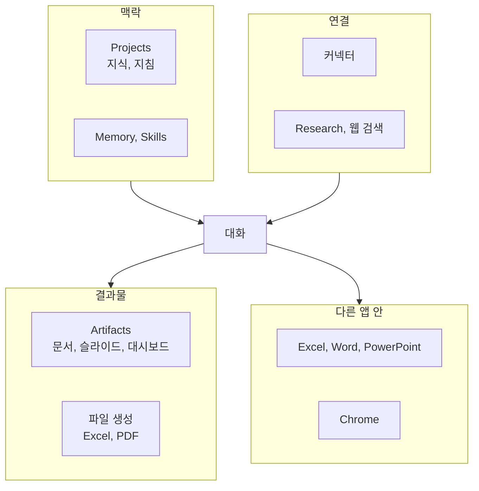

---

title: "[Claude Academy 6편] Claude 앱 기능 (Projects, Artifacts, 커넥터, Research, Office 연동)"
date: 2026-10-29
categories: [AI, Claude]
tags: [AI, Claude, Projects, Artifacts, Connectors]
layout: post
toc: true
math: false
mermaid: true
series: claude-academy
series_order: 6

---

## 참고자료

- [Claude Academy - 엔지니어링 과정 목록](https://academy.claude.com/ko/all?department=engineering)
- Claude Academy 강좌: Claude 101
- Claude Academy 튜토리얼: Getting started with Claude, Navigating the Claude Desktop App, Intro to Projects, Meet Claude Slides, Claude Design and Claude Docs, Build Custom Artifacts with Claude
- Claude Academy 튜토리얼: Getting started with connectors, Using Research, How to choose between voice mode and dictation, Choosing the right Claude model, How to select the right effort setting for Claude Cowork and Chat
- Claude Academy 튜토리얼: Claude for Chrome, Create and edit files with Claude, Claude in Excel, Claude for Word, Claude in PowerPoint(3편), Imagine with Claude

---

## 배경

앞의 편은 API와 Claude Code 같은 개발 쪽이었다. 이 글은 claude.ai 앱의 기능을 다룬다. 엔지니어링 업무에서도 문서를 쓰고, 자료를 조사하고, 보고서를 만드는 일이 많아서 앱 기능을 알아 두면 코드 밖의 일에서 시간이 줄어든다.

Claude 101은 첫 대화에서 Projects, Artifacts, Skills(작업 절차를 묶은 Claude Code 폴더), 커넥터, Research를 거쳐 데스크톱 앱의 Chat, Cowork, Code 구분까지 이어진다. 튜토리얼 스무 편 가까이가 기능별로 세부를 채운다. 스킬은 [5편](/posts/claude-academy-skills/)에서, Cowork는 [7편](/posts/claude-academy-cowork/)에서 따로 다룬다.

정리하면서 확인하고 싶었던 것들이다.

- 첫 대화에서 모델, 맥락, 결과 개선은 어떻게 다루는가?
- Projects와 Artifacts는 각각 무엇을 위한 기능인가?
- 커넥터, Research, 웹 검색은 어떻게 나눠 쓰는가?
- 데스크톱 앱, 음성, Chrome은 어떤 작업에 맞는가?
- Excel, Word, PowerPoint, 파일 생성은 무엇을 대신해 주는가?

---

## 큰 그림

앱 기능은 맥락을 쌓는 쪽, 결과물을 만드는 쪽, 바깥과 연결하는 쪽, 다른 앱 안으로 들어가는 쪽으로 나뉜다.

1절은 첫 대화, 2절은 Projects와 Artifacts, 3절은 연결 기능, 4절은 데스크톱과 입력 방식, 5절은 다른 앱 안에서 쓰는 방법이다.

---

## 1. 첫 대화

첫 질문이다.

프롬프트는 동료에게 말하듯 자연스럽고 간결하게 쓴다. 갖출 것은 세 가지다. 상황 설정, 작업 정의, 규칙 지정이다. 요청이 모호하면 Claude에게 먼저 질문하게 할 수 있다. 첫 응답은 초안으로 보고 맥락과 예시를 구체화하며 반복한다.

모델은 Sonnet이 기본이다. 모델 선택기에서 바꾸면 새 대화가 시작된다. 확장 사고는 지연을 늘리므로 단순 질문에는 끄고 Sonnet으로 시작한다. 한도 소모량은 Haiku가 가장 적고 Fable이 가장 많다. 계층별 용도는 [2편](/posts/claude-academy-platform-and-cloud/)에 있고, 앱에서의 요금제 차이는 Free가 Haiku와 Sonnet, Pro와 Max가 Opus와 Fable을 더한다.

Effort 설정은 모델 선택과 다르다. 모델 전환은 능력과 비용을 함께 바꾸고, Effort는 판단력은 두고 계획, 탐색, 재확인에 쓰는 시간만 바꾼다. 한도 때문에 작은 모델로 바꾸려면 새 모델의 Effort를 먼저 낮춘다. 중요한 것은 토큰(Token, 언어 모델이 텍스트를 처리하는 단위)당 비용이 아니라 **작업 완료당 비용**이다. 상위 모델이 한 번에 풀면 후속 질문이 줄어 더 쌀 수 있다.

| 신호 | 조치 |
|---|---|
| 지시를 빠뜨리거나 긴 작업이 끝나지 않는다. | Effort를 올린다. |
| 품질 향상 없이 장황하고, 정답 뒤에 계속 확인하다 답을 뒤집는다. | Effort를 낮춘다. |

신뢰 확인은 과거 분석을 재현해 보는 방식이 구체적이다. 지난 분기 데이터로 분석을 다시 시켜 AI 결과와 대조한다. 재현에 실패하는 작업은 위임하지 않는다. 이 판단 틀은 [AI 8편](/posts/ai-fluency-4d-claude-code/)의 4D와 같다.

---

## 2. Projects와 Artifacts

두 번째 질문이다.

### 2.1 Projects

Projects는 자체 대화 기록, 지식 파일, 지침을 가진 작업 공간이다. 같은 파일이나 규칙을 반복해서 설명하게 되면 만드는 시점이다. 이름과 목표를 넣고 만들면 되고, 지침은 어조, 전문 수준, 응답 방식, 목표를 지정한다.

| 항목 | 내용 |
|---|---|
| 지식 | PDF, 문서, CSV, 텍스트를 올리거나 Google Drive를 연결한다. 한도에 가까워지면 RAG 모드가 자동으로 켜져 용량이 늘어난다. |
| 범위 | 지식에 추가하지 않은 정보는 같은 프로젝트의 다른 채팅과 공유되지 않는다. 대화 중 올린 파일은 지식과 분리된다. |
| 권한 | Can view는 열람, 지식 접근, 채팅이 되고, Can edit는 지침, 지식, 구성원 관리까지 된다. 생성자는 전체 권한과 공개 범위를 정한다. |

### 2.2 Artifacts

아티팩트(artifact)는 대화 옆 패널에 열리는 문서, 슬라이드, 디자인, 대시보드, 애니메이션 결과물이다. 고유 페이지와 링크가 있어서 파일 다운로드와는 다르게 팀이 함께 편집한다. 사이드바 Artifacts 페이지에 저장되고 웹, 데스크톱, 모바일, Claude Code에서 다시 연다.

수정은 크기에 따라 고른다. 작은 수정은 직접 클릭해 입력하고, 일부 수정은 Comment와 Send to Claude로, 전체 수정은 대화로 요청한다. 큰 변경 전에는 Duplicate로 복사본을 만든다. 첫 결과를 좋게 만들려면 대상과 목적을 밝히고, 예시를 붙이고, 디자인 시스템을 쓰고, 반복되는 문체와 레이아웃 습관은 스킬로 저장한다.

슬라이드는 모든 플랜에서 대화 중 요청하면 열린다. 차트는 요청 시점의 데이터를 그리므로 숫자가 바뀌면 다시 요청한다. 자료에 없는 사실은 질문하거나 눈에 띄는 자리표시자로 남긴다. PowerPoint로 내려받으면 텍스트 상자, 표, 그림은 편집되지만 차트, 아이콘, 도형은 그림으로 바뀌고 전환 효과는 빠진다.

맞춤 아티팩트는 트래커, 퀴즈, 접수 양식처럼 기존 종류에 맞지 않는 대화형 페이지다. 입력값 저장, 연결 도구 읽기와 쓰기, 안에 Claude 추가를 요청으로 붙인다. 저장과 연결 도구는 유료 플랜이 필요하다.

### 2.3 대가

공유 전에는 다른 사람이 열 수 없고, 공유 페이지에는 아티팩트와 댓글만 보이고 Claude와의 대화는 보이지 않는다. 링크 공개로 외부에 공유하면 연결 도구 부분은 동작하지 않고, HTML로 내보내면 저장, Claude 사용, 연결 도구 기능이 멈춘다. 슬라이드의 숫자는 발표 전에 원본과 대조한다.

---

## 3. 커넥터, Research, 웹 검색

세 번째 질문이다.

| 기능 | 내용 | 맞는 작업 |
|---|---|---|
| 커넥터 | MCP 기반으로 Slack, Notion, Drive, Linear 같은 서비스를 연결한다. | 실제 프로젝트 데이터 조회, 도구 안의 작업 실행이다. |
| 웹 검색 | Free, Pro, Max는 기본으로 켜지고 Team과 Enterprise는 관리자가 켠다. | 최신 정보 확인이다. |
| Research | 계획을 세우고 여러 검색을 이어 실행해 인용 보고서를 만든다. 대부분 5분에서 15분, 복잡하면 최대 45분이다. | 시장 분석, 기술 문서 종합처럼 여러 출처를 모으는 작업이다. |
| 엔터프라이즈 검색 | "Ask 조직명" 프로젝트로 사내 도구 전반을 검색하고 출처를 인용한다. | 사내 지식 질의다. |

커넥터는 채팅 창 왼쪽 아래 검색 및 도구 버튼에서 추가한다. 웹 커넥터는 원격 서비스이고, 데스크톱 확장은 메모, 메시지, 코드 파일 같은 로컬 자료다. 연결한 뒤에는 Claude에게 그 도구에 접근할 수 있는지 물어 확인한다. Claude는 사용자가 접근할 수 있는 데이터만 보고, 부여된 권한은 항목별로 켜고 끈다.

잘 쓰는 방법은 네 가지다. 도구를 구체적으로 지정하고("Google Drive의 Finance 폴더에서 Q3 예산 시트 검색"), 복잡한 작업은 단계로 나누고, 여러 도구를 조합하고, 여러 출처의 맥락을 더한다. 예는 Linear의 완료 티켓과 템플릿으로 릴리스 노트를 쓰는 일, 회의 메모에서 담당자와 마감일이 있는 Asana 작업을 만드는 일이다.

Research는 프롬프트에 보고서 항목, 선호 출처 유형, 배경을 적는다. 정보가 부족하면 조사 전에 후속 질문을 한다. 확장 사고가 자동으로 켜진다. 대가는 시간과 한도다. 수백 개 출처를 보지만 인용이 달려도 원문을 열어 확인해야 한다.

LSEG 같은 외부 데이터는 원격 커넥터로 붙인다. 조직 소유자가 Admin settings의 Connectors에서 사용자 지정 커넥터를 추가한다. 접속하려면 LSEG의 MCP(Model Context Protocol, AI 앱과 외부 도구를 잇는 표준 프로토콜) 서버 접근 권한이 필요하다. 해외 채권은 통화 환산을 확인하고 분석 결과는 다른 도구 데이터와 교차 확인하라고 안내한다.

---

## 4. 데스크톱 앱, 음성, Chrome

네 번째 질문이다.

데스크톱 앱은 질문과 수정을 주고받는 일은 Chat, 여러 단계 결과물은 Cowork, 코드베이스는 Code 탭이 맡는다.

| 기능 | 내용 | 조건과 주의 |
|---|---|---|
| 빠른 입력 | 다른 앱 위에 뜨는 작은 창이다. Mac은 Option 두 번이다. | 스크린샷과 Caps Lock 음성은 Mac 전용이다. |
| 폴더 접근 | 메시지 창 아래에서 추가하고 편집 권한을 준다. | 모든 유료 플랜이다. |
| 내장 브라우저 | 사이트 열기, 클릭, 입력을 단계마다 본다. 사이트별로 한 번 허용, 항상 허용, 거부를 고른다. | Pro 이상이다. |
| 컴퓨터 사용 | 커넥터와 내장 브라우저로 안 되는 설치형 프로그램을 화면, 마우스, 키보드로 조작한다. 셋 중 가장 느려서 마지막 수단이다. | Mac, Windows의 Pro와 Max이고 베타다. |
| 스킬 녹화 | 작업을 한 번 시연하면 스킬로 변환한다. | Mac의 Pro, Max, Team이다. 비밀번호가 보이지 않게 한다. |

일부 웹페이지에는 AI를 속이려는 숨은 문장이 있다. 안전 장치는 위험을 줄일 뿐 없애지 못해서 은행과 건강 기록 같은 민감한 작업은 직접 한다. 자리를 비울 때는 Keep computer awake로 절전을 막는데, 노트북 덮개를 닫으면 절전된다.

음성은 두 가지다. 받아쓰기는 말을 텍스트로 입력하고 답은 텍스트로 온다. 음성 모드는 말로 주고받는 대화이고 Claude가 말하는 도중에 끼어들 수 있다. 하고 싶은 말이 정해져 있으면 받아쓰기, 생각을 정리하거나 연습하려면 음성 모드다. 음성 모드는 모든 요금제에서 쓰고 휴대폰이 우선이다. 유료는 상위 모델과 연결 앱 조회가 된다. 영어 외 언어는 베타이고 자동 감지가 없어서 설정에서 직접 고른다. Cowork의 마이크 버튼은 받아쓰기이고 음성 모드는 제공되지 않는다.

Claude in Chrome은 사용자의 권한과 로그인으로 브라우저에서 클릭과 입력을 대신하는 확장이다. 유료 요금제에서 쓴다.

| 맞는 작업 | 안 맞는 작업 |
|---|---|
| 지정한 사이트의 양식 작성, 정의된 워크플로우 반복, 로그인이 필요한 정보 수집이다. | 출처를 모르는 탐색형 조사, 수십 개 자료 종합은 Claude 앱이 낫다. 클릭 한 번, 주관적 결정은 직접 한다. |

반복 작업은 단축키로 저장하고 Schedule로 자동 실행한다. 만드는 방법은 Record workflow, Convert to task, 보낸 프롬프트 저장 세 가지다. 세션 간 기억이 없고 Projects, MCP 같은 확장 기능이 없다. 금융 서비스 등은 차단된다. 구매 같은 민감 동작 전에는 항상 확인한다. 브라우저 사용은 웹사이트와 직접 상호작용하는 만큼 위험 문서를 먼저 읽어야 한다.

---

## 5. Office 앱과 파일 생성

다섯 번째 질문이다.

| 도구 | 하는 일 |
|---|---|
| Excel | 사이드바에서 질문 답변, 오류 추적, 수식 설명, 데이터 정리, 예측 모델, DCF(Discounted Cash Flow, 미래 현금흐름을 현재 가치로 할인해 기업가치를 계산하는 모델), 피벗과 차트를 만든다. 변경 전에 권한을 묻고 참조 셀 링크를 보인다. |
| Word | 열린 의견을 리뷰어별로 정리하고 충돌을 찾는다. 변경 추적 상태에서 수치 대조, 서식 정리, 축약을 한다. 수락은 되돌릴 수 없어 매번 확인한다. 슬래시로 copy edit 같은 스킬을 호출한다. |
| PowerPoint | 슬라이드 마스터, 레이아웃, 글꼴, 색을 읽어 템플릿에 맞춘다. 선택한 슬라이드와 객체 단위로 수정하고, 글머리표를 다이어그램과 기본 차트로 바꾼다. 삭제 전에 확인한다. |
| 파일 생성 | Excel(작동하는 수식), 보고서, PDF 양식, 슬라이드를 직접 만든다. 같은 데이터로 PowerPoint, PDF, Excel을 한 번에 만든다. |

PowerPoint는 한 요소를 고치려고 전체를 다시 만들지 않고 개체 단위로 요청해야 변경 범위가 좁다. 결과물은 기본 도형과 텍스트 상자라서 직접 이동하고 색을 바꿀 수 있다. 복잡하거나 맞춤이 많은 템플릿은 결과가 브랜드 지침에 맞는지 확인한다. Claude.ai에 설정한 커넥터는 애드인에도 그대로 적용된다.

대화 안의 시각 자료도 있다. 질문에 시각 자료가 더 명확한 답일 때 다이어그램, 차트, 도구를 대화 흐름 안에 만든다. Artifacts의 가벼운 버전이고 이미지 생성이 아니다. 질문에 맞춰 만든 것이라 교재 그림과 달리 틀릴 수 있으므로 권위 있는 자료로 쓰기 전에 출처와 대조한다.

Excel과 Word 모두 외부로 공유할 결과는 조직 기준에 맞는지 보고, 민감하거나 규제 대상인 데이터는 조직의 처리 정책을 따른다. Team과 Enterprise는 코드 실행과 파일 생성의 네트워크 접근 설정을 확인한다.

---

## 내 자산에 적용

점검 대상은 Projects의 지침과 지식, 사용자 지정 지침, 메모리, 커넥터 권한, 반복해서 쓰는 프롬프트다.

| 점검 | 개선 |
|---|---|
| 같은 파일이나 규칙을 매 대화에 반복 설명하는가? | Project를 만들고 지침과 지식을 올린다. 지식에 넣지 않은 정보는 다른 채팅과 공유되지 않는다. |
| 반복 프롬프트가 길어졌는가? | 스킬로 옮긴다. 형식, 어조, 만족한 결과물 예시 하나를 붙인다. |
| 작업마다 Effort가 최대인가? | 기본값에서 시작한다. 지시 누락이나 미완료면 올리고, 장황하거나 답을 뒤집으면 내린다. |
| 커넥터 권한이 넓은가? | 항목별 권한을 확인하고 쓰기는 승인 뒤에 둔다. 연결 후 접근 여부를 Claude에게 물어 확인한다. |
| 아티팩트를 공유 전에 점검하지 않는가? | 공유 페이지에는 아티팩트와 댓글만 보이고 대화는 보이지 않는다는 점, 링크 공개 시 연결 도구가 동작하지 않는 점을 확인한다. |
| 자동화한 메일 정리나 발송이 승인 없이 도는가? | 삭제, 발송, 제출은 승인 후 실행하게 한다. |
| 생성한 Excel이나 슬라이드를 그대로 쓰는가? | 파일을 열어 서식, 셀 메모, 수식, 숫자를 원본과 대조한다. |

연습할 것은 과거 분석을 재현시켜 보는 습관이다. 지난 분기 자료로 같은 분석을 다시 시켜 결과를 대조해 보고, 재현에 실패하는 작업은 위임하지 않는다.

전수 점검의 순서와 지시문은 [11편](/posts/claude-academy-improvement-guide/)에 있다.

---

## 정리하며

처음 던진 질문들에 대한 답이다.

**첫 대화.** 상황, 작업, 규칙을 갖춘 프롬프트로 시작하고 Sonnet이 기본이다. Effort는 모델 전환과 달리 판단력을 두고 시간만 바꾸며, 기준은 작업 완료당 비용이다.

**Projects와 Artifacts.** Projects는 지식과 지침이 쌓이는 작업 공간이고, Artifacts는 링크가 있는 공유 가능한 결과물이다. 범위와 공유 제한을 알아야 한다.

**연결 기능.** 커넥터는 내 도구의 데이터, 웹 검색은 최신 정보, Research는 여러 출처 종합을 맡는다.

**데스크톱, 음성, Chrome.** 빠른 입력과 폴더 접근은 일상용이고, 컴퓨터 사용은 마지막 수단이다. 정의된 반복 작업만 Chrome에 맡긴다.

**Office 앱과 파일 생성.** 기계적인 서식, 수식, 일괄 수정을 맡기고 숫자와 브랜드 일치는 사람이 확인한다.

정리하고 나서 가장 크게 바뀐 인식은 **기능마다 쓸 수 있는 범위와 공유 경계가 다르다**는 점이었다. 그래서 새 기능을 쓰기 전에 어디까지 저장되고 누가 볼 수 있는지부터 확인한다.
