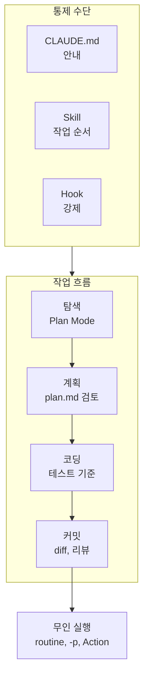

---

title: "[Claude Academy 3편] Claude Code 장시간 작업과 무인 실행 (컨텍스트 관리, 권한 모드, effort, 헤드리스)"
date: 2026-10-29
categories: [AI, Claude]
tags: [AI, ClaudeCode, Hooks, Headless, GitHubActions]
layout: post
toc: true
math: false
mermaid: true
series: claude-academy
series_order: 3

---

## 참고자료

- [Anthropic Academy - Claude Code 101](https://anthropic.skilljar.com/claude-code-101)
- [Anthropic Academy - Claude Code in Action](https://anthropic.skilljar.com/claude-code-in-action)
- Claude Academy 튜토리얼: Choosing the Right Effort Level in Claude Code, Using Claude Code Remote Control, How to enable Claude Code for your enterprise team
- [Claude Code Docs - Hooks](https://code.claude.com/docs/en/hooks)
- [Claude Code Docs - Memory (CLAUDE.md)](https://code.claude.com/docs/en/memory)

---

## 배경

[AI 6편](/posts/claude-code-tool-loop-hooks/)에서 도구 호출 루프, `CLAUDE.md`, 훅(정해진 시점에 자동 실행되는 셸 명령)의 종료 코드, 서브에이전트(별도 컨텍스트에서 일을 맡는 보조 에이전트)와 스킬(작업 절차를 묶은 Claude Code 폴더)의 기본 구조를 정리했다. 그 뒤로 짧은 질문과 답을 넘어, 몇 시간짜리 작업을 맡기고 결과를 믿을 수 있는 형태로 받는 방법이 필요해졌다.

Claude Code 101은 기본 흐름을, Claude Code in Action은 장시간 작업과 무인 실행을 다룬다. 두 강좌와 effort, Remote Control, Enterprise 좌석 튜토리얼에서 6편에 없던 내용만 모았다.

정리하면서 확인하고 싶었던 것들이다.

- 작업 흐름과 컨텍스트 창(Context Window, 모델이 한 번에 보는 최대 토큰 수)은 어떻게 관리하는가?
- `CLAUDE.md`, 스킬, 훅은 무엇을 기준으로 나누는가?
- 권한 모드는 여섯 가지가 어떻게 다른가?
- 사람이 없는 환경에서는 어떻게 실행하고 무엇을 확인하는가?
- effort와 모델은 어떻게 고르고, 팀에는 어떻게 배포하는가?

---

## 큰 그림

작업은 탐색, 계획, 코딩, 커밋 순서로 흐르고, 각 단계에서 쓰는 통제 수단이 다르다. 감독이 줄어들수록 확인 수단이 사람의 눈에서 훅과 테스트로 옮겨 간다.

1절은 작업 흐름과 컨텍스트, 2절은 세 통제 수단의 역할, 3절은 권한 모드, 4절은 무인 실행과 검증, 5절은 effort와 배포다.

---

## 1. 작업 흐름과 컨텍스트 관리

첫 질문이다.

### 1.1 탐색, 계획, 코딩, 커밋

코드를 바로 요청하지 않고 Plan Mode로 시작한다. Plan Mode에서는 Claude가 파일을 편집하지 못하고 읽기와 웹 검색으로만 조사한다. 계획을 승인한 뒤에 자동 수락 여부를 고른다.

계획 단계가 코드 작성 전에 방향을 고칠 수 있는 가장 싼 시점이다. 같은 교정을 반복해서 요청하게 되면 해결책을 `CLAUDE.md`에 저장한다.

코딩 단계에서는 성공 기준, 도구, 테스트 모음을 먼저 준비한다. 테스트 모음은 팀의 기준이 되므로 오탐이 없게 만든 뒤 넘긴다. 커밋 전에는 `/diff`로 요청하지 않은 변경, 약해진 테스트, 새 패키지, 하드코딩 값을 읽고, `/code-review`로 깨끗한 컨텍스트의 두 번째 리뷰를 받는다. 지적 사항은 바로 수정, 이유 질문, 보류로 분류한다.

### 1.2 긴 세션 조정

컨텍스트 창은 파일 읽기와 도구 결과가 모두 채운다. 한도에 가까워지면 자동 압축되고 이때 앞선 대화의 세부가 사라질 수 있다. `/context`로 항목별 사용량을 확인한다.

| 수단 | 쓰는 때 |
|---|---|
| `/compact` | 같은 기능 작업을 이어갈 때 쓴다. 뒤에 요약 방향을 적을 수 있다. |
| `/clear` | 새 기능으로 넘어갈 때 쓴다. 이전 대화의 편향을 막는다. |
| 이중 Esc | 체크포인트로 되돌린다. |
| `/goal` | 테스트와 타입 검사 결과로 완료 조건을 적는다. |
| `/loop` | 반복 확인을 설정한다. |
| worktree | 병렬 에이전트의 파일 충돌을 막는다. `.worktreeinclude`로 git이 무시하는 파일을 복사한다. |

짧은 프롬프트가 컨텍스트를 아끼지는 않는다. 구체적이지 않으면 탐색이 늘어서 오히려 더 쓴다.

### 1.3 대가

계획을 꼼꼼히 읽는 시간이 든다. 계획 단계를 건너뛰면 재작업이 늘고, 자동 압축에 의존하면 세부가 조용히 빠진다. 병렬 세션은 리뷰가 따라가는 만큼만 늘린다.

---

## 2. CLAUDE.md, Skill, Hook의 역할

두 번째 질문이다.

`CLAUDE.md`는 적용이 보장되지 않는 안내다. **길어질수록 개별 규칙이 지켜지는 비율이 떨어진다.** 규칙은 구체적이고 확인 가능하게 쓰고, 금지 대신 대체안을 적는다. `@` 임포트는 정리용이고 컨텍스트 사용량을 줄이지 않는다.

| 수단 | 맡는 일 | 강제력 |
|---|---|---|
| `CLAUDE.md` | 항상 적용할 규칙이다. | 없다. |
| Skill | 작업별 순서다. 확인용 Skill은 테스트 실행, diff 읽기, 테스트 약화 확인, 증거를 붙인 통과 또는 실패 보고를 자동으로 처리한다. | 없다. |
| Hook | 건너뛰면 안 되는 규칙이다. | 있다. |

훅의 종료 코드는 6편과 같다. 추가로 `PreToolUse`는 JSON의 `permissionDecision`으로 허용, 거부, 확인을 돌려주고 `updatedInput`으로 입력을 고쳐 쓸 수 있다. **종료 코드 2만 차단이고 1은 차단하지 않는다.** 운영 사고로 이어질 규칙(main 푸시 금지 등)은 `CLAUDE.md`가 아니라 `PreToolUse` 훅에 넣는다.

반대로 훅이 많아지면 관리 부담이 생긴다. 포맷 실행처럼 예외 없이 지켜야 하는 동작과 차단 규칙에만 쓰고, 나머지는 Skill로 둔다.

---

## 3. 권한 모드

세 번째 질문이다.

권한 모드는 여섯 가지다. `Shift + Tab`으로 순환한다.

| 모드 | 동작 |
|---|---|
| manual | 모든 행동을 묻는다. |
| accept edits | 파일 편집은 자동 수락하고 명령 실행은 묻는다. |
| plan | 읽기만 한다. |
| auto | 분류기가 각 행동의 위험을 보고 판단한다. |
| don't ask | 묻지 않고 허용된 도구만 쓴다. |
| bypass permissions | 권한 확인을 건너뛴다. |

auto 모드의 분류기(classifier, 행동의 위험도를 판정하는 모델)는 **행동의 위험을 볼 뿐 코드의 정확성은 보지 못한다.** 그래서 테스트용 stop 훅과 함께 쓴다. 무인 작업에서 bypass permissions 대신 auto를 쓰는 이유다.

권한을 생략할수록 실수를 미리 잡기 어렵다. 위험 명령 차단과 팀 공통 규칙은 `.claude/settings.json`의 훅과 프로젝트 `CLAUDE.md`로 저장소에 넣어 같은 설정을 배포한다.

---

## 4. 무인 실행과 검증

네 번째 질문이다.

### 4.1 실행 방법

| 방법 | 내용 |
|---|---|
| routine | 프롬프트, 저장소, 커넥터를 묶어 Anthropic 클라우드에서 실행한다. 최소 간격은 1시간이다. |
| `claude -p` | 헤드리스(headless, 화면 없이 실행하는 방식) 실행이다. JSON 스키마 출력, `--resume`, `--bare`를 쓴다. |
| Agent SDK | 자체 환경에서 코드로 에이전트를 제어한다. |
| GitHub Action | `anthropics/claude-code-action@v1`과 `claude_args`로 PR이나 이슈 댓글의 `@claude` 호출, 정기 보고를 처리한다. |
| Code Review | 관리형 서비스다. PR에 줄 단위 인라인 지적과 심각도, 요약 표를 남긴다. |

CI에서 같은 환경이 필요하면 `--bare`와 `ANTHROPIC_API_KEY`를 쓰고, 결과는 JSON과 종료 코드로 확인한다. Action 입력은 API 키, GitHub 토큰, 트리거 문구(기본 `@claude`), 프롬프트, `claude_args`이고 Bedrock과 Vertex로 바꿀 수 있다. `claude_args`로 최대 턴을 5로 제한하고 권한 모드를 don't ask로, 허용 도구를 읽기 전용으로 좁히는 조정이 가능하다.

Code Review는 PR을 승인하거나 막지 않고 수정을 푸시하지도 않는다. 판단은 사람에게 남고, 수정 적용은 로컬 `/code-review --fix`로 한다. 현재는 Team과 Enterprise 요금제 대상 연구 미리보기다.

### 4.2 감독하지 않은 만큼 확인

확인 강도는 감독하지 않은 정도에 비례한다.

- 요약보다 diff를 먼저 읽고, 계획에 없던 파일이 바뀌었는지 본다.
- 테스트는 stop 훅으로 관문화해서 실패하면 Claude가 스스로 고치게 한다.
- 새 세션이나 서브에이전트로 별도 리뷰를 요청한다. 작업 기억이 없는 쪽이 변경을 새로 본다.

서브에이전트의 설계 기준은 [6편](/posts/claude-code-tool-loop-hooks/)의 보완 절에 모았다.

### 4.3 대가

무인 실행은 감독을 줄이는 대신 확인 설계를 요구한다. auto 모드도 분류기의 판단이어서 정확성을 보장하지 않는다. routine의 최소 간격이 1시간이라 짧은 주기의 감시에는 맞지 않고, Code Review는 병합을 막지 못한다.

---

## 5. effort, 원격 접속, 팀 배포

다섯 번째 질문이다.

### 5.1 effort

effort는 모델이 쓰는 자원의 양을 정하고, 모델이 아는 내용은 바꾸지 않는다. 지식이 부족하면 모델 문제이고, 노력이 부족하거나 과하면 effort 문제다.

| 상태 | 증상 |
|---|---|
| 너무 낮다 | 작업이 중간에 멈춘다. 어디까지 했는지 확인하고 다시 요청해야 해서 더 비쌀 수 있다. |
| 너무 높다 | 토큰과 응답 시간이 늘고, 요청하지 않은 작업을 발견하는 과잉 사고가 생긴다. |

기본값에서 시작해 결과를 보고 한 단계씩 조정한다. 단순한 작업은 품질 차이가 느껴질 때까지 내리고, 오래 걸리거나 직접 확인하기 어려운 작업은 올린다. 모델은 effort를 올려도 해결되지 않을 때만 바꾼다. 모델을 바꾸면 같은 수준 이름이라도 작업량이 다르므로 기본값에서 다시 시작한다.

| 설정 위치 | 범위 |
|---|---|
| `--effort` 플래그 | 해당 세션만이다. |
| `/effort`, `/model` 슬라이더 | 다음 세션에도 유지된다. `/effort auto`로 기본값에 되돌린다. |
| 설정 파일 `effortLevel`, 환경 변수 `CLAUDE_CODE_EFFORT_LEVEL` | 지속된다. |
| 스킬과 서브에이전트 frontmatter `effort` | 해당 구성에만 적용된다. |

max는 세션 한정이고 환경 변수로만 계속 유지할 수 있다. Enterprise 관리자가 모델별 최대 수준을 제한할 수 있고, 제한을 넘는 요청은 제한 수준으로 실행된다.

### 5.2 Remote Control

Remote Control은 내 컴퓨터에서 실행 중인 세션을 웹이나 모바일 앱에서 이어 쓰는 기능이다. 세션은 계속 내 컴퓨터에서 돌고 클라우드로 옮겨지지 않아서 도구, MCP(Model Context Protocol, AI 앱과 외부 도구를 잇는 표준 프로토콜) 서버, 설정, 파일 시스템이 그대로다. 프로젝트 디렉터리에서 `claude remote-control`을 실행하면 URL이 나오고, 스페이스바로 QR 코드를 띄운다. 이미 쓰는 세션은 `/remote-control`로 전환한다. 대화는 기기 간 실시간 동기화된다.

### 5.3 플러그인과 좌석

플러그인은 Skill, 서브에이전트, 훅, MCP 설정을 한 번에 설치하는 단위다. 직접 만들 때는 `.claude-plugin/plugin.json`의 name으로 이름공간을 정한다. 설치 전에 훅과 에이전트를 읽어야 한다. 플러그인의 훅은 내 훅을 덮지 않고 함께 쌓여 실행된다. 플러그인 `settings.json`은 `agent`와 `subagentStatusLine` 키만 인정하고, `agent`를 지정하면 서브에이전트가 메인 스레드로 올라오므로 활성화만으로 기본 동작이 바뀐다. 팀 운영 사례는 [AI 11편](/posts/claude-code-plugins-for-infra-team/)에 있다.

Enterprise 플랜의 Claude Code 좌석은 Settings, Members, "View tier breakdown"에서 primary owner와 owner만 배정한다.

| 좌석 | 내용 |
|---|---|
| Standard | Claude Code 없이 Enterprise 전체 기능이다. |
| Premium | Claude Code 접근과 높은 사용 한도가 더해진다. |
| Unassigned | 티어를 바꿀 때 쓰는 예비 풀이다. |

배정은 개별 추가, CSV 대량 추가(한 번에 한 티어만), SCIM(System for Cross-domain Identity Management, 조직 계정을 자동 연동하는 표준) 자동 배정 세 가지다. 좌석이 모자라면 초과 인원은 unassigned가 된다. 최종 사용자는 로그인에서 "Claude account with subscription"을 고르고, 개인 API 계정이 있어도 Enterprise 조직을 선택한다.

---

## 내 자산에 적용

점검 대상은 `settings.json`, 훅, `CLAUDE.md`, 권한 설정, 헤드리스 호출 스크립트다.

| 점검 | 개선 |
|---|---|
| 반드시 막아야 하는 규칙(main 푸시 금지, 삭제 명령)이 `CLAUDE.md`에만 있는가? | `PreToolUse` 훅으로 옮긴다. 차단은 `exit 2`이고 `exit 1`은 차단하지 않는다. |
| 차단 훅이 사유를 알리지 않는가? | stderr에 사유를 출력해 Claude가 다른 방법을 찾게 한다. |
| 무인 작업을 bypass permissions로 돌리는가? | auto 모드로 바꾸고 테스트용 stop 훅을 붙인다. |
| 완료 조건이 모호한 긴 작업이 있는가? | `/goal`에 테스트와 타입 검사 결과로 완료 조건을 적는다. |
| 병렬 세션이 같은 작업 트리를 쓰는가? | worktree로 분리하고 `.worktreeinclude`로 필요한 무시 파일을 복사한다. |
| CI에서 Claude를 호출하는가? | `claude -p`, `--bare`, JSON 출력과 종료 코드로 결과를 확인한다. 최대 턴과 허용 도구를 `claude_args`로 좁힌다. |
| effort를 항상 최대로 두는가? | 기본값에서 시작해 한 단계씩 조정한다. 세션 한정이 필요하면 `--effort`를 쓴다. |
| 플러그인을 확인 없이 설치했는가? | 훅, 에이전트, MCP 설정을 읽고, `settings.json`의 `agent` 키가 기본 동작을 바꾸는지 본다. |

연습할 것은 감독하지 않은 만큼 확인을 늘리는 습관이다. 무인 실행 결과는 요약이 아니라 diff와 계획에 없던 파일 변경부터 읽는다.

전수 점검의 순서와 지시문은 [11편](/posts/claude-academy-improvement-guide/)에 있다.

---

## 정리하며

처음 던진 질문들에 대한 답이다.

**작업 흐름과 컨텍스트.** 탐색, 계획, 코딩, 커밋 순서로 가고 계획 단계에서 방향을 고친다. 같은 기능은 `/compact`, 새 기능은 `/clear`로 컨텍스트를 나눈다.

**통제 수단의 구분.** 항상 적용할 규칙은 `CLAUDE.md`, 작업별 순서는 Skill, 건너뛰면 안 되는 규칙은 훅이다. 강제력이 있는 것은 훅뿐이다.

**권한 모드.** manual부터 bypass permissions까지 여섯 가지이고, auto는 행동의 위험만 보므로 stop 훅으로 정확성을 확인한다.

**무인 실행과 검증.** routine, `claude -p`, Agent SDK, GitHub Action으로 돌리고 감독하지 않은 만큼 diff, 테스트 관문, 별도 리뷰로 확인한다.

**effort, 모델, 배포.** 기본값에서 한 단계씩 조정하고, 팀 구성은 플러그인과 좌석 배정으로 배포한다.

정리하고 나서 가장 크게 바뀐 인식은 **무인 실행의 품질은 모델이 아니라 확인 설계가 정한다**는 점이었다. 그래서 작업을 맡기기 전에 완료 조건과 관문 훅부터 정한다.
