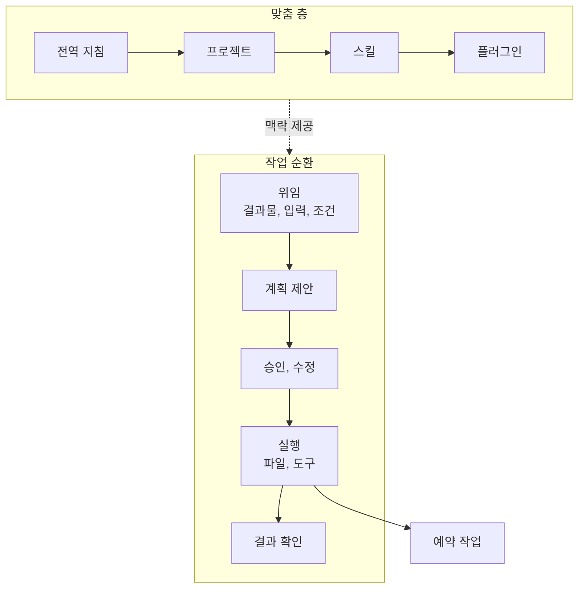

---

title: "[Claude Academy 7편] Claude Cowork 위임 방식 (작업 폴더, 예약 작업, 스킬, 플러그인)"
date: 2026-10-29
categories: [AI, Claude]
tags: [AI, Cowork, Plugin, Skills, Automation]
layout: post
toc: true
math: false
mermaid: true
series: claude-academy
series_order: 7

---

## 참고자료

- [Claude Academy - 엔지니어링 과정 목록](https://academy.claude.com/ko/all?department=engineering)
- Claude Academy 강좌: Introduction to Claude Cowork
- Claude Academy 튜토리얼: Get started in Claude Cowork in three steps, Delegating your first task in Claude Cowork, Delegating and scheduling tasks in Claude Cowork
- Claude Academy 튜토리얼: Choosing Between Claude Cowork or Chat, Customize Claude Cowork, How to Build a Plugin from Scratch in Cowork, How to customize plugins in Cowork

---

## 배경

Chat은 같이 생각하는 도구이고, Claude Code는 코드베이스를 다루는 도구다. 그 사이에 파일, 브라우저, 여러 서비스에 걸친 작업을 끝까지 맡기고 싶은 경우가 있다. 회의 준비 문서 만들기, 폴더 정리, 주간 현황 정리 같은 일이다. Cowork는 이 위임을 위한 방식이다.

[6편](/posts/claude-academy-claude-app/)에서 앱 기능을 훑었고, 이 글은 Cowork의 작업 방식과 맞춤 설정을 다룬다. 조직 단위 배포와 관리자 설정은 [8편](/posts/claude-academy-tag-and-enterprise/)에서 다룬다.

정리하면서 확인하고 싶었던 것들이다.

- Cowork는 Chat, Claude Code와 어떻게 다르고 어떤 작업에 맞는가?
- 첫 작업은 어떻게 설정하고 위임하는가?
- 반복 작업은 어떻게 예약하는가?
- 지침, 스킬(작업 절차를 묶은 Claude Code 폴더), 플러그인은 어떤 순서로 쌓는가?
- 안전하게 쓰려면 무엇을 지키는가?

---

## 큰 그림

Cowork는 계획을 제안하고, 승인을 받고, 파일 시스템에서 직접 실행하는 순환이다. 맞춤 설정은 반복이 생길 때 한 층씩 쌓는다.

1절은 Cowork의 위치, 2절은 설정과 첫 작업, 3절은 예약, 4절은 맞춤 층, 5절은 안전 습관, 6절은 배포와 Microsoft 365다.

---

## 1. Chat, Cowork, Code의 구분

첫 질문이다.

Chat은 질문 하나나 사고 파트너 용도이고, 사용자가 모든 턴에 참여한다. 결과는 읽거나 복사할 텍스트다. Cowork는 결과물이 분명한 다단계 작업을 맡기는 방식이고, Claude가 계획하고 실행하고 결과물을 전달한다. Claude Code와 같은 에이전트 엔진을 쓰되 대상이 코드베이스 대신 사용자의 파일과 앱이다.

| 기준 | Chat | Cowork |
|---|---|---|
| 목표 | 생각을 정리하는 중이다. | 결과물이 정해져 있다. |
| 작업 | 몇 턴 대화다. | 다단계, 다중 출처, 장시간이다. |
| 사용자 역할 | 매 턴 참여한다. | 한 번 설명하고 확인한다. |
| 출력 | 텍스트다. | 완성 파일이나 실행된 행동이다. |

Cowork에 맞는 작업은 세 패턴이다. 여러 단계가 있고, 실제 파일을 다루고, 여러 도구에 걸친다. 일반 채팅의 Claude는 정리 방법을 설명하고, Cowork의 Claude는 정리를 실행한다. 한 번의 질문이면 Chat이 낫다. 열려 있는 Word나 Excel 파일을 고치는 일은 Microsoft 365 애드인이 낫고, 여러 출처를 묶는 결과물은 Cowork가 낫다.

위임하되 통제한다. 행동이 사이드바에 보이고 언제든 중단하고 방향을 바꿀 수 있다. 이메일 발송, 메시지 게시, 작업 폴더 밖 파일 변경 같은 중대한 행동은 승인을 요청한다. 삭제 전 확인은 모든 모드에서 건너뛸 수 없다.

---

## 2. 설정과 첫 작업

두 번째 질문이다.

### 2.1 세 단계 설정

1. Claude 데스크톱 앱이나 claude.ai에 로그인하고 Cowork 탭을 고른다. 컴퓨터의 파일을 다루려면 데스크톱 앱을 쓴다.
2. 새 대화에 `/setup-claude`를 입력한다. 역할을 고르면 맞는 플러그인을 설치하고, 플러그인이 쓰는 도구(Slack, Google Workspace, Microsoft 365)를 연결하도록 안내한다.
3. 입력줄의 `Work in a folder`로 맥락을 읽고 결과를 저장할 위치를 정한다. 컴퓨터의 폴더이거나, 파일, 지침, 메모리를 세션 사이에 유지하는 Project다.

Cowork는 macOS와 Windows 데스크톱 앱에서 Pro, Max, Team, Enterprise 사용자에게 제공된다. 폴더는 여러 개를 연결하거나 즐겨찾기로 둘 수 있고, 파일 시스템을 바꾸기 전에 권한을 묻는다.

### 2.2 작업 순환

프롬프트에는 결과물, 입력, 세부 조건을 담는다. Claude가 확인 질문과 계획을 먼저 제시하고, 사용자는 계획을 고친다. 승인하면 파일 시스템에서 직접 실행한다.

다운로드 폴더 정리가 예다. 분류 범주, 정렬 방식, 이름 규칙, 확인이나 삭제 대상 표시를 담은 계획을 먼저 요청한다. Claude가 문서, 스프레드시트, 프레젠테이션, 이미지로 분류하고 중복으로 보이는 파일 4개를 표시했다. 사용자가 그중 2개는 다른 버전이라고 알려 확인용 폴더로 옮겼다. 작업 상황은 화면 오른쪽 위에서 보고, 눌러서 세부를 열거나 질문한다.

회의 준비 예시는 캘린더, Slack, 이메일, 이전 노트를 모아 기존 문서 형식에 맞춘 안건 문서를 만든다. 작업 중 이메일 확인 같은 지시를 추가하면 처음부터 다시 만들지 않고 방향을 바꿔 이어간다. 일반 채팅은 중단하거나 완료를 기다려야 한다. 완료 후에는 목표 충족과 사실 정확성을 직접 확인한다. **위임 대상은 작업이지 판단이 아니다.**

### 2.3 대가

세션은 기기에 로컬로 저장되고 작업 중에는 데스크톱 앱이 열려 있어야 한다. 웹이나 모바일에서 시작한 작업은 커넥터만 접근한다. 감사 추적이 필요한 업무에는 적합하지 않다. 처음에는 경계가 분명한 작업으로 시작한다.

---

## 3. 예약 작업

세 번째 질문이다.

한 번 실행해 본 작업을 `/schedule`로 반복 작업으로 바꾼다. Claude가 프롬프트 초안을 만들어 보이고, 주기(매시간, 매일, 평일, 수동)를 고치고 수락하면 사이드바 예약 페이지에 등록된다. 각 실행은 새 컨텍스트의 별도 Cowork 세션이라서 항상 최신 파일과 연결된 도구 상태를 읽는다.

예는 매시간 콘텐츠 팀 공유 드라이브 폴더의 추가와 수정 문서를 확인해서, 변경자 기록, 신규 내용 요약, 고객별 그룹화를 일일 업데이트 폴더에 문서로 저장하는 일이다. 예약 페이지에서 지난 실행을 확인하고, 지침을 고치고, 주기를 바꾸고, 바로 실행한다.

실행 조건은 컴퓨터가 켜져 있고 데스크톱 앱이 열려 있는 상태다. 예약 시각에 잠자기이거나 앱이 닫혀 있으면 복귀 후 실행되고 지연 안내가 뜬다. 예약 작업은 실제 도구에 결과를 올리므로 첫 실행 뒤 내용을 직접 확인한다. 클라우드에서 도는 routine과 다른 점은 [3편](/posts/claude-academy-claude-code-in-action/)에 있다.

---

## 4. 맞춤 층

네 번째 질문이다.

처음부터 모두 쓰지 않고 반복되는 필요가 생길 때 하나씩 더한다. 커넥터와 지침으로 시작하고, 같은 작업을 몇 번 반복한 뒤 스킬을 만들고, 동료가 요청하면 공유한다.

| 층 | 내용 |
|---|---|
| 커넥터 | Slack, Salesforce, Microsoft 365, Jira 같은 서비스에서 읽고 쓴다. Customize 패널에서 켜고 한 번 인증한다. Enterprise에서는 관리자가 읽기 전용과 쓰기를 정한다. |
| 지침 | 어조, 서식, 우선 출처 같은 상시 규칙이다. 전역(Settings), 프로젝트(오른쪽 패널), 조직(관리자 설정) 세 층이다. |
| 스킬 | 한 작업 유형에만 로드되는 작업 방식이다. 작업을 마친 뒤 "방금 한 일을 스킬로 만들어 달라"고 하면 skill-creator가 단계, 템플릿, 출처 위치를 기록한다. |
| 플러그인 | 직무 중심으로 묶은 스킬과 커넥터 패키지다. 하위 에이전트도 담는다. |

지침은 모든 작업에 적용되고 스킬은 필요할 때만 로드된다. 일반 규칙은 지침에, 반복 과정은 스킬에 둔다. 스킬 자체의 작성법은 [5편](/posts/claude-academy-skills/)에 있다.

### 4.1 플러그인 맞춤

Anthropic이 Sales, Finance, Legal, Marketing 같은 직무별 기본 플러그인을 제공한다. 기본 스킬은 범용 템플릿이다. Customize 세션에서 팀의 도구, 작업 방식(용어, 완료 기준, 에스컬레이션 시점), 완성된 작업의 참고 문서를 알려 주면 Claude가 스킬을 다시 쓰고 커넥터를 더해 설치용 패키지를 만든다. 도구 이름을 알려 주면 `/variance-analysis`는 Snowflake를, `/call-prep`은 Salesforce를 바로 조회한다.

| 직무 | 맞춤 예 |
|---|---|
| Sales | 단계별 확률로 `/forecast`를 가중한다. |
| Finance | 임계값을 넘는 항목을 표시한다. |
| Legal | 자사 입장에서 벗어난 조항을 표시한다. |
| Marketing | 자사 어조로 `/draft-content`를 쓴다. |

이후 개선은 스킬 실행 중 고칠 점을 발견하면 "add this to the plugin so it's right next time"이라고 말해 파일에 기록한다. 기성 플러그인으로 메워지지 않는 워크플로우는 처음부터 만든다. 구성은 스킬(지식과 워크플로우), 커넥터(도구 연결), 하위 에이전트(복잡한 작업)다. 스킬은 좁게 두고 설명을 "하는 일, 쓸 때, 다루는 범위" 순으로 쓴다.

### 4.2 공유와 대가

공유는 `.plugin` 파일 전달, GitHub 저장소 배포(푸시하면 갱신), 관리자의 조직 설정 배포 세 가지다. 직접 추가한 플러그인은 그 기기에 저장되어 다른 기기와 원격 세션에 따라가지 않는다. 조직이 배포한 플러그인은 관리자가 관리하며 로컬 변경을 덮어쓰고 다시 동기화한다. 플러그인은 데스크톱 앱의 Cowork에서만 동작하고 브라우저와 모바일에서는 Customize 세션을 쓸 수 없다.

스킬이 의도대로 동작하는지 평가하려면 스킬 사용 결과와 미사용 결과를 나란히 비교하고 구체적인 피드백을 준다. 한 번에 한 가지만 고치고 같은 프롬프트로 다시 실행한다.

---

## 5. 안전 습관

다섯 번째 질문이다.

- 전용 작업 폴더를 지정하고, 중요한 파일은 백업하고, 복사본으로 먼저 시험한다.
- 프롬프트에 파괴적 동사(삭제, 덮어쓰기)를 명확히 쓰고, 계획을 확인하고, 승인 창을 읽는다.
- 범위가 분명한 작업부터 시작하고 결과를 항상 점검한다.
- 스킬에 자격 증명을 넣지 않는다. 인증이 필요하면 커넥터로 연결한다.

Claude in Chrome으로 커넥터가 없는 웹 도구를 읽고 조작할 수 있다. 사용자가 먼저 로그인해야 하고 민감한 사이트는 접근 범위를 제한하며 구매 같은 민감 동작 전에는 확인한다. 흩어진 주택 리모델링 예산을 계획 문서와 계약자 이메일에서 모아 스프레드시트를 고치고 메일 초안까지 쓰되 발송 전 최종 수정은 사용자가 한다.

---

## 6. 보완: 배포와 Microsoft 365

조직 마켓플레이스 관리자에게 플러그인을 전달하면 관리자가 Available, 기본 설치, Required 중 하나로 배포 방식을 정한다. 소유자를 지정하고, 배포 전에 평가하고, 이름을 구체적으로 짓고, 분기별로 점검한다. Cowork는 `/setup-claude`로 맞는 플러그인을 추천받아 Customize에서 설치한다.

Claude for Microsoft 365는 Word, Excel, PowerPoint, Outlook 안에서 같은 대화로 맥락을 이어 가는 애드인이다. 여러 출처를 묶는 결과물은 Cowork, 열려 있는 파일의 수정은 Microsoft 365를 고른다. 사용량은 토큰으로 계산되므로 Cowork와 Chat의 Effort를 높일수록 작업당 한도 소모가 커진다. 감사 추적이 필요한 업무에는 Cowork가 적합하지 않다.

팀 업무를 가져온 예시도 있다. 회의 준비는 캘린더 검색, 참석자 조사, Slack 확인, 이전 노트 확인의 계획을 세우고, 노트 폴더의 기존 문서를 템플릿으로 삼아 제목 구조와 글머리 계층을 같게 맞춘다. 빈 액션 아이템 칸이 남고 누락된 맥락은 후속 지시로 더한다. 안건 문서의 참석자는 캘린더, 연락처는 Slack, 의견은 이메일에서 가져온다.

---

## 내 자산에 적용

점검 대상은 Cowork의 전역 지침, 프로젝트 지침, 스킬, 플러그인, 예약 작업이다. 회사 환경에서 Cowork를 쓸 수 없으면 이 점검은 해당 없음으로 표시한다.

| 점검 | 개선 |
|---|---|
| 첫 요청에 결과물과 입력, 조건이 없는가? | 결과물, 입력, 세부 조건을 쓰고 "계획을 먼저 보여 달라"를 넣는다. |
| 작업 폴더가 넓은가? | 전용 폴더를 정하고 중요한 파일을 백업한다. 복사본으로 먼저 시험한다. |
| 지침에 작업 한 가지에만 쓰는 절차가 섞였는가? | 상시 규칙은 지침에, 반복 절차는 스킬에 둔다. |
| 같은 작업을 몇 번 반복했는가? | 반복한 뒤에 스킬로 만든다. 처음부터 쌓지 않는다. |
| 기성 플러그인을 그대로 쓰는가? | Customize 세션에서 팀 도구, 작업 방식, 참고 문서를 알려 스킬을 다시 쓰게 한다. 실행 중 고칠 점을 "다음에 맞도록 플러그인에 추가해 달라"고 기록한다. |
| 예약 작업의 결과를 확인하지 않는가? | 첫 실행 뒤 내용을 직접 확인한다. 앱이 열려 있고 컴퓨터가 켜져 있어야 돈다. |
| 스킬에 자격 증명을 넣었는가? | 인증은 커넥터로 연결한다. |

연습할 것은 계획을 읽고 승인하는 단계에서 품질을 잡는 습관이다. 위임 대상은 작업이고 판단은 위임하지 않는다.

전수 점검의 순서와 지시문은 [11편](/posts/claude-academy-improvement-guide/)에 있다.

---

## 정리하며

처음 던진 질문들에 대한 답이다.

**Chat, Code와의 차이.** Chat은 같이 생각하는 도구, Code는 코드베이스, Cowork는 파일과 도구에 걸친 결과물을 맡기는 방식이다. 결과물이 분명하고 다단계일 때 고른다.

**첫 작업.** `/setup-claude`로 역할 플러그인을 설치하고 작업 폴더를 정한 뒤, 계획을 먼저 받아 승인하고 실행한다.

**예약.** 한 번 돌려 본 작업을 `/schedule`로 등록한다. 앱이 열려 있어야 돌고, 첫 실행 뒤 결과를 직접 확인한다.

**맞춤 층.** 커넥터와 지침, 스킬, 플러그인 순서로 반복이 생길 때 쌓는다.

**안전.** 전용 폴더, 백업, 계획 확인이 기본이고 판단은 위임하지 않는다.

정리하고 나서 가장 크게 바뀐 인식은 **Cowork에서는 프롬프트보다 승인 전에 계획을 읽는 단계가 품질을 정한다**는 점이었다. 그래서 첫 요청에 계획 먼저 보여 달라는 문장을 넣는다.
