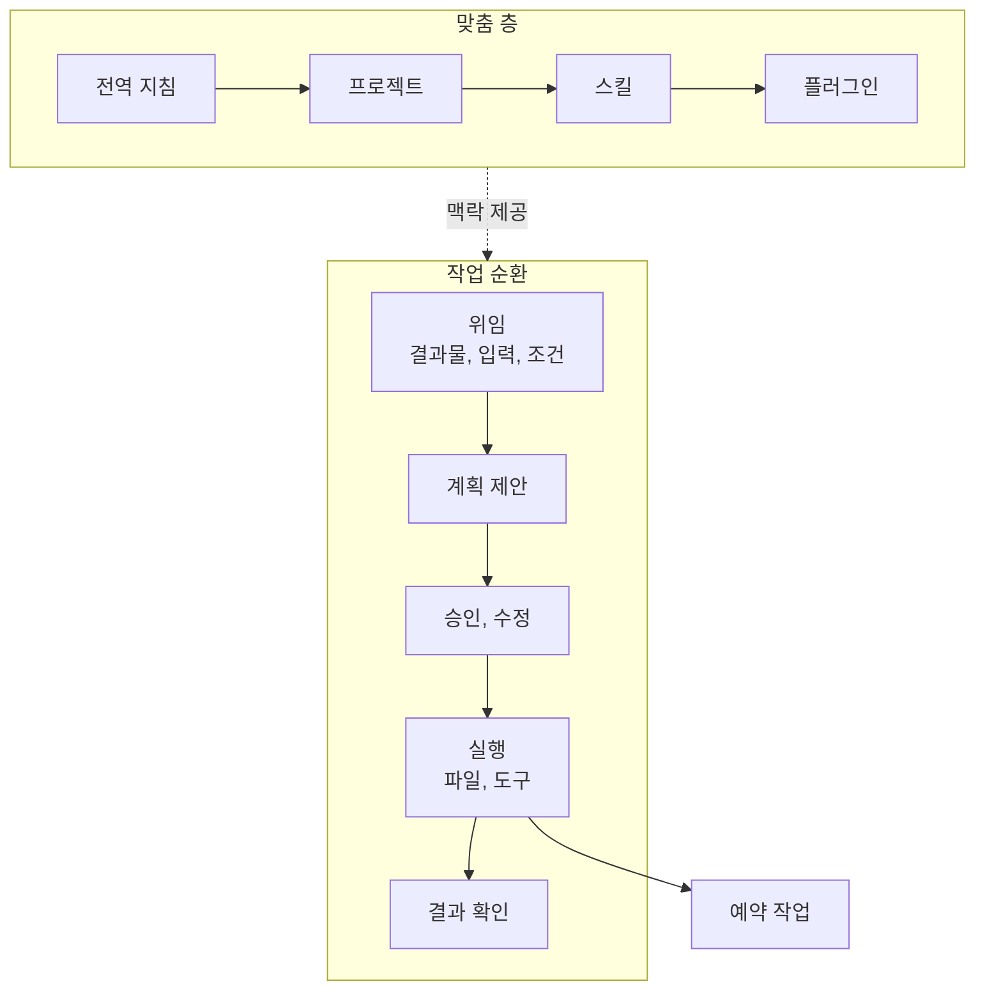

---

title: "[Claude Academy 7편] Claude Cowork 위임 방식 (작업 폴더, 예약 작업, 스킬, 플러그인)"
date: 2026-10-29
categories: [AI, Claude]
tags: [AI, Cowork, Plugin, Skills, Automation]
layout: post
toc: true
math: false
mermaid: true
series: claude-academy
series_order: 7

---

## 참고자료

- [Claude Academy - 엔지니어링 과정 목록](https://academy.claude.com/ko/all?department=engineering)
- Claude Academy 강좌: Introduction to Claude Cowork
- Claude Academy 튜토리얼: Get started in Claude Cowork in three steps, Delegating your first task in Claude Cowork, Delegating and scheduling tasks in Claude Cowork
- Claude Academy 튜토리얼: Choosing Between Claude Cowork or Chat, Customize Claude Cowork, How to Build a Plugin from Scratch in Cowork, How to customize plugins in Cowork
- 수집 기준: Claude Academy 엔지니어링 목록의 2026-10-21 수집본이다. 베타와 미리보기 표기, 요금제 조건, 모델 이름은 이후 바뀔 수 있다.

---

## 배경

Chat은 같이 생각하는 도구이고, Claude Code는 코드베이스를 다루는 도구다. 그 사이에 파일, 브라우저, 여러 서비스에 걸친 작업을 끝까지 맡기고 싶은 경우가 있다.

회의 준비 문서 만들기, 폴더 정리, 주간 현황 정리 같은 일이다. Cowork는 **이 위임을 위한 방식**이다.

[6편](/posts/claude-academy-claude-app/)에서 앱 기능을 훑었고, 이 글은 Cowork의 작업 방식과 맞춤 설정을 다룬다. 조직 단위 배포와 관리자 설정은 [8편](/posts/claude-academy-tag-and-enterprise/)에서 다룬다.

정리하면서 확인하고 싶었던 것들이다.

- Cowork는 Chat, Claude Code와 어떻게 다르고 어떤 작업에 맞는가?
- 첫 작업은 어떻게 설정하고 위임하는가?
- 반복 작업은 어떻게 예약하는가?
- 지침, 스킬(지침, 에셋, 참조, 스크립트로 구성된 재사용 가능한 작업 방식), 플러그인(plugin, 스킬과 커넥터(connector, 외부 서비스를 Claude에 연결하는 통로)를 직무별로 묶은 패키지)은 어떤 순서로 쌓는가?
- 안전하게 쓰려면 무엇을 지키는가?

---

## 큰 그림

Cowork는 계획을 제안하고, 승인을 받고, 파일 시스템에서 직접 실행하는 순환이다. 맞춤 설정은 반복이 생길 때 한 층씩 쌓는다.

1절은 Cowork의 위치, 2절은 설정과 첫 작업, 3절은 예약, 4절은 맞춤 층, 5절은 안전 습관, 6절은 배포와 Microsoft 365다.

---

## 1. Chat, Cowork, Code의 구분

첫 질문이다.

Chat은 질문 하나, 사고 파트너, 맥락이 적은 작업에 맞고, 사용자가 모든 턴에 참여한다. 결과는 읽거나 복사할 텍스트다. 일반 채팅은 단계별로 함께 일한다.

Cowork는 **결과물이 분명한 다단계 작업**을 맡기는 방식이다. 작업을 넘기면 Claude가 처리하는 동안 사용자는 다른 일에 집중하고, Claude가 계획하고 실행하고 결과물을 전달한다.

Claude Code와 같은 에이전트 엔진(agent engine, 계획을 세우고 도구를 호출해 작업을 끝까지 수행하는 실행 구조)을 쓴다. 그래서 계획, 도구 간 작업, 자기 결과 점검을 반복한다. 대상이 코드베이스 대신 사용자의 파일과 앱이다.

| 기준 | Chat | Cowork |
|---|---|---|
| 목표 | 생각을 정리하는 중이다. | 결과물이 정해져 있다. |
| 작업 | 몇 턴 대화다. | 다단계, 다중 출처, 장시간이다. |
| 사용자 역할 | 매 턴 참여한다. | 한 번 설명하고 확인한다. |
| 출력 | 텍스트다. | 완성 파일이나 실행된 행동이다. |

Cowork에 맞는 작업은 세 패턴이다. 여러 단계가 있고, 실제 파일을 다루고, 여러 도구에 걸친다. 문서 작성, 폴더를 입력으로 한 스프레드시트 구축, 여러 곳의 조사, 브라우저 작업처럼 **결과물이 명확한 일**이 해당한다.

Cowork의 추가 기능은 세 가지다.

데스크톱 앱에서 로컬 폴더를 직접 읽고 쓴다.

Claude in Chrome(Chrome 브라우저에서 Claude가 웹 페이지를 읽고 조작하게 하는 기능)을 연결하면 로그인된 브라우저를 쓴다.

컴퓨터 사용(computer use, Claude가 화면을 보고 마우스와 키보드로 앱을 조작하는 기능)으로 데스크톱 앱을 조작한다.

독립적인 부분이 있는 작업은 병렬로 실행하고, 반복 작업은 일정에 따라 자동 실행한다.

일반 채팅의 Claude는 정리 방법을 설명하고, Cowork의 Claude는 정리를 실행한다. 한 번의 질문이면 Chat이 낫다.

열려 있는 Word나 Excel 파일을 고치는 일은 Microsoft 365 애드인(add-in, Office 앱 안에 붙어 동작하는 확장 기능)이 낫다. **여러 출처를 묶는 결과물**은 Cowork가 낫다.

위임하되 통제한다. 행동이 사이드바에 보이고 언제든 중단하고 방향을 바꿀 수 있다.

이메일 발송, 메시지 게시, 작업 폴더 밖 파일 변경 같은 중대한 행동은 승인을 요청한다. 삭제 전 확인은 **모든 모드에서 건너뛸 수 없다.**

---

## 2. 설정과 첫 작업

두 번째 질문이다.

### 2.1 세 단계 설정

1. Claude 데스크톱 앱이나 claude.ai에 로그인한다. 홈에 Cowork 탭이 있으면 고르고, 없으면 새 대화를 시작한다. 컴퓨터의 파일을 다루려면 데스크톱 앱을 쓴다.
2. 새 대화에 `/setup-claude`를 입력한다. 역할을 고르면 맞는 플러그인을 설치하고, 플러그인이 쓰는 도구(Slack, Google Workspace, Microsoft 365 등)를 연결하도록 안내한다.
3. 입력줄의 `Work in a folder`로 맥락을 읽고 결과를 저장할 위치를 정한다. 컴퓨터의 폴더(데스크톱 앱)이거나, 파일, 지침, 메모리를 세션 사이에 유지하는 Project다. Project는 사이드바의 Projects에서 만든다.

신규 사용자에게는 같은 흐름을 시작하는 Set up Cowork 배너가 표시된다.

플러그인은 역할에 맞는 스킬, 커넥터, 예시 프롬프트를 묶은 것이라서 **설정이 끝나면 빈 세션이 아닌 시작점이 생긴다.**

커넥터는 사이드바의 Customize에서 더할 수 있다. 커넥터로 Google Drive, Notion, Slack 같은 서비스를 연결하면 맥락을 가져온다.

Cowork는 macOS와 Windows 데스크톱 앱에서 Pro, Max, Team, Enterprise 사용자에게 제공된다. 데스크톱 앱에서 작업 폴더를 지정하면 Claude가 읽기와 쓰기 권한을 얻는다.

폴더는 여러 개를 연결하거나 즐겨찾기로 둘 수 있고, 파일 시스템을 바꾸기 전에 권한을 묻는다.

권한 모드는 Ask before acting과 Act without asking이 있다. 삭제 전 확인은 두 모드 모두에서 건너뛸 수 없다. 모드별 세부 동작은 요약에 없어 확인이 필요하다.

첫 작업은 여러 도구에 걸치거나, 여러 단계가 필요하거나, 컴퓨터에서 실제 작업이 필요한 할 일로 고른다. 작업 폴더와 원하는 결과를 설명한다.

- 폴더의 리서치를 한 페이지 브리프로 정리한다.
- 지난주 Slack과 Linear 활동으로 현황 요약을 쓴다.
- PDF의 수치로 예측 모델을 업데이트한다.

`/`를 입력하면 플러그인이 설치한 시작 프롬프트가 나온다.

### 2.2 작업 순환

프롬프트에는 결과물, 입력, 세부 조건을 담는다. Claude가 확인 질문과 계획을 먼저 제시하고, 사용자는 계획을 고친다. 승인하면 파일 시스템에서 직접 실행한다.

다운로드 폴더 정리가 예다. 분류 범주, 정렬 방식, 이름 규칙, 확인이나 삭제 대상 표시를 담은 계획을 먼저 제안하게 하고, 변경 전에 보여 달라고 요청한다.

Claude가 문서, 스프레드시트, 프레젠테이션, 이미지, 중복 폴더 구조를 제안하고 중복으로 보이는 파일 4개를 표시했다. 사용자가 그중 2개는 다른 버전이라고 알려 확인용 폴더로 옮기게 했다.

Claude는 날짜 기반 이름 규칙도 제안했다. 승인 전에 계획을 조정하거나 일부 단계를 건너뛰도록 지시할 수 있다.

과정 영상에서는 계획에 보류 폴더를 추가하라고 고쳐 요청하자 Claude가 계획을 조정해 이어 갔다.

승인하면 Claude가 파일 시스템에서 직접 실행하고, 파일은 실제로 이동하고 이름이 바뀐다. 폴더 접근 후 Claude는 해당 폴더의 파일을 직접 읽고, 만들고, 편집한다.

작업 상황은 화면 오른쪽 위에서 보고, 작업을 눌러 세부를 열거나 질문한다.

회의 준비 예시는 요청 한 번으로 캘린더 검색, 참석자 조사, Slack 확인, 이전 노트 확인의 계획을 세우고 작업 목록대로 실행한다. 기존 문서 형식에 맞춘 안건 문서를 만든다.

작업 중 이메일 확인 같은 지시를 추가하면 처음부터 다시 만들지 않고 방향을 바꿔 이어간다. 일반 채팅은 중단하거나 완료를 기다려야 한다.

완료 후에는 **목표 충족과 사실 정확성을 직접 확인한다.** 최종 문서의 책임은 사용자에게 있다. 위임 대상은 **작업이지 판단이 아니다.**

### 2.3 대가

세션은 기기에 로컬로 저장되고 **작업 중에는 데스크톱 앱이 열려 있어야 한다.** 웹이나 모바일에서 시작한 작업은 커넥터만 접근한다.

감사 추적이 필요한 업무에는 적합하지 않다. 처음에는 경계가 분명한 작업으로 시작한다.

---

## 3. 예약 작업

세 번째 질문이다.

한 번 실행해 본 작업을 `/schedule`로 반복 작업으로 바꾼다. Claude가 프롬프트 초안을 만들어 보이고, 주기(매시간, 매일, 평일, 수동)를 고치고 수락하면 왼쪽 사이드바 예약 페이지에 등록된다.

각 실행은 새 컨텍스트의 별도 Cowork 세션이라서 항상 최신 파일과 연결된 도구 상태를 읽고, 설정한 커넥터를 모두 쓸 수 있다.

Cowork의 작업 유형은 둘로 나뉜다. 실행 중 방향을 조정하는 작업과 일정에 따라 혼자 실행되는 작업이다.

예는 매시간 콘텐츠 팀 공유 드라이브 폴더의 추가와 수정 문서를 확인하는 일이다. 변경자 기록, 신규 내용 요약, 고객별 그룹화를 일일 업데이트 폴더에 문서로 저장한다.

예약 페이지에서 지난 실행을 확인하고, 지침을 고치고, 주기를 바꾸고, 바로 실행한다.

실행 조건은 **컴퓨터가 켜져 있고 데스크톱 앱이 열려 있는 상태**다. 예약 시각에 잠자기이거나 앱이 닫혀 있으면 복귀 후 실행되고 지연 안내가 뜬다.

반복되는 보고서나 요약은 한 번 직접 실행해 결과를 확인한 뒤 `/schedule`로 주기 실행을 설정한다. 초기에는 초안 작성까지만 위임한다.

클라우드에서 도는 routine(루틴, 클라우드 환경에서 일정에 따라 실행되는 에이전트 작업)과 다른 점은 [3편](/posts/claude-academy-claude-code-in-action/)에 있다.

---

## 4. 맞춤 층

네 번째 질문이다.

처음부터 모두 쓰지 않고 **반복되는 필요가 생길 때 하나씩 더한다.**

같은 설명을 반복하게 되면 전역 지침, 프로젝트, 스킬 순서로 저장해 매번 입력하는 맥락을 줄인다. 커넥터와 지침으로 시작하고, 같은 작업을 몇 번 반복한 뒤 스킬을 만들고, 동료가 요청하면 공유한다.

| 층 | 내용 |
|---|---|
| 커넥터 | Slack, Salesforce, Microsoft 365, Jira, 사내 도구와 연결해 데이터를 읽고, 티켓 수정, 답장 초안, 채널 게시, 파일 저장 같은 쓰기 작업도 한다. 왼쪽 사이드바의 Customize 패널에서 켜고 한 번 인증하면 모든 세션에서 쓴다. Enterprise에서는 관리자가 사용 가능한 커넥터와 읽기 전용 또는 쓰기 권한을 정하며 Claude in Chrome도 포함된다. |
| 지침 | 어조, 서식, 우선 확인할 출처 같은 늘 적용되는 규칙이다. 전역(Settings), 프로젝트(오른쪽 패널), 조직(관리자 설정) 세 층이다. |
| 스킬 | 한 작업 유형에만 필요할 때 로드되는 작업 방식이고 팀원과 공유할 수 있다. `/skill-name`으로 부르거나 자연어로 설명하면 Claude가 알아보고 로드한다. 작업을 마친 뒤 "방금 한 일을 스킬로 만들어 달라"고 하면 내장 skill-creator가 단계, 템플릿, 출처 위치를 기록한다. |
| 플러그인 | 직무 중심으로 묶은 스킬과 커넥터 패키지다. 하위 에이전트(subagent, 별도 컨텍스트 창에서 하위 작업을 맡는 에이전트)도 담는다. 관리자가 조직 표준 세트를 역할별로 배포하는 수단이기도 하다. |
| 예약 작업, 아티팩트 | 예약 작업은 `/schedule`로 정한 시각에 프롬프트를 실행한다. 아티팩트(artifact)는 사이드바에 남는 대시보드와 트래커다. 맞춤 설정을 마친 뒤의 확장 단계다. |

지침은 모든 작업에 적용되고 스킬은 필요할 때만 로드된다. 일반 규칙은 지침에 두고 **반복 과정은 스킬에 둔다.** 스킬 자체의 작성법은 [5편](/posts/claude-academy-skills/)에 있다.

전역 지침은 모든 세션에 적용되는 기본 안내문이다. 예로 직무 맥락을 적거나 파일을 마크다운 대신 Word 문서로 만들라고 지시한다. 설정 위치는 Settings의 Cowork 탭이다.

프로젝트는 지침, 예약 작업, 컨텍스트, 메모리를 갖춘 작업 공간이다. 처음부터, 기존 폴더에서, 기존 프로젝트에서 만들 수 있다.

스킬은 지침, 에셋, 참조, 스크립트의 네 구성 요소로 이뤄진다. Claude에게 인터뷰 방식으로 만들게 하고, 수정 요청으로 바로 고친다.

플러그인에는 두 형태가 있다. 작업 흐름 전체를 담는 형과 자주 쓰는 스킬을 모은 형이다. Customize에서 설치하고 `/setup-claude`로 맞는 플러그인을 추천받는다.

### 4.1 플러그인 맞춤

Anthropic이 Sales, Finance, Legal, Marketing, Product, Operations 같은 직무별 기본 플러그인을 제공한다. 기본 스킬은 범용 템플릿이다. 시작 경로는 사이드바의 Customize, Plugins에서 플러그인을 고르고 Customize를 누르는 것이다.

Customize 세션에서 알려 줄 재료는 세 가지다.

- 사용 도구(CRM, 데이터 웨어하우스 등)
- 팀의 작업 방식(용어, 완료 기준, 에스컬레이션(escalation, 상위 담당자에게 넘기는 일) 시점)
- 완성된 작업의 참고 문서(마감 패키지, 브랜드 가이드, 메모 양식)

Claude는 연결된 Slack, 이메일, Drive에서 팀이 쓰는 시스템을 찾고 질문으로 확인한다. 그다음 스킬을 다시 쓰고 커넥터를 더해 설치용 패키지를 만든다.

도구 이름을 알려 주면 `/variance-analysis`는 Snowflake를, `/call-prep`은 Salesforce를 바로 조회한다. 아직 켜지 않은 커넥터는 목록으로 알려 준다.

세션이 끝나면 변경 요약과 플러그인 파일이 열린다. 플러그인은 일반 텍스트 지침 파일의 폴더이고, Save plugin으로 설치한다.

| 직무 | 맞춤 예 |
|---|---|
| Sales | 단계별 확률로 `/forecast`를 가중한다. |
| Finance | 임계값을 넘는 항목을 표시한다. |
| Legal | 자사 입장에서 벗어난 조항을 표시한다. |
| Marketing | 자사 어조로 `/draft-content`를 쓴다. |

이후 개선은 스킬 실행 중 고칠 점을 발견하면 "add this to the plugin so it's right next time"이라고 말해 스킬 파일에 기록한다.

남은 범용 부분은 새 Customize 세션에서 남은 플레이스홀더(placeholder, 채워지지 않은 자리표시 문구)를 물어 확인한다.

처음부터 만드는 경우는 세 가지다.

- 기성 플러그인으로 메워지지 않는 워크플로우가 있다.
- 팀의 기준과 판단을 한 문서로 맞추려 한다.
- 여러 도구를 조합한다.

Cowork에서 만들고 싶은 플러그인을 한 문장으로 설명하면 시작할 수 있고, Claude가 이어서 질문한다. 구성은 스킬(지식과 워크플로우), 커넥터(도구 연결), 하위 에이전트(복잡한 작업 담당)다.

스킬은 몇 줄의 서식 선호부터 전체 리뷰 방법론까지 담는다. `/`로 직접 호출하거나 설명이 맞으면 자동으로 불린다. 참고 문서와 입력값(`/close-package Europe`)을 받고, 예약 작업이나 스킬 연쇄로도 쓴다.

커넥터는 없어도 동작하지만 연결하면 작업 중 필요한 데이터를 가져오고 결과를 해당 도구에 기록한다.

하위 에이전트는 회사 조사, CRM 데이터, Slack 맥락을 병렬이나 순차로 맡고 각자 새 컨텍스트 창을 가진다.

지식, 판단, 반복 작업은 스킬로, 데이터 출처는 커넥터로 만든다. 만족한 결과물 예시를 주면 Claude가 구조와 서식을 파악한다.

예는 재무 월 마감(`/monthly-close`), 영업 계약 연장 점수(`/renewal-score`), 법무 실사(`/due-diligence`)다. 매번 기준을 다시 쓰지 않아도 **누가 실행해도 같은 수준이 나온다.**

스킬은 좁게 두고 설명을 "하는 일, 쓸 때, 다루는 범위" 순으로 쓴다. 설명이 모호한 스킬은 불리지 않을 수 있다.

개선은 실제 작업에 쓰고 어긋난 부분을 Claude에게 알려 파일을 고치는 방식이다.

### 4.2 공유와 대가

공유는 `.plugin` 파일 전달, GitHub 저장소 배포(푸시하면 갱신), 관리자의 조직 설정 배포 세 가지다.

직접 추가한 플러그인은 그 기기에 저장되어 **다른 기기와 원격 세션(베타)에 따라가지 않는다.**

조직 배포 플러그인은 관리자의 비공개 마켓플레이스에서 오고, 관리자가 관리하며 로컬 변경을 덮어쓰고 다시 동기화한다.

플러그인은 macOS와 Windows의 모든 유료 플랜에서 제공된다. 데스크톱 앱의 Cowork에서만 동작하고, Customize 세션은 로컬 파일을 편집하므로 브라우저와 모바일에서는 쓸 수 없다.

Customize, Skills에서 추가한 독립 스킬은 플러그인과 무관하게 모든 세션에서 쓸 수 있다.

스킬이 의도대로 동작하는지 평가하려면 스킬 사용 결과와 미사용 결과를 나란히 비교하고 구체적인 피드백을 준다. 한 번에 한 가지만 고치고 같은 프롬프트로 다시 실행한다.

---

## 5. 안전 습관

다섯 번째 질문이다.

- 전용 작업 폴더를 프로젝트 단위로 새로 만들어 지정하고, 복구할 수 없는 파일은 별도 위치에 백업하고, 복사본으로 먼저 시험한다.
- 프롬프트에 파괴적 동사(삭제, 덮어쓰기)를 명확히 쓰고, 계획을 확인하고, 승인 창을 읽는다.
- 범위가 분명한 작업부터 시작하고 결과를 항상 점검한다.
- 작업 중 이상 징후를 관찰한다.

Claude in Chrome으로 커넥터가 없는 웹 도구를 읽고 조작할 수 있다. 사용자가 먼저 로그인해야 하고 민감한 사이트는 접근 범위를 제한하며 구매 같은 민감 동작 전에는 확인한다. 영상은 안전 장치로 세분화된 권한, 프롬프트 인젝션(prompt injection, 웹 페이지에 심은 지시로 Claude를 속이는 공격) 방어, 접속 가능 사이트 제한을 든다.

영상은 Chrome 기능이 Sonnet 4.5 기반이라고 소개하는데, **현재 모델과 같은지는 확인이 필요하다.**

웹 페이지 읽기, 데이터 추출, 탭 간 이동 같은 브라우저 작업도 맡길 수 있다. 예로 흩어진 주택 리모델링 예산을 계획 문서와 계약자 이메일에서 모아 스프레드시트를 고친다.

파트너에게 보낼 메일 초안까지 쓰되 발송 전 최종 수정은 사용자가 한다.

---

## 6. 보완: 배포와 Microsoft 365

조직 마켓플레이스 관리자에게 플러그인을 전달하면 관리자가 Available, 기본 설치, Required 중 하나로 배포 방식을 정한다.

소유자를 지정하고, 팀에 공유할 스킬은 배포 전에 eval(evaluation, 4.2절의 사용 결과와 미사용 결과 비교)로 기준 결과와 비교한다. 이름을 구체적으로 짓고, 분기별로 점검한다.

Cowork는 `/setup-claude`로 맞는 플러그인을 추천받아 Customize에서 설치한다.

Claude for Microsoft 365는 Word, Excel, PowerPoint, Outlook 안에서 같은 대화로 맥락을 이어 가는 애드인이다. 여러 출처를 묶는 결과물은 **Cowork**, 열려 있는 파일의 수정은 **Microsoft 365**를 고른다. 감사 추적이 필요한 업무에는 Cowork가 적합하지 않다.

과정 요약이 드는 조합 예는 커넥터가 없는 내부 웹 대시보드다. Claude in Chrome으로 데이터를 가져오고, 최종 문서는 Cowork에서 만들고, Microsoft 365 애드인에서 다듬는다.

팀 업무를 가져온 예시도 있다. 회의 준비는 캘린더 검색, 참석자 조사, Slack 확인, 이전 노트 확인의 계획을 세우고, 노트 폴더의 기존 문서를 템플릿으로 삼아 제목 구조와 글머리 계층을 같게 맞춘다.

결과에는 안건, 회의에서 밀어붙일 결정 사항, 먼저 꺼낼 성과, 주의 항목이 들어가고 빈 액션 아이템 칸이 남는다.

누락된 맥락(지난주 가격 논의 Slack 스레드)은 후속 지시로 더하고 직접 편집도 가능하다. 안건 문서의 참석자는 캘린더, 연락처는 Slack, 의견은 이메일에서 가져오며 전체 안건은 작업 폴더에도 저장된다.

과정의 마지막 레슨은 과정 전체를 되짚고 이번 주에 실행할 다섯 가지 과제를 제시한다. 과제의 내용은 요약에 없어 확인이 필요하다. 후속 학습 경로는 AI Fluency, AI Capabilities and Limitations, Claude 101이다.

---

## 내 자산에 적용

점검 대상은 Cowork의 전역 지침, 프로젝트 지침, 스킬, 플러그인, 예약 작업이다. 회사 환경에서 Cowork를 쓸 수 없으면 이 점검은 해당 없음으로 표시한다.

| 점검 | 개선 |
|---|---|
| 첫 요청에 결과물과 입력, 조건이 없는가? | 결과물, 입력, 세부 조건을 쓰고 "계획을 먼저 보여 달라"를 넣는다. |
| 작업 폴더가 넓은가? | 프로젝트 단위로 전용 폴더를 새로 만들고, 복구할 수 없는 파일은 별도 위치에 백업한다. 복사본으로 먼저 시험한다. |
| 지침에 작업 한 가지에만 쓰는 절차가 섞였는가? | 상시 규칙은 지침에, 반복 절차는 스킬에 둔다. |
| 같은 작업을 몇 번 반복했는가? | 반복한 뒤에 스킬로 만든다. 처음부터 쌓지 않는다. |
| 기성 플러그인을 그대로 쓰는가? | Customize 세션에서 팀 도구, 작업 방식, 참고 문서를 알려 스킬을 다시 쓰게 한다. 실행 중 고칠 점을 "다음에 맞도록 플러그인에 추가해 달라"고 기록한다. |
| 예약 작업을 한 번도 직접 실행하지 않고 등록했는가? | 한 번 직접 실행해 결과를 확인한 뒤 예약하고, 초기에는 초안 작성까지만 위임한다. 앱이 열려 있고 컴퓨터가 켜져 있어야 돈다. |

연습할 것은 **계획을 읽고 승인하는 단계에서 품질을 잡는 습관**이다. 위임 대상은 작업이고 판단은 위임하지 않는다.

전수 점검의 순서와 지시문은 [11편](/posts/claude-academy-improvement-guide/)에 있다.

---

## 정리하며

처음 던진 질문들에 대한 답이다.

**Chat, Code와의 차이.** Chat은 같이 생각하는 도구, Code는 코드베이스, Cowork는 파일과 도구에 걸친 결과물을 맡기는 방식이다. 결과물이 분명하고 다단계일 때 고른다.

**첫 작업.** `/setup-claude`로 역할 플러그인을 설치하고 작업 폴더를 정한 뒤, 계획을 먼저 받아 승인하고 실행한다.

**예약.** 한 번 돌려 본 작업을 `/schedule`로 등록한다. 앱이 열려 있어야 돌고, 한 번 직접 실행해 결과를 확인한 뒤 등록하며 초기에는 초안까지만 위임한다.

**맞춤 층.** 커넥터와 지침, 스킬, 플러그인 순서로 반복이 생길 때 쌓는다.

**안전.** 전용 폴더, 백업, 계획 확인이 기본이고 판단은 위임하지 않는다.

정리하고 나서 가장 크게 바뀐 인식은 **Cowork에서는 프롬프트보다 승인 전에 계획을 읽는 단계가 품질을 정한다**는 점이었다. 그래서 첫 요청에 계획 먼저 보여 달라는 문장을 넣는다.
