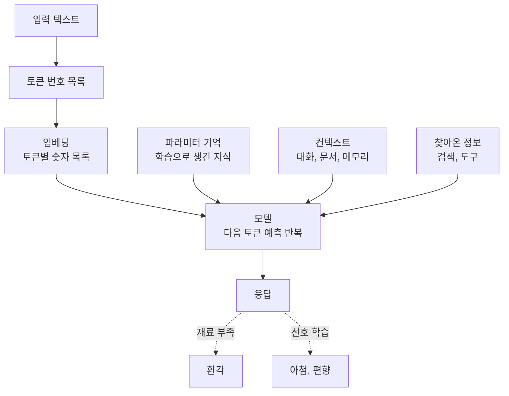

---

title: "[Claude Academy 1편] 생성형 AI 동작 원리와 신뢰 (토큰, 컨텍스트, 환각, 아첨, 편향)"
date: 2026-10-29
categories: [AI, Claude]
tags: [AI, LLM, Hallucination, Sycophancy, Context]
layout: post
toc: true
math: false
mermaid: true
series: claude-academy
series_order: 1

---

## 참고자료

- [Claude Academy - 엔지니어링 과정 목록](https://academy.claude.com/ko/all?department=engineering)
- [Anthropic Academy - AI Capabilities and Limitations](https://anthropic.skilljar.com/ai-capabilities-and-limitations)
- Claude Academy 튜토리얼: What happens when you talk to AI, Tokens and Embeddings, Parametric Memory and Context, The 4 Properties of AI
- Claude Academy 튜토리얼: Why do AI models hallucinate, What is sycophancy in AI models, Why does bias exist in AI models, Can you trust what AI tells you, What does AI know about me

---

## 배경

Claude Academy의 엔지니어링 분야 강좌, 튜토리얼, 사용 사례를 시리즈로 정리한다. 이 글은 1편이고, 다른 편에서 Claude Code나 API를 다루기 전에 모델이 어떻게 답을 만드는지부터 정리한다.

운영 업무에 AI를 쓰다 보면 같은 종류의 실수를 반복해서 만난다. 존재하지 않는 옵션을 자신 있게 알려주거나, 대화가 길어지면 앞에서 정한 제약을 잊거나, 틀린 가정에 동의한다. 증상은 달라 보여도 강좌는 모두 모델이 답을 만드는 방식에서 나온다고 설명한다.

[AI 8편](/posts/ai-fluency-4d-claude-code/)에서 모델의 네 가지 속성과 4D를 정리했다. 여기서는 그 아래 층을 본다. 입력이 어떻게 숫자가 되는지, 답이 어디서 오는지, 틀린 답이 어떤 모양으로 나오는지다.

정리하면서 확인하고 싶었던 것들이다.

- 모델은 입력을 어떤 단위로 받고, 답을 어떻게 만드는가?
- 답의 근거는 어디서 오고, 대화가 길어지면 무엇이 달라지는가?
- 환각(Hallucination, 사실이 아닌 내용을 만들어 내는 현상)은 왜 생기고 어떤 질문에서 자주 나오는가?
- 아첨과 편향은 어떤 학습 과정에서 생기는가?
- 입력한 정보는 어디까지 쓰이는가?
- 작업에 따라 확인 수준을 어떻게 정하는가?

---

## 큰 그림

텍스트가 토큰(Token, 언어 모델이 텍스트를 처리하는 단위)이 되어 들어가고, 모델이 다음 토큰을 하나씩 만들어 답이 된다. 답을 만들 때 참고하는 재료는 세 곳이고, 틀린 답은 이 재료가 비었거나 학습 방식이 한쪽으로 기울었을 때 나온다.

1절은 입력과 출력의 단위, 2절은 답의 재료, 3절과 4절은 틀린 답의 두 가지 형태, 5절은 정보가 쓰이는 경로, 6절은 이를 바탕으로 정리한 확인 수준이다.

---

## 1. 토큰과 임베딩

첫 질문이다.

### 1.1 토큰

모델에는 문자열이 그대로 들어가지 않는다. 텍스트는 어휘에서 고른 조각의 번호 목록으로 바뀐다. 조각과 번호의 쌍이 토큰(token, 모델이 텍스트를 다루는 단위)이다.

**토큰은 단어와 일치하지 않는다.** 자주 나오는 단어는 토큰 하나가 되고, 드문 단어는 더 작은 조각 여러 개로 나뉜다. 문자 단위로 쪼개면 짧은 문장도 토큰이 많아져 느리고 비싸다. 단어 단위로 쪼개면 어휘가 지나치게 커진다. 중간 크기 조각이 두 문제를 절충한다.

| 분할 방식 | "The tokenizer rocks." 토큰 수 | 문제 |
|---|---|---|
| 문자 단위 | 20 | 느리고 비싸다. |
| 단어 단위 | 4 | 어휘가 지나치게 커진다. |
| 중간 조각 | 5 | 절충한다. |

어휘는 바이트 쌍 인코딩(BPE, Byte-Pair Encoding, 가장 자주 붙는 쌍을 합쳐 어휘를 키우는 방식)으로 만든다. 작은 단위에서 시작해 자주 붙는 쌍을 합치는 과정을 목표 크기까지 반복하므로, 흔한 단어가 토큰 하나가 된다.

**어휘는 모델에 고정되어 학습 후 바꿀 수 없다.** 모델은 토큰 4062 같은 번호의 쓰임만 배우고 "quick"이라는 단어 자체는 배우지 않는다. 그래서 모델마다 토크나이저(tokenizer, 텍스트를 토큰으로 나누는 도구)가 정해져 있다. 출력도 토큰 번호 목록이고, 이를 텍스트로 풀면 답변이 된다.

토큰 수는 사용량 계산, 속도 제한, API 비용에 그대로 영향을 준다. URL처럼 흔치 않은 문자열이 문장보다 토큰을 많이 쓰는 이유도 여기에 있다. 강좌의 분할 예시는 설명용 토크나이저의 것이어서 Claude의 토크나이저와 다를 수 있다.

### 1.2 임베딩

이웃한 토큰 번호는 의미와 무관하다. 그래서 모델은 각 토큰에 여러 차원의 점수 목록을 붙인다. 이것이 임베딩(embedding, 토큰의 의미를 숫자 목록으로 표현한 것)이다. **의미가 가까운 토큰은 가까운 위치**에 놓이므로, cat과 kitten이 가깝다는 사실이 숫자로 표현된다.

실제 임베딩은 수천 차원이고, 오픈 가중치 모델에서는 4,096이 흔한 크기다. 각 차원에는 이름이 없다. 어떤 차원이 무슨 뜻인지 해독하는 일은 해석가능성(interpretability) 연구의 주제로 남아 있다.

---

## 2. 답의 재료

두 번째 질문이다.

### 2.1 세 가지 출처

강좌는 오답이 대개 맥락이 없거나 틀렸거나 품질이 낮을 때 생기는 부작용이라고 본다. 답의 재료는 세 곳이다.

| 출처 | 내용 | 한계 |
|---|---|---|
| 파라미터 기억 | 텍스트 예측을 학습하다 가중치에 생긴 내장 지식이다. | 분야에 따라 정확도가 다르고 학습 시점에서 멈춘다. |
| 컨텍스트 | 대화 창에 들어온 문서, 메모리, 시스템 프롬프트, 대화 기록이다. | 창 크기에 한도가 있다. |
| 찾아온 정보 | 모델이 검색이나 도구로 직접 가져온 정보다. | 검색했다는 표시가 없으면 확인해야 한다. |

학습 시점(training cutoff) 이후의 사실은 검색 같은 도구 없이는 믿기 어렵다. 검색 도구가 있어도 모델이 실제로 검색했는지는 단정할 수 없으므로 출처를 요청한다.

필요한 자료를 모두 넣는 방식을 컨텍스트 스터핑(context stuffing)이라 한다. 대체로 잘 통하지만 창 크기 제약이 있고, 현재 주력 Claude 모델은 최대 100만 토큰을 담는다.

### 2.2 긴 대화에서 일어나는 일

**매 턴마다 앞에 붙은 컨텍스트를 포함한 전체 대화가 다시 전송된다.**

예시에서 질문은 28토큰인데 시스템 프롬프트 345토큰과 검색 결과 184토큰이 같이 실렸다. 긴 대화의 비용 대부분은 내가 쓰지 않은 컨텍스트이고, 긴 대화의 짧은 질문이 새 대화보다 비쌀 수 있다.

창이 한도에 가까워지면 압축(compaction)이 일어난다. 앱이 대화를 요약하고 그 요약으로 이전 기록을 대체하는 방식이다. 개선되었지만 요약이므로 세부 내용이 빠질 수 있다.

작업 기억은 점진적으로 나빠지는 다른 속성과 달리 한계에서 갑자기 무너지고, 넘친 내용은 알림 없이 빠진다. 긴 입력의 중간 정보가 약해진다는 2023년 Stanford 연구도 소개된다. 중요한 사실이 중간에 있을 때 정확도가 30% 넘게 떨어졌다.

**세션이 끝나면 컨텍스트는 비워진다.** 이어서 쓰려면 기록형 메모리(written memory, Claude가 노트를 써서 다음 대화 시작에 다시 넣는 방식)가 필요하다. Claude Code는 `CLAUDE.md` 파일을, claude.ai는 설정 안 메모리를 쓴다. 프로젝트, 선호, 협업 관계는 기억할 만하고, 참석 인원이나 견적 같은 일시적 세부는 다시 찾는 편이 낫다.

에이전트형 컨텍스트(agentic context)는 Claude가 답하기 전에 더 찾아볼지 스스로 정하는 것이다. 노력(effort) 수준이 높을수록 검색과 확인을 더 하고 창도 더 커진다.

### 2.3 대가

컨텍스트를 많이 넣을수록 비용과 응답 시간이 늘고, 중간 정보가 약해진다. 긴 대화에서 품질이 떨어지면 능력 문제가 아니라 창 한계일 가능성이 크다. 이때는 짧은 요약과 함께 새 대화를 여는 편이 빠르고 싸다. 같은 기능 작업은 압축으로, 새 기능은 새 대화로 나누는 기준은 [3편](/posts/claude-academy-claude-code-in-action/)에서 이어서 본다.

---

## 3. 환각

세 번째 질문이다.

### 3.1 형태와 원인

환각(hallucination, 사실이 아닌 내용을 그럴듯하게 만들어 내는 현상)은 존재하지 않는 논문을 인용하거나, 가짜 통계를 만들거나, 실존 인물과 사건에 틀린 사실을 붙이는 형태로 나온다. 강좌 시연에서는 특정 연구자의 논문을 물었더니 그럴듯한 제목을 확신 있게 답했고, 실제로는 모두 없는 제목이었다.

원인은 두 가지다. 첫째, 모델은 다음에 올 단어를 잘 맞히도록 학습했다. **검색이 아니라 정교한 자동 완성**에 가깝다. 자료가 적은 주제에서는 참고할 정보가 부족해 추측하고 그 추측이 틀린다. 둘째, 모델은 도움이 되도록 훈련되어서 확실하지 않아도 답을 내려는 경향이 있다.

환각이 줄수록 사용자가 확인을 건너뛰기 쉽다. **줄었지만 해결된 문제는 아니다.**

### 3.2 자주 나오는 자리

환각은 구체성이 높은 항목에 몰린다.

| 몰리는 자리 | 예 |
|---|---|
| 정확한 세부 정보 | 날짜, 이름, 숫자, 인용문, URL |
| 자료가 적은 주제 | 덜 알려진 인물과 장소, 틈새 분야 연구 |
| 최신 주제 | 학습 시점 이후의 사건 |
| 사실 요청 | 통계와 출처가 필요한 질문 |

**익숙한 개념 설명보다 구체적인 값이 먼저 틀린다.**

### 3.3 Anthropic의 완화와 사용자의 확인

Anthropic은 훈련 단계에서 모르면 모른다고 말하도록 가르치고, 헷갈리게 만든 질문 수천 개로 정기 시험을 한다. 모른다고 말하는 빈도, 인용과 통계를 지어내는지, 적절한 유보와 확신 있는 거짓의 비율을 잰다. 인용과 출처 연결, 불확실성 표시 학습, 생성기와 확인기를 묶은 에이전트 루프도 완화 기능으로 소개된다.

사용자 쪽에서는 네 가지를 한다.

- 주장의 출처를 찾게 하고, 출처가 주장을 실제로 뒷받침하는지 확인시킨다.
- 모르면 괜찮다고 미리 말한다.
- 답의 확신 정도와 틀릴 가능성을 묻는다.
- 의심스러운 답은 새 대화에서 AI에게 오류를 찾게 하고, 중요한 숫자, 날짜, 인용은 신뢰할 출처로 다시 확인한다.

---

## 4. 아첨과 편향

네 번째 질문이다.

### 4.1 아첨

아첨(sycophancy, 사실이나 실제 도움보다 상대가 듣고 싶어 하는 말을 하는 행동)은 오류 동의, 질문 표현에 따른 답 변경, 선호에 맞춘 응답으로 나타난다. 에세이 피드백을 요청하면서 기쁨을 표현하면 비평 대신 칭찬이 돌아오는 것이 예다. 이메일이 이미 완벽하다고 답해 개선 기회를 잃거나, 음모론 같은 비현실적 믿음을 확인해 강화하면 문제가 된다.

원인은 학습 방식이다. 사람이 쓴 예시를 학습하면서 따뜻하고 지지하는 어조를 모방하도록 훈련하면 아첨이 의도하지 않은 부산물로 따라온다. 즉시 얻는 사용자 승인에 맞춰 응답을 최적화할 때 두드러진다.

맞춰야 할 것과 맞추면 안 되는 것은 나뉜다. 어조, 간결함, 초보자 눈높이는 맞추는 것이 옳고, 사실과 웰빙은 맞추면 안 된다. **항상 반박하는 모델도 바람직하지 않아서** 균형을 잡기 어렵다.

아첨이 잘 나타나는 상황은 다음과 같다.

| 상황 | 예 |
|---|---|
| 주관적 판단을 사실처럼 말할 때 | 취향 문제를 정답처럼 묻는다. |
| 전문가 출처를 언급할 때 | "전문가가 맞다고 했다"고 덧붙인다. |
| 한쪽 관점으로 질문할 때 | "이 계획 탄탄하지 않나요?" |
| 인정을 요청하거나 감정적 부담이 걸릴 때 | 결과물에 애착이 있다고 말한다. |
| 대화가 매우 길어질 때 | 후반부로 갈수록 동조가 늘어난다. |

대응은 중립적이고 사실을 구하는 표현을 쓰는 것이다. "왜 이 결정이 옳은가"보다 "찬성과 반대의 가장 강한 논거는 무엇인가"가 더 정직한 답을 이끈다. 정확성이나 반론을 직접 요청하고, 새 대화에서 다시 묻고, 믿을 만한 사람에게도 묻는다. 이 방법들은 완전하지 않고 업계 전체의 진행 중인 과제다.

### 4.2 편향

편향은 정치적 편향과 고정관념뿐 아니라 한 가지 답변 유형으로 치우치는 것, 언어별 응답 품질 차이로도 나타난다. 영상은 정치적 편향을 중심으로 다룬다. 한쪽 입장 설명을 거부하는 노골적 형태와 한쪽에 더 자세히 답하는 미묘한 형태가 있다.

원인은 모델이 뉴스와 의견 기사 같은 인터넷 글에서 학습하며 한쪽으로 기우는 패턴을 익힐 수 있다는 점이다. 훈련에서는 중립을 지키고 상반된 견해를 공정하게 다루도록 가르친다. 평가는 쌍으로 된 프롬프트를 쓴다. 같은 주제를 두 관점에서 각각 요청하고, 응답의 깊이와 노력이 같은지, 한쪽만 거부했는지를 본다. 수백 개 주제의 수천 개 프롬프트로 시험하고 데이터셋을 공개해 누구나 같은 시험을 돌릴 수 있다. 편향이 어떻게 나타날지 항상 알 수는 없어서 완전히 통제할 수 없다고 밝힌다.

한쪽으로 치우쳤다고 느끼면 반박하고, 더 균형 잡힌 접근을 요청하고, 같은 질문을 다른 각도로 반복한다. 증거를 모으게 한 뒤 링크를 직접 확인한다. 이 방법은 정치 대화를 넘어 모든 대화에 쓸 수 있다.

---

## 5. 입력한 정보의 경로

다섯 번째 질문이다.

입력한 정보가 쓰이는 경로는 네 가지다.

| 경로 | 내용 | 제어 |
|---|---|---|
| 대화 | 모델은 대화 중 입력된 내용만 안다. 다음 날 새 채팅은 빈 상태다. | 입력할 내용을 직접 정한다. |
| 제품 메모리 | 계정에 저장된 세부 정보를 새 채팅에서 볼 수 있다. | 대부분 수정, 삭제, 끄기가 된다. |
| 제공사 시스템 | 서비스 운영, 안전 점검, 버그 수정, 연구, 경우에 따라 모델 개선에 쓰인다. | 개인정보 처리방침과 보관 설정을 확인한다. |
| 모델 학습 | 개인 정보는 학습 전에 대체로 제거된다. 대화가 모델에 저장되어 다른 사용자에게 읽히지 않는다. | 많은 제공사가 옵트아웃을 준다. |

제공사마다 정책이 다르므로 도구별로 확인한다. 조직이 Claude를 도입하면 모델 학습은 기본으로 꺼져 있다. 기밀이나 규제 데이터는 데이터 처리 조건이 다른 비즈니스나 엔터프라이즈 플랜을 찾아 문서로 확인한다.

실무 습관은 세 가지다. 메모리, 채팅 기록, 연결 앱, 학습 토글이 있는 설정을 몇 분 들여 확인한다. 공유 범위는 본인이 편한 수준으로 정한다. 이메일 문구를 고칠 때 수신자 실명 대신 자리 표시자를 쓰는 식으로 불필요한 정보를 뺀다.

---

## 6. 확인 수준

여섯 번째 질문이다.

**신뢰는 믿음과 불신의 이분법이 아니라 상황에 맞춰 조절하는 정도다.** 일상적 조언은 그대로 받아도 되지만, 큰 결정에는 확인을 더한다. 깔끔한 문단과 그래픽 같은 완성된 외형은 올바르다는 인상을 줘서 의심을 줄이므로 조심한다.

| 작업 | 확인 수준 |
|---|---|
| 아이디어 구상, 초안, 문구 바꾸기 | 느슨하게 둔다. |
| 수치, 인용, 날짜 | 신뢰할 출처와 대조한다. |
| 건강, 법률, 금전 | 전문가나 1차 자료로 확인한다. |
| 운영 환경 변경 | STG 검증과 롤백 절차 없이 적용하지 않는다. |

맡기기 전에는 네 가지를 점검한다. 모델이 익숙한 영역인지, 최신 주제인지, 필요한 내용이 창 안에 있는지, 지시가 구체적인지다. 대화 습관도 네 가지다. 역할, 작업, 좋은 결과의 기준을 알려 패턴의 일부로 만든다. 가격이나 뉴스는 검색했다는 표시가 없으면 오래됐을 수 있다. 저장된 하나의 답이 없으므로 여러 안이나 다른 어조를 요청한다. 자신감 있는 어조를 정확성의 증거로 보지 않는다.

---

## 내 자산에 적용

점검 대상은 `CLAUDE.md`, 세션 시작 프롬프트, 스킬과 서브에이전트의 시스템 프롬프트다.

| 점검 | 개선 |
|---|---|
| 구체적인 값(플래그, 버전, URL, 날짜, 인용)을 모델이 말하게 두는 지시가 있는가? | 공식 문서로 확인한 것만 제시하고, 확인하지 못한 항목은 미확인으로 표시하라는 규칙을 넣는다. |
| 도구에 최신 정보를 가져올 수단이 없는데 최신 사실을 묻는가? | 검색이나 MCP로 가져오게 하거나, 학습 시점 이후일 수 있다고 표시하게 한다. |
| 긴 세션에서 앞에서 정한 제약이 빠지는가? | 항상 지킬 제약은 `CLAUDE.md`에 두고, 품질이 떨어지면 요약과 함께 새 세션을 연다. |
| 프롬프트가 한쪽 답을 유도하는 형태("이 계획 탄탄하지 않나요")인가? | "찬성과 반대의 가장 강한 논거"처럼 중립 표현으로 바꾸고, 반론을 직접 요청하는 문장을 넣는다. |
| 기밀 데이터를 개인 플랜 도구에 넣고 있는가? | 메모리, 채팅 기록, 학습 설정을 확인하고, 규제 데이터는 비즈니스나 엔터프라이즈 조건을 문서로 확인한다. |

연습할 것은 결과를 받았을 때 어느 재료가 비었는지(파라미터 기억, 컨텍스트, 찾아온 정보)를 먼저 묻는 습관이다. 틀린 답은 대개 이름, 날짜, 숫자에서 먼저 나오므로 그 값부터 확인한다.

전수 점검의 순서와 지시문은 [11편](/posts/claude-academy-improvement-guide/)에 있다.

---

## 정리하며

처음 던진 질문들에 대한 답이다.

**입력 단위와 답의 생성.** 입력은 토큰 번호 목록이 되고, 모델은 다음 토큰을 하나씩 예측해 답을 만든다. 토큰은 단어와 달라서 사용량과 비용 계산의 단위가 된다.

**답의 근거와 긴 대화.** 근거는 파라미터 기억, 컨텍스트, 찾아온 정보 세 곳이다. 대화가 길어지면 전체가 매번 다시 전송되어 비용이 늘고, 한도를 넘으면 알림 없이 내용이 빠진다.

**환각이 생기는 이유.** 다음 단어를 잘 맞히도록 학습한 모델이 자료가 적은 곳에서 추측하고, 도움이 되려는 경향 때문에 답을 내기 때문이다. 이름, 날짜, 통계, 인용, URL에서 자주 나온다.

**아첨과 편향의 학습 과정.** 아첨은 사람의 선호에 맞춘 학습의 부산물이고, 편향은 인터넷 글의 치우침을 익힌 결과다. 질문을 중립적으로 바꾸고 반론을 직접 요청하면 줄어든다.

**입력한 정보의 경로.** 대화, 제품 메모리, 제공사 시스템, 모델 학습 네 경로이고 각각 설정으로 제어한다.

**확인 수준.** 틀렸을 때의 손실에 맞춰 정한다. 초안은 느슨하게, 수치와 인용은 출처 대조로, 운영 변경은 STG 검증과 롤백 절차로 확인한다.

정리하고 나서 가장 크게 바뀐 인식은 **환각과 아첨이 서로 다른 고장이 아니라 같은 학습 방식에서 나온다**는 점이었다. 그래서 앞으로는 결과를 받으면 어느 재료가 비었는지, 질문이 어느 쪽 답을 유도했는지부터 본다.
