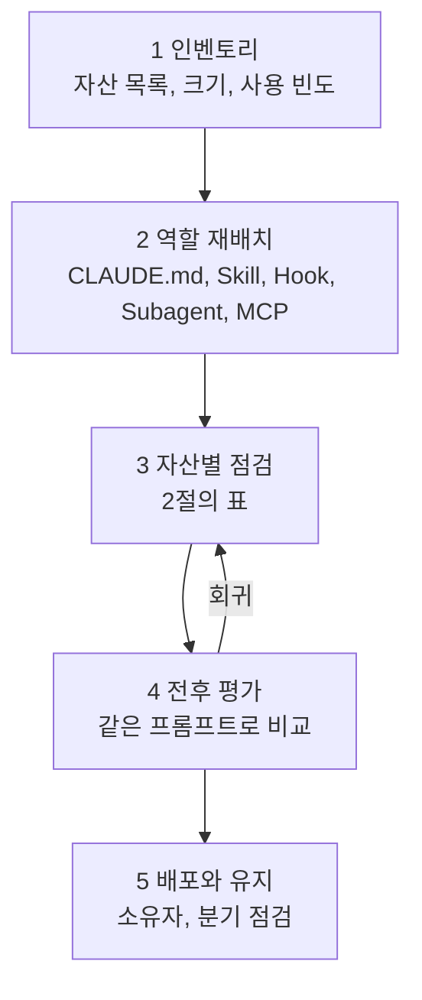

---

title: "[Claude Academy 11편] 기존 플러그인, 에이전트, 스킬, 훅 개선 가이드 (점검 기준, 연습 습관, 적용 지시문)"
date: 2026-10-29
categories: [AI, Claude]
tags: [AI, ClaudeCode, Skills, Hooks, Audit]
layout: post
toc: true
math: false
mermaid: true
series: claude-academy
series_order: 11

---

## 참고자료

- [Claude Academy 1편 - 생성형 AI 동작 원리와 신뢰](/posts/claude-academy-how-ai-works/)
- [Claude Academy 2편 - Claude Platform과 클라우드 제공자](/posts/claude-academy-platform-and-cloud/)
- [Claude Academy 3편 - Claude Code 장시간 작업과 무인 실행](/posts/claude-academy-claude-code-in-action/)
- [Claude Academy 4편 - AI 네이티브 SDLC 12개 플레이](/posts/claude-academy-ai-native-sdlc/)
- [Claude Academy 5편 - Agent Skills](/posts/claude-academy-skills/)
- [Claude Academy 6편 - Claude 앱 기능](/posts/claude-academy-claude-app/)
- [Claude Academy 7편 - Cowork](/posts/claude-academy-cowork/)
- [Claude Academy 8편 - Claude Tag와 Enterprise 도입](/posts/claude-academy-tag-and-enterprise/)
- [Claude Academy 9편 - 엔지니어링 사용 사례](/posts/claude-academy-use-cases-engineering/)
- [Claude Academy 10편 - 업무 자동화 사용 사례와 웨비나](/posts/claude-academy-use-cases-workflow/)
- [Claude Academy 12편 - 웨비나 전체 목록](/posts/claude-academy-webinars/)
- [Claude Academy 13편 - 원문 전체 색인](/posts/claude-academy-index/)
- 보완된 기존 글: [AI 4편](/posts/claude-api-stateless-eval-tooluse/), [AI 5편](/posts/mcp-server-client-transport/), [AI 6편](/posts/claude-code-tool-loop-hooks/), [AI 8편](/posts/ai-fluency-4d-claude-code/)

---

## 배경

1편부터 10편까지는 Claude Academy가 말하는 사실을 정리한 글이다. 12편은 웨비나 목록이고 13편은 원문 색인이다. 이 글은 그 사실을 이미 만들어 둔 자산에 되돌려 적용하는 방법을 다룬다. 대상은 플러그인, 서브에이전트, 스킬, 커맨드, 훅, `CLAUDE.md`, MCP 설정, 직접 만든 에이전트 코드, 예약 작업이다.

이 글은 다른 컴퓨터에서 이 시리즈의 링크를 붙여 넣고 "이 내용으로 내 자산을 점검하라"고 지시하는 용도로도 쓴다. 그래서 점검 기준을 자산 종류별 표로 두고, 근거가 되는 편을 함께 적었다. 근거 열의 "AI 4편, 5편, 6편, 8편"은 AI 시리즈의 기존 글이고, 번호만 쓴 것은 Claude Academy 시리즈의 편이다. 로컬 자산의 실제 내용은 이 글을 쓰는 시점에 전부 열어 보지 않았다. 아래 기준은 시리즈의 사실에서 나온 것이고, 각 자산이 지금 어떤지는 점검 단계에서 확인해야 한다.

정리하면서 확인하고 싶었던 것들이다.

- 어떤 순서로 점검해야 회귀 없이 개선되는가?
- 자산 종류별로 무엇을 어떤 기준으로 보는가?
- 직접 만든 에이전트 코드와 자동화에는 어떤 기준을 대는가?
- 도구가 아니라 쓰는 사람의 습관은 무엇을 의식하고 연습하는가?
- 점검을 맡길 때 어떤 지시문을 쓰는가?

---

## 큰 그림

개선은 인벤토리에서 시작해 자산을 올바른 자리로 옮기고, 자산별 기준으로 고치고, 고친 결과를 평가로 확인하는 순서다. 한꺼번에 바꾸면 무엇이 효과를 냈는지 모른다.



1절은 순서와 변경 원칙, 2절은 자산별 점검 기준, 3절은 코드로 만든 에이전트와 자동화, 4절은 습관, 5절은 적용 지시문이다. 점검 항목의 선택과 순서는 글쓴이 판단이고, 각 항목의 사실은 근거 열의 글을 따른다.

---

## 1. 점검 순서와 변경 원칙

첫 질문이다.

### 1.1 순서

1. 인벤토리를 만든다. 자산 이름, 종류, 위치, 줄 수, 마지막 수정일, 최근 실제로 쓰인 적이 있는지를 표로 모은다. 쓰이지 않는 자산을 개선 대상이 아니라 정리 후보로 보는 것은 글쓴이 판단이다. 시리즈에서는 [8편](/posts/claude-academy-tag-and-enterprise/)이 챔피언의 일로 분기별 스킬 정리를 든다(6.5절).
2. 역할을 다시 배치한다. 한 자산에 여러 역할이 섞여 있으면 나눈다. 기준은 아래 표다.
3. 자산별 점검 기준(2절)으로 하나씩 고친다.
4. 고치기 전과 후를 같은 프롬프트로 비교한다([7편](/posts/claude-academy-cowork/)의 스킬 평가, [4편](/posts/claude-academy-ai-native-sdlc/)의 CI 반복 평가).
5. 소유자와 점검 주기를 정한다. 7편 6절이 플러그인과 스킬의 소유자 지정과 분기별 점검을, 8편 6.5절이 분기마다 플러그인과 예약 작업의 소유자를 다시 정하라고 한다.

| 지키려는 것 | 둘 곳 | 근거 |
|---|---|---|
| 항상 적용할 규칙 | `CLAUDE.md` | 매 요청에 로드된다. 강제력은 없다. (AI 6편 2절, 3편 2절) |
| 작업별 순서와 지식 | Skill | 요청과 설명이 맞을 때만 로드된다. (5편 1절) |
| 건너뛰면 안 되는 규칙 | Hook | 도구 실행이 항상 Claude Code를 거치므로 모델이 우회하지 못한다. (AI 6편 3절, 3편 2절) |
| 중간 과정이 필요 없는 조사와 리뷰 | Subagent | 별도 컨텍스트에서 요약만 돌려준다. (AI 6편 4절, 7절) |
| 외부 서비스 연결 | MCP | 서비스 제공자가 연동 유지보수를 맡는다. (AI 5편 6절) |

### 1.2 변경 원칙

변경 원칙은 세 가지이고 출처가 서로 다르다.

- 한 번에 한 가지만 고치고 같은 프롬프트로 다시 실행한다. [7편](/posts/claude-academy-cowork/)이 스킬이 의도대로 동작하는지 평가하는 방법으로 든다. 자산 단위로도 하나씩 하라는 것은 이 글의 확장이다.
- 고치기 전에 사용 결과와 미사용 결과를 나란히 본다. 7편의 스킬 평가 방법이고, 다른 자산에 같은 방법이 통하는지는 추측이다.
- 롤백 경로를 먼저 정한다. 시리즈에서는 [4편](/posts/claude-academy-ai-native-sdlc/)이 운영 배포의 롤백 경로를 미리 연습하라고 할 뿐, 자산 변경 전반의 원칙으로는 말하지 않는다. 자산 폴더를 git에 두거나 복사본을 남기는 것과, 훅과 권한 설정을 잘못 걸면 모든 작업이 막힌다는 것은 글쓴이 판단이다.

대가는 시간이다. 자산이 많으면 전수 점검이 길어지므로 인벤토리에서 최근 자주 쓰는 순서로 상위부터 하는 것을 제안한다. 이 순서는 글쓴이 판단이다.

---

## 2. 자산 종류별 점검 기준

두 번째 질문이다.

근거 열의 편 번호는 해당 사실이 실제로 적힌 글이다. 점검 항목을 고르는 일과 순서는 글쓴이 판단이고, 기준 자체는 근거 열의 글에 적힌 내용이다. "추측"이라고 쓴 부분은 원문에 없다.

### 2.1 CLAUDE.md

| 점검 | 기준 | 근거 |
|---|---|---|
| 길이 | 길어질수록 개별 규칙이 지켜지는 비율이 떨어진다. 신규 입사자에게 필요한 명령, 규칙, 자주 틀리는 점만 남겨 한 쪽 이내로 유지한다. | 3편 2절, 4편 2절, AI 6편 2절 |
| 내용 | `/init` 초안은 대부분 코드에서 추론 가능한 내용(언어, 빌드 명령)이므로 지우고, 코드로는 알 수 없는 내용(구성 선택 이유, 사용 금지 명령)만 남긴다. 4편은 신규 입사자에게 필요한 명령을 남기라고 해서 명령의 취급이 두 글에서 다르게 읽힌다. 코드에서 읽히지 않는 명령만 남기는 절충은 추측이다. | AI 6편 2절, 4편 2절 |
| 위치 | 홈의 `~/.claude/CLAUDE.md`(모든 프로젝트), 저장소의 `CLAUDE.md`(팀 공유), `CLAUDE.local.md`(개인, gitignore) 세 곳이다. 합쳐서 읽히고 충돌하면 범위가 좁은 쪽이 우선한다. | AI 6편 2절 |
| 규칙 문장 | 구체적이고 확인 가능하게 쓴다. 금지만 쓰지 말고 대체안을 같이 쓴다. | 3편 2절 |
| `@` 임포트 | 정리용이다. 컨텍스트 사용량을 줄이지 않는다. DB 스키마처럼 거의 매번 필요한 파일에만 쓴다. | 3편 2절, AI 6편 2절 |
| 가끔 필요한 절차 | Skill로 옮긴다. 평소에는 `description` 한 줄만 컨텍스트를 차지한다. | AI 6편 2절, 5절 |
| 반드시 지킬 규칙 | Hook으로 옮기거나 이중화한다. `CLAUDE.md`는 적용이 보장되지 않는다. | 3편 2절, 4편 2절 |
| 갱신 | Claude가 같은 실수를 두 번 하면 교정 내용을 추가한다. | 3편 1절, 4편 2절 |
| 구체적인 값 | 플래그, 버전, URL, 날짜, 인용 같은 값을 모델이 말하게 두지 않는다. 공식 문서로 확인한 것만 제시하고 확인하지 못한 항목은 미확인으로 표시하라는 규칙을 넣는다. | 1편 내 자산에 적용, AI 8편 5.3절 |
| 최신 정보 | 최신 정보를 가져올 수단이 없는 도구에 최신 사실을 묻지 않는다. 검색이나 MCP로 가져오게 하거나 학습 시점 이후일 수 있다고 표시하게 한다. | 1편 2.1절, 내 자산에 적용 |
| 기밀 데이터 | 기밀이나 규제 데이터를 개인 플랜 도구에 넣지 않는다. 메모리, 채팅 기록, 학습 설정을 확인하고 규제 데이터는 비즈니스나 엔터프라이즈 조건을 문서로 확인한다. | 1편 5절 |

### 2.2 스킬

| 점검 | 기준 | 근거 |
|---|---|---|
| `description` | 무엇을 하는지와 언제 쓰는지를 함께 쓴다. 사용자가 실제로 쓰는 표현을 넣는다. 최대 1,024자다. | 5편 2.1절 |
| `name` | 소문자, 숫자, 하이픈, 64자 이하, 디렉터리 이름과 일치한다. `review`보다 `frontend-review`처럼 구체적으로 지어 충돌을 피한다. | 5편 2.1절 |
| 파일 위치 | `SKILL.md`는 이름 있는 디렉터리 안에 둔다. skills 루트에 두면 목록에 안 보이고, 파일명은 대문자 `SKILL`, 소문자 `md`다. 만들거나 고친 뒤에는 세션을 다시 시작해야 반영된다. | 5편 1.2절, 5절 |
| 본문 크기 | 500줄 안쪽으로 두고 넘으면 `scripts`, `references`, `assets`로 나눈다. | 5편 2.2절 |
| 스크립트 | 읽게 하지 말고 실행하게 지시한다. 출력만 컨텍스트에 들어간다. 실행 권한(`chmod +x`), 경로 구분자(Windows에서도 슬래시), 필요한 패키지를 확인한다. | 5편 2.2절, 5절 |
| `allowed-tools` | 읽기 전용 워크플로나 보안에 민감한 작업에는 도구를 제한한다. 생략하면 제한이 없다. 요약마다 설명이 갈려 지정하지 않은 도구가 막히는지는 확인이 필요하다. | 5편 2.1절 |
| 트리거 시험 | 요청 표현을 바꿔 가며 스킬이 쓰이는지 시험하고, 로드 오류는 `claude --debug`에서 스킬 이름이 언급된 메시지를 찾는다. 비슷한 `description`이 둘이면 구분한다. 검증 도구는 버전에 따라 달라 확인이 필요하다. | 5편 5절 |
| 플러그인 스킬 | 플러그인 스킬이 안 보이면 캐시를 지우고 재시작한 뒤 재설치한다. 그래도 안 되면 플러그인 구조를 검증 도구로 확인한다. | 5편 5절 |
| 공유 방식 | 저장소 커밋, 플러그인, 관리 설정 세 가지가 있다. 반드시 지켜야 하는 조직 표준만 관리 설정으로 배포한다. | 5편 4절 |
| 우선순위 | 같은 이름이면 Enterprise, 개인, 프로젝트 순으로 우선한다. 플러그인 스킬은 이름공간이 분리되지만 순위는 원문 요약마다 달라 확인이 필요하다. | 5편 1.2절, 4절 |
| 서브에이전트 연결 | 서브에이전트는 스킬을 자동으로 보지 못한다. 에이전트 파일의 `skills` 필드에 목적에 항상 관련된 것만 적는다. 내장 에이전트는 스킬에 접근하지 못한다. | 5편 4절 |
| 강제력 | 스킬은 권고다. 반드시 지킬 정책은 훅과 머지 조건으로 이중화한다. | 4편 2절 |
| 확인용 스킬 | 테스트 실행, diff 읽기, 테스트 약화 확인, 증거를 붙인 통과 또는 실패 보고를 자동화한다. | 3편 2절 |
| 자격 증명 | 스킬에 자격 증명을 넣지 않는다. 인증이 필요하면 커넥터로 연결한다. | 8편 6.5절 |
| 작성 입력 | 스킬을 만들 때 형식과 어조를 명시하고 만족한 실제 결과물 하나를 붙인다. | 5편 6절 |
| `model` | `model` 필드로 스킬에 쓸 모델을 지정할 수 있다. 세부 동작은 5편에 설명이 없다. | 5편 2.1절 |
| 실행 위치 | 스킬은 기본적으로 메인 대화 안에서 돌고, `context: fork`를 지정하면 서브에이전트에서 돈다. 본문에 `` !`git diff HEAD` `` 형식을 쓰면 로드 직전에 명령이 실행되어 결과가 본문에 들어간다. | AI 6편 5절 |

### 2.3 서브에이전트

| 점검 | 기준 | 근거 |
|---|---|---|
| 위임할 만한가 | 중간 과정이 메인 스레드에 필요하지 않은가를 묻는다. 필요 없으면 위임한다. 파일 1~2개 수준의 작업은 위임 비용이 더 크고, 결과를 바로 상세히 확인해야 하는 작업은 요약에서 정보가 빠지므로 맞지 않는다. | AI 6편 4절, 7.3절 |
| `description` | 한 줄이다. 메인 에이전트의 시스템 프롬프트에 매번 들어가 위임 시점을 정한다. 자동 위임 시점을 조절하려면 이 값과 `name`을 고친다. | AI 6편 7.2절 |
| 출력 형식 | 요약, 심각도별 문제, 승인 상태를 정의한다. 없으면 멈출 시점을 몰라 훨씬 오래 돈다. | AI 6편 7.2절 |
| 장애물 보고 | 겪은 장애물, 설정 문제, 우회 방법, 특수 플래그가 필요한 명령을 적게 한다. 없으면 메인 스레드가 같은 문제를 다시 푼다. | AI 6편 7.2절, 7.3절 |
| 도구 | 조사용은 `Glob`, `Grep`, `Read`만, 리뷰어는 git diff용 bash까지, 편집과 쓰기는 코드를 바꾸는 에이전트에만 준다. | AI 6편 7.2절 |
| 정리 대상 | 전문가 페르소나("Python 전문가입니다")는 이미 가진 지식이라 효과가 없다. 순차 파이프라인(재현, 디버그, 수정)과 테스트 실행은 정보가 손실되므로 메인으로 되돌린다. | AI 6편 7.3절 |
| 리뷰어 | 작성 이력이 없는 새 컨텍스트가 변경을 새로 본다. 장시간 작업 뒤 리뷰는 별도 에이전트에 맡긴다. | AI 6편 7.3절, 3편 4.2절 |
| 대가 | 메인 창에서 결론에 이른 과정을 볼 수 없어 결론을 검증하기 어렵다. | AI 6편 7.3절 |
| 병렬 실행 | 서로 의존하지 않는 작업(네트워크, 쿠버네티스, 데이터베이스 계층 동시 조사)은 여러 서브에이전트를 병렬로 실행한다. 관점별로 나눠 병렬 실행한 뒤 메인에서 결과를 합치는 구성도 있다. | AI 6편 4절, 6.3절 |
| 위임 유도 | `description`에 `proactively`를 넣으면 자동 위임이 잦아지고, 예시 대화를 넣으면 위임 시점이 분명해진다. | AI 6편 7.2절 |
| 범위 | 프로젝트의 `.claude/agents/`와 사용자의 `~/.claude/agents/`로 나뉜다. 팀 공통 리뷰 기준은 프로젝트 쪽에 두어 같은 기준을 공유한다. | AI 6편 7.1절, 7.3절 |

### 2.4 훅

| 점검 | 기준 | 근거 |
|---|---|---|
| 종료 코드 | 차단은 `exit 2`다. `exit 1`이나 예외는 훅 실패로 처리되어 차단하지 않고, 차단 사유도 모델에게 전달되지 않는다. 의도한 차단이 `exit 1`로 되어 있지 않은지 본다. | AI 6편 3.2절, 3편 2절 |
| 메시지 | 차단 사유를 stderr로 출력하면 Claude가 읽고 다른 방법을 찾는다. | AI 6편 3.2절, 3편 2절 |
| 시점 | 실행되면 안 되는 작업은 `PreToolUse`로 차단한다. `PostToolUse`는 이미 실행된 뒤라 차단하지 못하고 결과에 대한 피드백만 준다. | AI 6편 3.1절 |
| 입력 수정 | `PreToolUse`는 JSON의 `permissionDecision`으로 허용, 거부, 확인을 돌려주고 `updatedInput`으로 입력을 고칠 수 있다. | 3편 2절 |
| matcher | 도구마다 `tool_input`의 키가 다르다(`Read`는 `file_path`, `Grep`은 `path`와 `pattern`, `Bash`는 `command`). 파일 읽기를 막을 때는 `Read`와 `Grep`을 함께 지정한다. | AI 6편 3.2절 |
| 입력 검증 | 입력값의 키와 타입을 검사하고, 셸 변수는 큰따옴표로 감싸고, 경로의 `..`를 차단하고, 민감 파일은 훅에서도 처리하지 않는다. 입력값은 모델이 생성하므로 검증 없는 훅은 명령 실행 취약점이 된다. | AI 6편 3.3절 |
| 경로 | AI 6편은 훅 스크립트를 절대 경로로 지정하라고 하고, 3편은 프로젝트 디렉터리 환경 변수를 쓰라고 한다. 환경 변수가 절대 경로로 풀리므로 같은 뜻이라고 보는 것은 추측이다. | AI 6편 3.3절, 3편 1.4절 |
| 대상 | 이벤트 시점에 결정적으로 돌릴 검증과 차단(저장 뒤 포맷과 린트, 호출 전 입력 확인, main 푸시 금지 등)은 훅에 둔다. 요청에 따라 적용할 작업별 지식과 절차는 스킬에 둔다. 훅과 스킬의 배분 기준은 글쓴이 판단이다. | 3편 2절, 5편 3절, AI 6편 6.1절 |
| 테스트 관문 | stop 훅으로 테스트를 돌려 실패하면 Claude가 스스로 고치게 한다. auto 모드는 분류기가 코드의 정확성을 보지 못하므로 특히 필요하다. | 3편 3절, 4.2절 |
| 테스트 보호 | 버그 수정에서는 실패하는 테스트를 먼저 쓰고 테스트 파일 편집을 훅으로 막는다. 테스트를 고쳐서 통과시키는 길을 닫는 목적은 추측이다. | 4편 3.1절 |
| 운영 배포 훅 | 운영 배포는 변경 티켓 승인이 있어야 통과시키고, 승인 기록은 읽기만 하며 에이전트가 승인 기록에 쓰지 못하게 설계한다. 롤백 경로는 미리 연습한다. | 4편 5.1절 |
| 이벤트 | 3편이 든 훅 이벤트는 `UserPromptSubmit`, `PreToolUse`, `PostToolUse`, `Notification`, `Stop` 다섯 가지다. 원문이 이것을 전체 목록이라고 말하지는 않으므로 전체 이벤트는 공식 문서(code.claude.com/docs/en/hooks)로 확인해야 한다. 걸려 있는 이벤트가 목적에 맞는지 보되, 이 다섯 가지 밖의 이벤트가 더 맞을 수 있다는 점을 전제로 한다. | 3편 1.4절 |
| 입력 확인 | 훅을 쓰기 전에 `matcher`를 `"*"`로 두고 `jq . > dump.json` 훅을 임시로 걸어 실제 `tool_input`을 확인한다. | AI 6편 3.2절 |
| 호출 비용 | 훅에서 별도 Claude 인스턴스를 호출하면 파일을 수정할 때마다 모델 호출이 늘어 비용이 커진다. 공용 함수 디렉터리처럼 범위를 좁힌다. | AI 6편 3.4절 |
| deny 목록 | `settings.json`의 deny 목록도 훅과 같은 방식으로 프로그램이 차단한다고 원문이 적는다. 단순한 명령 차단을 deny 목록으로 대신할 수 있는지는 글쓴이 판단이다. | AI 6편 3절 |

### 2.5 커맨드

슬래시 명령은 직접 입력해야 하고 스킬은 Claude가 상황을 보고 적용한다. 이 구분은 [5편](/posts/claude-academy-skills/) 1절에 있고, 같은 설명을 반복하게 되면 스킬로 만들 신호라는 것은 3편 1.4절에 있다. 여기까지는 근거가 있다.

다만 이 경계는 원문 기준으로 그리 선명하지 않다. 스킬도 `/skill-name`으로 직접 부를 수 있다([7편](/posts/claude-academy-cowork/) 4절, AI 6편 5절). 7편 4.1절은 스킬이 입력값을 받는 예(`/close-package Europe`)를 보인다. 다만 7편은 Cowork 스킬 기준이어서 Claude Code 스킬이 같은 방식으로 인자를 받는지는 원문에 없고 확인이 필요하다.

그래서 인자를 받는 반복 작업은 커맨드로 남긴다는 판단은 이 글의 추측이다. 스킬로 옮겨도 직접 호출과 인자가 유지될 수 있다는 것도 추측이다. 원문에는 `.claude/commands`의 `$ARGUMENTS` 커맨드로 병렬 실행의 생성과 병합을 자동화한 Bedrock 강좌 예([2편](/posts/claude-academy-platform-and-cloud/) 7.3절)만 있다. 5편 자신도 자동 적용돼도 되는 커맨드를 스킬로 바꾸는 것은 원문에 없는 추측이라고 적는다. 기존 커맨드를 스킬로 바꾼 뒤 동작이 같은지는 시험으로 확인해야 한다.

### 2.6 플러그인, MCP, 설정

| 대상 | 점검 | 근거 |
|---|---|---|
| 플러그인 설치 | 설치 전에 훅과 에이전트를 읽는다. 플러그인은 MCP 설정도 함께 묶으므로 이것까지 읽는 것은 글쓴이 판단이다. 플러그인의 훅은 내 훅을 덮지 않고 함께 쌓여 실행된다. | 3편 5.3절 |
| 플러그인 구성 | `.claude-plugin/plugin.json`의 name으로 이름공간을 정한다. 플러그인 `settings.json`은 `agent`와 `subagentStatusLine` 키만 인정하고, `agent`를 지정하면 활성화만으로 기본 동작이 바뀐다. | 3편 5.3절 |
| 플러그인 운영 | 소유자를 지정하고, 팀에 공유할 스킬은 배포 전에 기준 결과와 비교하고, 분기별로 점검한다. 7편은 Cowork 플러그인 기준으로 쓴 내용이고, Claude Code 플러그인에도 같은 기준을 대는 것은 글쓴이 판단이다. | 7편 6절, 8편 6.5절 |
| MCP 범위 | local, user, project 범위를 확인한다. project 범위는 `.mcp.json`을 버전 관리에 올려 팀이 같은 서버를 받는다. | 3편 1.4절 |
| MCP 비용 | 도구 정의가 컨텍스트의 10%를 넘으면 도구 검색 모드로 자동 전환되며 성능이 떨어질 수 있다. 쓰지 않는 서버는 `/mcp`로 끄고, `gh`, `aws`처럼 CLI가 있는 도구는 CLI를 우선한다. | 3편 1.4절 |
| MCP 권한 | Claude API의 `mcp_toolset`은 `default_config`를 비활성화하고 읽기 도구만 열 수 있다(Slack은 검색과 채널 목록만 열고 게시와 삭제는 막는 예). 여기까지가 AI 5편과 2편의 원문이다. 조직의 커넥터 권한은 읽기 전용을 기본으로 하고 쓰기는 위험 책임자 승인 뒤에 그룹 단위로 단계적으로 부여한다는 것은 8편 3절의 조직 절차다. 개인 앱의 커넥터는 쓰기를 승인 뒤에 둔다고 6편 표가 적는다. 반면 MCP 쓰기 호출마다 승인 단계를 거치게 하는 것은 AI 5편 6.1절이 원문에 없는 운영 판단이라고 밝힌 부분이고, Claude Code의 MCP 서버 일반에 적용하는 것도 글쓴이 판단이다. | AI 5편 6.1절, 2편 2.3절, 8편 3절과 6.2절(필요한 워크플로가 확인된 그룹에만 부여), 6편 내 자산에 적용 표의 커넥터 항목 |
| 권한 모드 | 무인 작업은 bypass permissions 대신 auto를 쓴다. 분류기는 행동의 위험만 보고 코드의 정확성은 보지 못하므로 stop 훅과 함께 쓴다. 여섯 모드 중 plan과 auto 외 네 모드의 동작은 원문에 없어 사용 중인 버전에서 확인한다. | 3편 3절 |
| 장시간과 무인 작업 | 완료 조건을 `/goal`에 테스트와 타입 검사 결과로 적는다. 병렬 세션은 worktree로 분리하고 `.worktreeinclude`로 필요한 무시 파일을 복사한다. CI에서는 `claude -p`, `--bare`, JSON 출력과 종료 코드를 쓰고 `claude_args`로 최대 턴과 허용 도구를 좁힌다. | 3편 1.2절, 4.1절 |
| 관리형 설정 | 개인이 바꾸지 못하는 권한 거부 목록, 샌드박스, 승인된 플러그인 마켓플레이스 정책은 관리형 설정으로 건다. 1인 운영이라 해당하는지는 글쓴이가 판단한다. | 4편 4절 |
| 변경 의도 기록 | 큰 변경마다 `intent.md`, `spec.md`, `plan.md`를 커밋해 Git 이력을 감사 기록으로 쓴다. 리뷰 정책은 `REVIEW.md`에 쓰고 승인은 브랜치 보호 규칙(branch protection, 병합 조건을 저장소에 거는 Git 호스팅 기능)에 맡긴다. | 4편 1절, 4절, 9편 3.2절 |
| 기억 | 어느 범위(프로젝트, 계정, 채널)에 무엇이 저장되는지 확인한다. 프로젝트, 선호, 협업 관계는 기억할 만하고 참석 인원이나 견적 같은 일시적 세부는 다시 찾는 편이 낫다(1편 2.2절). 틀린 기억은 직접 고친다(6편 6절). 6편은 기억할 만한 항목의 구분을 추측이라고 표시했지만 원문 튜토리얼에는 같은 문장이 있다. | 1편 2.2절(기억할 항목), 6편 6절(저장 범위 확인, 틀린 기억 수정) |
| effort와 모델 | 기본값에서 시작해 한 단계씩 조정한다. 지식 부족은 모델 문제이고 노력 부족이나 과잉은 effort 문제다. 모델이 바뀌면 기본값에서 다시 시작하고, 새 모델이 나오면 낮은 effort로 다시 시험한다. | 3편 5.1절 |
| 직접 운영하는 MCP 서버 | 외부 서비스를 연동하기 전에 공식 또는 공개 MCP 서버가 있는지 먼저 확인한다. 기능 선택은 모델이 판단해 호출하면 도구, 화면 구성이나 문맥 주입용 데이터는 리소스, 반복 워크플로는 프롬프트로 나눈다. 조회 전용 서버는 읽기 전용 ServiceAccount, 기본 차단 NetworkPolicy, 사용자별 API 키 인증으로 두고, 폐쇄망에서는 변경 기능을 사용자가 명시적으로 승인할 때만 실행하게 했다. | AI 5편 5절, 6.2절, 정리하며 |
| 환경별 훅과 읽기 전용 시작 | 훅의 허용, 확인, 차단을 환경별로 다르게 적용한다. CI/CD 연동은 `claude -p`로 읽기 전용 판단 단계부터 시작하고 쓰기 단계는 기존 게이트 뒤에 추가한다. 병렬 세션은 2~3개에서 시작해 리뷰가 따라가는 만큼만 늘린다. | 4편 2절, 4절, 5.1절 |
| effort 설정 범위 | `--effort`는 해당 세션만, `/effort`로 지정한 수준은 다음 세션에도 유지된다. 한 번만 쓸 때는 `--effort`를 쓴다. 스킬과 서브에이전트 frontmatter에 `effort`를 둘 수 있고, Enterprise 관리자가 모델별 최대 수준을 제한할 수 있다. 제한을 넘는 요청은 제한 수준으로 실행된다. | 3편 5.1절 |
| 커밋 전 리뷰 | `/diff`로 요청하지 않은 변경, 약해진 테스트, 새 패키지, 하드코딩 값을 읽는다. `/code-review`로 깨끗한 컨텍스트의 두 번째 리뷰를 받고 지적을 바로 수정, 이유 질문, 보류로 나눈다. 지적마다 테스트 출력 같은 증거를 요구한다. Code Review는 PR을 승인하거나 막지 않으므로 승인은 사람이 맡는다. | 3편 1.1절, 4.1절 |
| 비용 | 토큰당이 아니라 작업 완료당 비용을 본다. 상위 모델이 한 번에 풀면 더 쌀 수 있다. 지출 한도를 올리기 전에 기본 모델과 effort부터 살핀다. | 6편 1절, 8편 3절 |

### 2.7 Cowork

회사 환경에서 Cowork를 쓸 수 없으면 이 절은 해당 없음으로 표시한다. [7편](/posts/claude-academy-cowork/)의 내 자산 적용 절도 같은 표기를 쓴다.

| 점검 | 기준 | 근거 |
|---|---|---|
| 첫 요청 | 결과물, 입력, 세부 조건을 쓰고 "계획을 먼저 보여 달라"를 넣는다. 승인 전에 계획을 읽고 고친다. | 7편 2.2절 |
| 작업 폴더 | 프로젝트 단위로 전용 폴더를 새로 만들어 지정하고, 복구할 수 없는 파일은 별도 위치에 백업하고, 복사본으로 먼저 시험한다. | 7편 5절 |
| 지침과 스킬 | 어조, 서식처럼 늘 적용할 규칙은 전역 지침이나 프로젝트 지침에 둔다. 한 작업 유형에만 필요한 반복 절차는 스킬에 둔다. | 7편 4절 |
| 스킬을 만드는 시점 | 처음부터 쌓지 않는다. 커넥터와 지침으로 시작하고 같은 작업을 몇 번 반복한 뒤 스킬로 만든다. 몇 번이 적당한지는 원문에 없다. | 7편 4절 |
| 플러그인 | 기성 플러그인의 기본 스킬은 범용 템플릿이다. Customize 세션에서 사용 도구, 작업 방식, 참고 문서를 알려 다시 쓰게 한다. 실행 중 고칠 점은 다음에 맞도록 플러그인에 추가해 달라고 말해 기록한다. | 7편 4.1절 |
| 예약 작업 | 한 번 직접 실행해 결과를 확인한 뒤 `/schedule`로 등록하고, 초기에는 초안 작성까지만 위임한다. 데스크톱 앱이 열려 있고 컴퓨터가 켜져 있어야 돈다. 잠자기나 앱 종료 상태였다면 복귀 후 실행되고 지연 안내가 뜬다. | 7편 3절 |
| 안전 습관 | 프롬프트에 파괴적 동사(삭제, 덮어쓰기)를 명확히 쓰고, 계획을 확인하고, 승인 창을 읽는다. 삭제 전 확인은 모든 모드에서 건너뛸 수 없고, 이메일 발송, 메시지 게시, 작업 폴더 밖 파일 변경은 승인을 요청한다. | 7편 1절, 5절 |
| 스킬 설명 | 스킬은 좁게 두고 설명을 "하는 일, 쓸 때, 다루는 범위" 순으로 쓴다. 설명이 모호하면 불리지 않을 수 있다. | 7편 4.1절 |
| 한계 | 세션이 기기에 로컬로 저장되고, 감사 추적이 필요한 업무에는 적합하지 않다. | 7편 2.3절, 6절 |

---

## 3. 코드로 만든 에이전트와 자동화

세 번째 질문이다.

API나 SDK로 직접 만든 에이전트, 알림 연동, 스크립트, 예약 작업에는 [2편](/posts/claude-academy-platform-and-cloud/)과 [9편](/posts/claude-academy-use-cases-engineering/)의 기준을 대고, 승인과 예약은 [4편](/posts/claude-academy-ai-native-sdlc/), [7편](/posts/claude-academy-cowork/), [8편](/posts/claude-academy-tag-and-enterprise/), [10편](/posts/claude-academy-use-cases-workflow/)에서 가져왔다. API 호출 방식은 [AI 4편](/posts/claude-api-stateless-eval-tooluse/)을 따른다.

| 점검 | 기준 | 근거 |
|---|---|---|
| 구조 | 단계를 미리 그릴 수 있으면 워크플로우(병렬화, 체이닝, 라우팅, 평가자-최적화)로 바꾼다. 평가자-최적화는 생성자와 채점자가 피드백 루프를 도는 패턴이다. 에이전트는 과제가 불확실할 때만 쓴다. | 2편 3절 |
| 도구 설명 | 모호한 도구 설명이 오작동의 첫째 원인이다. 도구 이름, 입력 검증, 오류 메시지, 설명문을 구체적으로 쓴다. | 2편 2.1절, 내 자산에 적용, AI 4편 8.3절 |
| 사고 | 확장 사고와 적응형 사고는 다단계 논리와 절충 판단에 쓴다. 단순 분류에는 지연과 비용만 늘린다. 평가로 효과를 확인한 뒤 적용한다. | 2편 2.2절, AI 4편 7절 |
| 도구 단위 | 한 작업 전용 도구보다 추상적이고 조합 가능한 작은 도구가 효과적이다. 행동 결과를 관찰할 수단(수정 전 파일 읽기, 스크린샷)을 같이 준다. | 2편 3절 |
| 모델 | 대표 예시 20~30개를 Haiku부터 돌려 품질이 유지되면 멈추고 부족할 때만 올린다. `response.usage`로 토큰을 확인하고 작업별로 모델을 나눈다. | 2편 1.2절 |
| 컨텍스트 | 적시 로딩, 서버 측 압축, 프롬프트 캐싱, 메모리 도구를 상황에 맞게 겹쳐 쓴다. | 2편 2.4절 |
| 캐시 | 바뀌지 않는 시스템 프롬프트와 도구 정의에 캐시 중단점을 단다. 최소 길이는 강좌 기준 API의 Haiku 4.5가 4,096토큰, Bedrock과 Vertex가 1,024토큰이다. 이 값은 강좌 예제 기준이고 모델별로 다르므로 최신 한도는 공식 문서로 확인해야 한다(AI 4편 8.3절은 6절 표의 1,024토큰이 API 강좌의 4,096과 어긋난다고 적는다). 못 미치면 오류 없이 캐시되지 않으므로 `usage` 값으로 확인한다. | 2편 5절, 내 자산에 적용, AI 4편 8.3절 |
| 클라우드 경로 | Bedrock이나 Vertex AI를 쓰면 기능이 해당 경로에 있는지 문서로 확인한다. 캐시 키워드와 한도가 다르다. | 2편 5절 |
| 평가 | 실제 작업 20~50개를 평가로 만들고 `CLAUDE.md`, 스킬, 훅이 바뀔 때 돌린다. 운영 사고마다 케이스를 하나 추가한다. 20~50개는 강좌가 제시한 규모이고 팀 업무에 맞는 기준은 직접 정한다. | 4편 3.2절 |
| 평가 데이터 | 데이터셋을 파일로 고정해 같은 입력으로 비교한다. 형식은 코드 채점기로, 품질은 모델 채점기로 보되 모델 채점기에는 강점, 약점, 근거를 먼저 쓰게 한 뒤 점수를 받는다. 점수만 요청하면 6점 근처로 몰린다. | AI 4편 4절 |
| 응답 확인 | 응답을 다음 단계로 넘기기 전에 `stop_reason`을 확인한다. `max_tokens`로 잘린 응답은 JSON 파싱이 실패하거나 결론이 빠진 채 정상 결과로 통과한다. | AI 4편 2절 |
| 도구 오류 | 도구 실행이 실패해도 예외로 끝내지 않고 `is_error: true`와 메시지로 반환한다. 응답 블록 전체를 `assistant` 메시지로 추가한다. 텍스트만 추출하면 `tool_use` 블록이 빠져 다음 요청이 실패한다. | AI 4편 5절 |
| API 키 | 키는 서버에만 둔다. 브라우저나 모바일 앱에서 직접 호출하면 노출된다. | AI 4편 1절 |
| 캐시 수명 | 기본 5분이고 1시간은 추가 비용이 드는 옵션이다. 간헐적인 호출에는 효과가 없다. 앞부분 중간에 날짜나 요청 ID처럼 요청마다 바뀌는 값이 있으면 그 뒤는 캐시되지 않는다. 그러므로 바뀌는 값은 고정 내용(도구 정의, 시스템 프롬프트) 뒤, 요청의 끝쪽에 둔다. | AI 4편 6절 |
| 위임 전 재현 | 과거 분석을 재현시켜 AI 결과와 대조하고, 재현에 실패하는 작업은 위임하지 않는다. | 6편 1절 |
| 로컬 작업 | 로컬 파일을 다루는 자동화나 에이전트는 전용 작업 폴더에서 돌린다. 복구할 수 없는 파일은 별도로 백업하고 복사본으로 먼저 시험한다. | 7편 5절 |
| 승인 지점 | 롤백, 머지, 게시, 전송, 삭제는 사람이 승인한다. 어디서 승인을 받는지 코드나 지시에 적는다. 설계 문서 초안에서는 본인만 아는 부분을 직접 채우도록 표시하게 한다(9편 4절). | 9편 1절, 5절, 10편 4절, 7편 1절 |
| 알림 연동 지시 | 누구를 멘션할지와 롤백 전에 승인을 기다릴지를 지시에 명시한다. 직접 롤백할 수 있는지는 관리자가 연결에 준 접근 권한이 정한다. 승인 전에 링크된 PR과 지연 대시보드를 열어 배포가 증상보다 먼저인지 확인한다. | 9편 1절 |
| 자동 응답 | `Respond automatically`와 mute 명령은 안내일 뿐 차단 장치가 아니다. 차단 경계는 지출 한도, 멤버 접근 토글, 범위별 활성화 스위치, 차단한 커넥터다. | 8편 2절 |
| PR 승인 규칙 | 요청자가 승인할 수 있으므로 승인 2건을 요구하고, 새 커밋이 올라오면 기존 승인을 무효화한다. | 8편 2절 |
| 알림 채널 범위 | 알림이 많은 채널에서는 조사할 게시물 유형과 무시할 유형을 지정한다. | 9편 1절 |
| 시간대 | 루틴과 예약 프롬프트에 시간대를 명시한다. 게시 전에 목록에 표시된 예약 시각으로 시간대가 맞는지 확인한다. | 9편 1절, 10편 2.3절 |
| 전송 권한 | Slack, Gmail 같은 커넥터의 전송과 게시 권한은 needs-approval로 둔다. | 9편 3.3절 |
| 성과 리뷰 초안 | 모든 주장에 증거 링크를 요구하고 평점은 쓰지 않게 한다. 포스트모템 같은 다른 초안에 같은 요구를 거는 것은 글쓴이 판단이다. | 9편 4절 |
| 출처 표기 | 결정 기록은 항목마다 원본 메시지 링크를 붙인다. 사내 질의 에이전트는 매 답변에 출처를 인용하고, 확신이 없으면 담당 팀이나 채널을 알리게 한다. | 10편 2.2절 |
| 주간 게시물 | 전달 전에 아직 열림 항목의 티켓을 열어 실제 상태를 확인한다. 요약 하단의 티켓 상태는 게시 시각 기준이다. | 10편 2.3절 |
| 포스트모템 자동화 | "요약" 대신 "재구성"으로 요청해 타임스탬프와 알림 타임라인에서 증거 기반 타임라인을 만든다. 근본 원인과 기여 요인을 나누고, 시스템 동작을 서술하는 비난 없는 어조를 지정하고, 모든 액션 아이템에 담당자를 붙인다. | 9편 내 자산에 적용 |
| 인수인계 자동화 | 항목마다 상태(resolved, monitoring, still open), 원인 한 줄, 다음 담당자가 볼 점을 필드로 두고 지난 문서를 입력에 포함한다. | 9편 내 자산에 적용 |
| 비용 점검 자동화 | 3개월 평균 대비 20% 초과 같은 임계값을 정하고 항목마다 담당자와 권장 조치를 적게 한다. 20%는 원문 예시이므로 환경에 맞는 값은 직접 정한다. | 9편 내 자산에 적용 |
| CI 호출 | `claude -p`, `--bare`, JSON 출력과 종료 코드로 결과를 확인하고 `claude_args`로 최대 턴과 허용 도구를 좁힌다. 같은 환경이 필요하면 `--bare`와 함께 `ANTHROPIC_API_KEY`를 쓴다. | 3편 4.1절 |
| RAG | 청킹 방식이 문서 구조에 맞는지(겹침을 더한 크기 기반이 기본), 정확한 용어 검색이 필요하면 BM25와 RRF를 더하는지 본다. 재순위화와 문맥 검색은 평가로 효과를 확인한 뒤 적용한다. | 2편 6절 |
| 예약 작업 | 읽을 소스, 필드, 저장과 게시 위치를 프롬프트에 지정한다. 한 번 직접 실행해 결과를 확인한 뒤 등록하고, 초기에는 초안 작성까지만 위임한다. 예약 작업은 실제 도구에 결과를 올리므로 첫 실행 뒤에도 직접 확인한다. Anthropic 클라우드에서 도는 routine의 최소 간격은 1시간이다(3편 4.1절). 짧은 주기의 감시에 routine이 맞지 않는다는 해석은 3편이 원문에 없는 추측이라고 표시한 부분이다. | 9편 5절, 7편 3절, 8편 4절, 3편 4.1절 |
| 담당자 | 담당자가 없으면 결과가 백로그가 된다. 원문은 이를 코드 스캔 결과 사례로만 말하므로 예약 작업 전반에 일반화하는 것은 글쓴이 판단이다. | 8편 5.2절 |
| 출처 간 모순 | 정보가 없으면 조용히 메우지 말고 "기록된 진척 없음"처럼 표시하게 한다. 출처 간 숫자가 다르면 Claude가 하나를 고른다(예: 재무 보고서 4.2M 대신 Looker 4.6M 채택). 고른 값과 선택 이유를 부록에 적게 하고, 사람이 기준 시스템 값과 대조한다. | 10편 2.1절, 3절, 3.1절 |
| 지표 이탈 감지 | 감지는 모델이 아니라 결정론적 스크립트(같은 입력이면 항상 같은 결과를 내는 코드)가 맡고, 진단과 제안만 Claude가 맡게 나눈다. 모델이 감지하면 같은 지표에도 판단이 달라질 수 있다는 이유는 4편이 원문에 없는 추측이라고 표시한 부분이다. | 4편 5.2절, 내 자산에 적용 |
| 장시간 루프 | 장시간 에이전트 루프를 직접 유지하고 있다면 Managed Agents(Anthropic 인프라에서 에이전트 루프를 호스팅하는 API 모음)를 검토한다. 루프 중간의 세밀한 제어가 필요하면 현행 유지가 맞다는 것은 2편이 추측이라고 표시했다. | 2편 4절, 내 자산에 적용 |
| 이벤트 스트림 | Managed Agents를 쓸 때는 이벤트 스트림을 킥오프 메시지보다 먼저 열어야 이벤트를 놓치지 않는다. | 2편 4절 |
| 도구 스키마 | 도구 결과를 전송하는 후속 요청에도 도구 스키마를 다시 포함한다. | 2편 7.1절, AI 4편 8.3절 |
| 산출물 열기 | 생성한 Excel, 슬라이드, PDF 양식을 채팅 미리보기만 믿지 않는다. 파일을 직접 열어 서식, 셀 메모, 수식, 숫자, 필드 동작을 원본과 대조한다. | 6편 내 자산에 적용, 10편 4절 |
| 아티팩트 공유 | 공유하기 전에 공유 페이지에는 아티팩트와 댓글만 보이고 대화는 보이지 않는다는 점, 링크를 공개하면 연결 도구가 동작하지 않는다는 점을 확인한다. | 6편 내 자산에 적용 |
| 반복 설명 | 같은 파일이나 규칙을 매 대화에 반복 설명하고 있다면 Project의 지침과 지식으로 옮긴다. 지식에 넣지 않은 정보는 다른 채팅과 공유되지 않는다. | 6편 내 자산에 적용 |
| 높은 권한 자격 증명 | 공유 도구에 붙은 높은 권한 자격 증명은 공개 채널 범위가 아니라 비공개 채널 범위에 둔다. | 8편 2절 |
| 로그와 보존 | 대화 내용(Compliance API)과 메타데이터(감사 로그)는 다른 경로로 남는다. 보존 기간을 줄이면 삭제된 내용이 복구되지 않으므로 줄이기 전에 확인한다. | 8편 3절 |
| 되돌리기 어려운 설정 | 도메인 클레임, 조직 수, 그룹 구조, 보존 기간처럼 되돌리기 어렵거나 비용이 큰 설정을 먼저 정한다. | 8편 3절, 6.2절 |
| 도입 지표 | 사용 현황, 사용 깊이, 가치 창출로 나눠 보고 지표를 목표 할당량으로 쓰지 않는다. | 8편 3절, 4절 |
| 버그 수정 요청 | 저장소 이름과 멈출 시점(초안 PR이 열리고 CI가 통과할 때)을 적는다. | 9편 내 자산에 적용 |
| 장애 분석 시작 | 처음부터 쓰지 않고 템플릿, 런북, 로그 내보내기를 한 폴더에 두고 프로젝트로 만든다. | 9편 2.1절, 내 자산에 적용 |
| 회고와 인수인계 | 목적이 달라 문서를 나눈다. | 9편 2.3절 |
| 긴급 기준과 읽기 범위 | 브리핑 프롬프트에 구조와 긴급 기준을 직접 지정한다. 작업 패널에서 어느 커넥터가 느린지 볼 수 있다는 것까지가 원문이다. 읽는 범위가 넓어서 느려지는지와 범위를 줄이는 조치는 추측이고 글쓴이 판단이다. | 10편 1절, 내 자산에 적용 |
| 반복 요청의 스킬화 | 매일 같은 요청을 새로 쓰면 스킬로 만들고 `/schedule`로 예약한다. 아침과 저녁 실행은 날짜별 파일로 이어 이월 항목을 잇는다. | 10편 내 자산에 적용, 1절 |
| 문체 프로필 | 말투가 매번 어긋나면 보낸 메시지로 문체 프로필 스킬을 만들고, 고칠 때마다 규칙을 더한다. | 10편 1.2절 |

위 표의 8편 항목(높은 권한 자격 증명, 로그와 보존, 되돌리기 어려운 설정, 도입 지표)은 팀 도입 때를 대비한 체크리스트이고, 1인 운영에 해당하는지는 글쓴이가 정한다. 8편의 내 자산 적용 절도 1인 환경에서는 이 항목들을 팀에 도입할 때의 체크리스트로 쓴다고 적는다.

대가는 구조를 바꾸는 비용이다. 이미 잘 돌아가는 에이전트를 워크플로우로 바꾸면 유연성을 잃으므로, 평가에서 실패가 반복되는 곳부터 바꾸는 순서는 글쓴이 판단이다. 2편도 워크플로우가 정확도와 테스트 용이성이 높은 대신 유연성이 낮다고 적는다.

---

## 4. 의식하고 연습할 습관

네 번째 질문이다.

도구를 고쳐도 쓰는 방식이 그대로면 효과가 제한된다. 시리즈의 연구와 사례에서 습관으로 옮길 수 있는 것을 모았다. 근거 열은 원문에 있는 내용이고, 연습 방법 열은 글쓴이 제안이다. AI Fluency Index 수치는 Claude.ai 대화 9,830건(2026년 1월 한 주)에서 나온 상관관계이며 인과가 입증되지 않았다([AI 8편](/posts/ai-fluency-4d-claude-code/) 6.1절).

| 습관 | 근거 | 연습 방법 |
|---|---|---|
| 완성돼 보일수록 의심한다. | 결과물(코드, 문서 등)을 만든 대화에서 맥락 누락 확인(-5.2%p), 사실 확인(-3.7%p), 추론 의문 제기(-3.1%p)가 줄었다. 완성된 외형이 비판적 평가를 줄일 가능성이라는 해석이다. (AI 8편 6.1절, 1편 6절) | 결과를 받아 쓰기 전에 "무엇을 가정했나", "무엇이 틀리게 만들까"를 한 번 묻는다. 앞의 질문은 AI 8편이 Claude Code의 예(diff를 받기 전)로, 뒤의 질문은 Cowork의 예(결과를 쓰기 전)로 든다. |
| 분별력은 따로 연습한다. | 지시 방법은 연습으로 늘지만 분별력은 사용 기간과 기능 숙련도로 늘지 않고 가르쳐야 늘어난다. diff를 보거나 테스트를 돌리는 확인은 잘못된 가정과 빠진 맥락을 놓친다. (AI 8편 6.1절) | 자주 만드는 결과물마다 점검표(질문 5~8개)를 스킬로 만든다. 점검표 스킬은 AI 8편 6.2절이 제안한 도구다. |
| 협업 조건을 먼저 말한다. | AI에 협업 방식을 지시한 대화는 30%였다. (AI 8편 6.1절) | "가정이 틀리면 반박해 달라", "불확실한 부분을 알려 달라"를 세션 시작이나 `CLAUDE.md`에 둔다. 두 문장은 AI 8편의 협업 조건 예다. |
| 제약은 다시 넣는다. | 긴 대화 후반에는 제약 조건(폐쇄망 조건 등)이 빠지고, 세션 초반 지시가 후반 지시에 덮어써진다. (AI 8편 4절) | 제약을 다시 입력하고, 안 되면 새 세션을 연다. 항상 지킬 제약은 `CLAUDE.md`에 둔다. |
| 주장마다 출처를 단다. | 사실 주장마다 출처 원문, 링크 또는 쪽수를 달게 하고 일반 지식은 unsourced로 표시하게 한다. (AI 8편 6.2절, 1편 6절) | 요청에 이 지시를 넣고, 달린 링크는 실제로 열어 본다. |
| 작업자와 점검자를 나눈다. | 서브에이전트로 적대적 리뷰를 하거나, 한 AI가 작업하고 다른 AI가 부분별로 점검하는 구조가 나왔다. (AI 8편 6.2절) | 큰 결과는 새 컨텍스트의 서브에이전트에 반박 리뷰를 맡긴다. |
| AI가 한 일을 밝힌다. | 성실성 고지문은 AI가 도운 작업, 사용한 도구, 내가 확인한 내용, 내가 바꾼 부분, 책임 소재를 적는다. (AI 8편 6.3절) | 문서나 PR에 다섯 요소를 짧게 붙이고, 적은 문장이 실제 행동과 맞는지 직접 확인한다. |
| 위임 전에 재현해 본다. | 과거 분석을 재현시켜 AI 결과와 대조하고, 재현에 실패하는 작업은 위임하지 않는다. (6편 1절) | 지난 분기 자료로 같은 분석을 다시 시켜 결과를 대조한다. |
| 목표를 먼저 쓴다. | Chat, Claude Code, Cowork 50,000건 이상의 분석에서 Claude Code와 Cowork는 시작 전에 목표를 밝히는 것이 시작 행동이고, Chat은 후속 턴으로 다듬는 반복이다. (AI 8편 6.1절) | 요청의 첫 문장을 결과물과 완료 조건으로 쓴다. Chat에서는 후속 턴으로 다듬는다. |
| 계획을 읽고 승인한다. | 계획 단계가 코드 작성 전에 방향을 고칠 최적의 시점이다. Plan Mode는 파일 편집 없이 읽기와 웹 검색만 한다. (3편 1.1절) | 큰 작업은 Plan Mode로 시작하고 계획의 영향 파일과 의존성을 확인한다. |
| 감독한 만큼 확인한다. | 확인 강도는 감독하지 않은 정도에 비례한다. 요약보다 diff를 먼저 읽고 계획에 없던 파일이 바뀌었는지 본다. (3편 4.2절) | 무인 작업의 결과는 요약보다 diff와 변경 파일 목록부터 읽는다. |
| 확인 수준을 위험에 맞춘다. | 아이디어와 초안은 느슨하게, 수치와 인용과 날짜는 신뢰하는 출처와 대조한다. 출처를 요청한 뒤 실제로 열어 보고, 원하는 답을 암시하지 않는다. (1편 6절) | 질문을 "이 계획 탄탄하지 않나요" 대신 "찬성과 반대의 가장 강한 논거"로 쓴다. 이 예는 1편 내 자산에 적용 절에 있다. |
| 같은 교정은 파일로 옮긴다. | Claude가 같은 실수를 두 번 하면 교정 내용을 파일에 추가한다. 예외 없이 지켜야 할 동작은 프롬프트가 아니라 훅으로 둔다. (3편 1.1절, 2절, 4편 2절) | 두 번째 교정에서 `CLAUDE.md`나 스킬에 쓰고, 어겨서 사고가 날 규칙이면 훅으로 올린다. |
| 컨텍스트를 관리한다. | 긴 대화에서 품질이 떨어지면 능력 문제가 아니라 창 한계일 가능성이 크다. 짧은 요약과 함께 새 대화를 여는 편이 낫다. 같은 기능 작업은 `/compact`, 새 기능은 `/clear`다. (1편 2.3절, 3편 1.2절) | 품질이 떨어지면 요약을 가지고 새 대화를 연다. |
| 위임하되 판단은 맡기지 않는다. | 위임 대상은 작업이지 판단이 아니다. (7편 2.2절) 롤백 승인, 머지 결정, 평점은 사람이 맡는 지점으로 적혀 있다. (9편 5절) | 롤백, 평점, 머지처럼 서명하는 지점을 미리 적어 둔다. |
| 비용은 완료당으로 본다. | 중요한 것은 토큰당 비용이 아니라 작업 완료당 비용이고, 상위 모델이 한 번에 풀면 더 쌀 수 있다. (6편 1절) | 3편 5.1절의 비교 실험처럼 같은 프롬프트를 low, 기본값, max로 실행하고 `/usage`로 토큰 수를 기록한다. |
| 사고는 평가로 남긴다. | 운영 사고가 나면 평가 케이스 하나를 추가해 회귀 테스트로 유지한다. (4편 3.2절) | 포스트모템의 액션 아이템에 평가 케이스 추가를 넣는다. |

STG 검증과 롤백 절차 없이 운영에 적용하지 않는다는 것은 글쓴이의 운영 규칙이고, 시리즈 원문에는 없다(1편 6절 표도 같은 표기다). 이 글은 그 규칙이 위 습관들의 바닥이라고 본다. 승인 지점을 사람에게 두는 설계가 4편, 9편, 10편에서 반복되므로 시리즈의 사례가 이 규칙과 충돌하지는 않는 것으로 읽었다.

주 단위로 돌릴 연습 루틴은 다음과 같다. 시점별 배분은 글쓴이 제안이고, 항목 내용의 근거는 위 표에 있다.

| 시점 | 할 일 |
|---|---|
| 매 작업 시작 | 목표와 완료 조건을 첫 문장에 쓴다. 큰 작업은 계획부터 받는다. |
| 매 작업 끝 | 결과를 받아 쓰기 전에 가정을 묻는다. 맞는지 모르는 값(플래그, 버전, URL)은 공식 문서로 확인한다. 틀린 답은 이름, 날짜, 숫자에서 먼저 나온다는 점이 1편의 근거다. |
| 주 1회 | 이번 주 두 번 이상 한 교정을 모아 파일로 옮긴다. 쓰이지 않은 자산 하나를 정리한다. |
| 월 1회 | 자산 한 종류를 2절 표로 점검한다. 모델이나 기능이 바뀌었으면 낮은 effort로 재시험한다. |
| 사고 후 | 포스트모템 초안을 증거 기반으로 재구성시키고 평가 케이스를 추가한다. |

---

## 5. 적용 지시문

다섯 번째 질문이다.

다른 컴퓨터에서 이 시리즈를 읽고 점검을 맡길 때는 한 번에 전수 개선을 시키지 말고 단계를 나눈다. 2절과 3절의 근거 열에는 AI 4편(`stop_reason`, 도구 오류, 캐시), AI 5편(MCP 권한), AI 6편(훅 입력 검증, 서브에이전트 설계 기준), AI 8편(분별 도구, `CLAUDE.md` 예시)에만 있는 사실이 있다. 이 링크를 빼면 근거를 대조할 수 없으므로 함께 붙인다. 아래 지시문은 1단계(읽기 전용 인벤토리와 진단)만 맡긴다. 변경은 진단을 읽고 자산 하나씩 승인한 뒤에 시킨다.

```text
아래 링크는 Claude Academy 정리 시리즈다. 먼저 전부 읽어라.
(여기에 1편~11편 링크와, 참고자료의 보완된 기존 글인 AI 4편, 5편, 6편, 8편 링크를 붙인다)

목표: 내 로컬의 CLAUDE.md, 스킬, 서브에이전트, 커맨드, 훅, 플러그인, MCP 설정, 직접 만든 에이전트 코드를
11편 2절과 3절의 기준으로 점검한다.

1단계는 읽기 전용이다. 파일을 수정하지 마라.
1. 위 자산을 모두 찾아 인벤토리 표를 만든다(이름, 종류, 위치, 줄 수, 마지막 수정일).
2. 자산마다 기준 위반을 찾아 표로 정리한다. 열은 자산, 위반한 기준, 근거가 되는 편, 제안 변경, 위험이다.
3. 확인하지 못한 항목은 미확인으로 표시하고 추측과 사실을 구분한다.
4. 변경 우선순위를 사용 빈도와 사고 위험 순으로 제시한다.
5. 각 변경의 롤백 방법을 적는다.

내가 항목을 승인하면 한 번에 한 자산씩, 한 가지 변경만 하고 전후를 같은 프롬프트로 비교해 보고해라.
```

2단계 이후에는 자산 하나를 골라 "이 자산을 2절 표로 고쳐라, 변경 전 복사본을 남겨라, 고친 뒤 같은 프롬프트로 전후를 비교해라"로 지시한다. 회사 환경에서는 외부 OAuth가 막혀 있을 수 있다. [AI 6편](/posts/claude-code-tool-loop-hooks/) 6절이 외부 OAuth 차단 때문에 사내 메신저 연동 MCP 서버를 바로 쓰지 못했다고 적는다. 그래서 Claude Tag(Slack 연동)나 Anthropic 클라우드에서 도는 routine 같은 항목도 쓸 수 없을 가능성이 있다고 보지만, 이는 추측이고 환경에서 직접 확인해야 한다. 쓸 수 없는 항목은 점검 결과에서 해당 없음으로 표시하게 한다. 7편도 회사 환경에서 Cowork를 쓸 수 없으면 해당 점검을 해당 없음으로 표시하라고 적는다.

---

## 정리하며

처음 던진 질문들에 대한 답이다.

**점검 순서.** 인벤토리, 역할 재배치, 자산별 점검, 전후 평가, 배포와 유지 순이다. 한 번에 한 자산, 한 가지 변경만 하고 롤백 경로를 먼저 정한다.

**자산별 기준.** `CLAUDE.md`는 짧게 구체적으로, 스킬은 `description`과 크기와 연결, 서브에이전트는 위임 기준과 출력 형식, 훅은 종료 코드와 이벤트와 대상을 본다. 커맨드는 스킬과의 경계를 확인하는 것이고, 스킬로 바꾸는 판단은 원문에 없는 추측이다. 플러그인, MCP, 설정은 설치 전 검토, 범위, 권한, 모델과 비용 설정을 2.6절 표로 점검하고, Cowork는 쓸 수 있는 환경에서만 2.7절 표로 점검한다.

**에이전트 코드와 자동화.** 워크플로우로 바꿀 수 있는지, 도구 설명이 구체적인지, 모델과 컨텍스트와 평가가 갖춰졌는지, 승인 지점이 적혀 있는지를 본다.

**습관.** 완성돼 보일수록 의심하고, 목표를 먼저 쓰고, 협업 조건을 말하고, 같은 교정은 파일로 옮기고, 감독한 만큼 확인한다. 분별력은 따로 연습해야 늘어난다.

**적용 지시문.** 1단계는 읽기 전용 진단만 맡기고, 변경은 승인한 항목을 한 자산씩 진행한다.

정리하고 나서 가장 크게 바뀐 인식은 **자산을 개선하는 일과 쓰는 습관을 바꾸는 일이 같은 목록의 양쪽**이라는 점이었다. 그래서 점검을 마칠 때마다 이번에 고친 규칙 중 사람이 지켜야 할 것을 습관 표에 한 줄 더한다.
