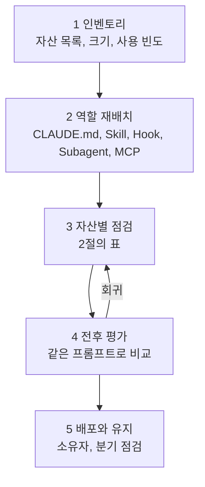

---

title: "[Claude Academy 11편] 기존 플러그인, 에이전트, 스킬, 훅 개선 가이드 (점검 기준, 연습 습관, 적용 지시문)"
date: 2026-10-29
categories: [AI, Claude]
tags: [AI, ClaudeCode, Skills, Hooks, Audit]
layout: post
toc: true
math: false
mermaid: true
series: claude-academy
series_order: 11

---

## 참고자료

- [Claude Academy 1편 - 생성형 AI 동작 원리와 신뢰](/posts/claude-academy-how-ai-works/)
- [Claude Academy 2편 - Claude Platform과 클라우드 제공자](/posts/claude-academy-platform-and-cloud/)
- [Claude Academy 3편 - Claude Code 장시간 작업과 무인 실행](/posts/claude-academy-claude-code-in-action/)
- [Claude Academy 4편 - AI 네이티브 SDLC 12개 플레이](/posts/claude-academy-ai-native-sdlc/)
- [Claude Academy 5편 - Agent Skills](/posts/claude-academy-skills/)
- [Claude Academy 6편 - Claude 앱 기능](/posts/claude-academy-claude-app/)
- [Claude Academy 7편 - Cowork](/posts/claude-academy-cowork/)
- [Claude Academy 8편 - Claude Tag와 Enterprise 도입](/posts/claude-academy-tag-and-enterprise/)
- [Claude Academy 9편 - 엔지니어링 사용 사례](/posts/claude-academy-use-cases-engineering/)
- [Claude Academy 10편 - 업무 자동화 사용 사례와 웨비나](/posts/claude-academy-use-cases-workflow/)
- [Claude Academy 12편 - 웨비나 전체 목록](/posts/claude-academy-webinars/)
- [Claude Academy 13편 - 원문 전체 색인](/posts/claude-academy-index/)
- 보완된 기존 글: [AI 4편](/posts/claude-api-stateless-eval-tooluse/), [AI 5편](/posts/mcp-server-client-transport/), [AI 6편](/posts/claude-code-tool-loop-hooks/), [AI 8편](/posts/ai-fluency-4d-claude-code/)

---

## 배경

1편부터 10편까지(웨비나 목록은 12편)는 Claude Academy가 말하는 사실을 정리한 글이다. 이 글은 그 사실을 이미 만들어 둔 자산에 되돌려 적용하는 방법을 다룬다. 대상은 플러그인, 서브에이전트, 스킬, 커맨드, 훅, `CLAUDE.md`, MCP 설정, 직접 만든 에이전트 코드, 예약 작업이다.

이 글은 다른 컴퓨터에서 이 시리즈의 링크를 붙여 넣고 "이 내용으로 내 자산을 점검하라"고 지시하는 용도로도 쓴다. 그래서 점검 기준을 자산 종류별 표로 두고, 근거가 되는 편을 함께 적었다. 로컬 자산의 실제 내용은 이 글을 쓰는 시점에 전부 열어 보지 않았다. 아래 기준은 시리즈의 사실에서 나온 것이고, 각 자산이 지금 어떤지는 점검 단계에서 확인해야 한다.

정리하면서 확인하고 싶었던 것들이다.

- 어떤 순서로 점검해야 회귀 없이 개선되는가?
- 자산 종류별로 무엇을 어떤 기준으로 보는가?
- 직접 만든 에이전트 코드와 자동화에는 어떤 기준을 대는가?
- 도구가 아니라 쓰는 사람의 습관은 무엇을 의식하고 연습하는가?
- 점검을 맡길 때 어떤 지시문을 쓰는가?

---

## 큰 그림

개선은 인벤토리에서 시작해 자산을 올바른 자리로 옮기고, 자산별 기준으로 고치고, 고친 결과를 평가로 확인하는 순서다. 한꺼번에 바꾸면 무엇이 효과를 냈는지 모른다.



1절은 순서와 변경 원칙, 2절은 자산별 점검 기준, 3절은 코드로 만든 에이전트와 자동화, 4절은 습관, 5절은 적용 지시문이다.

---

## 1. 점검 순서와 변경 원칙

첫 질문이다.

### 1.1 순서

1. 인벤토리를 만든다. 자산 이름, 종류, 위치, 줄 수, 마지막 수정일, 최근 실제로 쓰인 적이 있는지를 표로 모은다. 쓰이지 않는 자산은 개선 대상이 아니라 정리 후보다.
2. 역할을 다시 배치한다. 한 자산에 여러 역할이 섞여 있으면 나눈다. 기준은 아래 표다.
3. 자산별 점검 기준(2절)으로 하나씩 고친다.
4. 고치기 전과 후를 같은 프롬프트로 비교한다([4편](/posts/claude-academy-ai-native-sdlc/)의 평가).
5. 소유자와 점검 주기를 정한다.

| 지키려는 것 | 둘 곳 | 근거 |
|---|---|---|
| 항상 적용할 규칙 | `CLAUDE.md` | 매 요청에 로드된다. 강제력은 없다. |
| 작업별 순서와 지식 | Skill | 요청과 설명이 맞을 때만 로드된다. |
| 건너뛰면 안 되는 규칙 | Hook | 도구 실행을 Claude Code가 하므로 모델이 우회하지 못한다. |
| 중간 과정이 필요 없는 조사와 리뷰 | Subagent | 별도 컨텍스트에서 요약만 돌려준다. |
| 외부 서비스 연결 | MCP | 제공자가 연동을 유지한다. |

### 1.2 변경 원칙

시리즈에서 반복해서 나오는 원칙은 세 가지다.

- **한 번에 한 자산, 한 가지 변경.** 평가 사례가 한 번에 한 가지만 고치고 같은 프롬프트로 다시 실행하라고 한다.
- **고치기 전에 사용 결과와 미사용 결과를 나란히 본다.** 스킬 평가 방법이다.
- **롤백 경로를 먼저 정한다.** 자산 폴더를 git에 두거나 복사본을 남긴다. 훅과 권한 설정은 잘못 걸면 모든 작업이 막힌다.

대가는 시간이다. 자산이 많으면 전수 점검이 길어지므로, 인벤토리에서 최근 자주 쓰는 순서로 상위부터 한다.

---

## 2. 자산 종류별 점검 기준

두 번째 질문이다.

### 2.1 CLAUDE.md

| 점검 | 기준 | 근거 |
|---|---|---|
| 길이 | 길어질수록 개별 규칙이 지켜지는 비율이 떨어진다. 한 쪽 안쪽을 목표로 한다. | 3편, 4편 |
| 내용 | 코드에서 추론 가능한 내용(언어, 빌드 명령)은 지운다. 신규 입사자에게 매번 설명하던 내용과 자주 틀리는 점만 남긴다. | AI 6편, 4편 |
| 규칙 문장 | 구체적이고 확인 가능하게 쓴다. 금지만 쓰지 말고 대체안을 같이 쓴다. | 3편 |
| `@` 임포트 | 정리용이다. 컨텍스트 사용량을 줄이지 않는다. 거의 매번 필요한 파일에만 쓴다. | 3편, AI 6편 |
| 가끔 필요한 절차 | Skill로 옮긴다. | 5편 |
| 반드시 지킬 규칙 | Hook으로 옮기거나 이중화한다. | 3편, 4편 |
| 갱신 | Claude가 같은 실수를 두 번 하면 교정 내용을 추가한다. | 4편 |

### 2.2 스킬

| 점검 | 기준 |
|---|---|
| `description` | 무엇을 하는지와 언제 쓰는지를 함께 쓴다. 사용자가 실제로 쓰는 표현을 넣는다. 최대 1,024자다. |
| `name` | 소문자, 숫자, 하이픈, 64자 이하, 디렉터리 이름과 일치한다. `review`보다 `frontend-review`처럼 구체적으로 지어 충돌을 피한다. |
| 본문 크기 | 500줄 안쪽이다. 넘는 내용은 `references`로 나눈다. |
| 스크립트 | 읽게 하지 말고 실행하게 지시한다. 출력만 컨텍스트에 들어간다. 실행 권한과 경로 구분자를 확인한다. |
| `allowed-tools` | 읽기 전용 스킬이나 보안에 민감한 스킬에는 도구를 제한한다. 생략하면 제한이 없다. |
| 트리거 시험 | 요청 표현을 바꿔 가며 스킬이 쓰이는지 시험한다. 비슷한 `description`이 둘이면 구분한다. |
| 우선순위 | Enterprise, 개인, 프로젝트 순으로 우선한다. 이름 충돌로 가려지지 않는지 본다. |
| 서브에이전트 연결 | 서브에이전트는 스킬을 자동으로 보지 못한다. 에이전트 파일의 `skills` 필드에 항상 관련된 것만 적는다. |
| 강제력 | 스킬은 권고다. 반드시 지킬 정책은 훅과 머지 조건으로 이중화한다. |
| 확인용 스킬 | 테스트 실행, diff 읽기, 테스트 약화 확인, 증거를 붙인 통과 또는 실패 보고를 자동화한다. |

### 2.3 서브에이전트

| 점검 | 기준 |
|---|---|
| 위임할 만한가 | 중간 과정이 메인 스레드에 필요하지 않은가를 묻는다. 필요 없으면 위임한다. |
| `description` | 한 줄이다. 메인 에이전트의 시스템 프롬프트에 매번 들어가 위임 시점을 정한다. 자동 위임이 너무 잦거나 드물면 이 값과 `name`을 고친다. |
| 출력 형식 | 요약, 심각도별 문제, 승인 상태를 정의한다. 없으면 멈출 시점을 몰라 오래 돈다. |
| 장애물 보고 | 겪은 문제, 설정 문제, 우회 방법, 특수 플래그가 필요한 명령을 적게 한다. |
| 도구 | 조사용은 읽기만, 리뷰어는 diff 확인까지, 편집은 코드를 바꾸는 에이전트에만 준다. |
| 정리 대상 | 전문가 페르소나("OO 전문가입니다")는 효과가 없다. 순차 파이프라인(재현, 디버그, 수정)과 테스트 러너는 정보가 손실되므로 메인으로 되돌린다. |
| 리뷰어 | 작성 이력이 없는 새 컨텍스트가 변경을 새로 본다. 장시간 작업 뒤 리뷰는 별도 에이전트에 맡긴다. |

### 2.4 훅

| 점검 | 기준 |
|---|---|
| 종료 코드 | 차단은 `exit 2`다. `exit 1`은 차단하지 않는다. 의도한 차단이 `exit 1`로 되어 있지 않은지 본다. |
| 메시지 | 차단 사유를 stderr로 출력하면 Claude가 읽고 다른 방법을 찾는다. |
| 입력 수정 | `PreToolUse`는 JSON의 `permissionDecision`으로 허용, 거부, 확인을 돌려주고 `updatedInput`으로 입력을 고칠 수 있다. |
| 대상 | 예외 없이 지켜야 하는 동작과 운영 사고로 이어질 규칙(main 푸시 금지 등)만 훅에 둔다. 나머지는 스킬이다. |
| 테스트 관문 | stop 훅으로 테스트를 돌려 실패하면 Claude가 스스로 고치게 한다. auto 모드에서 특히 필요하다. |
| 테스트 보호 | 버그 수정에서는 테스트 파일 편집을 훅으로 막아 테스트를 고쳐서 통과시키는 길을 닫는다. |
| 경로 | 훅 스크립트 경로에 프로젝트 디렉터리 환경 변수를 쓴다. |
| 운영 배포 훅 | 승인 기록을 읽기만 하고 에이전트가 승인 기록에 쓰지 못하게 설계한다. |

### 2.5 커맨드

슬래시 명령은 직접 입력해야 하고 스킬은 Claude가 상황을 보고 적용한다. 같은 설명을 반복해서 입력하는 커맨드는 스킬로 바꿀 후보다. 인자를 받는 반복 작업(`$ARGUMENTS`)이나 사람이 시점을 정해야 하는 작업은 커맨드로 남긴다. 이 구분은 강좌의 비교에서 나온 것이고, 기존 커맨드를 스킬로 바꾼 뒤 동작이 같은지는 시험으로 확인해야 한다.

### 2.6 플러그인과 MCP, 설정

| 대상 | 점검 |
|---|---|
| 플러그인 | 설치 전에 훅, 에이전트, MCP 설정을 읽는다. 훅은 내 훅을 덮지 않고 함께 쌓인다. `.claude-plugin/plugin.json`의 name으로 이름공간을 정한다. `settings.json`은 `agent`와 `subagentStatusLine` 키만 인정되고 `agent`를 지정하면 기본 동작이 바뀐다. 소유자를 지정하고 배포 전에 평가하고 분기별로 점검한다. |
| MCP | 범위(local, user, project)를 확인한다. 도구 정의가 컨텍스트의 10%를 넘으면 도구 검색 모드로 전환되어 성능이 떨어질 수 있다. 쓰지 않는 서버는 끄고, CLI가 있는 도구는 CLI를 우선한다. 읽기 전용을 기본으로 하고 쓰기는 승인 뒤에 허용한다. |
| 권한 모드 | 무인 작업은 bypass permissions 대신 auto를 쓴다. 분류기는 위험만 보고 정확성은 보지 않으므로 stop 훅과 함께 쓴다. |
| 기억 | 어느 범위(프로젝트, 계정, 채널)에 무엇이 저장되는지 확인한다. 일시적 세부는 기억시키지 않고, 틀린 기억은 직접 고친다(6편 6절). |
| effort와 모델 | 기본값에서 시작해 한 단계씩 조정한다. 지식 부족은 모델 문제이고 노력 부족이나 과잉은 effort 문제다. 모델이 바뀌면 기본값에서 다시 시작한다. |
| 비용 | 토큰당이 아니라 작업 완료당 비용을 본다. 상한을 올리기 전에 기본 모델과 effort부터 살핀다. |

---

## 3. 코드로 만든 에이전트와 자동화

세 번째 질문이다.

API나 SDK로 직접 만든 에이전트, 알림 연동, 스크립트, 예약 작업에는 [2편](/posts/claude-academy-platform-and-cloud/)과 [9편](/posts/claude-academy-use-cases-engineering/)의 기준을 댄다.

| 점검 | 기준 |
|---|---|
| 구조 | 단계를 미리 그릴 수 있으면 워크플로우(병렬화, 체이닝, 라우팅)로 바꾼다. 에이전트는 과제가 불확실할 때만 쓴다. |
| 도구 설명 | 모호한 도구 설명이 오작동의 첫째 원인이다. 이름, 입력 검증, 오류 메시지를 구체적으로 쓴다. |
| 도구 단위 | 추상적이고 조합 가능한 작은 도구가 효과적이다. 행동 결과를 관찰할 수단(파일 읽기, 스크린샷)을 같이 준다. |
| 모델 | 대표 예시 20~30개를 Haiku부터 돌려 필요한 만큼만 올린다. 작업별로 모델을 나눈다. |
| 컨텍스트 | 적시 로딩, 서버 측 압축, 프롬프트 캐싱, 메모리 도구를 겹쳐 쓴다. 바뀌지 않는 시스템 프롬프트와 도구 정의에 캐시 중단점을 단다. |
| 평가 | 실제 작업 20~50개를 평가로 만들고 변경 때 돌린다. 사고마다 케이스를 하나 추가한다. |
| 승인 지점 | 롤백, 게시, 머지, 삭제, 발송은 사람이 승인한다. 어디서 승인을 받는지 코드나 지시에 적는다. |
| RAG | 청킹 방식이 문서 구조에 맞는지(겹침을 더한 크기 기반이 기본), 정확한 용어 검색이 필요하면 BM25와 RRF를 더하는지 본다. 재순위화와 문맥 검색은 평가로 효과를 확인한 뒤 적용한다(2편 6절). |
| 자동 응답 | `Respond automatically`와 mute 명령은 안내일 뿐 차단 장치가 아니다. 차단은 권한, 지출 한도, 커넥터 설정으로 한다. |
| 예약 작업 | 읽을 소스, 필드, 저장과 게시 위치, 담당자를 지정한다. 첫 실행 뒤 결과를 직접 확인한다. 담당자가 없으면 결과가 백로그가 된다. |
| 출처 간 모순 | 정보가 없으면 "기록된 진척 없음"처럼 비워 두게 한다. 모순되는 숫자는 부록에 차이를 적게 하고 사람이 확인한다. |

대가는 구조를 바꾸는 비용이다. 이미 잘 돌아가는 에이전트를 워크플로우로 바꾸면 유연성을 잃으므로, 평가에서 실패가 반복되는 곳부터 바꾼다.

---

## 4. 의식하고 연습할 습관

네 번째 질문이다.

도구를 고쳐도 쓰는 방식이 그대로면 효과가 제한된다. 시리즈의 연구와 사례에서 습관으로 옮길 수 있는 것을 모았다.

| 습관 | 근거 | 연습 방법 |
|---|---|---|
| 완성돼 보일수록 의심한다. | 결과물을 만든 대화에서 맥락 누락 확인, 사실 확인, 추론 의문 제기가 줄었다(AI 8편). | 결과를 받으면 "무엇을 가정했나", "무엇이 틀리게 만들까"를 한 번 묻는다. |
| 분별력은 따로 연습한다. | 분별력은 사용 기간과 기능 숙련도로 늘지 않는다. | 자주 만드는 결과물마다 점검표(질문 5~8개)를 스킬로 만든다. |
| 협업 조건을 먼저 말한다. | 협업 조건을 말한 대화는 30%였다. | "가정이 틀리면 반박해라", "불확실한 부분을 표시해라"를 세션 시작이나 `CLAUDE.md`에 둔다. |
| 목표를 먼저 쓴다. | Claude Code와 Cowork에서 목표 명확화가 다른 좋은 행동을 끌어올리는 시작 행동이다. | 요청의 첫 문장을 결과물과 완료 조건으로 쓴다. Chat에서는 후속 턴으로 다듬는다. |
| 계획을 읽고 승인한다. | 계획 단계가 방향을 고치는 가장 싼 시점이다. | 큰 작업은 Plan Mode로 시작하고 계획의 영향 파일을 확인한다. |
| 감독한 만큼 확인한다. | 감독하지 않은 정도에 비례해 확인 강도를 높인다. | 무인 작업의 결과는 요약보다 diff와 변경 파일 목록부터 읽는다. |
| 같은 교정은 파일로 옮긴다. | 같은 실수를 두 번 하면 파일에 추가한다. | 두 번째 교정에서 `CLAUDE.md`나 스킬에 쓰고, 어겨서 사고가 날 규칙이면 훅으로 올린다. |
| 컨텍스트를 관리한다. | 긴 대화의 품질 저하는 능력이 아니라 창 한계일 가능성이 크다. | 같은 기능은 `/compact`, 새 기능은 `/clear`. 품질이 떨어지면 요약을 가지고 새 대화를 연다. |
| 위임하되 판단은 맡기지 않는다. | 위임 대상은 작업이지 판단이 아니다. | 롤백, 평점, 머지처럼 서명하는 지점을 미리 적어 둔다. |
| 비용은 완료당으로 본다. | 상위 모델이 한 번에 풀면 더 쌀 수 있다. | 작업 유형 3가지로 기본 effort와 한 단계 낮춘 설정을 비교해 기록한다. |
| 사고는 평가로 남긴다. | 운영 사고마다 평가 케이스를 하나 추가한다. | 포스트모템의 액션 아이템에 평가 케이스 추가를 넣는다. |

1인 DevOps의 환경에서는 STG 검증과 롤백 절차 없이 운영에 적용하지 않는다는 기존 규칙이 이 습관들의 바닥이다. 시리즈의 사례는 이 규칙과 충돌하지 않는다. 승인 지점을 사람에게 두는 설계가 전체에서 반복된다.

주 단위로 돌릴 연습 루틴은 다음과 같다.

| 시점 | 할 일 |
|---|---|
| 매 작업 시작 | 목표와 완료 조건을 첫 문장에 쓴다. 큰 작업은 계획부터 받는다. |
| 매 작업 끝 | 결과를 받고 가정을 묻는다. 맞는지 모르는 값(플래그, 버전, URL)은 공식 문서로 확인한다. |
| 주 1회 | 이번 주 두 번 이상 한 교정을 모아 파일로 옮긴다. 쓰이지 않은 자산 하나를 정리한다. |
| 월 1회 | 자산 한 종류를 2절 표로 점검한다. 모델이나 기능이 바뀌었으면 낮은 effort로 재시험한다. |
| 사고 후 | 포스트모템 초안을 증거 기반으로 재구성시키고 평가 케이스를 추가한다. |

---

## 5. 적용 지시문

다섯 번째 질문이다.

다른 컴퓨터에서 이 시리즈를 읽고 점검을 맡길 때는 한 번에 전수 개선을 시키지 말고 단계를 나눈다. 아래 지시문은 1단계(읽기 전용 인벤토리와 진단)만 맡긴다. 변경은 진단을 읽고 자산 하나씩 승인한 뒤에 시킨다.

```text
아래 링크는 Claude Academy 정리 시리즈다. 먼저 전부 읽어라.
(여기에 1편~11편 링크를 붙인다)

목표: 내 로컬의 CLAUDE.md, 스킬, 서브에이전트, 커맨드, 훅, 플러그인, MCP 설정, 직접 만든 에이전트 코드를
11편 2절과 3절의 기준으로 점검한다.

1단계는 읽기 전용이다. 파일을 수정하지 마라.
1. 위 자산을 모두 찾아 인벤토리 표를 만든다(이름, 종류, 위치, 줄 수, 마지막 수정일).
2. 자산마다 기준 위반을 찾아 표로 정리한다. 열은 자산, 위반한 기준, 근거가 되는 편, 제안 변경, 위험이다.
3. 확인하지 못한 항목은 미확인으로 표시하고 추측과 사실을 구분한다.
4. 변경 우선순위를 사용 빈도와 사고 위험 순으로 제시한다.
5. 각 변경의 롤백 방법을 적는다.

내가 항목을 승인하면 한 번에 한 자산씩, 한 가지 변경만 하고 전후를 같은 프롬프트로 비교해 보고해라.
```

2단계 이후에는 자산 하나를 골라 "이 자산을 2절 표로 고쳐라, 변경 전 복사본을 남겨라, 고친 뒤 같은 프롬프트로 전후를 비교해라"로 지시한다. 회사 환경에서는 Slack, 클라우드 연결, 외부 OAuth가 막혀 있을 수 있어서 Claude Tag나 클라우드 기반 routine 같은 항목은 쓸 수 없을 가능성이 크다. 이 부분은 점검 결과에서 해당 없음으로 표시하게 한다.

---

## 정리하며

처음 던진 질문들에 대한 답이다.

**점검 순서.** 인벤토리, 역할 재배치, 자산별 점검, 전후 평가, 배포와 유지 순이다. 한 번에 한 자산, 한 가지 변경만 하고 롤백 경로를 먼저 정한다.

**자산별 기준.** `CLAUDE.md`는 짧게 구체적으로, 스킬은 `description`과 크기와 연결, 서브에이전트는 위임 기준과 출력 형식, 훅은 종료 코드와 대상, 커맨드는 스킬로 바꿀 후보를 가려내는 것이다.

**에이전트 코드와 자동화.** 워크플로우로 바꿀 수 있는지, 도구 설명이 구체적인지, 모델과 컨텍스트와 평가가 갖춰졌는지, 승인 지점이 적혀 있는지를 본다.

**습관.** 완성돼 보일수록 의심하고, 목표를 먼저 쓰고, 협업 조건을 말하고, 같은 교정은 파일로 옮기고, 감독한 만큼 확인한다. 분별력은 따로 연습해야 늘어난다.

**적용 지시문.** 1단계는 읽기 전용 진단만 맡기고, 변경은 승인한 항목을 한 자산씩 진행한다.

정리하고 나서 가장 크게 바뀐 인식은 **자산을 개선하는 일과 쓰는 습관을 바꾸는 일이 같은 목록의 양쪽**이라는 점이었다. 그래서 점검을 마칠 때마다 이번에 고친 규칙 중 사람이 지켜야 할 것을 습관 표에 한 줄 더한다.
