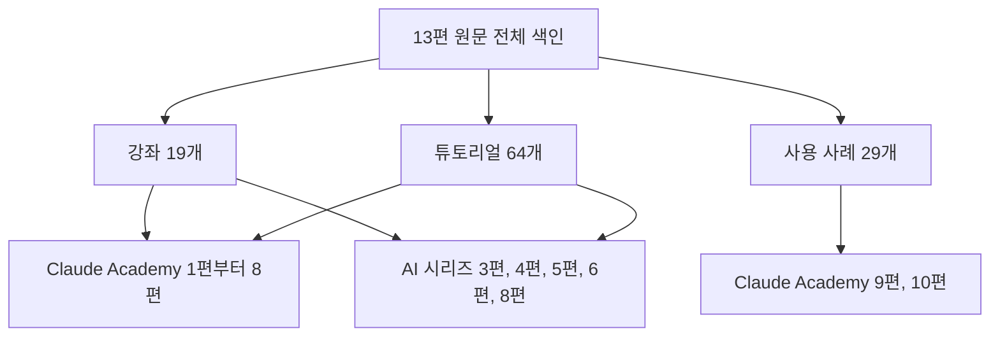

---

title: "[Claude Academy 13편] 원문 전체 색인 (강좌, 튜토리얼, 사용 사례별 정리 위치)"
date: 2026-10-29
categories: [AI, Claude]
tags: [AI, Claude, Index]
layout: post
toc: true
math: false
mermaid: true
series: claude-academy
series_order: 13

---

## 참고자료

- [Claude Academy - 엔지니어링 과정 목록](https://academy.claude.com/ko/all?department=engineering) (2026-10-21 수집)
- [Claude Academy 11편 - 기존 자산 개선 가이드](/posts/claude-academy-improvement-guide/)
- [Claude Academy 12편 - 웨비나 전체 목록](/posts/claude-academy-webinars/)
- 수집 기준: Claude Academy 엔지니어링 목록의 2026-10-21 수집본이다. 베타와 미리보기 표기, 요금제 조건, 모델 이름은 이후 바뀔 수 있다.

---

## 배경

Claude Academy 엔지니어링 필터에서 수집한 **강좌 19개, 튜토리얼 64개, 사용 사례 29개**는 모두 이 시리즈나 기존 AI 시리즈 글에 정리되어 있다. 웨비나(Webinar, 온라인으로 진행하는 세미나) 목록은 12편에 있다.

이 글은 원문 하나하나가 어느 글에 있는지를 모은 색인이고, 누락 여부를 점검하는 용도로도 쓴다.

수집 방식의 한계도 같이 적는다. 본문은 사이트가 번들한 영문 원문과 레슨 영상 자막을 읽고 요약한 것이고, **영상 자막은 113개 중 일부만 확보**했다.

상호작용형 실습 위젯(widget, 화면 안에서 직접 조작하는 입력 요소)과 퀴즈 레슨은 본문이 없어 정리하지 못했다.

그리고 "The 4 Ds of AI Fluency: Behavioral Indicators" 튜토리얼은 본문이 위젯이라 행동별 세부 내용이 수집되지 않았다.

정리하면서 확인하고 싶었던 것들이다.

- 강좌는 어느 글에 정리되어 있는가?
- 튜토리얼은 어느 글에 정리되어 있는가?
- 사용 사례는 어느 글에 정리되어 있는가?

## 큰 그림

색인은 원문 세 종류를 정리한 글로 이어 주는 지도다. 아래 그림은 이 글의 구조다.

---

## 1. 강좌 19개

| 원문 | 정리한 글 |
|---|---|
| AI의 능력과 한계(AI Capabilities and Limitations) | [Claude Academy 1편](/posts/claude-academy-how-ai-works/), [AI 8편](/posts/ai-fluency-4d-claude-code/) |
| 빌더를 위한 AI 유창성(AI Fluency for Builders) | [AI 8편](/posts/ai-fluency-4d-claude-code/) |
| AI 유창성 프레임워크와 기초(AI Fluency: Framework & Foundations) | [AI 8편](/posts/ai-fluency-4d-claude-code/) |
| AI 네이티브 SDLC 플레이북(The AI-Native SDLC Playbook) | [Claude Academy 4편](/posts/claude-academy-ai-native-sdlc/) |
| 효과적인 사람-에이전트 팀 구축(Building Effective Human-Agent Teams) | [Claude Academy 8편](/posts/claude-academy-tag-and-enterprise/) |
| Claude API로 개발하기(Building with the Claude API) | [Claude Academy 2편](/posts/claude-academy-platform-and-cloud/), [AI 4편](/posts/claude-api-stateless-eval-tooluse/), [AI 5편](/posts/mcp-server-client-transport/), [AI 3편](/posts/ai-engineering-rag-agent-memory/) |
| Claude 101(Claude 101) | [Claude Academy 6편](/posts/claude-academy-claude-app/) |
| Claude Code 101(Claude Code 101) | [Claude Academy 3편](/posts/claude-academy-claude-code-in-action/), [AI 6편](/posts/claude-code-tool-loop-hooks/) |
| Claude Code 실전 운용(Claude Code in action) | [Claude Academy 3편](/posts/claude-academy-claude-code-in-action/) |
| Claude Platform 101(Claude Platform 101) | [Claude Academy 2편](/posts/claude-academy-platform-and-cloud/) |
| Amazon Bedrock 기반 Claude(Claude with Amazon Bedrock) | [Claude Academy 2편](/posts/claude-academy-platform-and-cloud/) |
| Google Cloud Vertex AI 기반 Claude(Claude with Google Cloud's Vertex AI) | [Claude Academy 2편](/posts/claude-academy-platform-and-cloud/) |
| Claude Enterprise 자신 있게 도입하기(Deploying Claude Enterprise with Confidence) | [Claude Academy 8편](/posts/claude-academy-tag-and-enterprise/) |
| Agent Skills 입문(Introduction to Agent Skills) | [Claude Academy 5편](/posts/claude-academy-skills/) |
| Claude Cowork 입문(Introduction to Claude Cowork) | [Claude Academy 7편](/posts/claude-academy-cowork/) |
| Claude Tag 입문(Introduction to Claude Tag) | [Claude Academy 8편](/posts/claude-academy-tag-and-enterprise/) |
| Model Context Protocol 입문(Introduction to Model Context Protocol) | [AI 5편](/posts/mcp-server-client-transport/) |
| 서브에이전트 입문(Introduction to Subagents) | [AI 6편](/posts/claude-code-tool-loop-hooks/) |
| MCP 고급 주제(Model Context Protocol: Advanced Topics) | [AI 5편](/posts/mcp-server-client-transport/) |

---

## 2. 튜토리얼 64개

| 원문 | 정리한 글 |
|---|---|
| AI Fluency Index 토론 가이드(A discussion guide for the AI Fluency Index) | [AI 8편](/posts/ai-fluency-4d-claude-code/) |
| Claude Tag 사용 모범 사례(Best Practices Using Claude Tag) | [Claude Academy 8편](/posts/claude-academy-tag-and-enterprise/) |
| Claude로 맞춤 artifact 만들기(Build Custom Artifacts with Claude) | [Claude Academy 6편](/posts/claude-academy-claude-app/) |
| Claude로 PowerPoint 만들기(Building a PowerPoint with Claude) | [Claude Academy 6편](/posts/claude-academy-claude-app/) |
| AI에 능숙한 조직 만들기(Building AI-fluent organizations) | [Claude Academy 8편](/posts/claude-academy-tag-and-enterprise/) |
| AI가 하는 말을 믿을 수 있는가에 대한 영상(Can you trust what AI tells you?) | [Claude Academy 1편](/posts/claude-academy-how-ai-works/) |
| Claude Cowork와 Chat 중 고르기(Choosing Between Claude Cowork or Chat) | [Claude Academy 7편](/posts/claude-academy-cowork/) |
| 알맞은 Claude 모델 고르기(Choosing the right Claude model) | [Claude Academy 2편](/posts/claude-academy-platform-and-cloud/), [Claude Academy 6편](/posts/claude-academy-claude-app/) |
| Claude Code에서 적절한 effort 수준 고르기(Choosing the Right Effort Level in Claude Code) | [Claude Academy 3편](/posts/claude-academy-claude-code-in-action/) |
| Claude Cowork 엔터프라이즈 관리자 가이드(Claude Cowork Enterprise Administrator Guide) | [Claude Academy 8편](/posts/claude-academy-tag-and-enterprise/) |
| Claude for Word로 초안을 완성 문서로 만들기(Claude for Word: Turn a draft into a finished document) | [Claude Academy 6편](/posts/claude-academy-claude-app/) |
| Claude Tag 관리자 가이드(Claude Tag admin guide) | [Claude Academy 8편](/posts/claude-academy-tag-and-enterprise/) |
| 구성과 다중 파일 스킬(Configuration and multi-file skills) | [Claude Academy 5편](/posts/claude-academy-skills/) |
| 도구를 연결해 더 유능한 AI 만들기(Connect your tools to unlock a smarter, more capable AI companion) | [Claude Academy 6편](/posts/claude-academy-claude-app/) |
| Claude로 파일 만들고 편집하기(Create and edit files with Claude to eliminate hours of busy work) | [Claude Academy 6편](/posts/claude-academy-claude-app/) |
| 첫 번째 스킬 만들기(Creating Your First Skill) | [Claude Academy 5편](/posts/claude-academy-skills/) |
| Claude Cowork 맞춤 설정(Customize Claude Cowork) | [Claude Academy 7편](/posts/claude-academy-cowork/) |
| Claude Cowork에서 작업 위임과 예약(Delegating and scheduling tasks in Claude Cowork) | [Claude Academy 7편](/posts/claude-academy-cowork/) |
| Claude Cowork에서 첫 작업 위임하기(Delegating your first task in Claude Cowork) | [Claude Academy 7편](/posts/claude-academy-cowork/) |
| 분별력 도구 상자(Discernment Toolkit) | [AI 8편](/posts/ai-fluency-4d-claude-code/) |
| 세 단계로 Claude Cowork 시작하기(Get started in Claude Cowork in three steps) | [Claude Academy 7편](/posts/claude-academy-cowork/) |
| Claude를 잘 쓰게 되는 연구 기반 커리큘럼(Getting Good at Claude: A Research-Backed Curriculum) | [AI 8편](/posts/ai-fluency-4d-claude-code/) |
| Claude in Excel 시작하기(Getting started with Claude in Excel) | [Claude Academy 6편](/posts/claude-academy-claude-app/) |
| Claude Security 시작하기(Getting Started with Claude Security) | [Claude Academy 8편](/posts/claude-academy-tag-and-enterprise/) |
| Claude Tag 시작하기(Getting started with Claude Tag) | [Claude Academy 8편](/posts/claude-academy-tag-and-enterprise/) |
| Claude 시작하기(Getting started with Claude) | [Claude Academy 6편](/posts/claude-academy-claude-app/) |
| 커넥터 시작하기(Getting started with connectors) | [Claude Academy 6편](/posts/claude-academy-claude-app/), [AI 5편](/posts/mcp-server-client-transport/) |
| 스킬과 다른 Claude Code 기능 비교(How skills compare to other Claude Code features) | [Claude Academy 5편](/posts/claude-academy-skills/) |
| Cowork에서 플러그인 처음부터 만들기(How to Build a Plugin from Scratch in Cowork) | [Claude Academy 7편](/posts/claude-academy-cowork/) |
| 음성 모드와 받아쓰기 선택하기(How to choose between voice mode and dictation) | [Claude Academy 6편](/posts/claude-academy-claude-app/) |
| 대화로 스킬 만들기(How to create a skill with Claude through conversation) | [Claude Academy 5편](/posts/claude-academy-skills/) |
| Cowork 플러그인 맞춤 설정(How to customize plugins in Cowork) | [Claude Academy 7편](/posts/claude-academy-cowork/) |
| Enterprise 팀에 Claude Code 활성화하기(How to enable Claude Code for your enterprise team) | [Claude Academy 3편](/posts/claude-academy-claude-code-in-action/) |
| Cowork와 Chat의 Effort 설정 고르기(How to select the right effort setting for Claude Cowork and Chat) | [Claude Academy 6편](/posts/claude-academy-claude-app/) |
| Claude Code에서 FHIR Developer Agent Skill 사용법(How to use the FHIR Developer agent skill with Claude Code) | [Claude Academy 5편](/posts/claude-academy-skills/) |
| Claude와 상상하기 학생 가이드(Imagine with Claude Student Guide) | [Claude Academy 6편](/posts/claude-academy-claude-app/) |
| 아티팩트 소개(Meet Claude Slides, Claude Design and Claude Docs) | [Claude Academy 6편](/posts/claude-academy-claude-app/) |
| 프로젝트 입문(Intro to Projects) | [Claude Academy 6편](/posts/claude-academy-claude-app/) |
| Claude 데스크톱 앱 둘러보기(Navigating the Claude Desktop App) | [Claude Academy 6편](/posts/claude-academy-claude-app/) |
| 파라미터 기억과 컨텍스트(Parametric Memory and Context) | [Claude Academy 1편](/posts/claude-academy-how-ai-works/) |
| Claude로 PowerPoint 다듬기(Refining a PowerPoint with Claude) | [Claude Academy 6편](/posts/claude-academy-claude-app/) |
| 조직 전체로 Claude Cowork 워크플로우 확산(Scaling Workflows with Claude Cowork at Your Organization) | [Claude Academy 8편](/posts/claude-academy-tag-and-enterprise/) |
| 스킬 공유하기(Sharing skills) | [Claude Academy 5편](/posts/claude-academy-skills/) |
| Claude for Chrome으로 브라우징 단순화하기(Simplify your browsing experience with Claude for Chrome) | [Claude Academy 6편](/posts/claude-academy-claude-app/) |
| Claude Tag 시험 과제 모음(Tasks to try with Claude Tag in your workspace) | [Claude Academy 8편](/posts/claude-academy-tag-and-enterprise/) |
| 스킬로 Claude에게 내 작업 방식 가르치기(Teach Claude Your Way of Working Using Skills) | [Claude Academy 5편](/posts/claude-academy-skills/) |
| AI 유창성의 4D 행동 지표(The 4 Ds of AI Fluency: Behavioral Indicators) | [AI 8편](/posts/ai-fluency-4d-claude-code/) |
| AI의 네 가지 속성(The 4 Properties of AI) | [Claude Academy 1편](/posts/claude-academy-how-ai-works/), [AI 8편](/posts/ai-fluency-4d-claude-code/) |
| AI 유창성 지수(The AI Fluency Index) | [AI 8편](/posts/ai-fluency-4d-claude-code/) |
| 토큰과 임베딩(Tokens and Embeddings) | [Claude Academy 1편](/posts/claude-academy-how-ai-works/) |
| 스킬 문제 해결(Troubleshooting skills) | [Claude Academy 5편](/posts/claude-academy-skills/) |
| Claude Code Remote Control 사용하기(Using Claude Code Remote Control) | [Claude Academy 3편](/posts/claude-academy-claude-code-in-action/) |
| 프레젠테이션과 슬라이드 덱에 Claude Design 쓰기(Using Claude Design for Presentations and Slide Decks) | [Claude Academy 6편](/posts/claude-academy-claude-app/) |
| LSEG로 금융 시장 데이터 분석하기(Using LSEG for financial market data analysis) | [Claude Academy 6편](/posts/claude-academy-claude-app/) |
| 리서치 기능 사용하기(Using Research) | [Claude Academy 6편](/posts/claude-academy-claude-app/) |
| 스킬이란(What are skills) | [Claude Academy 5편](/posts/claude-academy-skills/) |
| AI는 나에 대해 무엇을 아는가(What does AI know about me) | [Claude Academy 1편](/posts/claude-academy-how-ai-works/) |
| AI와 대화할 때 일어나는 일(What happens when you talk to AI) | [Claude Academy 1편](/posts/claude-academy-how-ai-works/) |
| Claude Managed Agents 소개(What is Claude Managed Agents?) | [Claude Academy 2편](/posts/claude-academy-platform-and-cloud/) |
| AI 모델의 아첨(sycophancy)이란(What is sycophancy in AI models?) | [Claude Academy 1편](/posts/claude-academy-how-ai-works/) |
| AI 모델이 환각을 일으키는 이유(Why do AI models hallucinate) | [Claude Academy 1편](/posts/claude-academy-how-ai-works/) |
| AI 모델에 편향이 생기는 이유(Why does bias exist in AI models) | [Claude Academy 1편](/posts/claude-academy-how-ai-works/) |
| PowerPoint에서 Claude로 더 똑똑하게 일하기(Working smarter with Claude in PowerPoint) | [Claude Academy 6편](/posts/claude-academy-claude-app/) |
| AI 성실성 고지문 작성(Writing an AI Diligence Statement) | [AI 8편](/posts/ai-fluency-4d-claude-code/) |

---

## 3. 사용 사례 29개

| 원문 | 정리한 글 |
|---|---|
| 사내 질문에 답하는 에이전트 만들기(Ask the company) | [Claude Academy 10편](/posts/claude-academy-use-cases-workflow/) |
| 여러 도구에 걸친 일일 브리핑 만들기(Build a daily briefing across your tools) | [Claude Academy 10편](/posts/claude-academy-use-cases-workflow/) |
| 프로모션 이메일 정리하기(Clean up promotional emails) | [Claude Academy 10편](/posts/claude-academy-use-cases-workflow/) |
| 월간 클라우드 비용 이상 보고서 만들기(Monthly cloud-cost anomaly report) | [Claude Academy 9편](/posts/claude-academy-use-cases-engineering/) |
| 경쟁 옵션 비교와 분석(Compare and analyze competing options) | [Claude Academy 10편](/posts/claude-academy-use-cases-workflow/) |
| 사내 뉴스레터 만들기(Create a company newsletter) | [Claude Academy 10편](/posts/claude-academy-use-cases-workflow/) |
| 프로세스 플로우차트 만들기(Create a process flowchart) | [Claude Academy 10편](/posts/claude-academy-use-cases-workflow/) |
| 대화형 PDF 양식 만들기(Create interactive PDF forms) | [Claude Academy 10편](/posts/claude-academy-use-cases-workflow/) |
| 설계 문서와 RFC 작성하기(Write the design doc or RFC) | [Claude Academy 9편](/posts/claude-academy-use-cases-engineering/) |
| 엔지니어 성과 리뷰 초안 작성하기(Engineering performance reviews) | [Claude Academy 9편](/posts/claude-academy-use-cases-engineering/) |
| Claude가 할 수 있는 일 탐색하기(Explore what Claude can do for you) | [Claude Academy 10편](/posts/claude-academy-use-cases-workflow/) |
| 보고된 버그를 초안 PR로 고치기(Fix a reported bug with a draft PR) | [Claude Academy 9편](/posts/claude-academy-use-cases-engineering/) |
| 프로젝트 상태 보고서 만들기(Generate project status reports) | [Claude Academy 10편](/posts/claude-academy-use-cases-workflow/) |
| 자리를 비운 상태에서 요청 처리하기(Handle a request while away from your keyboard) | [Claude Academy 9편](/posts/claude-academy-use-cases-engineering/) |
| 인시던트 포스트모템 초안 작성하기(Draft the incident postmortem) | [Claude Academy 9편](/posts/claude-academy-use-cases-engineering/) |
| 여러 앱의 메시지 훑어보기(Message sweep) | [Claude Academy 10편](/posts/claude-academy-use-cases-workflow/) |
| 아침 브리핑과 저녁 마무리 만들기(Morning and evening briefing) | [Claude Academy 10편](/posts/claude-academy-use-cases-workflow/) |
| 내 문체 프로필 만들기(My voice) | [Claude Academy 10편](/posts/claude-academy-use-cases-workflow/) |
| 온콜 인수인계 브리프 작성하기(Write the on-call handoff brief) | [Claude Academy 9편](/posts/claude-academy-use-cases-engineering/) |
| 캘린더로 준비와 계획하기(Prepare and plan from your calendar) | [Claude Academy 10편](/posts/claude-academy-use-cases-workflow/) |
| 한 주 일정 빠르게 준비하기(Quickly Prep for Your Week) | [Claude Academy 10편](/posts/claude-academy-use-cases-workflow/) |
| 보유한 리서치로 시장 규모 산정하기(Size a market using your research) | [Claude Academy 10편](/posts/claude-academy-use-cases-workflow/) |
| 연결된 도구에서 통찰을 모아 덱 만들기(Source Insights from Your Tools to Build a Deck) | [Claude Academy 10편](/posts/claude-academy-use-cases-workflow/) |
| 스프린트 회고와 온콜 인수인계 작성하기(Sprint retro and on-call handoff) | [Claude Academy 9편](/posts/claude-academy-use-cases-engineering/) |
| 긴 스레드를 결정 기록으로 바꾸기(Thread to decision) | [Claude Academy 10편](/posts/claude-academy-use-cases-workflow/) |
| 온콜 알림 분류와 장애 진단(Triage On-Call Alerts and Diagnose Incidents) | [Claude Academy 9편](/posts/claude-academy-use-cases-engineering/) |
| 이메일을 행사 트래커로 바꾸기(Turn emails into an event tracker) | [Claude Academy 10편](/posts/claude-academy-use-cases-workflow/) |
| 다음 주 회의 준비하기(Week-ahead prep) | [Claude Academy 10편](/posts/claude-academy-use-cases-workflow/) |
| 팀 채널과 트래커로 주간 현황 게시물 만들기(Weekly status posts from the team's channels and tracker) | [Claude Academy 10편](/posts/claude-academy-use-cases-workflow/) |

---

## 정리하며

처음 던진 질문들에 대한 답이다.

강좌는 **19개 모두 위 1절 표의 글에 있다**. API와 클라우드 강좌는 반복되는 부분이 많아 2편과 AI 4편, 5편, 3편에 나눠 정리했다.

튜토리얼은 **64개 모두 2절 표의 글에 있다**. 모델 동작 원리는 1편, 스킬은 5편, 앱 기능은 6편, Cowork는 7편, 조직 도입은 8편에 있다.

사용 사례는 **29개 모두 3절 표의 글에 있다**. 엔지니어링 9개는 9편, 나머지는 10편이다.

정리하고 나서 가장 크게 바뀐 인식은 **요약을 쓰는 일보다 어디에 무엇을 넣었는지 추적하는 일이 누락을 막는다**는 점이었다. 그래서 원문이 늘어나면 이 색인에 먼저 한 줄을 더한다.
