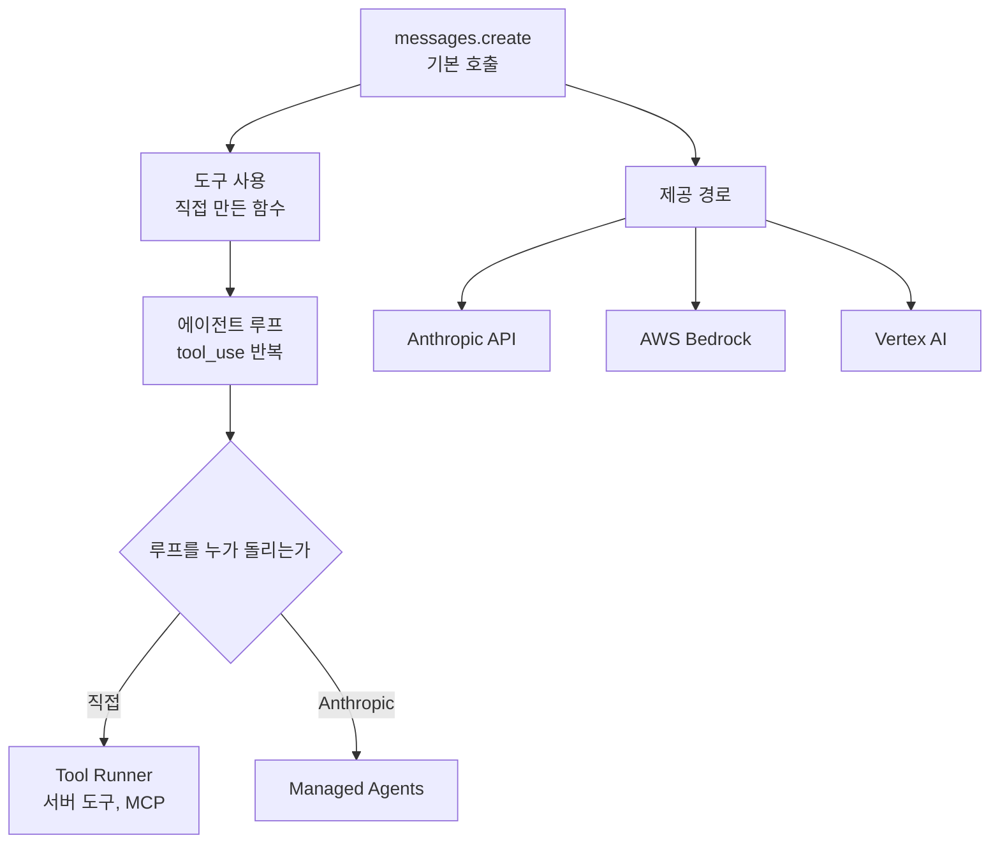

---

title: "[Claude Academy 2편] Claude Platform과 클라우드 제공자 (모델 선택, 에이전트 루프, Managed Agents, Bedrock, Vertex AI)"
date: 2026-10-29
categories: [AI, Claude]
tags: [AI, ClaudeAPI, ManagedAgents, Bedrock, VertexAI]
layout: post
toc: true
math: false
mermaid: true
series: claude-academy
series_order: 2

---

## 참고자료

- [Anthropic Academy - Building with the Claude API](https://anthropic.skilljar.com/claude-with-the-anthropic-api)
- Claude Academy 강좌: Claude Platform 101, Claude with Amazon Bedrock, Claude with Google Cloud's Vertex AI
- Claude Academy 튜토리얼: Choosing the right Claude model, What is Claude Managed Agents
- 수집 기준: Claude Academy 엔지니어링 목록의 2026-10-21 수집본이다. 베타와 미리보기 표기, 요금제 조건, 모델 이름은 이후 바뀔 수 있다.

---

## 배경

[AI 4편](/posts/claude-api-stateless-eval-tooluse/)에서 멀티턴 대화, `stop_reason`, 프롬프트 평가, Tool Use 형식을 정리했다. 프롬프트 캐싱(반복 프롬프트 처리 결과 재사용)도 그 글에서 다뤘다.

이 글은 그 위에 얹는 내용이다.

모델을 고르는 기준, 에이전트 루프와 내장 도구, 워크플로우와 에이전트의 선택, Anthropic이 루프를 대신 돌려 주는 Managed Agents가 나온다. 마지막으로 같은 모델을 AWS Bedrock과 Google Cloud Vertex AI에서 쓸 때 달라지는 점을 다룬다.

Bedrock과 Vertex AI 강좌는 직접 호출 API의 본 강좌와 레슨 구성이 거의 같다. 순서는 요청, 평가, 도구 사용, RAG, MCP다.

RAG(Retrieval-Augmented Generation)는 문서 조각을 검색해 프롬프트에 넣는 방식이다. MCP(Model Context Protocol)는 AI 앱과 외부 도구를 잇는 표준 프로토콜이다.

달라지는 부분은 호출 클라이언트와 인증, 한도, 도구 필드명, 캐시 키워드, 임베딩 모델 같은 항목이다.

그래서 공통 부분은 한 번만 쓰고 차이를 표로 모았다.

정리하면서 확인하고 싶었던 것들이다.

- 플랫폼은 어떤 계층으로 이뤄지고, 모델은 무엇을 기준으로 고르는가?
- 에이전트 루프와 사고, 내장 도구는 어떻게 동작하는가?
- 워크플로우와 에이전트는 무엇으로 나누는가?
- Managed Agents는 무엇을 대신 해 주는가?
- Bedrock과 Vertex AI에서는 무엇이 달라지는가?
- RAG 파이프라인은 어떤 단계로 만들고 무엇을 보강하는가?
- 호출 기초, MCP 실습, Claude Code 연동에서 더 챙길 것은 무엇인가?

---

## 큰 그림

플랫폼은 프리미티브, 인프라, 컨트롤 세 계층이다. 기본 호출에서 시작해 도구와 루프를 붙이고, 그 루프를 직접 돌릴지 Anthropic에 맡길지, 어느 클라우드로 부를지를 고른다.

1절은 계층과 모델 선택, 2절은 루프와 도구, 3절은 워크플로우와 에이전트의 선택이다. 4절은 Managed Agents, 5절은 클라우드별 차이, 6절은 RAG이고, 7절은 호출 기초, MCP 실습, Claude Code 연동이다.

---

## 1. 플랫폼 계층과 모델 선택

첫 질문이다.

### 1.1 세 계층

Claude Platform은 REST API, SDK, CLI, 키와 사용량을 관리하는 콘솔이다. 강좌는 이를 만들고(프리미티브), 확장하고(인프라), 운영하는(컨트롤) 세 계층으로 나눈다.

첫 예시는 `messages.create` 한 번으로 헬프데스크 답변 초안 버튼을 붙이는 것이다. 영상에서는 이 예시에 Haiku를 쓴다.

`messages.create`는 `model`, `max_tokens`, `system`, `messages`로 구성한다. 키는 `platform.claude.com`에서 받는데 크레딧을 먼저 사야 하고, **클라이언트 코드에 두지 않고** 서버를 거쳐 호출한다.

첫 호출 예제는 20줄 분량으로, 버그가 있는 코드를 리뷰시킨다. 영상에서는 `add` 함수가 뺄셈을 하는 버그를 Claude가 한 문단으로 짚어 낸다.

응답의 `content`는 **문자열이 아니라 블록 배열**이다. 텍스트, 도구 호출, 사고 블록이 섞일 수 있어서 항상 `type`을 확인하며 순회한다.

### 1.2 모델 선택

모델은 Haiku, Sonnet, Opus, Fable 네 계층이다. 영상은 앞의 세 가지를 중심으로 설명해서 요약과 표현이 다르다. 영상 쪽을 따라 세 계층을 기준으로 쓰고, Fable은 튜토리얼 기준으로 덧붙인다.

| 모델 | 맞는 작업 | 한도 소모, 제공 요금제 |
|---|---|---|
| Haiku 5.5 | 가장 빠르다. 짧은 답변, 요약, 정보 추출, 분류다. | 한도 소모가 가장 적다. |
| Sonnet 5.5 | 기본 모델이다. 코딩, 글쓰기, 분석, 다단계 작업, 컴퓨터 사용, 문서와 스프레드시트 생성이다. | 한도 소모는 보통이다. |
| Opus 5.5 | 오래 생각해야 하는 복잡한 추론이다. | 한도 소모가 많다. Pro 이상 요금제에서 제공한다. |
| Fable 5.1 | 가장 크다. 결과만 설명하면 단계를 계획하고 스스로 점검한다. 응답이 느리다. | 한도를 가장 많이 쓴다. 유료 요금제에서 제공한다. |

요금제별로 쓸 수 있는 모델이 다르다. Free는 Haiku와 Sonnet이고, Pro와 Max는 Opus와 Fable이 추가된다.

고르는 방법은 **대표 예시 20~30개를 Haiku부터 돌려** 품질이 유지되면 멈추고, 부족하면 Sonnet, 필요할 때만 Opus로 올리는 것이다. `response.usage`로 토큰(Token, 언어 모델이 텍스트를 처리하는 단위)을 확인한다. 영상에서는 같은 프롬프트를 세 모델에 돌려 지연과 토큰을 비교한다.

튜토리얼은 출발점이 다르다. 모르면 Sonnet으로 시작하고, 가벼운 모델 결과가 부족할 때 위 단계로 올린다고 한다. 두 설명의 차이는 원문에 이유가 없고, 추측으로는 튜토리얼이 앱 사용자 기준이고 강좌가 API 평가 기준이어서다.

한 애플리케이션 안에서 작업별로 나눠도 된다. 강좌 사례는 문서 처리 경로에서 분류는 Haiku, 고객 보고 초안은 Sonnet, 입찰 제안서 응답만 Opus로 나눴다.

Bedrock 강좌는 Opus를 지능 최우선, Sonnet을 균형, Haiku를 속도 최우선으로 설명한다. 사용자 응답은 Haiku, 업무 로직은 Sonnet, 복잡한 추론은 Opus로 나누는 구성을 예로 든다.

새 모델이 나오면 이전에 한계가 있던 작업을 다시 시도한다. 단순 작업에 큰 모델을 쓰면 토큰만 더 쓰고 응답이 느려진다.

튜토리얼의 비교 연습은 직접 읽은 보고서로 Haiku와 Sonnet에 같은 요약 프롬프트를 실행하는 것이다. 이때 답변 길이가 아니라 빠뜨린 내용을 비교한다.

| 작업 | 튜토리얼의 선택 |
|---|---|
| 기사 요약 | Haiku |
| 코드 디버깅 | Sonnet |
| 연구 논문 분석 | Opus |
| 아이디어에서 프로젝트 구축 | Fable |

앱의 모델 선택기에는 Effort 설정이 있어 추론 깊이를 조절한다. 기본값이 대부분 적합하고, 낮추면 빠르고 한도를 덜 쓰며, 가장 높은 설정은 어려운 문제용이다.

일부 생물학과 보안 주제에서는 선택한 모델과 다른 모델로 전환될 수 있고, 이때 Claude가 알려 준다.

---

## 2. 에이전트 루프, 사고, 내장 도구

두 번째 질문이다.

### 2.1 루프와 Tool Runner

에이전트는 Claude가 루프를 도는 구조다. 응답이 `tool_use`면 도구를 실행하고 결과를 돌려보내며, `end_turn`이면 끝낸다. 날씨 도구 예제는 API 호출 두 번과 도구 실행 한 번으로 끝난다.

실제 환경에서는 건축 보고서를 읽고 건축 법규를 도구로 조회해 위험 소견을 DB에 기록하는 준법 점검 에이전트가 같은 루프다.

도구는 개발자가 정의한 함수이고 실행은 코드가 맡는다. **도구 설명문이 모호한 것이 에이전트 오작동의 첫째 원인**이다. 설명문에는 입력값과 반환값을 구체적으로 적는다.

Tool Runner(베타)는 TypeScript, Python, Ruby SDK에 있고, `while` 루프와 스키마 직접 작성이 사라진다. TypeScript에서는 Zod(스키마를 코드로 정의하는 라이브러리) 스키마로 도구를 정의해 코드량을 줄인다.

### 2.2 사고

적응형 사고(adaptive thinking, 질문 난이도에 맞춰 사고량을 정하는 방식)는 `output_config`의 effort로 깊이를 조절한다. `effort`는 **`thinking` 블록 옆이 아니라 `output_config` 안**에 둔다. 단계는 low, medium, high, extra high, max이고 기본값은 high다.

다단계 논리와 절충 판단에는 유용하다. 단순 분류에는 지연과 비용만 늘린다. 영상에서는 도로 여행 계획처럼 절충이 필요한 질문에서 사고 블록이 응답에 보인다.

강좌 요약은 Opus 5의 적응형 사고가 기본으로 켜져 있다고 한다. 영상은 Opus 4.7 기준으로 적응형 사고를 켜고 effort를 고른다고 설명해 두 설명이 다르다.

영상 쪽을 따랐지만 현재 모델의 기본 설정 여부와 기본값은 확인이 필요하다.

API 강좌의 확장 사고(extended thinking)는 `thinking` 파라미터에 `budget_tokens`를 주는 방식이다. 추론 과정이 응답에 포함된다.

비용과 지연이 늘어나므로 **프롬프트를 개선한 뒤에도 정확도가 부족할 때** 쓴다.

### 2.3 내장 도구, 스킬, MCP

| 구분 | 내용 |
|---|---|
| 서버 도구 | 웹 검색, 코드 실행, 웹 페치다. Anthropic이 서버에서 실행하므로 에이전트 루프가 필요 없고, 응답에 `server_tool_use`와 코드 실행 결과 같은 새 블록 유형이 온다. 웹 검색으로 확인한 내용도 사실이라는 보장은 없으므로 다시 확인하라고 주의한다. |
| 클라이언트 도구 | 메모리와 bash다. 코드가 직접 실행한다. |
| 스킬 | `SKILL.md` 패키지를 한 번 올리고 `container.skills`로 요청에 붙인다. 코드 실행 도구와 함께 쓴다. 업로드는 `client.beta.skills.create`, 호출은 `client.beta.messages.create`와 베타 헤더로 한다. |
| MCP | `mcp_servers`와 `mcp_toolset`으로 연결한다. 기본 비활성화 설정(`default_config`)으로 읽기 전용 도구만 허용할 수 있다. 베타 헤더가 필요하다. |

도구는 무엇을 할 수 있는지를, 스킬은 어떻게 할지를 정한다. 일일 상태 보고서 예시에서 사용자 프롬프트는 한 줄이고 순서는 스킬에 있다.

MCP 예시는 두 가지다. Linear(이슈 추적 서비스) MCP 서버는 `mcp_servers`에 type, URL, 이름, 선택적 인증 토큰을 적는다. Slack은 검색과 채널 목록만 열고 게시와 삭제는 막는 설정을 보인다.

역할 구분은 도구가 내부 시스템용, 스킬(작업 절차를 묶은 Claude Code 폴더)이 순서용, MCP가 제3자 서비스용이다. MCP를 쓰면 연동 유지보수를 서비스 제공자에게 넘긴다. 쓰기 권한이 필요 없는 MCP 서버는 읽기 도구만 열어 사고 가능성을 낮춘다.

영상 시점에 스킬과 MCP는 베타 기능이어서 베타 헤더가 필요하다. 직접 만든 MCP 서버와 클라이언트는 [AI 5편](/posts/mcp-server-client-transport/)에 있다.

### 2.4 컨텍스트 관리

컨텍스트는 한 턴에 Claude가 보는 모든 입력이다. 컨텍스트 창(Context Window, 모델이 한 번에 보는 최대 토큰 수)이 차면 요청이 실패한다. 100만 토큰 창도 실제 에이전트에서는 빨리 찬다.

네 수단을 상황에 맞게 겹쳐 쓴다.

| 수단 | 내용 |
|---|---|
| 적시 로딩 | 필요한 시점에 필요한 정보만 넣는다. |
| 서버 측 압축 | `context_management`의 edits로 설정한다. |
| 프롬프트 캐싱 | 시스템 프롬프트 4,000토큰을 시간당 100번 호출하는 경우처럼 반복이 많을 때 효과가 크다. |
| 메모리 도구 | 대화 밖에 기록하고 필요할 때 읽는다. 클라이언트 도구여서 세션 간 기억에 쓰는 저장소는 직접 구현한다. |

---

## 3. 워크플로우와 에이전트

세 번째 질문이다.

**단계를 미리 그릴 수 있으면 워크플로우, 과제가 불확실하면 에이전트**를 고른다. 워크플로우는 정확도, 예측 가능성, 테스트 용이성이 높고 유연성이 낮다.

에이전트는 유연한 대신 성공률과 평가 용이성이 낮다. 강좌는 가능하면 워크플로우를 선택하라고 권한다.

| 패턴 | 내용 |
|---|---|
| 병렬화 | 큰 판단을 항목별 평가로 나눠 동시에 호출하고 결과를 모아 최종 판단한다. 항목별 프롬프트 개선과 추가가 쉽다. 예제는 부품 이미지에서 재료를 추천하는 것으로, 재료 종류별로 분석한 뒤 최종 비교로 이어진다. |
| 체이닝 | 순차 하위 작업으로 나누고 단계 사이에 일반 코드 처리를 넣는다. 제약이 많은 긴 프롬프트에서 위반이 반복되면 초안 작성과 집중된 수정 요청 2단계로 나눈다. |
| 라우팅 | 요청을 범주로 분류하고 범주별 전문 프롬프트나 파이프라인 한 곳으로만 보낸다. 예제는 영상 대본이고, 교육이나 엔터테인먼트 같은 장르마다 어조가 다른 프롬프트를 쓴다. |
| 평가자-최적화 | 생성자와 채점자가 피드백 루프를 돈다. 예제는 이미지에서 CAD(컴퓨터 지원 설계) 모델을 만드는 것이다. |

에이전트는 목표와 도구 집합을 주고 Claude가 조합 방법을 정하게 한다. 한 작업 전용 도구보다 Claude Code의 bash, read, write, edit, glob, grep처럼 추상적이고 조합 가능한 도구가 효과적이다.

Claude는 행동 결과를 직접 보지 못하므로 매 행동 뒤 상태를 확인할 수단도 줘야 한다. 수정 전 파일 읽기, 컴퓨터 사용 도구의 스크린샷 반환, UI 조작 후 스크린샷, 영상 에이전트의 자막과 프레임 확인이 점검 수단이다. 점검 방법은 시스템 프롬프트로 지시할 수 있다.

API 강좌는 Claude Code와 컴퓨터 사용을 에이전트 사례로 소개하고, 도구 연동, 다단계 작업, 환경 상호작용을 관찰 대상으로 제시한다.

RAG는 6절에 따로 정리했다.

---

## 4. Managed Agents

네 번째 질문이다.

Managed Agents는 에이전트를 규모 있게 만들고 배포하는 API 모음이고, Anthropic 인프라에서 에이전트 루프를 호스팅한다. 도구와 페르소나를 가진 에이전트를 정의하고, 패키지와 네트워크 제어를 설정한 샌드박스(Sandbox, 외부와 격리된 실행 환경)에서 세션을 실행한다.

구성은 Agent, Environment, Session, Event 네 요소다. 튜토리얼은 구성 요소를 agents, sessions, environments, tools, MCP, memory, outcomes(결과 기준), 다중 에이전트 조율로 나열한다.

Claude는 파일 시스템과 bash, 웹 검색이 되는 격리된 컨테이너에서 일한다. 완료 기준을 정의하면 도달할 때까지 작업한다.

| 예시 | 동작 |
|---|---|
| 칸반 연동 | 티켓을 In progress 열로 옮기면 세션이 자동 시작된다. Lighthouse(웹 성능 측정 도구)와 Puppeteer(브라우저 자동화 도구)가 설치된 환경에 GitHub 저장소를 마운트하고 성능 최적화 작업을 실행한다. |
| 결과 기준 | 결과 기준(rubric)은 Lighthouse 점수 90 초과, 렌더링 차단 리소스 없음, 이미지 지연 로딩이다. 별도 컨텍스트의 평가자가 채점해 미달분을 고치고 다시 내며, 점수는 96까지 오른다. |
| 병렬 실행 | 첫 작업 중에 두 번째 티켓을 옮기면 별도 컨테이너에서 병렬로 실행된다. 도구 호출은 이벤트 스트림으로 실시간 전달된다. |
| 가격 리서치 | 웹의 가격 페이지를 확인하고 Python으로 비용 분석을 하며 Excel 스킬로 요약 보고서를 쓴다. MCP 서버로 Slack 링크와 Asana(작업 관리 서비스) 확인 작업을 만든다. |
| 메모리 | 지난주 결과를 읽고 변경 사항을 저장해 다음 보고서에 "클라우드 컴퓨팅 15% 하락" 같은 변화를 담는다. |
| 장애 대응 | 알림 페이로드를 사용자 정의 도구 결과로 세션에 넣으면 조율 에이전트가 전문가 에이전트 셋에 위임하고 하나의 요약으로 종합한다. |
| 승인 단계 | Slack 게시 전에 권한 정책이 작동해 초안을 화면에서 승인해야 발송된다. 메모리로 2주 전 DNS TTL 설정 오류와 유사한 패턴을 알려 준다. |

Lighthouse 기준은 두 원문이 다르다. 튜토리얼은 90 초과, Platform 101 영상은 90 이상이라고 해서 어느 쪽이 맞는지 확인이 필요하다.

첫 에이전트는 Agent, Environment, Session을 만들고 이벤트를 주고받는 다섯 단계 예제다. **이벤트 스트림을 킥오프 메시지보다 먼저** 열어야 이벤트를 놓치지 않는다.

완료 신호는 **`session.status_idle`**이고, 파일 정리 같은 장시간 작업에 알맞다. Platform 101 실무 포인트는 장시간 실행과 재개가 필요한 작업을 Managed Agents에 맡기라고 한다. 재개 방식은 요약에 설명이 없다.

네트워크는 `limited`와 `allowed_hosts`로 제한한다.

Managed Agents 자체는 모든 API 계정에서 기본 활성화되어 별도 신청이 필요 없다.

결과 기준, 다중 에이전트 조율, 메모리는 베타이고 모든 API 계정에 기본으로 켜져 있어 별도 신청이 필요 없다. **MCP 터널과 드리밍(dreaming)은 제한된 연구 미리보기**로 신청이 필요하다. 드리밍이 무엇인지는 원문에 설명이 없다.

원문은 Managed Agents의 단점을 따로 말하지 않는다. 추측이지만 루프를 Anthropic이 돌리므로 루프 중간의 세밀한 제어가 필요하면 Tool Runner나 직접 구현이 맞다. 장애 대응 사례는 [AI 12편](/posts/rca-diagnosis-review-agents/)과 비교해 볼 만하다.

---

## 5. Bedrock과 Vertex AI의 차이

다섯 번째 질문이다.

| 항목 | Anthropic API | AWS Bedrock | Vertex AI |
|---|---|---|---|
| 클라이언트 | `anthropic` | boto3 `bedrock-runtime`의 `converse` | `anthropic[vertex]`를 설치해 `AnthropicVertex` |
| 모델 활성화 | 콘솔 | 모델 ID, 리전별 차이는 추론 프로필 ID | Model Garden에서 Anthropic 모델을 찾아 활성화, gcloud CLI 설치 |
| 인증 | API 키 | AWS 자격 증명 | `gcloud auth application-default login` |
| 스트리밍 | `stream=True` 또는 `text_stream` | `converse_stream`, `contentBlockDelta` 이벤트에서 텍스트 추출 | `stream=True` 또는 `messages.stream`의 `text_stream`, 완성 메시지는 `get_final_message()` |
| 도구 호출 필드 | `tool_use`, `tool_result`, `tool_use_id`, `is_error` | `toolUse`, `toolResult`, `toolUseId`, `stopReason`, 결과에 success 또는 error 상태 표기 | `tool_use`, `tool_result`, `tool_use_id`, `is_error` |
| 도구 선택 | 요약에 없음 | `toolChoice`의 auto, any, 도구 이름 지정 | `tool_choice={"type": "tool", "name": ...}`로 도구 지정 |
| 캐시 중단점 | `cache_control`, Haiku 4.5에서 최소 4,096토큰 | `cachePoint`, 최소 1,024토큰 | `cache_control`, 최소 1,024토큰 |
| 캐시 수명과 규칙 | 수명 5분, 재사용 때마다 연장, 1시간 옵션은 쓰기 비용이 더 높음, 중단점 최대 4개, 처리 순서는 도구, 시스템, 메시지 | 수명 5분, `cachePoint`를 직접 지정, 앞부분 내용이 완전히 같아야 적중, 시스템 프롬프트와 도구 정의에도 지정 가능 | 수명 5분, 중단점 최대 4개, 처리 순서는 도구, system, 메시지 |
| 임베딩 | VoyageAI 권장 | `amazon.titan-embed-text-v2:0`(1,024차원), `invoke_model`로 호출 | `text-embedding-005`, Google GenAI SDK로 호출 |
| 이미지 한도 | 요청당 100개, 이미지당 5MB | 요청당 20장, 3.75MB, 한 변 8,000px, 토큰 수는 가로 곱하기 세로를 750으로 나눈 값 | 요청당 100장, 장당 5MB, base64 이미지 블록 |
| PDF | `type`을 `document`, `media_type`을 `application/pdf`로 지정 | `document` 객체에 format, name, source 바이트 지정 | 요약에 없음 |
| 인용 | 문서 블록에 `title`과 `citations` 활성화, `cited_text`와 페이지 번호, 텍스트 문서는 문자 위치 | 문서 설정에 `citations` 활성화, 답변과 출처 위치가 구조화된 파트로 반환 | 문서 블록에 `title`과 `citations: {"enabled": True}`, PDF는 쪽 번호, 일반 텍스트는 문자 위치 |
| 확장 사고 | `thinking`의 `budget_tokens` | 최신 모델은 `adaptive` 사고와 `effort`, 4.5 세대 이하는 `budget_tokens`, 응답에 추론 내용 파트와 텍스트 파트 | `budget_tokens`는 최소 1,024이고 `max_tokens`보다 작아야 함, 사고 토큰에도 비용이 붙고 지연이 늘어남 |
| 웹 검색 | 콘솔에서 허용한 뒤 `type`, `name`, `max_uses`로 활성화, `allowed_domains`로 범위 제한, 인용 블록으로 출처 표시 | 요약에 없음 | `web_search_20250305`에 `max_uses`와 `allowed_domains` 지정, 응답에 검색 쿼리, 결과 목록, 인용 위치 블록 |

Anthropic은 임베딩 모델을 제공하지 않는다. 그래서 어느 경로든 임베딩은 외부 모델을 쓴다.

Bedrock은 `system`에 빈 문자열을 못 넣고 대화 중간에 system 메시지를 넣는 방식도 지원하지 않는다. 시스템 프롬프트와 도구 정의는 바뀌는 일이 드물어 캐시 효과가 크지만, 중단점 앞 내용이 완전히 같아야 읽히고 한 글자만 바뀌어도 무효화된다.

Bedrock에서는 MCP 도구 정의를 `to_bedrock_tools`로 Bedrock 형식에 맞춰 변환한다. 도구 결과를 보낼 때 도구 스키마를 다시 넣지 않으면 Claude가 도구 참조를 해석하지 못한다.

요약에 없다고 표시한 칸은 해당 기능이 그 경로에 없다는 뜻이 아니라, 강좌 요약이 다루지 않았다는 뜻이다.

세 경로의 호출 개념은 같다. 달라지는 부분은 **인증, 모델 식별자, 한도, 기능 지원 시점**이다. 기능 지원은 경로마다 다를 수 있어서 쓰려는 기능이 해당 경로에 있는지 문서로 확인해야 한다.

이 글의 표는 강좌 예제 기준이며 최신 한도를 보증하지 않는다. Bedrock 예제는 Haiku 4.5와 boto3 기준이다.

---

## 6. RAG 파이프라인

여섯 번째 질문이다.

긴 문서를 프롬프트에 통째로 넣으면 토큰 한도, 성능 저하, 비용, 지연 문제가 생긴다.

RAG(Retrieval-Augmented Generation, 검색 증강 생성)는 문서를 조각(청크, chunk)으로 나눈다. 질문과 관련된 조각만 프롬프트에 넣어 이 문제를 푼다.

대가는 전처리와 검색 로직을 직접 만들어야 한다는 점이고, 관련 부분만 넣으므로 맥락이 빠질 위험도 있다.

개념 설명은 [AI 3편](/posts/ai-engineering-rag-agent-memory/)에도 있다. 여기서는 세 강좌(API, Bedrock, Vertex AI)에 공통으로 나오는 구현 순서를 정리한다.

### 6.1 기본 흐름

1. 문서를 청크로 나눈다.
2. 각 청크를 임베딩(텍스트 의미를 -1에서 1 사이 숫자 목록으로 나타낸 값, 각 숫자의 의미는 해석할 수 없다)으로 바꾼다. Vertex 강좌는 이 뒤에 정규화 단계를 흐름에 넣고, Bedrock 강좌는 두 숫자짜리 가상 임베딩 설명에서 정규화를 언급한다. 정규화가 무엇인지는 요약에 풀이가 없어 확인이 필요하다.
3. 임베딩과 원문을 함께 벡터 데이터베이스(Vector Database, 임베딩을 저장하고 가까운 것을 찾는 저장소)에 저장한다. 원문을 같이 저장해야 검색 결과를 프롬프트에 쓸 수 있다. 숫자 벡터만으로는 프롬프트에 넣을 내용을 알 수 없기 때문이다.
4. 질문을 임베딩하고 코사인 유사도(두 벡터가 가리키는 방향이 얼마나 가까운지를 보는 값)로 가까운 청크를 찾는다. Bedrock과 Vertex 강좌는 두 숫자짜리 가상 임베딩으로 코사인 유사도와 코사인 거리를 설명한다(API 강좌는 예시 수치로 설명한다). 구현 예제는 `VectorIndex`에서 거리가 가까운 조각 두 개를 조회한다.
5. 찾은 청크로 최종 프롬프트를 만든다.

Anthropic은 임베딩 모델을 제공하지 않는다. API 강좌는 VoyageAI를 쓴다. Bedrock 강좌는 `amazon.titan-embed-text-v2:0`(1,024개 숫자)을, Vertex 강좌는 `text-embedding-005`를 쓴다.

### 6.2 청킹 방식

| 방식 | 내용 |
|---|---|
| 크기 기반 | 글자 수로 자른다. 겹침(overlap)을 더한 방식이 모든 문서에 통하는 기본 선택이다. |
| 구조 기반 | 섹션 단위로 자른다. 정돈된 문서용이다. |
| 의미 기반 | 요약이 방식 이름만 적고 동작을 설명하지 않아 확인이 필요하다. |
| 문장 기반 | 문장 단위로 자른다. 산문용이다. |

Bedrock과 Vertex 강좌는 크기 기반, 구조 기반, 의미 기반 세 가지로 비교한다. 문자 기반은 범용 대안, 문장 기반은 산문용, 섹션 기반은 정돈된 문서용으로 정리한다. 문서 유형별 선택 기준과 문자, 섹션, 문장 단위 구현 함수를 함께 보인다.

### 6.3 검색 보강

의미 검색은 `INC-2023-Q4-011` 같은 정확한 용어를 놓칠 수 있다. BM25(단어 일치와 희귀도로 점수를 매기는 어휘 검색)는 질의를 토큰으로 나누고 드문 용어에 높은 가중치를 주어 정확한 일치를 찾는다. 두 검색을 모두 쓰려면 Retriever가 벡터 인덱스와 BM25 인덱스에 질의하고 결과를 합친다.

합치는 방법이 RRF(Reciprocal Rank Fusion, 각 시스템에서의 순위 역수를 더해 점수를 매기는 방식)다.

RRF는 점수 대신 **순위로 계산하므로** 서로 다른 점수 체계를 섞을 수 있다. 같은 인터페이스를 따르면 새 인덱스도 추가할 수 있다.

합친 결과를 Claude에 넘겨 관련도 순으로 다시 정렬하는 재순위화(reranking)도 있다. 문서 전문 대신 문서 ID만 반환시켜 응답 시간을 줄이고, 지연과 비용이 늘어나는 단점은 감수한다.

문맥 검색(contextual retrieval)은 각 청크에 문서 내 위치를 설명하는 문구를 Claude로 생성해 앞에 붙여 저장한다. 문서가 크면 앞부분 청크와 직전 청크만 맥락으로 준다.

청크마다 Claude 호출이 필요하다는 점에서 색인 비용이 늘 것으로 보이지만, 원문에 비용 서술은 없어 추측이다.

### 6.4 대가

Vertex 강좌는 재순위화와 문맥 검색을 추가할 때 지연과 비용 증가를 감수할 만큼 정확도가 필요한지 평가 점수로 판단하라고 한다. 평가 세트로 효과를 확인한 뒤에 적용한다. 이미지, PDF, 인용 같은 입력 형식은 [AI 4편](/posts/claude-api-stateless-eval-tooluse/)의 보완 절에 있다.

---

## 7. 보완: 호출 기초, MCP 실습, Claude Code 연동

일곱 번째 질문이다.

직접 호출의 기초는 AI 4편에 있고, 여기서는 3개 강좌에 공통으로 나오는 나머지 항목을 모았다.

### 7.1 호출 기초

- 사용자 요청은 서버, API, 모델, 응답 순으로 흐른다. API 키 노출을 막으려면 반드시 서버를 거친다.
- 모델은 토큰화, 임베딩, 맥락화, 생성 단계를 거치고 최대 토큰, 종료 토큰, 정지 시퀀스에서 멈춘다.
- 키는 콘솔에서 Create Key로 만들며 한 번만 표시되므로 복사해 보관한다. `.env.local`에 두고 SDK를 설치한 뒤 `model`, `max_tokens`, `messages` 세 값으로 호출한다.
- API 강좌의 Python 예제는 `python-dotenv`로 `.env`의 키를 읽고 `message.content[0].text`로 응답 텍스트를 꺼낸다.
- 온도는 낮은 값과 높은 값의 용도가 정해져 있지만, Vertex 강좌는 결과 차이가 보장되지는 않는다고 덧붙인다.
- 도구 함수는 설명적인 이름, 입력값 확인, 의미 있는 오류 메시지를 갖춘 일반 Python 함수로 작성한다. Claude는 오류 메시지를 보고 재시도할 수 있다.
- 도구 스키마는 `name`, `description`, `input_schema`로 구성하고 Claude에게 작성을 맡길 수 있다. 도구 설명은 3~4문장, 파라미터 설명은 구체적으로 쓰고, `ToolParam` 타입으로 타입 오류를 줄인다.
- 응답의 `ToolUse` 블록을 처리하고 `tool_use_id`를 맞춘 `tool_result`를 사용자 메시지로 보낸다. 오류는 `is_error`로 전달하고, 후속 요청에도 도구 스키마를 다시 포함한다. 여러 번 호출하는 대화 루프를 위해 도우미 함수가 블록 목록과 Message 객체를 받도록 고치고, Vertex 강좌는 `text_from_message`를 추가한다.
- 도구 예제는 현재 시각 조회, 기간 더하기, 알림 설정 세 개이고, 날짜 계산 뒤 알림 설정으로 이어지는 연쇄 호출을 확인한다. Bedrock 강좌는 100일 뒤, Vertex 강좌는 177일 뒤 알림 요청을 쓴다.
- 세밀한 도구 호출(fine-grained tool calling)은 스트리밍(streaming, 응답을 생성되는 대로 나눠 받는 방식) 중 `input_json` 이벤트로 인자 조각을 받는다. API는 기본으로 JSON 유효성을 확인한 뒤 한꺼번에 보내는데, 이 확인을 끄면 지연이 줄지만 잘못된 JSON 처리를 앱이 맡는다.
- Vertex AI의 확장 사고는 사고 토큰에도 비용이 붙고, thinking 블록의 서명과 암호화된 redacted thinking을 다룬다. **`budget_tokens`는 최소 1,024이고 `max_tokens`보다 작아야** 한다.
- 평가 파이프라인은 `run_prompt`, `run_test_case`, `run_eval` 세 함수로 데이터셋 전체를 실행한다. 채점은 처음에 고정 점수 10으로 두었다가 실제 채점으로 바꾼다. Vertex 강좌는 코드, 모델, 사람 채점기의 특징을 비교하고 모델 채점기 구현을 다룬다. 모델 채점은 점수와 함께 강점, 약점, 판단 이유를 요구해야 점수가 중간값으로 쏠리지 않는다.
- 코드 기반 채점은 `json.loads`, `ast.parse`, `re.compile`로 형식과 문법을 확인해 통과하면 10점, 실패하면 0점을 주고, 모델 점수와 평균을 내 최종 점수로 쓴다. 평가 데이터셋은 Haiku로 AWS 관련 Python, JSON, 정규식 과제를 만들어 `dataset.json`에 저장한다.
- 프롬프트 엔지니어링의 구체적으로 쓰기는 출력 품질 가이드라인과 사고 과정 단계 두 종류다. Bedrock 강좌 기준으로 가이드라인은 3.92에서 7.86으로, 단계 방식은 7.3으로 나왔다.
- 이미지는 단계별 분석 지침과 원샷 예시를 주면 개수 세기 같은 작업의 정확도가 오른다. Bedrock 강좌는 텍스트용 프롬프트 기법을 이미지에도 그대로 적용한다고 설명한다.

### 7.2 MCP 실습

- MCP 서버는 서비스용 도구 스키마와 실행 코드를 대신 맡아 개발자의 작성과 유지 부담을 줄인다. 도구 사용과 대체 관계가 아니라 도구를 누가 만드는지의 차이이고, 도구 사용과 보완 관계다.
- 클라이언트와 서버는 stdio, HTTP, WebSocket 같은 전송 방식에 구애받지 않고 `ListToolsRequest`와 `CallToolRequest`로 도구 목록 조회와 실행을 주고받는다.
- 실습 프로젝트는 문서 읽기와 수정 도구를 가진 MCP 서버와 CLI 챗봇 클라이언트를 함께 만든다. 실무에서는 보통 클라이언트나 서버 중 하나만 구현한다. Bedrock 강좌의 챗봇은 `@문서명` 멘션, `/명령` 실행, 메모리 문서 저장소를 갖춘다.
- 시작 직후 1+1 같은 질문으로 기준선을 확인하는 습관을 제시한다.
- Python SDK의 `FastMCP`와 `@mcp.tool` 데코레이터, `Field` 설명으로 스키마가 자동 생성된다. 문서 읽기(`read_doc_contents`)와 문자열 치환 편집(`edit_document`) 도구를 구현한다.
- `mcp dev mcp_server.py`로 브라우저 인스펙터를 열어 도구를 목록 조회하고 매개변수를 넣어 실행한다. 편집 도구를 실행한 뒤 읽기 도구로 변경 내용을 확인하는 흐름이고, Bedrock 강좌는 호출 기록으로 수정과 재시험을 반복한다.
- 클라이언트는 `list_tools`와 `call_tool`로 세션을 감싸 앱이 도구 목록을 Claude에 넘기고 요청 시 실행한다. Vertex 강좌는 문서 내용을 묻는 질문으로 서버, 클라이언트, Claude의 전체 흐름을 시험한다. Bedrock에서는 `to_bedrock_tools`로 형식을 변환한다.
- 리소스는 GET과 비슷한 읽기 전용 데이터 노출 방식이다. 고정 URI와 `{doc_id}` 같은 템플릿 URI 두 종류가 있다. `@mcp.resource`에 URI와 `mime_type`을 지정하고, 템플릿 URI의 파라미터는 함수 인자로 전달된다.
- 클라이언트의 `read_resource`는 contents 첫 항목을 읽고 MIME 타입에 따라 JSON을 파싱하거나 텍스트를 반환한다. `@문서명`을 언급하면 내용을 프롬프트에 바로 넣어 도구 호출 없이 컨텍스트를 주며, Vertex 강좌는 `@` 멘션 자동완성에도 쓴다.
- 프롬프트는 `@mcp.prompt`로 서버 제작자가 시험을 마친 지시문을 메시지 목록으로 제공한다. 문서를 마크다운으로 바꾸는 `format` 프롬프트가 예시이고, 클라이언트는 `list_prompts`와 `get_prompt`로 받아 슬래시 명령으로 고른다.
- 도구는 모델이, 리소스는 앱이, 프롬프트는 사용자가 제어한다. 기능 확장은 도구, UI 데이터는 리소스, 정해진 작업 흐름은 프롬프트에 쓴다.
- 직접 구현한 서버와 전송 방식은 [AI 5편](/posts/mcp-server-client-transport/)에 있다.

### 7.3 Claude Code와의 연동

- API 코드를 Claude Code에 맡길 때는 Tool Runner 코드를 채울 스텁 파일을 넘기고 프롬프트에 파일, 패턴, 완료 상태를 명시한 뒤 결과 diff를 확인한다. TypeScript SDK를 쓰면 내장 스킬 `/claude-api`가 자동 호출되고, 보이지 않으면 `/plugin marketplace`로 `anthropics/skills`를 추가한다.
- Claude Code는 Node.js를 설치한 뒤 npm으로 `@anthropic-ai/claude-code`를 설치하고 `claude` 명령으로 로그인한다. 파일, 터미널, 웹, MCP를 지원한다.
- `/init`이 만드는 `CLAUDE.md`는 프로젝트, 로컬, 사용자 범위로 나뉜다. 작업 흐름은 맥락 제공, 계획, 구현 순서와 테스트 주도 방식이다.
- MCP 서버는 `claude mcp add 이름 명령`으로 등록한다. API 강좌 예시는 Sentry, Playwright, Figma, Jira와 Confluence, Slack 서버를 조합한 개발 흐름이다. Bedrock 강좌 예시는 sentry, playwright, figma, atlassian, firecrawl, slack이다.
- 병렬 실행은 git worktree(한 저장소에서 작업 폴더를 여러 개 만드는 기능)로 인스턴스마다 작업 공간을 분리해 파일 충돌을 막고, `.claude/commands`의 `$ARGUMENTS` 커맨드로 생성과 병합을 자동화한다(Bedrock 강좌).
- 자동 디버깅 사례는 GitHub Action이 매일 CloudWatch 로그 24시간치를 가져와 Claude가 오류를 분석하고 수정한 뒤 PR을 연다. 예제에서는 운영 환경의 잘못된 모델 ID를 고쳤다(Bedrock 강좌).
- 컴퓨터 사용(computer use)은 Claude가 스크린샷, 클릭, 입력으로 데스크톱을 조작한다. 일반 도구 사용과 같은 구조이고 도구가 마우스와 키보드 동작을 실행하며, 참조 구현은 Docker 컨테이너의 Firefox다. 자동완성 컴포넌트 QA에서 세 번째 케이스 실패를 찾아냈다.

에이전트의 특성은 네 가지다. 관찰한 뒤 행동하는 패턴을 보이고, 소수의 단순 도구를 반복 실행하고, 환경 맥락을 도구로 수집하고, 오류 비용이 낮은 고가치 작업에 적합하며 평가로 계속 개선한다.

---

## 내 자산에 적용

점검 대상은 API나 SDK로 만든 에이전트, 도구 정의, 알림 연동 스크립트다.

| 점검 | 개선 |
|---|---|
| 단계가 고정된 작업을 에이전트로 돌리는가? | 병렬화, 체이닝, 라우팅 워크플로우로 바꿔 정확도와 테스트 용이성을 올린다. |
| 도구 설명이 모호한가? | 도구 이름, 입력 검증, 오류 메시지, 설명문을 구체적으로 다시 쓴다. 오작동의 첫째 원인으로 지목된 부분이다. |
| 모든 호출을 큰 모델로 보내는가? | 대표 예시 20~30개를 Haiku부터 돌려 작업별로 나눈다. `response.usage`로 토큰을 측정한다. |
| 바뀌지 않는 시스템 프롬프트와 도구 정의가 매번 처리되는가? | 마지막 도구와 시스템 블록에 캐시 중단점을 단다. 최소 길이(강좌 기준 API의 Haiku 4.5는 4,096토큰, Bedrock과 Vertex는 1,024토큰)와 5분 수명을 고려한다. 최소 길이에 못 미치면 오류 없이 캐시되지 않으므로 `usage` 값으로 확인한다. |
| 컨텍스트가 차서 요청이 실패하는 구간이 있는가? | 서버 측 압축, 적시 로딩, 메모리 도구를 적용한다. |
| 행동 결과를 관찰할 수단이 없는가? | 수정 전 파일 읽기, UI 조작 후 스크린샷 같은 점검 도구를 준다. |
| 장시간 에이전트의 루프를 직접 유지하는가? | 파일 정리 같은 장시간 작업은 Managed Agents를 검토한다. 루프 중간 제어가 필요하면 현행 유지하는 쪽이 맞다는 것은 추측이다. |
| RAG 청크가 문서 구조와 맞지 않는가? | 겹침을 더한 크기 기반을 기본으로 두고, 정확한 용어를 놓치면 BM25와 RRF를 더한다. |
| 클라우드 경로가 정해져 있는가? | 쓰려는 기능이 해당 경로(Bedrock, Vertex AI)에 있는지 문서로 확인한다. 캐시 키워드와 한도가 다르다. |

연습할 것은 모델 이름이 아니라 평가 결과로 모델을 고르는 습관이다. 새 모델이 나오면 한계가 있던 작업을 다시 시도한다.

전수 점검의 순서와 지시문은 [11편](/posts/claude-academy-improvement-guide/)에 있다.

---

## 정리하며

처음 던진 질문들에 대한 답이다.

**계층과 모델 선택.** 프리미티브, 인프라, 컨트롤 세 계층이다. 모델은 예시 20~30개를 Haiku부터 돌려 필요한 만큼만 올린다.

**루프, 사고, 내장 도구.** 응답이 `tool_use`면 실행하고 `end_turn`이면 끝낸다. 서버 도구는 루프가 필요 없고, 사고는 단순 분류에는 비용만 늘린다.

**워크플로우와 에이전트.** 단계를 그릴 수 있으면 워크플로우다. 불확실한 과제만 에이전트로 가고, 관찰 수단을 같이 준다.

**Managed Agents.** 루프, 샌드박스, 메모리, 결과 기준을 Anthropic이 맡는다. 루프 중간 제어가 줄어드는지는 원문에 없는 추측이다.

**클라우드별 차이.** 개념은 같고 인증, 모델 식별자, 캐시 키워드, 한도가 다르다.

**RAG.** 청킹, 임베딩, 벡터 저장, 유사도 검색 순이고, 어휘 검색(BM25)과 순위 결합(RRF), 재순위화, 문맥 검색으로 보강한다. 보강할수록 지연과 비용이 늘어난다.

**호출 기초, MCP 실습, Claude Code 연동.** 키는 서버에서만 쓰고 도구 결과는 `tool_use_id`로 맞춘다. MCP는 도구를 모델이, 리소스를 앱이, 프롬프트를 사용자가 제어한다. Claude Code 쪽은 worktree 병렬 실행, 자동 디버깅 Action, 컴퓨터 사용이 이어진다.

정리하고 나서 가장 크게 바뀐 인식은 **모델 선택이 이름이 아니라 평가 결과로 정해진다**는 점이었다. 그래서 새 모델이 나오면 한계가 있던 작업부터 다시 시도한다.
