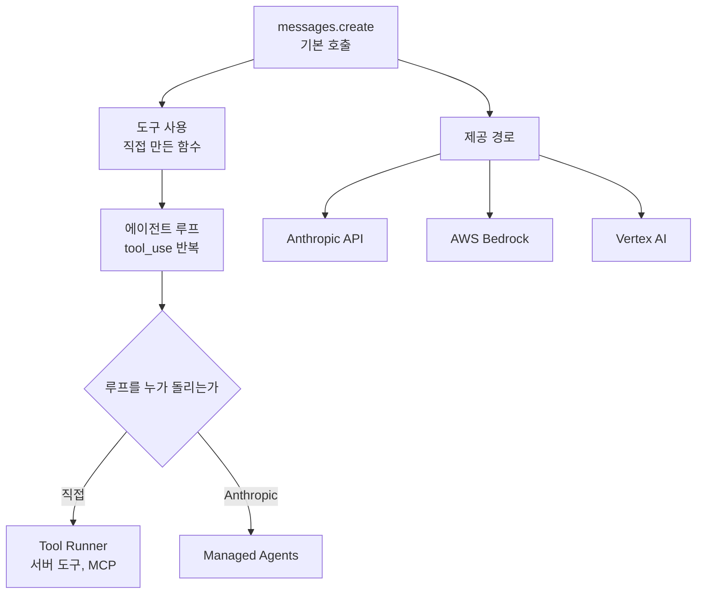

---

title: "[Claude Academy 2편] Claude Platform과 클라우드 제공자 (모델 선택, 에이전트 루프, Managed Agents, Bedrock, Vertex AI)"
date: 2026-10-29
categories: [AI, Claude]
tags: [AI, ClaudeAPI, ManagedAgents, Bedrock, VertexAI]
layout: post
toc: true
math: false
mermaid: true
series: claude-academy
series_order: 2

---

## 참고자료

- [Anthropic Academy - Building with the Claude API](https://anthropic.skilljar.com/claude-with-the-anthropic-api)
- Claude Academy 강좌: Claude Platform 101, Claude with Amazon Bedrock, Claude with Google Cloud's Vertex AI
- Claude Academy 튜토리얼: Choosing the right Claude model, What is Claude Managed Agents

---

## 배경

[AI 4편](/posts/claude-api-stateless-eval-tooluse/)에서 멀티턴 대화, `stop_reason`, 프롬프트 평가, Tool Use 형식, 프롬프트 캐싱(반복 프롬프트 처리 결과 재사용)을 정리했다. 이 글은 그 위에 얹는 내용이다. 모델을 고르는 기준, 에이전트 루프와 내장 도구, 워크플로우와 에이전트의 선택, Anthropic이 루프를 대신 돌려 주는 Managed Agents, 그리고 같은 모델을 AWS Bedrock과 Google Cloud Vertex AI에서 쓸 때 달라지는 점이다.

Bedrock과 Vertex AI 강좌는 직접 호출 API의 본 강좌와 레슨 구성이 거의 같다. 요청, 평가, 도구 사용, RAG(Retrieval-Augmented Generation, 문서 조각을 검색해 프롬프트에 넣는 방식), MCP(Model Context Protocol, AI 앱과 외부 도구를 잇는 표준 프로토콜) 순서이고, 달라지는 부분은 호출 클라이언트와 인증, 몇몇 한도뿐이다. 그래서 공통 부분은 한 번만 쓰고 차이를 표로 모았다.

정리하면서 확인하고 싶었던 것들이다.

- 플랫폼은 어떤 계층으로 이뤄지고, 모델은 무엇을 기준으로 고르는가?
- 에이전트 루프와 사고, 내장 도구는 어떻게 동작하는가?
- 워크플로우와 에이전트는 무엇으로 나누는가?
- Managed Agents는 무엇을 대신 해 주는가?
- Bedrock과 Vertex AI에서는 무엇이 달라지는가?
- RAG 파이프라인은 어떤 단계로 만들고 무엇을 보강하는가?
- 호출 기초와 Claude Code 연동에서 더 챙길 것은 무엇인가?

---

## 큰 그림

플랫폼은 프리미티브, 인프라, 컨트롤 세 계층이다. 기본 호출에서 시작해 도구와 루프를 붙이고, 그 루프를 직접 돌릴지 Anthropic에 맡길지, 어느 클라우드로 부를지를 고른다.

1절은 계층과 모델 선택, 2절은 루프와 도구, 3절은 워크플로우와 에이전트의 선택, 4절은 Managed Agents, 5절은 클라우드별 차이, 6절은 RAG, 7절은 호출 기초와 Claude Code 연동이다.

---

## 1. 플랫폼 계층과 모델 선택

첫 질문이다.

### 1.1 세 계층

Claude Platform은 REST API, SDK, CLI, 키와 사용량을 관리하는 콘솔이다. 강좌는 이를 만들고(프리미티브), 확장하고(인프라), 운영하는(컨트롤) 세 계층으로 나눈다. 첫 예시는 `messages.create` 한 번으로 헬프데스크 답변 초안 버튼을 붙이는 것이다. 키는 `platform.claude.com`에서 받는데 크레딧을 먼저 사야 하고, 클라이언트 코드에 두지 않고 서버를 거쳐 호출한다.

응답의 `content`는 문자열이 아니라 블록 배열이다. 텍스트, 도구 호출, 사고 블록이 섞일 수 있어서 항상 `type`을 확인하며 순회한다.

### 1.2 모델 선택

모델은 Haiku, Sonnet, Opus, Fable 네 계층이다. 영상은 앞의 세 가지를 중심으로 설명해서 요약과 표현이 다르다. 영상 쪽을 따라 세 계층을 기준으로 쓰고, Fable은 튜토리얼 기준으로 덧붙인다.

| 모델 | 맞는 작업 |
|---|---|
| Haiku 5.5 | 가장 빠르다. 짧은 답변, 요약, 정보 추출, 분류다. |
| Sonnet 5.5 | 기본 모델이다. 코딩, 글쓰기, 분석, 다단계 작업, 문서 생성이다. |
| Opus 5.5 | 오래 생각해야 하는 복잡한 추론이다. |
| Fable 5.1 | 가장 크다. 결과만 설명하면 단계를 계획하고 스스로 점검한다. 응답이 느리고 한도를 가장 많이 쓴다. |

고르는 방법은 **대표 예시 20~30개를 Haiku부터 돌려** 품질이 유지되면 멈추고, 부족하면 Sonnet, 필요할 때만 Opus로 올리는 것이다. `response.usage`로 토큰(Token, 언어 모델이 텍스트를 처리하는 단위)을 확인한다. 한 애플리케이션 안에서 작업별로 나눠도 된다. 강좌 사례는 분류는 Haiku, 고객 보고 초안은 Sonnet, 입찰 제안서 응답만 Opus로 나눴다. 새 모델이 나오면 한계가 있던 작업을 낮은 단계로 다시 시험해 비용을 줄일 수 있는지 본다.

단순 작업에 큰 모델을 쓰면 토큰만 더 쓰고 응답이 느려진다. 반대로 작은 모델 결과를 의심 없이 쓰면 빠뜨린 내용을 놓친다. 비교할 때는 답변 길이가 아니라 빠뜨린 내용을 본다.

---

## 2. 에이전트 루프, 사고, 내장 도구

두 번째 질문이다.

### 2.1 루프와 Tool Runner

에이전트는 Claude가 루프를 도는 구조다. 응답이 `tool_use`면 도구를 실행하고 결과를 돌려보내며, `end_turn`이면 끝낸다. 날씨 도구 예제는 API 호출 두 번과 도구 실행 한 번으로 끝난다. 실제 환경에서는 건축 보고서를 읽고 건축 법규를 도구로 조회해 위험 소견을 DB에 기록하는 준법 점검 에이전트가 같은 루프다.

도구는 개발자가 정의한 함수이고 실행은 코드가 맡는다. **도구 설명문이 모호한 것이 에이전트 오작동의 첫째 원인**이다. Tool Runner(베타)는 TypeScript, Python, Ruby SDK에 있고, `while` 루프와 스키마 직접 작성이 사라진다.

### 2.2 사고

적응형 사고는 `output_config`의 effort로 깊이를 조절한다. 단계는 low, medium, high, extra high, max이고 기본값은 high다. 다단계 논리와 절충 판단에는 유용하다. 단순 분류에는 지연과 비용만 늘린다. 강좌 요약은 Opus 5 기준이고 영상은 Opus 4.7 기준으로 설명해 두 설명이 다르다. 영상 쪽을 따랐지만 현재 모델에서의 기본값은 확인이 필요하다.

### 2.3 내장 도구, 스킬, MCP

| 구분 | 내용 |
|---|---|
| 서버 도구 | 웹 검색, 코드 실행, 웹 페치다. Anthropic이 서버에서 실행하므로 에이전트 루프가 필요 없고, 응답에 `server_tool_use` 같은 새 블록이 온다. |
| 클라이언트 도구 | 메모리와 bash다. 코드가 직접 실행한다. |
| 스킬 | `SKILL.md` 패키지를 한 번 올리고 `container.skills`로 요청에 붙인다. 코드 실행 도구와 함께 쓴다. 베타 헤더가 필요하다. |
| MCP | `mcp_servers`와 `mcp_toolset`으로 연결한다. 읽기 전용 도구만 허용하는 설정이 가능하다. |

역할 구분은 도구가 내부 시스템용, 스킬(작업 절차를 묶은 Claude Code 폴더)이 순서용, MCP가 제3자 서비스용이다. MCP를 쓰면 연동 유지보수를 서비스 제공자에게 넘긴다. 웹 검색으로 확인했다고 사실이라는 보장은 없어서 다시 확인한다. 직접 만든 MCP 서버와 클라이언트는 [AI 5편](/posts/mcp-server-client-transport/)에 있다.

### 2.4 컨텍스트 관리

컨텍스트 창(Context Window, 모델이 한 번에 보는 최대 토큰 수)이 차면 요청이 실패한다. 100만 토큰 창도 실제 에이전트에서는 빨리 찬다. 네 수단을 상황에 맞게 겹쳐 쓴다.

| 수단 | 내용 |
|---|---|
| 적시 로딩 | 필요한 시점에 필요한 정보만 넣는다. |
| 서버 측 압축 | `context_management`의 edits로 설정한다. |
| 프롬프트 캐싱 | 시스템 프롬프트 4,000토큰을 시간당 100번 호출하는 경우처럼 반복이 많을 때 효과가 크다. |
| 메모리 도구 | 대화 밖에 기록하고 필요할 때 읽는다. |

---

## 3. 워크플로우와 에이전트

세 번째 질문이다.

**단계를 미리 그릴 수 있으면 워크플로우, 과제가 불확실하면 에이전트**를 고른다. 워크플로우는 정확도, 예측 가능성, 테스트 용이성이 높다. 에이전트는 유연한 대신 성공률과 평가 용이성이 낮다. 강좌는 가능하면 워크플로우를 선택하라고 권한다.

| 패턴 | 내용 |
|---|---|
| 병렬화 | 큰 판단을 항목별 평가로 나눠 동시에 호출하고 결과를 모아 최종 판단한다. 항목별 프롬프트 개선이 쉽다. |
| 체이닝 | 순차 하위 작업으로 나누고 단계 사이에 일반 코드를 넣는다. 제약이 많은 긴 프롬프트는 초안 작성과 수정 요청 2단계로 나눈다. |
| 라우팅 | 요청을 범주로 분류하고 범주별 전문 프롬프트 한 곳으로만 보낸다. |
| 평가자-최적화 | 생성자와 채점자가 반복한다. |

에이전트에는 bash, read, write, edit, glob, grep처럼 추상적이고 조합 가능한 도구가 효과적이다. 행동 결과를 관찰할 수단도 줘야 한다. 수정 전 파일 읽기, UI 조작 후 스크린샷 같은 점검 수단이다.

RAG는 6절에 따로 정리했다.

---

## 4. Managed Agents

네 번째 질문이다.

Managed Agents는 Anthropic 인프라에서 에이전트 루프를 호스팅하는 API 모음이다. 구성은 Agent, Environment, Session, Event 네 요소다. Environment는 패키지와 네트워크 제어를 설정한 샌드박스이고, Claude는 파일 시스템과 bash, 웹 검색이 되는 격리된 컨테이너에서 일한다.

| 예시 | 동작 |
|---|---|
| 칸반 연동 | 티켓을 In progress로 옮기면 세션이 자동 시작된다. 결과 기준(rubric)은 Lighthouse 점수 90 초과, 렌더링 차단 리소스 없음이다. 별도 컨텍스트의 평가자가 채점해 미달분을 고치고 다시 낸다. |
| 가격 리서치 | 메모리 저장소 덕에 지난주 결과와 비교한 변화를 보고서에 담는다. |
| 장애 대응 | 알림 페이로드를 사용자 정의 도구 결과로 넣으면 조율 에이전트가 전문가 에이전트 셋에 위임하고 하나로 종합한다. Slack 게시 전에는 권한 정책이 승인을 요구한다. |

첫 에이전트를 만들 때는 **이벤트 스트림을 킥오프 메시지보다 먼저** 열어야 이벤트를 놓치지 않는다. 완료 신호는 `session.status_idle`이다. 결과 기준, 다중 에이전트 조율, 메모리는 베타이고 모든 API 계정에 기본으로 켜져 있다.

대가는 제어권이다. 루프를 Anthropic이 돌리므로 루프 중간의 세밀한 제어가 필요하면 Tool Runner나 직접 구현이 맞다. 파일 정리 같은 장시간 작업에는 Managed Agents가 알맞다. 장애 대응 사례는 [AI 12편](/posts/rca-diagnosis-review-agents/)과 비교해 볼 만하다.

---

## 5. Bedrock과 Vertex AI의 차이

다섯 번째 질문이다.

| 항목 | Anthropic API | AWS Bedrock | Vertex AI |
|---|---|---|---|
| 클라이언트 | `anthropic` | boto3 `bedrock-runtime`의 `converse` | `AnthropicVertex` |
| 모델 활성화 | 콘솔 | 모델 ID, 리전별 차이는 추론 프로필 ID | Model Garden |
| 인증 | API 키 | AWS 자격 증명 | `gcloud auth application-default login` |
| 캐시 중단점 | `cache_control` | `cachePoint`, 최소 1,024토큰 | `cache_control`, 최소 1,024토큰 |
| 임베딩 | VoyageAI 권장 | `amazon.titan-embed-text-v2:0`(1,024차원) | `text-embedding-005` |
| 이미지 한도 | 요청당 100개, 이미지당 5MB | 요청당 20장, 3.75MB, 한 변 8,000px | 문서에 없음 |
| 도구 선택 | `tool_choice` | `toolChoice`의 auto, any, 도구 이름 지정 | `tool_choice` |

Anthropic은 임베딩 모델을 제공하지 않는다. 그래서 어느 경로든 임베딩은 외부 모델을 쓴다. Bedrock은 `system`에 빈 문자열을 못 넣고 대화 중간에 system 메시지를 넣는 방식도 지원하지 않는다. 시스템 프롬프트와 도구 정의는 바뀌는 일이 드물어 캐시 효과가 크지만, 한 글자만 바뀌어도 무효화된다.

세 경로의 호출 개념은 같다. 달라지는 부분은 인증, 모델 식별자, 한도, 기능 지원 시점이다. 기능 지원은 경로마다 다를 수 있어서 쓰려는 기능이 해당 경로에 있는지 문서로 확인해야 한다. 이 글의 표는 강좌 예제 기준이며 최신 한도를 보증하지 않는다. Bedrock 예제는 Haiku 4.5와 boto3 기준이다.

---

## 6. RAG 파이프라인

여섯 번째 질문이다.

긴 문서를 프롬프트에 통째로 넣으면 토큰 한도, 성능 저하, 비용, 지연 문제가 생긴다. RAG(Retrieval-Augmented Generation)는 문서를 조각(청크, chunk)으로 나누고 질문과 관련된 조각만 프롬프트에 넣어 이를 푼다. 대가는 전처리와 검색 로직을 직접 만들어야 한다는 점이다. 개념 설명은 [AI 3편](/posts/ai-engineering-rag-agent-memory/)에도 있고, 여기서는 세 강좌(API, Bedrock, Vertex AI)에 공통으로 나오는 구현 순서를 정리한다.

### 6.1 기본 흐름

1. 문서를 청크로 나눈다.
2. 각 청크를 임베딩(텍스트 의미를 -1에서 1 사이 숫자 목록으로 나타낸 값, 각 숫자의 의미는 해석할 수 없다)으로 바꾼다.
3. 임베딩과 원문을 함께 벡터 데이터베이스에 저장한다. 원문을 같이 저장해야 검색 결과를 프롬프트에 쓸 수 있다.
4. 질문을 임베딩하고 코사인 유사도(두 벡터가 가리키는 방향이 얼마나 가까운지를 보는 값)로 가까운 청크를 찾는다.
5. 찾은 청크로 최종 프롬프트를 만든다.

Anthropic은 임베딩 모델을 제공하지 않는다. API 강좌는 VoyageAI를, Bedrock 강좌는 `amazon.titan-embed-text-v2:0`(1,024개 숫자)을, Vertex 강좌는 `text-embedding-005`를 쓴다.

### 6.2 청킹 방식

| 방식 | 내용 |
|---|---|
| 크기 기반 | 글자 수로 자른다. 겹침(overlap)을 더한 방식이 모든 문서에 통하는 기본 선택이다. |
| 구조 기반 | 섹션 단위로 자른다. 정돈된 문서용이다. |
| 의미 기반 | 의미가 바뀌는 지점에서 자른다. |
| 문장 기반 | 문장 단위로 자른다. 산문용이다. |

### 6.3 검색 보강

의미 검색은 `INC-2023-Q4-011` 같은 정확한 용어를 놓칠 수 있다. BM25(단어 일치와 희귀도로 점수를 매기는 어휘 검색)는 드문 용어에 높은 가중치를 주어 정확한 일치를 찾는다. 두 검색을 모두 쓰려면 Retriever가 벡터 인덱스와 BM25 인덱스에 질의하고 결과를 합친다. 합치는 방법이 RRF(Reciprocal Rank Fusion, 각 시스템에서의 순위 역수를 더해 점수를 매기는 방식)다. 같은 인터페이스를 따르면 새 인덱스도 추가할 수 있다.

합친 결과를 Claude에 넘겨 관련도 순으로 다시 정렬하는 재순위화(reranking)도 있다. 문서 ID만 반환시켜 응답 시간을 줄이고, 지연이 늘어나는 단점은 감수한다. 문맥 검색(contextual retrieval)은 각 청크에 문서 내 위치를 설명하는 문구를 Claude로 생성해 앞에 붙여 저장한다. 문서가 크면 앞부분 청크와 직전 청크만 맥락으로 준다. 청크 수만큼 호출이 늘어나므로 색인 비용이 커진다.

### 6.4 대가

재순위화와 문맥 검색은 정확도를 올리는 대신 지연과 비용을 더한다. 평가 세트로 효과를 확인한 뒤에 적용한다. 이미지, PDF, 인용 같은 입력 형식은 [AI 4편](/posts/claude-api-stateless-eval-tooluse/)의 보완 절에 있다.

---

## 7. 보완: 호출 기초와 Claude Code 연동

일곱 번째 질문이다.

직접 호출의 기초는 AI 4편에 있고, 여기서는 3개 강좌에 공통으로 나오는 나머지 항목을 모았다.

### 7.1 호출 기초

- 사용자 요청은 서버, API, 모델, 응답 순으로 흐른다. API 키 노출을 막으려면 반드시 서버를 거친다.
- 모델은 토큰화, 임베딩, 맥락화, 생성 단계를 거치고 최대 토큰, 종료 토큰, 정지 시퀀스에서 멈춘다.
- 키는 콘솔에서 Create Key로 만들며 한 번만 표시되므로 복사해 보관한다. `.env.local`에 두고 SDK를 설치한 뒤 `model`, `max_tokens`, `messages` 세 값으로 호출한다.
- 도구 스키마는 `name`, `description`, `input_schema`로 구성하고 Claude에게 작성을 맡길 수 있다. 응답의 `ToolUse` 블록을 처리하고 `tool_use_id`를 맞춘 `tool_result`를 사용자 메시지로 보낸다. 오류는 `is_error`로 전달한다.
- 세밀한 도구 호출(fine-grained tool calling)은 스트리밍 중 `input_json` 이벤트로 인자 조각을 받는다. API는 기본으로 JSON 유효성을 확인한 뒤 한꺼번에 보내는데, 이 확인을 끄면 지연이 줄지만 잘못된 JSON 처리를 앱이 맡는다.
- Vertex AI의 확장 사고는 사고 토큰에도 비용이 붙고, thinking 블록의 서명과 암호화된 redacted thinking을 다룬다. `budget_tokens`는 최소 1,024이고 `max_tokens`보다 작아야 한다.

### 7.2 Claude Code와의 연동

- API 코드를 Claude Code에 맡길 때는 스텁 파일을 넘기고 프롬프트에 파일, 패턴, 완료 상태를 명시한 뒤 결과 diff를 확인한다. TypeScript SDK를 쓰면 내장 스킬 `/claude-api`가 자동 호출되고, 보이지 않으면 `/plugin marketplace`로 `anthropics/skills`를 추가한다.
- MCP 서버는 `claude mcp add`로 등록한다. 강좌 예시는 Sentry, Playwright, Figma, Jira와 Confluence, Slack 서버를 조합한 개발 흐름이다.
- 병렬 실행은 git worktree로 인스턴스마다 작업 공간을 분리해 파일 충돌을 막고, `.claude/commands`의 `$ARGUMENTS` 커맨드로 생성과 병합을 자동화한다(Bedrock 강좌).
- 자동 디버깅 사례는 GitHub Action이 매일 CloudWatch 로그 24시간치를 가져와 Claude가 오류를 분석하고 수정한 뒤 PR을 연다. 예제에서는 운영 환경의 잘못된 모델 ID를 고쳤다(Bedrock 강좌).
- 컴퓨터 사용(computer use)은 Claude가 스크린샷, 클릭, 입력으로 데스크톱을 조작한다. 일반 도구 사용과 같은 구조이고 도구가 마우스와 키보드 동작을 실행하며, 참조 구현은 Docker 컨테이너의 Firefox다. 자동완성 컴포넌트 QA에서 세 번째 케이스 실패를 찾아냈다.

에이전트의 특성은 네 가지다. 관찰한 뒤 행동하는 패턴을 보이고, 소수의 단순 도구를 반복 실행하고, 환경 맥락을 도구로 수집하고, 오류 비용이 낮은 고가치 작업에 적합하며 평가로 계속 개선한다.

---

## 내 자산에 적용

점검 대상은 API나 SDK로 만든 에이전트, 도구 정의, 알림 연동 스크립트다.

| 점검 | 개선 |
|---|---|
| 단계가 고정된 작업을 에이전트로 돌리는가? | 병렬화, 체이닝, 라우팅 워크플로우로 바꿔 정확도와 테스트 용이성을 올린다. |
| 도구 설명이 모호한가? | 도구 이름, 입력 검증, 오류 메시지, 설명문을 구체적으로 다시 쓴다. 오작동의 첫째 원인으로 지목된 부분이다. |
| 모든 호출을 큰 모델로 보내는가? | 대표 예시 20~30개를 Haiku부터 돌려 작업별로 나눈다. `response.usage`로 토큰을 측정한다. |
| 바뀌지 않는 시스템 프롬프트와 도구 정의가 매번 처리되는가? | 마지막 도구와 시스템 블록에 캐시 중단점을 단다. 1,024토큰 최소 길이와 5분 수명을 고려한다. |
| 컨텍스트가 차서 요청이 실패하는 구간이 있는가? | 서버 측 압축, 적시 로딩, 메모리 도구를 적용한다. |
| 행동 결과를 관찰할 수단이 없는가? | 수정 전 파일 읽기, UI 조작 후 스크린샷 같은 점검 도구를 준다. |
| 장시간 에이전트의 루프를 직접 유지하는가? | 파일 정리 같은 장시간 작업은 Managed Agents를 검토하되, 루프 중간 제어가 필요하면 현행 유지한다. |
| RAG 청크가 문서 구조와 맞지 않는가? | 겹침을 더한 크기 기반을 기본으로 두고, 정확한 용어를 놓치면 BM25와 RRF를 더한다. |
| 클라우드 경로가 정해져 있는가? | 쓰려는 기능이 해당 경로(Bedrock, Vertex AI)에 있는지 문서로 확인한다. 캐시 키워드와 한도가 다르다. |

연습할 것은 모델 이름이 아니라 평가 결과로 모델을 고르는 습관이다. 새 모델이 나오면 한계가 있던 작업을 낮은 effort로 다시 돌려 비용을 줄일 수 있는지 본다.

전수 점검의 순서와 지시문은 [11편](/posts/claude-academy-improvement-guide/)에 있다.

---

## 정리하며

처음 던진 질문들에 대한 답이다.

**계층과 모델 선택.** 프리미티브, 인프라, 컨트롤 세 계층이다. 모델은 예시 20~30개를 Haiku부터 돌려 필요한 만큼만 올린다.

**루프, 사고, 내장 도구.** 응답이 `tool_use`면 실행하고 `end_turn`이면 끝낸다. 서버 도구는 루프가 필요 없고, 사고는 단순 분류에는 비용만 늘린다.

**워크플로우와 에이전트.** 단계를 그릴 수 있으면 워크플로우다. 불확실한 과제만 에이전트로 가고, 관찰 수단을 같이 준다.

**Managed Agents.** 루프, 샌드박스, 메모리, 결과 기준을 Anthropic이 맡는다. 대신 루프 중간 제어는 줄어든다.

**클라우드별 차이.** 개념은 같고 인증, 모델 식별자, 캐시 키워드, 한도가 다르다.

**RAG.** 청킹, 임베딩, 벡터 저장, 유사도 검색 순이고, 어휘 검색(BM25)과 순위 결합(RRF), 재순위화, 문맥 검색으로 보강한다. 보강할수록 지연과 비용이 늘어난다.

**호출 기초와 Claude Code 연동.** 키는 서버에서만 쓰고 도구 결과는 `tool_use_id`로 맞춘다. Claude Code 쪽은 worktree 병렬 실행, 자동 디버깅 Action, 컴퓨터 사용이 이어진다.

정리하고 나서 가장 크게 바뀐 인식은 **모델 선택이 이름이 아니라 평가 결과로 정해진다**는 점이었다. 그래서 새 모델이 나오면 먼저 대표 예시를 낮은 단계에서 다시 돌린다.
