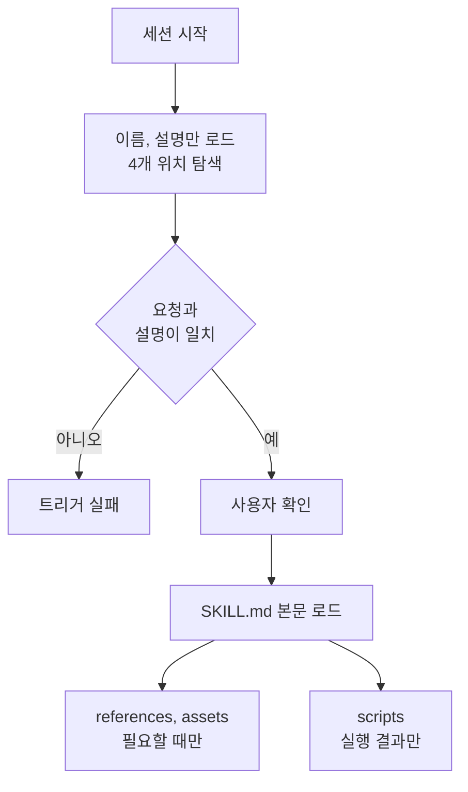

---

title: "[Claude Academy 5편] Agent Skills 작성, 구성, 공유, 문제 해결"
date: 2026-10-29
categories: [AI, Claude]
tags: [AI, ClaudeCode, Skills, Plugin]
layout: post
toc: true
math: false
mermaid: true
series: claude-academy
series_order: 5

---

## 참고자료

- [Anthropic Academy - Introduction to Agent Skills](https://anthropic.skilljar.com/introduction-to-agent-skills)
- [Claude Code Docs - Skills](https://code.claude.com/docs/en/skills)
- Claude Academy 튜토리얼: What are skills, Creating your first skill, Configuration and multi-file skills, How skills compare to other Claude Code features, Sharing skills, Troubleshooting skills
- Claude Academy 튜토리얼: Teach Claude your way of working using skills, How to create a skill with Claude through conversation

---

## 배경

[AI 6편](/posts/claude-code-tool-loop-hooks/)에서 스킬을 `CLAUDE.md`와 비교하는 정도로만 다뤘다. 스킬은 직접 만들기 시작하면 이름 충돌, 트리거 실패, 서브에이전트와의 연결 같은 문제를 만난다. Agent Skills 강좌와 스킬 튜토리얼 8편은 이 부분을 작성, 구성, 공유, 문제 해결 순서로 다룬다.

**스킬은 Claude Code만의 기능이 아니다.** claude.ai의 대화에서도 같은 형태의 스킬을 만들고 쓸 수 있어서, 두 환경의 차이도 같이 본다.

정리하면서 확인하고 싶었던 것들이다.

- 스킬은 언제 어떻게 로드되고, 어디에 두는가?
- `SKILL.md`의 필드와 파일 구성은 어떻게 하는가?
- 스킬, `CLAUDE.md`, 서브에이전트, 훅, MCP는 어떻게 나누는가?
- 스킬을 어떻게 공유하고 서브에이전트에 연결하는가?
- 스킬이 동작하지 않을 때 무엇부터 확인하는가?
- claude.ai 대화에서는 스킬을 어떻게 만들고 쓰는가?

---

## 큰 그림

스킬은 지침이 든 폴더다. 시작할 때는 이름과 설명만 읽고, 요청이 설명과 맞을 때만 본문과 보조 파일을 읽는다. 그래서 문제도 이 순서를 따라 생긴다. 찾지 못하거나, 읽지 못하거나, 다른 스킬에 가려지거나, 실행 중에 실패한다.



1절은 정의와 위치, 2절은 필드와 파일 구성, 3절은 다른 기능과의 역할 구분, 4절은 공유, 5절은 문제 해결, 6절은 claude.ai에서 쓰는 방법이다.

---

## 1. 스킬의 정의와 위치

첫 질문이다.

### 1.1 해결하는 문제

코딩 표준, PR 리뷰 피드백 구조, 커밋 메시지 형식을 매번 다시 설명하고 있다면 스킬로 만들 대상이다. 스킬은 이 지침을 `SKILL.md`에 한 번 적어 두고, Claude가 관련 요청에서 자동으로 읽게 한다.

`CLAUDE.md`는 모든 대화에 로드되고, 스킬은 요청과 일치할 때만 로드된다. 평소에는 이름과 설명만 읽으므로 컨텍스트 창을 채우지 않는다. 슬래시 명령은 직접 입력해야 하지만 스킬은 Claude가 상황을 알아보고 적용한다.

### 1.2 위치와 우선순위

| 범위 | 위치 | 용도 |
|---|---|---|
| 개인 | `~/.claude/skills` | 모든 프로젝트에서 쓰는 커밋 스타일, 문서 형식이다. |
| 프로젝트 | 저장소의 `.claude/skills` | clone한 사람이 자동으로 받는 팀 표준이다. |
| Enterprise | 관리 설정으로 배포 | 조직 의무 표준이다. |
| 플러그인 | 설치된 플러그인 | 이름공간이 분리된다. |

시작할 때 Enterprise, 개인, 프로젝트, 플러그인 네 위치를 훑는다. 같은 이름이면 Enterprise, 개인, 프로젝트 순으로 우선한다. 만든 뒤에는 세션을 다시 시작해야 목록에 보인다. 수정은 `SKILL.md`를 고치고, 삭제는 디렉터리를 지우며, 둘 다 재시작이 필요하다.

### 1.3 첫 스킬

예시는 PR 설명을 항상 같은 형식으로 쓰게 하는 스킬이다. `~/.claude/skills/pr-description/SKILL.md`를 만든다.

```markdown
---
name: pr-description
description: PR 설명을 작성할 때 사용한다. 변경 요약, 테스트 방법, 롤백 방법을 고정 형식으로 쓴다.
---

diff를 읽고 아래 순서로 PR 설명을 쓴다.
1. 변경 요약 (3줄 이하)
2. 테스트 방법
3. 롤백 방법
```

브랜치를 바꾼 뒤 PR 설명을 요청하면 스킬 사용을 표시하고 diff를 읽어 템플릿대로 쓴다. 요청과 `description`의 의도가 겹치면 사용 전에 확인을 구한다. 어떤 컨텍스트를 쓰는지 사용자가 알게 하려는 단계다.

---

## 2. 필드와 파일 구성

두 번째 질문이다.

### 2.1 프론트매터 필드

| 필드 | 규칙 |
|---|---|
| `name` | 필수다. 소문자, 숫자, 하이픈만 쓰고 64자 이하이며 디렉터리 이름과 일치한다. |
| `description` | 필수다. 최대 1,024자이고 매칭의 주요 기준이다. |
| `allowed-tools` | 스킬이 활성인 동안 승인 없이 쓸 도구를 정한다. 생략하면 제한이 없고 기본 권한 모델을 따른다. |
| `model` | 스킬에 쓸 모델을 지정한다. |

`description`은 **무엇을 하는지와 언제 쓰는지를 함께** 적는다. 매칭은 의미 기반이라서 사용자가 실제로 쓰는 표현이 들어가야 한다. 이름은 `review`보다 `frontend-review`처럼 구체적으로 지어 충돌을 피한다. `allowed-tools`는 읽기 전용 워크플로나 보안에 민감한 작업에 알맞다.

### 2.2 점진적 공개

스킬은 대화와 컨텍스트 창을 공유한다. 그래서 점진적 공개(progressive disclosure, 처음에는 핵심만 보이고 필요할 때 세부를 여는 방식)로 설계한다. `SKILL.md`에는 핵심 지침만 두고 500줄 안쪽으로 유지한다.

| 폴더 | 내용 |
|---|---|
| `scripts` | 실행 코드다. 내용을 읽지 않고 실행하므로 출력만 토큰을 쓴다. |
| `references` | 추가 문서다. 링크된 파일은 필요할 때만 읽힌다. |
| `assets` | 이미지, 템플릿이다. |

스크립트는 환경 확인이나 일관된 데이터 변환처럼 테스트된 코드가 나은 작업에 맞는다. 읽으라고 쓰지 말고 **실행하라고 지시**해야 출력만 컨텍스트에 들어간다.

### 2.3 대가

본문이 길어질수록 로드될 때 컨텍스트를 많이 쓴다. 보조 파일로 나누면 `SKILL.md`에서 링크가 끊기거나 경로가 틀릴 수 있어서 검증이 필요하다.

---

## 3. 다른 기능과의 역할 구분

세 번째 질문이다.

| 기능 | 반응하는 대상 | 맡는 일 |
|---|---|---|
| `CLAUDE.md` | 항상 로드된다. | 프로젝트 전체 표준이다. 예는 TypeScript strict 모드, 스키마 수정 금지다. |
| 스킬 | 요청에 반응한다. | PR 리뷰 체크리스트처럼 가끔 필요한 작업별 지식이다. 현재 대화에 지식이 더해진다. |
| 서브에이전트 | 위임에 반응한다. | 별도 컨텍스트에서 작업하고 결과만 돌려준다. 다른 도구 접근이 필요하거나 격리하려는 경우다. |
| 훅 | 이벤트에 반응한다. | 파일 저장 시 린터 실행, 도구 호출 전 입력 확인이다. |
| MCP | 연결에 반응한다. | 외부 도구를 제공한다. |

**한 기능에 모두 넣지 않는다.** 항상 적용할 표준은 `CLAUDE.md`, 작업별 전문 지식은 스킬, 자동 작업은 훅으로 나눈다. **스킬은 기존 컨텍스트에 합류하고 서브에이전트는 격리된다**는 점이 두 기능의 가장 큰 차이다.

---

## 4. 공유

네 번째 질문이다.

| 방법 | 내용 | 맞는 경우 |
|---|---|---|
| 저장소 커밋 | `.claude/skills`에 두면 clone과 pull로 받는다. | 팀 코딩 표준, 프로젝트 전용 워크플로다. |
| 플러그인 | 플러그인 프로젝트의 `skills` 디렉터리에 두고 마켓플레이스로 배포한다. | 프로젝트 의존이 적은 스킬이다. |
| 관리 설정 | 관리자가 managed settings로 배포한다. Enterprise 스킬이 가장 우선한다. | 보안, 규정 대응 같은 의무 표준이다. |

서브에이전트는 새 컨텍스트로 시작하므로 스킬을 자동으로 보지 못한다. `.claude/agents`의 에이전트 파일에 `skills` 필드로 목록을 적으면 시작할 때 로드된다. 메인 대화처럼 필요할 때 로드되지 않으므로 **서브에이전트의 목적에 항상 관련된 스킬만** 적는다. 내장 서브에이전트(explore, plan, verify)는 스킬에 접근할 수 없고, 직접 만든 서브에이전트만 쓸 수 있다. 프런트엔드 리뷰어와 백엔드 리뷰어처럼 서브에이전트별로 다른 스킬을 줄 수 있다.

반드시 지켜야 하는 조직 표준만 관리 설정으로 배포한다. 모든 스킬을 Enterprise로 올리면 개인 스킬이 이름 충돌로 가려진다.

---

## 5. 문제 해결

다섯 번째 질문이다.

먼저 스킬 구조를 검증 도구(agent skills validator, uv로 설치를 권장)로 확인하고, 로드 오류는 `claude --debug`에서 스킬 이름이 언급된 메시지를 찾는다. 강좌 요약에는 `claude plugin validate`가 나오고 영상은 별도 검증 도구를 uv로 설치하라고 안내한다. 두 설명이 달라서 사용 중인 버전에서 어느 쪽이 되는지는 **확인이 필요하다.**

| 증상 | 원인과 조치 |
|---|---|
| 트리거되지 않는다. | `description`에 사용자가 실제로 쓰는 표현을 추가한다. "이 코드 프로파일링해 줘", "왜 느려", "더 빠르게 해 줘" 같은 변형으로 시험한다. |
| 목록에 안 보인다. | `SKILL.md`가 이름 있는 디렉터리 안에 있어야 한다. skills 루트에 두면 안 되고 파일명은 대문자 `SKILL`, 소문자 `md`다. |
| 엉뚱한 스킬이 쓰인다. | `description`이 서로 비슷하다. 구체적으로 구분한다. |
| 이름 충돌로 무시된다. | 같은 이름의 Enterprise 스킬이 개인 스킬을 항상 덮어쓴다. 이름을 바꾸거나 관리자와 상의한다. |
| 플러그인 스킬이 안 보인다. | 캐시를 지우고 재시작한 뒤 재설치한다. 그래도 안 되면 플러그인 구조를 검증 도구로 확인한다. |
| 실행 중에 실패한다. | 외부 패키지 설치, 스크립트 실행 권한(`chmod +x`), 경로 구분자를 본다. Windows에서도 슬래시를 쓴다. 필요한 패키지는 `description`에 적는다. |

---

## 6. claude.ai에서 스킬 쓰기

여섯 번째 질문이다.

스킬은 대화 환경에서도 같은 형태로 쓴다. 쓰려면 Code execution and file creation 설정을 켠다. Free, Pro, Max는 Settings, Capabilities에서, Team과 Enterprise는 소유자가 조직 설정에서 관리한다.

비개발자가 파일을 직접 쓰지 않아도 대화로 만든다. 네 단계다.

- 새 채팅에서 만들고 싶은 스킬을 말하고 템플릿, 우수 사례, 브랜드 가이드, 데이터 파일을 올린다.
- Claude가 사용 예시와 좋은 결과의 기준을 묻는다. 숙련됐지만 처음 보는 사람이 따라 할 수 있을 만큼 설명한다.
- Claude가 skill-creator 스킬을 읽고 `SKILL.md`를 만들고, 자료를 정리하고, 반복돼야 하는 작업은 스크립트로 묶는다.
- Settings, Capabilities, Skills에서 켜고, 작업을 설명해 "Using [skill name]"이 표시되는지 확인한다. 어긋나면 같은 대화에서 수정을 요청한다.

Projects와의 차이는 범위다. Projects는 시간이 지나며 맥락이 쌓이는 작업에 쓰고 해당 프로젝트 안에서만 유효하다. 스킬은 일반 대화와 프로젝트 안을 가리지 않는다. 사용자 지정 지침은 모든 작업에 적용되는 일반 선호이고, 스킬은 분량이 큰 지침과 참고 자료를 담아 관련 작업에서만 활성화된다.

스킬이 어울리는 경우는 세 가지다. 경험으로 다듬은 방식이 있는 경우, 품질에 지정 자료가 필요한 경우, 준비에 여러 요소가 필요한 경우다. 일회성 작업은 일반 프롬프트로 충분하다. 시험은 새 대화에서 평소처럼 요청하고, 생각 과정에 스킬 이름이 뜨는지와 결과가 붙여 넣은 예시와 같은 구조와 어조인지 본다. 형식을 명시하고, 어조를 지정하고, 만족한 실제 결과물 하나를 붙이는 세 가지가 품질을 좌우한다.

---

## 정리하며

처음 던진 질문들에 대한 답이다.

**로드와 위치.** 시작할 때 네 위치에서 이름과 설명만 읽고, 요청과 의미가 겹치면 확인을 거쳐 본문을 읽는다. 개인은 `~/.claude/skills`, 프로젝트는 `.claude/skills`에 둔다.

**필드와 파일 구성.** `name`과 `description`이 필수이고 `description`이 매칭을 정한다. `SKILL.md`는 500줄 안쪽으로 두고 `scripts`, `references`, `assets`로 나눈다.

**기능 구분.** 항상 적용할 규칙은 `CLAUDE.md`, 작업별 지식은 스킬, 격리는 서브에이전트, 이벤트 동작은 훅, 외부 연결은 MCP다.

**공유와 연결.** 저장소 커밋, 플러그인, 관리 설정 세 가지이고, 서브에이전트에는 `skills` 필드로 명시해야 한다.

**문제 해결.** 트리거, 로드, 우선순위, 실행 네 범주로 나눠서 보고, 원인은 대개 `description`이다.

**claude.ai에서의 사용.** Code execution 설정을 켜고 대화로 만든다. Projects와 달리 일반 대화와 프로젝트 안을 가리지 않는다.

정리하고 나서 가장 크게 바뀐 인식은 **스킬의 품질이 본문보다 한 줄짜리 `description`에서 갈린다**는 점이었다. 그래서 스킬을 만들면 요청 표현을 바꿔 가며 트리거 시험부터 한다.
