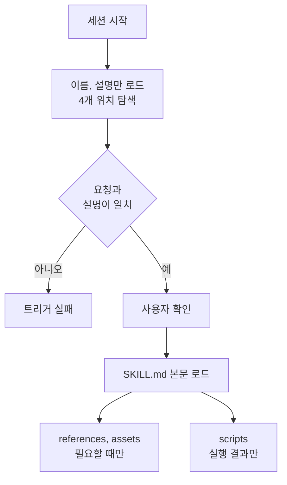

---

title: "[Claude Academy 5편] Agent Skills 작성, 구성, 공유, 문제 해결"
date: 2026-10-29
categories: [AI, Claude]
tags: [AI, ClaudeCode, Skills, Plugin]
layout: post
toc: true
math: false
mermaid: true
series: claude-academy
series_order: 5

---

## 참고자료

- [Anthropic Academy - Introduction to Agent Skills](https://anthropic.skilljar.com/introduction-to-agent-skills)
- [Claude Code Docs - Skills](https://code.claude.com/docs/en/skills)
- Claude Academy 튜토리얼: What are skills, Creating your first skill, Configuration and multi-file skills, How skills compare to other Claude Code features, Sharing skills, Troubleshooting skills
- Claude Academy 튜토리얼: Teach Claude your way of working using skills, How to create a skill with Claude through conversation
- Claude Academy 튜토리얼: How to use the FHIR Developer agent skill with Claude Code
- 수집 기준: Claude Academy 엔지니어링 목록의 2026-10-21 수집본이다. 베타와 미리보기 표기, 요금제 조건, 모델 이름은 이후 바뀔 수 있다.

---

## 배경

[AI 6편](/posts/claude-code-tool-loop-hooks/)에서 스킬(작업 절차를 묶은 Claude Code 폴더)을 `CLAUDE.md`와 비교하는 정도로만 다뤘다. 스킬은 직접 만들기 시작하면 이름 충돌, 트리거 실패, 서브에이전트(별도 컨텍스트에서 일을 맡는 보조 에이전트)와의 연결 같은 문제를 만난다.

Agent Skills 강좌와 스킬 튜토리얼 9편은 이 부분을 첫 스킬 작성, 설정과 다중 파일 구성, 다른 기능과의 비교, 공유, 문제 해결 순서로 다룬다.

튜토리얼 두 편은 claude.ai의 대화에서 스킬을 만들고 쓰는 방법을 다뤄서 함께 정리한다. 원문은 이 스킬이 Claude Code 스킬과 같은 형태인지 말하지 않으며, 확인이 필요하다.

정리하면서 확인하고 싶었던 것들이다.

- 스킬은 언제 어떻게 로드되고, 어디에 두는가?
- `SKILL.md`의 필드와 파일 구성은 어떻게 하는가?
- 스킬, `CLAUDE.md`, 서브에이전트, 훅(Hook, 정해진 시점에 자동 실행되는 셸 명령), MCP(Model Context Protocol, AI 앱과 외부 도구를 잇는 표준 프로토콜)는 어떻게 나누는가?
- 스킬을 어떻게 공유하고 서브에이전트에 연결하는가?
- 스킬이 동작하지 않을 때 무엇부터 확인하는가?
- claude.ai 대화에서는 스킬을 어떻게 만들고 쓰는가?

---

## 큰 그림

스킬은 지침이 든 폴더다. 시작할 때는 **이름과 설명만 읽고**, 요청이 설명과 맞을 때만 본문과 보조 파일을 읽는다.

그래서 문제도 이 순서를 따라 생긴다. 찾지 못하거나, 읽지 못하거나, 다른 스킬에 가려지거나, 실행 중에 실패한다.



1절은 정의와 위치, 2절은 필드와 파일 구성, 3절은 다른 기능과의 역할 구분, 4절은 공유, 5절은 문제 해결과 도메인 스킬 사례(FHIR), 6절은 claude.ai에서 쓰는 방법이다.

---

## 1. 스킬의 정의와 위치

첫 질문이다.

### 1.1 해결하는 문제

스킬은 Claude에 작업 방법을 한 번 가르치는 마크다운 파일이고, 지침, 스크립트, 리소스를 담은 폴더다. Claude는 사용자 요청을 사용 가능한 스킬의 `description`과 비교해 일치하는 스킬을 활성화한다.

같은 설명을 매번 프롬프트에 붙이는 일을 없애고 팀 표준을 일관되게 적용하는 것이 목적이다. 팀 코드 리뷰 기준, 선호 커밋 형식, 조직 브랜드 가이드라인처럼 작업별로 쓰는 전문 지식이 알맞다.

코딩 표준, PR 리뷰 피드백 구조, 커밋 메시지 형식을 매번 다시 설명하고 있다면 스킬로 만들 대상이다. 스킬은 이 지침을 `SKILL.md`에 한 번 적어 두고, Claude가 관련 요청에서 자동으로 읽게 한다.

`CLAUDE.md`는 모든 대화에 로드되고, **스킬은 요청과 일치할 때만** 로드된다. 평소에는 이름과 설명만 읽으므로 컨텍스트 창(Context Window, 모델이 한 번에 보는 최대 토큰 수)을 채우지 않는다. 슬래시 명령은 직접 입력해야 하지만 스킬은 Claude가 상황을 알아보고 적용한다.

### 1.2 위치와 우선순위

| 범위 | 위치 | 용도 |
|---|---|---|
| 개인 | 홈 디렉터리의 `~/.claude/skills` | 모든 프로젝트에서 쓰는 커밋 스타일, 문서 형식 같은 개인 선호다. |
| 프로젝트 | 저장소 루트의 `.claude/skills` | clone한 사람이 자동으로 받는 팀 표준이다. 예는 브랜드 가이드라인이다. |
| Enterprise | 관리 설정으로 배포 | 조직 의무 표준이다. |
| 플러그인 | 설치된 플러그인 | 이름공간이 분리된다. |

시작할 때 Enterprise, 개인, 프로젝트, 플러그인 네 위치를 훑는다. 같은 이름이면 **Enterprise, 개인, 프로젝트 순**으로 우선한다.

만든 뒤에는 **세션을 다시 시작**해야 목록에 보인다.

수정은 `SKILL.md`를 고치고, 삭제는 디렉터리를 지우며, 둘 다 재시작이 필요하다.

첫 스킬 튜토리얼 요약은 우선순위를 enterprise, personal, project, plugins 순으로 적었다. 강좌 요약은 플러그인 스킬의 이름공간이 분리된다고 적어서 두 설명이 다르며, 플러그인이 마지막 순위인지는 확인이 필요하다.

### 1.3 첫 스킬

예시는 PR 설명을 항상 같은 형식으로 쓰게 하는 스킬이다. 영상 도입부는 코드를 다이어그램과 비유로 설명하는 스킬도 언급한다.

개인 스킬은 홈 디렉터리의 skills 폴더 아래에 스킬 이름으로 디렉터리를 만들어 두고, 여러 프로젝트에서 공통으로 쓴다. `SKILL.md`는 `name`, `description`, 그 뒤의 지침으로 구성되며 `description`이 매칭 기준이고 지침은 Claude가 따르는 본문이다.

`~/.claude/skills/pr-description/SKILL.md`를 만든다. 아래 본문은 원문에 없는 작성 예이고, 원문이 정한 것은 PR 설명을 항상 같은 형식으로 쓴다는 목적뿐이다.

```markdown
---
name: pr-description
description: PR 설명을 작성할 때 사용한다. 변경 요약, 테스트 방법, 롤백 방법을 고정 형식으로 쓴다.
---

diff를 읽고 아래 순서로 PR 설명을 쓴다.
1. 변경 요약 (3줄 이하)
2. 테스트 방법
3. 롤백 방법
```

브랜치에서 변경한 뒤 PR 설명을 요청하면 스킬 사용을 표시하고 diff를 읽어 템플릿대로 쓴다. 요청과 `description`의 의도가 겹치면 사용 전에 확인을 구한다. 어떤 컨텍스트를 쓰는지 사용자가 알게 하려는 단계다.

---

## 2. 필드와 파일 구성

두 번째 질문이다.

### 2.1 프론트매터 필드

프론트매터의 필드는 agentskills.io에 공개된 표준을 따른다. 기본 스킬은 `name`과 `description`만으로 동작하고, 선택 필드와 파일 분리는 효과를 높이는 용도다.

| 필드 | 규칙 |
|---|---|
| `name` | 필수다. 소문자, 숫자, 하이픈만 쓰고 64자 이하이며 디렉터리 이름과 일치한다. |
| `description` | 필수다. 최대 1,024자이고 매칭의 주요 기준이다. |
| `allowed-tools` | 스킬이 활성인 동안 쓸 수 있는 도구를 정한다. 지정하면 그 도구만 승인 없이 쓰고, 생략하면 제한이 없고 기본 권한 모델을 따른다. |
| `model` | 스킬에 쓸 모델을 지정한다. |

`description`은 **무엇을 하는지와 언제 쓰는지를 함께** 적는다. 매칭은 의미 기반이라서 사용자가 실제로 쓰는 표현이 들어가야 한다. 스킬이 작동하지 않으면 사용자가 요청하는 표현과 맞는 키워드를 `description`에 추가한다.

이름은 `review`보다 `frontend-review`처럼 구체적으로 지어 충돌을 피한다. 첫 스킬 튜토리얼 요약의 예는 `review` 대신 front-end PR review, security review다.

`allowed-tools`는 읽기 전용 워크플로나 보안에 민감한 작업에 알맞다. 요약마다 도구를 제한한다는 설명과 승인 없이 쓰게 한다는 설명이 갈리므로, 지정하지 않은 도구가 막히는지는 확인이 필요하다.

### 2.2 점진적 공개

스킬은 대화와 컨텍스트 창을 공유한다. 그래서 점진적 공개(progressive disclosure, 처음에는 핵심만 보이고 필요할 때 세부를 여는 방식)로 설계한다.

`SKILL.md`에는 핵심 지침만 두고 **500줄 안쪽**으로 유지하며, 넘으면 분리를 고려한다. 각 폴더의 파일은 `SKILL.md`에서 링크한다.

| 폴더 | 내용 |
|---|---|
| `scripts` | 실행 코드다. 내용을 읽지 않고 실행하므로 출력만 토큰을 쓴다. |
| `references` | 추가 문서다. 링크된 파일은 필요할 때만 읽힌다. |
| `assets` | 이미지, 템플릿이다. |

스크립트는 환경 확인이나 일관된 데이터 변환처럼 테스트된 코드가 나은 작업에 맞는다. 읽으라고 쓰지 말고 **실행하라고 지시**해야 출력만 컨텍스트에 들어간다.

### 2.3 대가

원문에는 파일을 나눌 때의 대가를 다룬 문장이 없다. 스킬이 대화와 컨텍스트 창을 공유하므로 본문이 길수록 로드될 때 그만큼 컨텍스트를 쓴다는 것은 추측이다. 보조 파일로 나누면 `SKILL.md`의 링크 경로가 틀릴 수 있다는 점도 추측이며, 확인이 필요하다.

---

## 3. 다른 기능과의 역할 구분

세 번째 질문이다.

Claude Code의 맞춤 기능은 각각 풀어 주는 문제가 다르다. 한 기능에 모두 넣지 않고 맞는 기능을 골라 함께 쓰는 구성이 권장된다.

| 기능 | 동작 시점 | 맡는 일 |
|---|---|---|
| `CLAUDE.md` | 모든 대화에 항상 로드된다. | 프로젝트 전체 표준이다. 예는 TypeScript strict 모드, 스키마 수정 금지, 프레임워크 선호다. |
| 스킬 | 요청과 일치할 때 로드되며 요청에 반응한다. | PR 리뷰 체크리스트처럼 가끔 필요한 작업별 전문 지식과 긴 지침이다. 현재 대화에 지식이 더해진다. |
| 서브에이전트 | 작업을 위임받을 때 동작한다. | 별도 컨텍스트에서 작업을 받아 독립적으로 처리하고 결과만 돌려준다. 다른 도구 접근이 필요하거나 격리하려는 경우다. |
| 훅 | 이벤트에 반응한다. 스킬은 요청에 반응하는 방식이다. | 파일 저장 시 린터 실행, 도구 호출 전 입력 확인이다. |
| MCP | 원문에 동작 시점 설명이 없다. | 외부 도구를 제공한다. |

**한 기능에 모두 넣지 않는다.** 항상 적용할 표준은 `CLAUDE.md`, 작업별 전문 지식은 스킬, 자동 작업은 훅으로 나눈다. **스킬은 기존 컨텍스트에 합류하고 서브에이전트는 격리된다**는 점이 두 기능의 가장 큰 차이다.

---

## 4. 공유

네 번째 질문이다.

스킬은 팀이 함께 쓸 때 가치가 커지며 코드 리뷰 같은 작업의 형식을 맞출 수 있다.

| 방법 | 내용 | 맞는 경우 |
|---|---|---|
| 저장소 커밋 | `.claude/skills`에 두면 clone한 사람이 추가 설치 없이 받고 pull로 업데이트한다. | 팀 코딩 표준, 프로젝트 전용 워크플로다. |
| 플러그인 | 플러그인 프로젝트에 `skills` 디렉터리를 만들고 스킬 이름 폴더와 `SKILL.md`를 둔다. 마켓플레이스에 배포하면 다른 사용자가 내려받는다. | 저장소 간 배포가 필요하고 프로젝트 의존이 적은 스킬이다. |
| 관리 설정 | 관리자가 managed settings로 배포한다. Enterprise 스킬이 가장 우선해 같은 이름의 개인, 프로젝트, 플러그인 스킬을 덮어쓴다. | 보안, 규정 대응 같은 의무 표준이다. |

서브에이전트는 새 컨텍스트로 시작하므로 스킬을 자동으로 보지 못한다. `.claude/agents`의 에이전트 파일에 `skills` 필드로 목록을 적으면 시작할 때 로드된다.

메인 대화처럼 필요할 때 로드되지 않으므로 **서브에이전트의 목적에 항상 관련된 스킬만** 적는다.

내장 서브에이전트(explore, plan, verify)는 스킬에 접근할 수 없고, **직접 만든 서브에이전트만** 쓸 수 있다.

프런트엔드 리뷰어와 백엔드 리뷰어처럼 서브에이전트별로 전문 지식이 다르고, 프롬프트에 의존하지 않고 표준을 적용하려는 경우에 알맞다.

내장 서브에이전트 이름을 강좌 요약은 explore, 튜토리얼 요약은 explorer로 적었다. 표기가 달라서 정확한 이름은 확인이 필요하다.

반드시 지켜야 하는 조직 표준만 관리 설정으로 배포한다. Enterprise 스킬은 같은 이름의 개인, 프로젝트, 플러그인 스킬을 덮어쓴다(sharing 튜토리얼). 이름이 겹칠 때만 가려지므로, 개인 스킬 이름을 구체적으로 지으면 충돌을 피한다.

---

## 5. 문제 해결

다섯 번째 질문이다.

스킬 문제는 트리거 안 됨, 로드 안 됨, 이름 충돌, 실행 중 실패의 네 범주로 나뉘고 대부분 수정이 간단하다. 원인은 대개 **`description`**이다. 원인이 거기 있는 이유는 Claude가 의미 기준으로 매칭하므로 요청 표현과 설명이 겹쳐야 하기 때문이다.

먼저 스킬 구조를 검증 도구(agent skills validator, uv로 설치를 권장)로 확인한다.

로드 오류는 `claude --debug`에서 스킬 이름이 언급된 메시지를 찾는다.

강좌 요약에는 `claude plugin validate`가 나오고 영상은 별도 검증 도구를 uv로 설치하라고 안내한다. 강좌 요약 파일은 영상 쪽을 따른다고 적었지만, 사용 중인 버전에서 어느 쪽이 되는지는 확인이 필요하다.

| 증상 | 원인과 조치 |
|---|---|
| 트리거되지 않는다. | 검증 도구를 통과해도 쓰이지 않으면 `description`에 사용자가 실제로 쓰는 표현을 추가한다. "이 코드 프로파일링해 줘"("Help me profile this"), "왜 느려"("Why is this slow?"), "더 빠르게 해 줘" 같은 변형으로 시험한다. |
| 목록에 안 보인다. | `SKILL.md`가 이름 있는 디렉터리 안에 있어야 한다. skills 루트에 두면 안 되고 파일명은 대문자 `SKILL`, 소문자 `md`다. |
| 엉뚱한 스킬이 쓰인다. | `description`이 서로 비슷하다. 구체적으로 구분한다. |
| 이름 충돌로 무시된다. | 같은 이름의 Enterprise 스킬이 개인 스킬을 항상 덮어쓴다. 이름을 바꾸거나 관리자와 상의한다. |
| 플러그인 스킬이 안 보인다. | 캐시를 지우고 재시작한 뒤 재설치한다. 그래도 안 되면 플러그인 구조를 검증 도구로 확인한다. |
| 실행 중에 실패한다. | 외부 패키지 설치, 스크립트 실행 권한(`chmod +x`), 경로 구분자를 본다. Windows에서도 슬래시를 쓴다. 필요한 패키지는 `description`에 적는다. |

### 5.1 도메인 스킬 사례: FHIR

도메인 지식을 스킬로 배포한 사례가 `anthropics/healthcare` 마켓플레이스의 FHIR Developer 스킬이다.

HL7 FHIR R4 표준의 리소스 구조, 필수와 선택 필드 규칙(cardinality), 코딩 체계(LOINC, SNOMED CT, RxNorm)를 Claude Code에 더한다. RESTful API 패턴과 유효성 확인 구현 패턴도 더한다.

의료 데이터 상호운용성을 높이고 의료 시스템 연동의 오류를 줄인다.

대상은 의료 소프트웨어 개발자와 연동 담당자이고, FHIR 호환 REST API 구축, 의료 데이터의 FHIR 변환, 임상 데이터 유효성 확인 구현을 직접 코드 작성 없이 시작하려는 경우다.

설치는 `/plugin marketplace add anthropics/healthcare`로 등록한 뒤 `/plugin install fhir-developer@healthcare`를 실행한다.

표준 문서처럼 **양이 많고 변하지 않는 지식을 스킬로 두는 구성**이 자기 도메인(Kubernetes 매니페스트 규칙, 사내 명명 규칙 등)에도 적용된다. 이는 이 사례에서 끌어낸 추측이다.

---

## 6. claude.ai에서 스킬 쓰기

여섯 번째 질문이다.

스킬은 claude.ai 대화에서도 쓴다. 쓰려면 **Code execution and file creation 설정**을 켠다. Free, Pro, Max는 Settings, Capabilities에서, Team과 Enterprise는 소유자가 조직 설정에서 관리한다.

스킬은 지침(`SKILL.md`), 참고 자료와 자산, 스크립트 세 가지로 구성된다.

`SKILL.md` 맨 위의 이름과 설명을 Claude가 먼저 읽고 전체 스킬을 불러올지 정한다.

참고 자료는 브랜드 자산, 정책 문서, 수식이 있는 템플릿, CSV 조회표, 미디어 파일이다. 지침에 넣을지 별도 파일로 묶을지는 Claude가 정한다.

스크립트는 데이터 정리와 계산, 문서 일괄 편집, 외부 도구 연동, 미디어 변환에 쓰이며 사용자가 직접 쓸 필요가 없다.

만들 수 있는 스킬의 예는 CRM 자동화, 법률 계약 리뷰, 스프린트 계획, SEO 콘텐츠, 음악 작곡, 보고서 자동화, 다른 스킬을 평가하는 스킬이다.

비개발자가 파일을 직접 쓰지 않아도 대화로 만든다. 네 단계다.

- 새 채팅에서 "분기 업무 리뷰용 스킬을 만들고 싶다"처럼 만들고 싶은 스킬을 말하고 템플릿, 우수 사례, 브랜드 가이드, 데이터 파일을 올린다.
- Claude가 사용 예시와 좋은 결과의 기준을 묻는다. 숙련됐지만 처음 보는 사람이 따라 할 수 있을 만큼 설명한다.
- Claude가 skill-creator 스킬을 읽고 `SKILL.md`를 만들고, 자료를 정리하고, 반복돼야 하는 작업은 스크립트로 묶는다.
- Settings, Capabilities, Skills에서 켜고 끌 수 있다. 작업을 설명해 "Using [skill name]"이 표시되는지 확인하고, 어긋나면 같은 대화에서 수정을 요청해 맞을 때까지 반복한다.

구조와 구현을 직접 다루려면 파일을 직접 쓰는 방법과 Skills authoring best practices 문서를 따른다.

Projects와의 차이는 **범위**다. Projects는 시간이 지나며 맥락이 쌓이는 작업에 쓰고 해당 프로젝트 안에서만 유효하다. 스킬은 일반 대화와 프로젝트 안을 가리지 않는다.

사용자 지정 지침은 모든 작업에 적용되는 일반 선호이고, 스킬은 분량이 큰 지침과 참고 자료를 담아 관련 작업에서만 활성화된다.

스킬은 형식, 기준, 예시를 한 번 문서화해 모든 대화에서 자동 적용되게 하는 도구다. 작업 이름이나 목적을 언급하면 Claude가 알아보고 "Reading QBR skill" 같은 표시와 함께 불러온다.

스킬이 어울리는 경우는 세 가지다. 경험으로 다듬은 방식이 있는 경우, 품질에 지정 자료가 필요한 경우, 준비에 여러 요소가 필요한 경우다.

일회성 작업은 일반 프롬프트로 충분하지만, 스킬은 참고 자료와 품질 기준을 묶어 프롬프트만으로 어려운 결과물을 만들게 한다.

기술 지식 없이 Claude에게 설명해 스킬 파일을 만들게 할 수 있다. 시험은 **새 대화에서 평소처럼 요청**하고, 생각 과정에 스킬 이름이 뜨는지와 결과가 붙여 넣은 예시와 같은 구조와 어조인지 본다.

만들 때 쓰는 세 가지는 형식을 명시하고, 어조를 지정하고, 만족한 실제 결과물 하나를 붙이는 것이다.

---

## 내 자산에 적용

점검 대상은 `~/.claude/skills`와 프로젝트의 `.claude/skills`에 있는 모든 스킬과 서브에이전트의 `skills` 필드다.

| 점검 | 개선 |
|---|---|
| `description`이 "무엇을"만 말하는가? | "언제 쓰는가"와 사용자가 실제로 쓰는 표현을 넣는다. 최대 1,024자 안에서 쓴다. |
| 비슷한 `description`이 둘 이상인가? | 구체적으로 구분하고 이름을 `frontend-review`처럼 좁힌다. |
| `SKILL.md`가 500줄을 넘는가? | 참고 문서는 `references`, 스크립트는 `scripts`, 템플릿은 `assets`로 나눈다. |
| 스크립트를 읽으라고 지시하는가? | 실행하라고 지시한다. 실행 권한과 슬래시 경로를 확인한다. |
| 읽기 전용 스킬에 도구 제한이 없는가? | `allowed-tools`를 지정한다. |
| 트리거가 불안정한가? | 요청 표현을 바꿔 시험하고 `claude --debug`로 로드 오류를 본다. 검증 도구는 버전에 따라 다르므로 확인한다. |
| 서브에이전트가 스킬을 못 쓰는가? | 에이전트 파일의 `skills`에 항상 관련된 스킬만 적는다. 내장 에이전트는 못 쓴다. |
| 자주 입력하는 슬래시 커맨드가 있는가? | 슬래시 명령은 직접 입력해야 하고 스킬은 상황에 따라 자동 적용된다. 자동 적용돼도 되는 것을 스킬로 바꾸는 것은 원문에 없는 추측이다. |
| Claude에 같은 설명을 반복하고 있는가? | 스킬로 만든다. |
| 정책 스킬에 강제력이 필요한가? | 훅으로 뒷받침하는 방안이 있다. 원문에 없는 추측이다. |

연습할 것은 스킬을 만들 때마다 **트리거 시험부터 하는 습관**이다. 시험은 새 대화에서 평소처럼 요청하고 스킬 이름이 표시되는지와 결과의 구조와 어조를 본다.

전수 점검의 순서와 지시문은 [11편](/posts/claude-academy-improvement-guide/)에 있다.

---

## 정리하며

처음 던진 질문들에 대한 답이다.

**로드와 위치.** 시작할 때 네 위치에서 이름과 설명만 읽고, 요청과 의미가 겹치면 확인을 거쳐 본문을 읽는다. 개인은 `~/.claude/skills`, 프로젝트는 `.claude/skills`에 둔다.

**필드와 파일 구성.** `name`과 `description`이 필수이고 `description`이 매칭을 정한다. `SKILL.md`는 500줄 안쪽으로 두고 `scripts`, `references`, `assets`로 나눈다.

**기능 구분.** 항상 적용할 규칙은 `CLAUDE.md`, 작업별 지식은 스킬, 격리는 서브에이전트, 이벤트 동작은 훅, 외부 연결은 MCP다.

**공유와 연결.** 저장소 커밋, 플러그인, 관리 설정 세 가지이고, 서브에이전트에는 `skills` 필드로 명시해야 한다.

**문제 해결.** 트리거, 로드, 우선순위, 실행 네 범주로 나눠서 보고, 원인은 대개 `description`이다.

**claude.ai에서의 사용.** Code execution 설정을 켜고 대화로 만든다. Projects와 달리 일반 대화와 프로젝트 안을 가리지 않는다.

정리하고 나서 가장 크게 바뀐 인식은 **스킬 문제의 원인이 대개 `description`**이라는 점이었다. 그래서 스킬을 만들면 요청 표현을 바꿔 가며 트리거 시험부터 한다.
