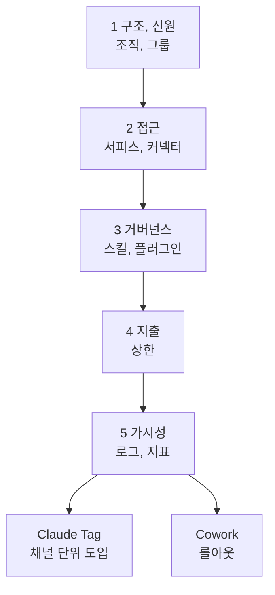

---

title: "[Claude Academy 8편] Claude Tag와 Enterprise 도입 (접근 제어, 거버넌스, 지출, 가시성)"
date: 2026-10-29
categories: [AI, Claude]
tags: [AI, ClaudeTag, Enterprise, Governance, Slack]
layout: post
toc: true
math: false
mermaid: true
series: claude-academy
series_order: 8

---

## 참고자료

- [Claude Academy - 엔지니어링 과정 목록](https://academy.claude.com/ko/all?department=engineering)
- Claude Academy 강좌: Introduction to Claude Tag, Deploying Claude Enterprise with Confidence, Building Effective Human-Agent Teams
- Claude Academy 튜토리얼: Getting started with Claude Tag, Best Practices Using Claude Tag, Tasks to try with Claude Tag, Claude Tag admin guide
- Claude Academy 튜토리얼: Claude Cowork Enterprise Administrator Guide, Scaling Workflows with Claude Cowork at Your Organization, Building AI-fluent organizations, Getting Started with Claude Security

---

## 배경

1인 DevOps에게 이 주제는 거리가 있어 보이지만, 도구를 팀에 넣는 순간 같은 질문이 생긴다. 누가 쓸 수 있는가, 무엇에 접근하는가, 비용 상한은 어디인가, 나중에 무엇을 볼 수 있는가다. 앞의 편이 개인이 쓰는 방법이었다면 이 글은 팀 공간과 조직 단위의 설정을 다룬다.

Claude Tag는 Slack 채널에서 `@Claude`로 일을 맡기는 방식이다. Enterprise 도입 강좌는 관리자가 내릴 다섯 가지 결정을 의존 순서대로 다룬다. Cowork 관리자 가이드와 사람-에이전트 팀 강좌, Claude Security 튜토리얼도 같은 축에 놓인다.

정리하면서 확인하고 싶었던 것들이다.

- Claude Tag는 채널과 DM에서 어떻게 다르게 동작하는가?
- Tag를 도입할 때 관리자가 정할 접근, 신원, 비용은 무엇인가?
- Enterprise 도입의 다섯 결정은 어떤 순서로 내리는가?
- Cowork를 조직에 확산할 때 무엇을 먼저 갖추는가?
- 사람과 에이전트가 함께 일하는 팀은 무엇을 준비해야 하는가?

---

## 큰 그림

공유 공간의 에이전트는 개인용과 달리 자기 신원으로 움직이고 기억이 누적된다. 그래서 관리 결정이 앞에 오고, 사용은 단계적으로 넓힌다.

1절은 Tag 사용 방식, 2절은 Tag 관리자 설정, 3절은 Enterprise 다섯 결정, 4절은 Cowork 롤아웃, 5절은 사람-에이전트 팀과 보안 스캔이다.

---

## 1. Claude Tag의 동작

첫 질문이다.

Claude Tag는 채널에서 대화를 따라가며 작업을 맡는 팀 구성원이다. 접근 권한이 있는 대화 기록, 공유 문서, 팀의 커넥터와 도구를 훑어 질문에 답하고, 문서를 초안하고, 도구 안의 변경까지 한다. 작업은 단계로 나뉘어 스레드에서 모두에게 보이고, 노트북을 닫은 뒤에도 이어지며 완료나 결정이 필요할 때 알린다. 태그 없이도 응답하거나 정기 작업을 도는 설정이 있다.

| 공간 | 신원과 경계 |
|---|---|
| DM | 본인 Claude 계정과 개인 커넥터로 본인 이름으로 동작한다. 학습 내용은 그 DM에만 남는다. |
| 공개 채널 | 채널 전체 기록과 팀 연결 도구를 쓴다. 교정이 채널 전원에게 도움이 된다. 개인 커넥터는 Allow, Allow with review, Don't allow 중 고른다. |
| 비공개 채널 | 채널 경계가 Claude의 경계다. 학습은 그 채널에만 저장되고 멤버 목록이 접근 목록이다. |

개인 일은 DM, 지정한 그룹 일은 비공개 채널, 여러 곳이 맞으면 공개 채널이다. `what can you access from here?`로 현재 권한을 확인한다. 개인 캘린더와 이메일은 DM에서만 동작한다.

**팀 업무는 DM보다 공개 채널에서 처리해야 기록이 쌓여** Claude와 동료가 참고한다. 한 종류의 일만 두면 Claude가 전문가처럼 동작한다. 기억은 `remember for this channel:`로 저장하고, 모든 스레드에 적용할 규칙은 채널 지침으로 올린다. 지침과 메모리가 충돌하면 지침이 이긴다.

요청은 목표와 이유를 새 팀원에게 설명하듯 쓰고, 입력과 확인 방법을 넣는다. 보낸 메시지를 수정해도 효과가 없으므로 새 답글로 보낸다. 최상위 메시지마다 새 작업이 시작되므로 별개 작업은 스레드를 나눈다. 영향이 큰 결과일수록 꼼꼼히 읽고, 분석은 두 번째 점검을 요청한다. 범위는 고정 작업에서 시작해 연결, 교정, 자동 응답, 정기 작업이 쌓이면 장기 업무 위임으로 넓힌다. 엔지니어링 채널 예시는 버그 수정과 초안 PR, CI와 리뷰 추적, 서비스 구조 다이어그램, 신입 첫 주 페이지 작성이다.

---

## 2. Tag 관리자 설정

두 번째 질문이다.

| 항목 | 내용 |
|---|---|
| 선결 조건 | Team 또는 Enterprise 플랜, 조직 Owner, Slack 워크스페이스 관리자, 충전된 사용 잔액, Routines 활성화다. ZDR, CMEK, HIPAA 구성 조직에서는 쓸 수 없다. |
| 설정 순서 | 워크스페이스 페어링, 첫 도구 선택, GitHub 연결과 저장소 선택, 도구별 계정 생성, 크레딧 구매, 출시다. 페어링 코드는 1회용이고 15분 뒤 만료된다. |
| 접근 제어 | 접근 번들(access bundle)을 기본 Slack, 워크스페이스, 채널 세 범위에 붙인다. 좁은 범위는 추가만 가능하다. |
| 신원 | 채널과 그룹 DM은 서비스 계정으로 동작해 모든 행동이 Claude Tag 이름으로 기록된다. 일대일 DM은 요청자 계정을 쓴다. |
| 자격 증명 | 작업은 스레드마다 격리된 샌드박스에서 돌고 키는 샌드박스에 들어가지 않는다. Agent Proxy가 규칙에 맞는 요청에만 자격 증명을 붙인다. |
| 비용 | 조직 한도와 채널별 한도를 동시에 받고 도달하면 새 작업을 거절한다. 사용자별 한도는 없다. |
| 도입 | 관리자 파일럿 채널, 한 팀, 전체 세 고리로 넓히고 첫 주에 Usage와 Activity 페이지를 본다. |

사용 대상, 응답 위치, 접근 대상은 서로 다른 세 설정이다. 공개 채널에 붙인 번들은 참여자 누구에게나 열리므로 높은 권한 자격 증명은 비공개 채널 범위에 둔다.

**`Respond automatically`와 mute 명령은 Claude가 따르는 안내일 뿐 차단 장치가 아니다.** 차단 경계는 지출 한도, 멤버 접근 토글, 범위별 활성화 스위치, 차단한 커넥터다. PR 승인 규칙은 요청자가 승인할 수 있으므로 승인 2건을 요구하고 새 커밋 시 기존 승인을 무효화한다.

| 제약 | 내용 |
|---|---|
| Slack Connect | 동작하지 않는다. 게스트가 있는 채널은 기본값 Restrict에서 응답하지 않는다. |
| 규제 데이터 | BAA 대상이 아니므로 PHI를 넣으면 안 된다. 허용 목록 방식으로 승인된 채널에서만 켠다. |
| 삭제 | 메모리 파일을 지워도 대화 기록은 지워지지 않는다. 워크스페이스 연결 해제나 채널 항목 제거 단위로만 삭제된다. |

공개 베타 기능이라 변경될 수 있다.

---

## 3. Enterprise 도입의 다섯 결정

세 번째 질문이다.

다섯 결정은 구조와 신원, 접근, 거버넌스, 지출, 가시성이다. 앞 결정이 뒤 결정의 범위를 정하고, 각 레슨은 결정 내용, 선택지, 나중에 바꿀 때의 영향 순서다. 되돌리기 어려운 설정이 네 가지 있다.

| 결정 | 핵심 |
|---|---|
| 구조와 신원 | 조직은 멤버, 그룹, 설정, 데이터의 경계다. 계약, 신원, 데이터 격리 중 하나가 분리를 요구할 때만 나눈다. 나중에 합치거나 쪼개면 재구축이다. 도메인 클레임은 되돌릴 수 없다. 그룹에 역할을 붙여 접근을 정하고 여러 그룹에 속하면 권한이 합집합이다. |
| 접근 | 조직 전체 스위치가 상한이고 역할 부여가 실제 접근을 정한다. 커넥터는 조직, 역할, 멤버 세 관문이 모두 열려야 쓴다. 읽기 전용을 기본으로 하고 쓰기는 위험 책임자 승인 뒤에 단계적으로 준다. |
| 거버넌스 | 스킬, 플러그인, 프로젝트, 조직 지침의 공유 범위다. 열린 제작과 심사 후 확산, 중앙 집중, 완전 개방 세 태세가 있다. |
| 지출 | 조직 상한, 그룹 상한, 멤버별 예외 세 단계다. 상한에 닿으면 일시 중지되므로 승인 요청 소유자를 미리 정한다. 상한을 올리기 전에 기본 모델과 노력 수준부터 살핀다. |
| 가시성 | Compliance API는 대화 내용을, 감사 로그는 메타데이터만 기록한다. OpenTelemetry는 운영 상태를 보인다. 보존 기간을 줄이면 삭제된 내용이 복구되지 않는다. |

도입 지표는 활성 멤버, 재방문, 대화 수, 스킬(작업 절차를 묶은 Claude Code 폴더)과 커넥터 사용이다. **지표는 진단용이며 목표 할당량으로 쓰지 않는다.** 새 제품을 넣을 때는 조직 경계, 그룹, 거버넌스, 상한, 가시성이 대체로 유지되고, 누가 쓰는지, 무엇을 가져오는지, 위험이 달라지는지 세 질문만 다시 판단한다. Claude Tag가 그 예다. 이 순서는 [AI 11편](/posts/claude-code-plugins-for-infra-team/)의 플러그인 배포와 [AI 13편](/posts/claude-code-telemetry-otel/)의 사용량 수집 사례가 닿는 지점이다.

---

## 4. Cowork 롤아웃

네 번째 질문이다.

관리자 가이드는 기술 설정, 변경 관리와 출시, 교육, 확산 네 단계다. 신원 통제, 커넥터, 관측성(Observability, 외부 데이터로 내부 상태를 알아내는 정도)을 먼저 갖춘다.

- 신원은 SSO보다 그룹과 RBAC(Role-Based Access Control, 역할 기반 접근 제어)를 먼저 완성한 뒤 SSO를 켠다. 일찍 켜면 미프로비저닝 사용자가 잠기고 자가 복구 수단이 없다. 중첩 IdP 그룹은 지원되지 않는다.
- RBAC 적용 전환 시 역할이 미구성이면 모든 사용자의 권한이 0이 되고 되돌리는 기능이 없다. 역할 권한은 합집합이고 지출 한도는 가장 엄격한 값이 적용된다.
- 좌석이 부족하면 SCIM 프로비저닝이 오류 없이 실패한다.
- 커넥터는 조직 단위 활성화와 사용자별 OAuth의 2단계다. 그룹별 커넥터 제어는 없다.
- 감사 로그는 아직 Cowork를 포함하지 않고 Compliance API가 세션 기록을 반환한다. OTEL 엔드포인트로 세션 데이터를 SIEM에 내보낸다.
- Windows 배포에는 .exe가 아닌 MSIX를 쓴다.

출시 전 점검은 실제 작업 1건 완료, OTEL 대시보드 수신, 플러그인 마켓플레이스 구성, 지원 채널 개설이다.

조직 확산의 흐름은 스킬 플라이휠이다. 개인이 만들고(Build), 소수가 시험하고(Vet), 챔피언이 팀 플러그인으로 올리고(Promote), 부서 전체로 확산한다(Spread). 거버넌스는 관리자 큐레이션, 안내형 생성, 완전 개방 세 가지이고 대부분의 팀에는 안내형이 맞다. 챔피언은 사용자 25~50명당 1명이 목표이고, 회의적인 사람도 넣어야 낙관 편향이 줄어든다. 롤아웃은 파일럿(4주차 주간 활성 사용자 70% 초과가 종료 조건), 확장, 확대와 모니터링 순이다. 지표는 사용 현황, 사용 깊이, 가치 창출 세 열로 보고, 가치가 부진하면 왼쪽 열부터 확인한다.

시간 절감만 측정하면 새로 가능해진 업무라는 큰 가치를 놓친다. 출시만으로는 롤아웃이 아니고 변경 관리가 필요하다. 예약 작업은 실제 도구에 결과를 올리므로 첫 실행 뒤 직접 확인한다.

---

## 5. 사람-에이전트 팀과 보안 스캔

다섯 번째 질문이다.

### 5.1 팀 준비

개인용 에이전트는 사용자의 연장선이다. 다중 사용자 에이전트는 자기 신원으로 움직이고, 팀이 접근 범위와 도구를 정하고, 기억이 누적된다. 에이전트가 있으면 오류 비용이 커져서 명확한 역할, 문서로 쓴 북극성(north star, 팀이 같이 보는 하나의 목표), 알맞은 정보 접근, 신뢰가 더 중요하다.

| 준비도 질문 | 내용 |
|---|---|
| 정보 | 공개되어 있고 검색 가능한가? |
| 담당 | 담당자가 명시되어 있는가? |
| 도구 | 필요한 도구가 제공되는가? |
| 점검 | 결과를 점검하는 장치가 있는가? |
| 목표 | 북극성이 문서로 있는가? |

시작은 3~5명과 에이전트 하나다. 로스터와 북극성을 쓰고, 아침 브리핑 같은 가시적 업무 하나부터 맡기고, 신뢰를 단계적으로 넓힌다.

AI 능숙한 조직의 틀은 마인드셋, 스킬, 접근 세 요소다. 접근은 모델, 하네스(harness, 에이전트와 도구 권한 같은 모델 주변 구조), 서피스(surface, AI가 나타나는 자리), 기능 네 층이고 조직이 가장 직접 통제한다. 접근이 없으면 마인드셋과 스킬로 보완할 수 없다. "오늘의 AI는 앞으로 쓸 AI 중 가장 못한 것"이라는 믿음이 없으면 인식이 굳어 혁신이 멈춘다. 이 세 요소는 평가 기준표가 아니다.

### 5.2 Claude Security

Claude Security는 코드베이스의 취약점을 스캔하고 리뷰용 패치를 제안하는 Enterprise 베타 기능이다. 필요 조건은 Enterprise 플랜, Claude Code on the Web 활성화, Extra Usage 활성화, Claude GitHub App 설치, 스캔 사용자의 프리미엄 좌석이다. 지원 저장소는 GitHub.com과 GitHub Enterprise Server다.

스캔은 `claude.ai/security`에서 저장소를 골라 시작하고 디렉터리나 브랜치로 범위를 좁힌다. 결과는 유형, 심각도, 파일과 줄, 설명, 수정 제안이다. 조치는 수정 세션 열기와 오탐 기각이다. 기각 사유가 감사 기록이 되고 이후 스캔에 다시 나오지 않는다. 사용량 과금이라 지출 한도를 정하고, 저장소나 팀별로 Project를 나눈다. 일정 스캔에 담당자가 없으면 결과가 아무도 보지 않는 백로그가 된다. 모노레포는 모듈 단위로 스캔해야 결정성이 높아진다.

---

## 내 자산에 적용

점검 대상은 팀에 공유하는 도구의 권한, 접근 범위, 지출 한도, 로그다. 1인 환경에서는 도구를 팀에 넣을 때를 대비한 체크리스트로 쓴다.

| 점검 | 개선 |
|---|---|
| 공유 도구에 높은 권한 자격 증명이 붙어 있는가? | 공개 범위가 아니라 비공개 범위에 둔다. 범위가 좁을수록 추가만 가능하다는 구조를 이용한다. |
| 자동 응답이나 mute 설정을 차단으로 믿는가? | 차단은 권한, 지출 한도, 접근 토글, 차단한 커넥터로 한다. |
| 커넥터가 쓰기 권한을 갖는가? | 읽기 전용을 기본으로 하고 쓰기는 승인 뒤에 단계적으로 준다. |
| 한도를 올려서 비용을 해결하는가? | 올리기 전에 기본 모델과 effort부터 살핀다. 승인 요청 소유자를 정한다. |
| 로그를 남기지 않는가? | 대화 내용과 메타데이터가 다른 경로로 남는다는 점을 확인하고, 보존 기간을 줄이기 전에 복구 불가 여부를 확인한다. |
| 되돌리기 어려운 설정을 먼저 정하지 않았는가? | 조직 경계, 도메인 클레임, SSO 순서를 먼저 확인한다. |
| 성과를 사용 시간만으로 재는가? | 사용 현황, 사용 깊이, 가치 창출로 나눠 보고 지표를 할당량으로 쓰지 않는다. |
| PR 승인 규칙이 요청자 승인을 허용하는가? | 승인 2건을 요구하고 새 커밋 시 기존 승인을 무효화한다. |
| 코드 스캔 결과에 담당자가 없는가? | 담당자를 지정하고 오탐 기각 사유를 남긴다. |

연습할 것은 새 도구를 넣기 전에 되돌릴 수 있는지부터 따지는 습관이다.

전수 점검의 순서와 지시문은 [11편](/posts/claude-academy-improvement-guide/)에 있다.

---

## 정리하며

처음 던진 질문들에 대한 답이다.

**Tag의 동작.** DM은 본인 계정, 공개 채널은 채널 기록과 팀 도구, 비공개 채널은 채널 경계를 쓴다. 팀 업무는 기록이 쌓이는 공개 채널에서 한다.

**Tag 관리자 설정.** 접근 번들을 세 범위에 붙이고, 채널에서는 서비스 계정으로 동작하며, 키는 샌드박스 밖에 둔다. 자동 응답 설정은 차단 장치가 아니다.

**Enterprise 다섯 결정.** 구조와 신원, 접근, 거버넌스, 지출, 가시성 순이다. 되돌리기 어려운 설정을 앞에서 정한다.

**Cowork 롤아웃.** 그룹과 RBAC를 먼저 완성한 뒤 SSO를 켜고, 파일럿에서 챔피언을 세워 확산한다.

**사람-에이전트 팀.** 역할, 북극성, 정보 접근, 점검 장치를 갖춘 소규모 팀에서 시작한다.

정리하고 나서 가장 크게 바뀐 인식은 **에이전트 도입의 위험이 모델보다 접근 범위와 되돌릴 수 없는 설정에 있다**는 점이었다. 그래서 새 도구를 팀에 넣기 전에 되돌릴 수 있는지부터 따진다.
