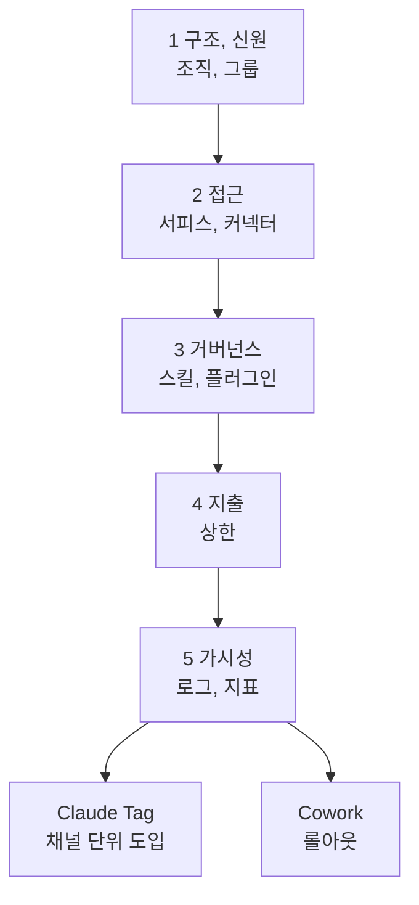

---

title: "[Claude Academy 8편] Claude Tag와 Enterprise 도입 (접근 제어, 거버넌스, 지출, 가시성)"
date: 2026-10-29
categories: [AI, Claude]
tags: [AI, ClaudeTag, Enterprise, Governance, Slack]
layout: post
toc: true
math: false
mermaid: true
series: claude-academy
series_order: 8

---

## 참고자료

- [Claude Academy - 엔지니어링 과정 목록](https://academy.claude.com/ko/all?department=engineering)
- Claude Academy 강좌: Introduction to Claude Tag, Deploying Claude Enterprise with Confidence, Building Effective Human-Agent Teams
- Claude Academy 튜토리얼: Getting started with Claude Tag, Best Practices Using Claude Tag, Tasks to try with Claude Tag, Claude Tag admin guide
- Claude Academy 튜토리얼: Claude Cowork Enterprise Administrator Guide, Scaling Workflows with Claude Cowork at Your Organization, Building AI-fluent organizations, Getting Started with Claude Security
- 수집 기준: Claude Academy 엔지니어링 목록의 2026-10-21 수집본이다. 베타와 미리보기 표기, 요금제 조건, 모델 이름은 이후 바뀔 수 있다.

---

## 배경

1인 DevOps에게 이 주제는 거리가 있어 보이지만, 도구를 팀에 넣는 순간 같은 질문이 생긴다. 누가 쓸 수 있는가, 무엇에 접근하는가, 비용 상한은 어디인가, 나중에 무엇을 볼 수 있는가다. 앞의 편이 개인이 쓰는 방법이었다면 이 글은 팀 공간과 조직 단위의 설정을 다룬다.

Claude Tag는 Slack 채널에서 `@Claude`로 일을 맡기는 방식이다. Enterprise 도입 강좌는 관리자가 내릴 다섯 가지 결정을 의존 순서대로 다룬다. Cowork 관리자 가이드와 사람-에이전트 팀 강좌, Claude Security 튜토리얼도 같은 축에 놓인다.

정리하면서 확인하고 싶었던 것들이다.

- Claude Tag는 채널과 DM에서 어떻게 다르게 동작하는가?
- Tag를 도입할 때 관리자가 정할 접근, 신원, 비용은 무엇인가?
- Enterprise 도입의 다섯 결정은 어떤 순서로 내리는가?
- Cowork를 조직에 확산할 때 무엇을 먼저 갖추는가?
- 사람과 에이전트가 함께 일하는 팀은 무엇을 준비해야 하는가?

---

## 큰 그림

공유 공간의 에이전트는 개인용과 달리 자기 신원으로 움직이고 기억이 누적된다. 그래서 관리 결정이 앞에 오고, 사용은 단계적으로 넓힌다.

1절은 Tag 사용 방식, 2절은 Tag 관리자 설정, 3절은 Enterprise 다섯 결정, 4절은 Cowork 롤아웃, 5절은 사람-에이전트 팀과 보안 스캔, 6절은 세부 항목이다.

---

## 1. Claude Tag의 동작

첫 질문이다.

Claude Tag는 채널에서 대화를 따라가며 작업을 맡는 팀 구성원이다. 접근 권한이 있는 대화 기록, 공유 문서, 팀의 커넥터와 도구를 훑어 질문에 답하고, 문제를 알리고, 문서를 초안하고, 도구 안의 변경까지 한다. 작업은 단계로 나뉘어 스레드에서 모두에게 보이고, 노트북을 닫은 뒤에도 이어지며 완료나 결정이 필요할 때 알린다. 채팅 창을 오가거나 맥락을 복사해 붙일 필요가 없다. 태그 없이도 응답하거나 정기 작업을 도는 설정이 있다.

| 공간 | 신원과 경계 |
|---|---|
| DM | 본인 Claude 계정과 개인 커넥터로 본인 이름으로 동작한다. 학습 내용은 그 DM에만 남는다. |
| 공개 채널 | 채널 전체 기록과 팀 연결 도구를 쓴다. 교정이 채널 전원에게 도움이 된다. 개인 커넥터는 Allow, Allow with review, Don't allow 중 고른다. |
| 비공개 채널 | 채널 경계가 Claude의 경계다. 학습은 그 채널에만 저장되고 멤버 목록이 접근 목록이다. |

개인 일은 DM, 지정한 그룹 일은 비공개 채널, 여러 곳이 맞으면 공개 채널이다. `what can you access from here?`로 현재 권한을 확인한다. 개인 캘린더와 이메일은 DM에서만 동작한다.

**팀 업무는 DM보다 공개 채널에서 처리해야 기록이 쌓여** Claude와 동료가 참고한다. 한 종류의 일만 두면 Claude가 전문가처럼 동작한다. 기억은 `remember for this channel:`로 저장하고, 모든 스레드에 적용할 규칙은 채널 지침으로 올린다. 지침과 메모리가 충돌하면 지침이 이긴다.

요청은 목표와 이유를 새 팀원에게 설명하듯 쓰고, 입력과 확인 방법을 넣는다. 보낸 메시지를 수정해도 효과가 없으므로 새 답글로 보낸다. 최상위 메시지마다 새 작업이 시작되므로 별개 작업은 스레드를 나눈다. 영향이 큰 결과일수록 꼼꼼히 읽고, 분석은 두 번째 점검을 요청한다. 범위는 고정 작업에서 시작해 연결, 교정, 자동 응답, 정기 작업이 쌓이면 장기 업무 위임으로 넓힌다. 엔지니어링 채널 예시는 버그 수정과 초안 PR, CI와 리뷰 추적, 서비스 구조 다이어그램, 신입 첫 주 페이지 작성이다.

입문 과정의 실무 적용 제안은 다섯 가지다. 담당 업무별로 채널을 나누고 채널마다 지침에 목적, 어조, 응답 대상, 금지 사항을 적는다.

같은 교정이 반복되면 스레드에서 말하지 말고 `remember for this channel:`로 메모리에 저장한다. 민감한 작업은 비공개 채널에서 실행하고 멤버 목록을 접근 목록처럼 관리한다.

주간 요약 같은 반복 업무는 정기 작업으로 등록하고 첫 결과 스레드에서 형식을 한 번 교정한다. 위임은 결과를 확인할 수 있는 작업부터 시작하고, 신뢰가 쌓이면 자동 응답과 장기 책임으로 넓힌다.

---

## 2. Tag 관리자 설정

두 번째 질문이다.

| 항목 | 내용 |
|---|---|
| 선결 조건 | Team 또는 Enterprise 플랜, 조직 Owner, Slack 워크스페이스 관리자, 충전된 사용 잔액, Routines 활성화다. ZDR(Zero Data Retention, 데이터 비보존), CMEK(Customer-Managed Encryption Keys, 고객 관리 암호화 키), HIPAA(미국 의료정보 보호법) 구성 조직에서는 쓸 수 없다. |
| 설정 순서 | 워크스페이스 페어링, 첫 도구 선택, GitHub 연결과 저장소 선택, 도구별 계정 생성, 크레딧 구매, 출시다. 페어링 코드는 1회용이고 15분 뒤 만료된다. |
| 접근 제어 | 접근 번들(access bundle)을 기본 Slack, 워크스페이스, 채널 세 범위에 붙인다. 좁은 범위는 추가만 가능하다. |
| 신원 | 채널과 그룹 DM은 서비스 계정으로 동작해 모든 행동이 Claude Tag 이름으로 기록된다. 일대일 DM은 요청자 계정을 쓴다. |
| 자격 증명 | 작업은 스레드마다 격리된 샌드박스에서 돌고 키는 샌드박스에 들어가지 않는다. Agent Proxy가 규칙에 맞는 요청에만 자격 증명을 붙인다. |
| 비용 | 조직 한도와 채널별 한도를 동시에 받고 도달하면 새 작업을 거절한다. 사용자별 한도는 없다. |
| 도입 | 관리자 파일럿 채널, 한 팀, 전체 세 고리로 넓히고 첫 주에 Usage와 Activity 페이지를 본다. |

사용 대상, 응답 위치, 접근 대상은 서로 다른 세 설정이다. 공개 채널에 붙인 번들은 참여자 누구에게나 열리므로 높은 권한 자격 증명은 비공개 채널 범위에 둔다.

**`Respond automatically`와 mute 명령은 Claude가 따르는 안내일 뿐 차단 장치가 아니다.** 차단 경계는 지출 한도, 멤버 접근 토글, 범위별 활성화 스위치, 차단한 커넥터다. PR 승인 규칙은 요청자가 승인할 수 있으므로 승인 2건을 요구하고 새 커밋 시 기존 승인을 무효화한다.

| 제약 | 내용 |
|---|---|
| Slack Connect | 동작하지 않는다. 게스트가 있는 채널은 기본값 Restrict에서 응답하지 않는다. |
| 규제 데이터 | BAA(Business Associate Agreement, 의료정보 처리 위탁 계약) 대상이 아니므로 PHI(Protected Health Information, 보호 대상 건강 정보)를 넣으면 안 된다. PHI 가능성이 있으면 허용 목록 방식으로 승인된 채널에서만 켜고 DM을 끈다. |
| 삭제 | 메모리 파일을 지워도 대화 기록은 지워지지 않는다. 워크스페이스 연결 해제나 채널 항목 제거 단위로만 삭제된다. |

Claude Tag는 공개 베타다.

---

## 3. Enterprise 도입의 다섯 결정

세 번째 질문이다.

다섯 결정은 구조와 신원, 접근, 거버넌스, 지출, 가시성이다. 앞 결정이 뒤 결정의 범위를 정하고, 각 레슨은 결정 내용, 선택지, 나중에 바꿀 때의 영향 순서다. 되돌리기 어려운 설정이 네 가지 있다.

| 결정 | 핵심 |
|---|---|
| 구조와 신원 | 조직은 멤버, 그룹, 설정, 데이터의 경계다. 계약, 신원, 데이터 격리 중 하나가 분리를 요구할 때만 나눈다. 나중에 합치거나 쪼개면 재구축이다. 도메인 클레임은 되돌릴 수 없다. 그룹에 역할을 붙여 접근을 정하고 여러 그룹에 속하면 권한이 합집합이다. |
| 접근 | 조직 전체 스위치가 상한이고 역할 부여가 실제 접근을 정한다. 커넥터는 조직, 역할, 멤버 세 관문이 모두 열려야 쓴다. 읽기 전용을 기본으로 하고 쓰기는 위험 책임자 승인 뒤에 단계적으로 준다. |
| 거버넌스 | 스킬, 플러그인, 프로젝트, 조직 지침의 공유 범위다. 열린 제작과 심사 후 확산, 중앙 집중, 완전 개방 세 태세가 있다. |
| 지출 | 조직 상한, 그룹 상한, 멤버별 예외 세 단계다. 상한에 닿으면 일시 중지되므로 승인 요청 소유자를 미리 정한다. 상한을 올리기 전에 기본 모델과 노력 수준부터 살핀다. |
| 가시성 | Compliance API는 대화 내용을, 감사 로그는 메타데이터만 기록한다. OpenTelemetry는 운영 상태를 보인다. 보존 기간을 줄이면 삭제된 내용이 복구되지 않는다. |

도입 지표는 활성 멤버, 재방문, 대화 수, 스킬(작업 지침)과 커넥터 사용이다. **지표는 진단용이며 목표 할당량으로 쓰지 않는다.** 새 제품을 넣을 때는 조직 경계, 그룹, 거버넌스, 상한, 가시성이 대체로 유지되고, 누가 쓰는지, 무엇을 가져오는지, 위험이 달라지는지 세 질문만 다시 판단한다. Claude Tag가 그 예다. 이 순서는 [AI 11편](/posts/claude-code-plugins-for-infra-team/)의 플러그인 배포와 [AI 13편](/posts/claude-code-telemetry-otel/)의 사용량 수집 사례가 닿는 지점이다.

---

## 4. Cowork 롤아웃

네 번째 질문이다.

관리자 가이드는 기술 설정, 변경 관리와 출시, 교육, 확산 네 단계다. 신원 통제, 커넥터, 관측성(Observability, 외부 데이터로 내부 상태를 알아내는 정도)을 먼저 갖춘다.

- 신원은 SSO보다 그룹과 RBAC(Role-Based Access Control, 역할 기반 접근 제어)를 먼저 완성한 뒤 SSO를 켠다. 일찍 켜면 미프로비저닝 사용자가 잠기고 자가 복구 수단이 없다. 중첩 IdP 그룹은 지원되지 않는다.
- RBAC 적용 전환 시 역할이 미구성이면 모든 사용자의 권한이 0이 되고 되돌리는 기능이 없다. 역할 권한은 합집합이고 지출 한도는 가장 엄격한 값이 적용된다.
- 좌석이 부족하면 SCIM 프로비저닝이 오류 없이 실패한다.
- 커넥터는 조직 단위 활성화와 사용자별 OAuth의 2단계다. 그룹별 커넥터 제어는 없다.
- 감사 로그는 아직 Cowork를 포함하지 않고 Compliance API가 세션 기록을 반환한다. OTEL 엔드포인트로 세션 데이터를 SIEM에 내보낸다.
- Windows 배포에는 .exe가 아닌 MSIX를 쓴다.

출시 전 점검은 실제 작업 1건 완료, OTEL 대시보드 수신, 플러그인 마켓플레이스 구성, 지원 채널 개설이다.

조직 확산의 흐름은 스킬 플라이휠이다. 개인이 만들고(Build), 소수가 시험하고(Vet), 챔피언이 팀 플러그인으로 올리고(Promote), 부서 전체로 확산한다(Spread). 거버넌스는 관리자 큐레이션, 안내형 생성, 완전 개방 세 가지이고 대부분의 팀에는 안내형이 맞다. 챔피언은 확산 가이드 기준 사용자 25~50명당 1명이 목표이고, 관리자 가이드는 부서당 2~3명을 두라고 적는다. 두 기준이 다르므로 어느 쪽을 쓸지 확인이 필요하다. 회의적인 사람도 넣어야 낙관 편향이 줄어든다. 롤아웃은 파일럿(4주차 주간 활성 사용자 70% 초과가 종료 조건), 확장, 확대와 모니터링 순이다. 지표는 사용 현황, 사용 깊이, 가치 창출 세 열로 보고, 가치가 부진하면 왼쪽 열부터 확인한다.

시간 절감만 측정하면 새로 가능해진 업무라는 큰 가치를 놓친다. 출시만으로는 롤아웃이 아니고 변경 관리가 필요하다. 예약 작업은 실제 도구에 결과를 올리므로 첫 실행 뒤 직접 확인한다.

---

## 5. 사람-에이전트 팀과 보안 스캔

다섯 번째 질문이다.

### 5.1 팀 준비

개인용 에이전트는 사용자의 연장선이다. 다중 사용자 에이전트는 자기 신원으로 움직이고, 팀이 접근 범위와 도구를 정하고, 기억이 누적된다. 에이전트가 있으면 오류 비용이 커져서 명확한 역할, 문서로 쓴 북극성(north star, 팀이 같이 보는 하나의 목표), 알맞은 정보 접근, 신뢰가 더 중요하다.

| 준비도 질문 | 내용 |
|---|---|
| 정보 | 공개되어 있고 검색 가능한가? |
| 담당 | 담당자가 명시되어 있는가? |
| 도구 | 필요한 도구가 제공되는가? |
| 점검 | 결과를 점검하는 장치가 있는가? |
| 목표 | 북극성이 문서로 있는가? |

시작은 3~5명과 에이전트 하나다. 로스터와 북극성을 쓰고, 아침 브리핑 같은 가시적 업무 하나부터 맡기고, 신뢰를 단계적으로 넓힌다.

원문의 실무 적용 제안은 다섯 가지다.

| 제안 | 내용 |
|---|---|
| 결정 게시 | 회의나 DM에서 정한 결정을 당일 공유 공간에 게시해 에이전트가 읽을 수 있게 하는 규칙을 도입한다. |
| 로스터 | 반복 업무마다 담당자를 한 명씩 정한 로스터를 만들고, 에이전트에게 초안 제안을 맡긴 뒤 사람이 확정한다. |
| 루브릭 | 에이전트에 맡기는 각 업무에 합격 기준 루브릭(rubric, 합격 기준표)을 붙여 사람이 보기 전에 점검하는 구조를 마련한다. |
| 서면 지침 | 같은 설명을 두 번 하게 되면 서면 지침으로 만들어 에이전트에 전달한다. |
| 주간 회고 | 사람과 에이전트가 잘 된 점과 고칠 점을 공유하고 기록으로 남긴다. |

AI 능숙한 조직의 틀은 마인드셋, 스킬, 접근 세 요소다. 접근은 모델, 하네스(harness, 에이전트와 도구 권한 같은 모델 주변 구조), 서피스(surface, AI가 나타나는 자리), 기능 네 층이다. 접근은 사람이 쓸 수 있는 것으로, 모델부터 조직에서 켜 둔 기능까지 쌓이는 구조이고 조직이 가장 직접 통제한다. 접근이 없으면 마인드셋과 스킬로 보완할 수 없다. "오늘의 AI는 앞으로 쓸 AI 중 가장 못한 것"이라는 믿음이 없으면 인식이 굳어 혁신이 멈춘다. 이 세 요소는 평가 기준표가 아니다.

### 5.2 Claude Security

Claude Security는 코드베이스의 취약점을 스캔하고 리뷰용 패치를 제안하는 Enterprise 베타 기능이다. 필요 조건은 Enterprise 플랜, Claude Code on the Web 활성화, Extra Usage 활성화, Claude GitHub App 설치와 저장소 접근, 스캔 사용자의 프리미엄 좌석이다. 프리미엄 좌석 사용자는 Claude Mythos 5.1로 스캔한다. 지원 저장소는 GitHub.com과 GitHub Enterprise Server다.

스캔은 `claude.ai/security`에서 저장소를 골라 시작하고 디렉터리나 브랜치로 범위를 좁힌다. 결과는 유형, 심각도, 파일과 줄, 설명, 수정 제안이다. 조치는 수정 세션 열기와 오탐 기각이다. 기각 사유가 감사 기록이 되고 이후 스캔에 다시 나오지 않는다. 사용량 과금이라 지출 한도를 정하고, 저장소나 팀별로 Project를 나눈다. 일정 스캔에 담당자가 없으면 결과가 아무도 보지 않는 백로그가 된다. 모노레포는 모듈 단위로 스캔해야 결정성이 높아진다.

---

## 6. 보완: 세부 항목

### 6.1 Claude Tag 강좌의 나머지

- 정기 작업은 읽을 대상, 확인할 것, 게시할 내용, 시각을 한 메시지에 적어 등록한다. 보고할 것이 없으면 게시하지 않도록 지정할 수 있다.
- 한 채널에 한 종류의 일만 두고, 응답할 메시지와 무시할 메시지를 한 줄 지침으로 정한다.
- 책임을 넓힐 때는 목표 하나, Claude가 맡을 범위, 사람에게 돌려보낼 결정을 정한다. 한 채널을 골라 팀의 습관을 점검표로 확인하고 빈 항목을 시작하는 메시지를 만든다.
- 시험 과제는 채널 유형별로 나뉜다. 도구 없이는 놓친 스레드 요약, 채널 정리, 주간 요약, 답이 없는 요청 찾기, 스레드 기반 명세 초안, 게시된 수치 차트화다. 한 번 설정하면 도는 일은 질문 응답과 긴급 건 담당자 호출, 채널 개요 고정이다. 고객 채널은 요청 순위화와 통화 전 계정 브리핑, 데이터 채널은 웨어하우스 쿼리와 대시보드와 가입 단계별 이탈 분석, 문서와 팀 채널은 정책 문서 인용 답변과 회의 준비와 차단 현황 정리다. 결과는 스레드 답변, 첨부 파일이나 차트, 열람 가능한 대화형 페이지, 새로 고쳐지는 결과물, 도구 안의 작업(PR 생성, 티켓 발행)이다.
- 입문 과정의 세 습관은 동료처럼 일 맡기기, 팀이 일하는 채널에서 작업하기, 신뢰를 단계적으로 넓히기다. 시작은 `/invite @Claude`로 채널에 초대하고 짧은 질문으로 응답을 확인하는 것이다.
- 채널에서 `@Claude`로 요청하면 스레드에 답하고, 채널 기록을 먼저 읽으므로 배경 설명이 필요 없다. 채팅창과 달리 작업이 계속 실행되고, 팀 전체가 스레드에서 방향을 바꿀 수 있다.
- 팀 연결(connection)은 Claude 자체 계정으로 동작한다. 개인 커넥터는 본인 이름으로 본인 요청에만 동작한다.
- 메모리는 Claude가 쌓는 채널 노트이고, 채널 지침은 Configure 페이지의 규칙이다. 원문은 채널 지침에 목적, 어조, 응답 대상, 금지 사항을 적도록 제안한다.
- 기억의 범위는 공개 채널 내용이 워크스페이스 전체이고, 비공개 채널과 DM 내용은 그 공간에만 적용된다. 기억은 개인이 아니라 채널과 워크스페이스에 속한다.
- 응답 시점의 기본값은 태그될 때만 응답하는 것이다. 평문 지시로 모든 질문에 답하게 하거나 `Respond automatically` 설정으로 조절하고, 예약 작업(매주 월요일 9시 요약 등)과 자동 후속 확인도 설정할 수 있다.
- 응답 빈도는 채널별 설정이라 관리자가 정한다. 자동 응답이 필요하면 관리자에게 요청한다.
- 정기 작업(routine)은 한 번의 메시지로 등록하고 목록 확인, 일시 중지, 중단을 할 수 있다. 첫 결과 스레드에서 형식을 한 번 교정하라는 것이 원문의 제안이다.
- 요청 작성은 일 선택, 요청 작성, 작업 지켜보기, 결과 확인의 네 단계다. 요청에는 목표, 입력, 확인 방법, 우선순위, 결과 형태를 담고 스레드에서 방향을 조정한다.
- 결과는 링크, 파일, 쿼리와 대조해 확인하고 교정 내용을 메모리에 저장한다. 틀린 부분은 구체적으로 지적하고, 반복되는 실수는 Claude의 세션 기록에서 단계를 확인한 뒤 교정하면 채널에 저장된다.
- 의사결정은 사람에게 돌려보내도록 Claude가 맡을 범위를 정한다. 책임 확대의 예는 하루를 돌아보며 개선점을 기록하는 일과 반복 질문 중 답이 없는 항목을 점검하는 일이다.
- 시작하기 문서의 예시 요청은 최근 3일 스레드, Google Drive 회의록, 열린 Asana 작업을 확인해 이번 주 미결 액션 아이템을 정리하는 일이다. Team과 Enterprise 계정에서 제공된다.
- Claude는 자체 계정으로 일하며 모든 변경과 요청자를 기록한다. 개별 도구에 접근해 대신 응답할 때는 매번 권한을 요청한다.
- 채널의 누구나 기존 요청에 이어서 요청하거나 새 요청을 줄 수 있고, 워크스페이스가 연결된 어느 기기에서도 확인하고 후속 요청을 할 수 있다.
- "이 채널에서는 이벤트 스프레드시트의 원본 링크를 직접 포함하라"처럼 말하면 지침을 저장하고, 채널에서 Claude를 태그해 누구나 메모리를 읽고 고친다. 스타일 가이드나 체크리스트를 참조하게 하면 문서를 고쳤을 때 기본적으로 최신 상태를 따른다.
- 조직은 작업 범위, 개입 빈도, 채널별 자율 수준을 통제한다. 다른 공개 채널의 정보는 접근하게 할 수 있고 DM과 비공개 채널은 비공개로 유지된다.
- 영상에서 확인된 내용은 팀의 스타일과 선호를 학습해 시간이 지나면 더 어려운 작업을 맡길 수 있다는 점, 사용자가 다른 우선순위로 넘어가도 작업이 계속되고 완료나 결정 필요 시 알림이 온다는 점, 대화 기록과 공유 문서와 커넥터를 취합해 답한다는 점이다.
- 접근이 필요한 도구가 연결되지 않았으면 관리자에게 추가를 요청한다. 개인 도구의 내용이 채널에 섞이지 않도록 개인 연결은 DM에서만 작동한다. 이 사용 지침은 Slack과 연결한 사용을 전제로 하며 채널 설정, 요청 작성, 결과 확인, 책임 확대의 네 부분으로 구성된다. 채널 기록이 맥락이 되고 교정이 채널 단위로 기억되어 시간이 지날수록 해당 업무에 맞춰진다. 요금제와 계정 사항은 원문이 Help Center 문서를 안내한다.
- 시험 과제에서 채널의 결과는 모두가 보고 DM의 결과는 본인만 본다. 주간 요약의 예는 매주 월요일 9시이고, 채널 개요 메시지는 고정하고 최신 상태를 유지한다.
- 고객과 피드백 채널은 각 항목에 출처 메시지와 계정을 표시한다. 데이터 채널은 웨어하우스 쿼리 실행과 차트와 SQL 게시, 의사결정용 대시보드를 다룬다.
- 문서 채널은 현재 정책 문서를 인용해 답하고, 팀 채널의 차단 현황은 티켓과 채널을 함께 읽어 정리한다. 현재 채널에서 쓸 수 있는 도구는 `@Claude what tools can you use in this channel?`로 확인한다.
- 도구 연결은 관리자가 채널 단위로 설정하며 연결이 없으면 해당 도구 기반 과제는 동작하지 않는다.

### 6.2 Enterprise 강좌의 나머지

- 설정에 손대기 전에 도입 목표와 결정별 소유자를 문서로 확정하고, 소유자 없는 결정이 남지 않게 한다.
- 결정마다 소유자의 성격을 정한다. 지출은 예산 책임자, 가시성은 데이터 위험 책임자에게 넘어가는 경우가 많다.
- 관리 위치는 조직 설정, IdP, Claude Console 세 곳이다. 되돌릴 수 없는 도메인 클레임은 30일 이전 기간 안내가 있다.
- 그룹 설계는 조직도 기반, 위험 등급 기반, 혼합 세 패턴이다. 조직 전체 스위치가 상한이고 역할 부여가 실제 접근을 정하며, 기본 모델과 노력 수준을 역할별로 설정한다.
- 사용자 지정 거버넌스의 세 태세는 열린 제작과 심사 후 확산, 중앙 집중, 완전 개방이다. 결정 간 연결 레슨은 한 결정을 바꿨을 때 하위 결정에 번지는 영향을 예측한다. 가상 회사 Pluto를 예시로 쓰고 동반 문서를 채우면 도입 계획서가 완성된다. 규제 대상 부서의 답이 하나의 태세로 맞물리는지도 확인한다. 수료 퀴즈는 본문이 없다.
- 도입 목표는 성공 기준과 제약 조건 두 부분으로 정한다. 결정마다 소유자를 지정하고 접수 설문(intake)으로 별도 확인이 필요한 결정을 가려낸다.
- 되돌릴 수 없거나 비용이 큰 설정 네 가지는 도메인 클레임, 조직 수, 그룹 구조, 데이터 보존 기간이다.
- 선행 조건은 여섯 가지이지만 요약에 항목이 없어 내용은 확인이 필요하다.
- 조직 수를 정하는 기준과 JIT(Just-In-Time, 로그인 시점에 계정 생성), SCIM(System for Cross-domain Identity Management, 계정 자동 동기화 표준) 프로비저닝(provisioning, 계정 준비)의 차이를 다룬다. 차이의 내용은 요약에 없어 확인이 필요하다.
- 서피스(surface)와 커넥터(connector)는 그룹별로 단계를 나눠 부여한다. 지출 관리 레슨은 청구 구조와 지출을 움직이는 설정을 설명한다.
- 원문의 실무 적용 제안은 Owner 역할을 직접 지정한 담당자를 두 명 이상 확보한 뒤 SSO와 그룹 동기화를 설정하는 것이다. 도메인 클레임 전에는 SSO 적용 상태와 프로비저닝이 작동하는지 확인하고, 개인 계정 사용자에게 30일 이전 기간과 스킬 내보내기를 공지한다.
- 같은 제안에서 커넥터 쓰기 권한은 필요한 워크플로가 확인된 그룹에만 위험 책임자 승인을 받아 부여한다. 보존 기간은 사내 데이터 정책 담당자와 합의한 뒤 한 번에 정한다.

### 6.3 사람-에이전트 팀과 AI 능숙 조직

- 가상 팀 Lantern(건강 추적 앱 출시)을 따라가며 개인 사용에서 다중 사용자로의 전환을 본다. 개인용 AI는 개인 작업을 빠르게 하지만 정보가 분리되고, 공유 공간에서는 모든 사람과 에이전트가 같은 맥락을 보며 에이전트가 더 선제적으로 일한다.
- 스킬 예시 차트는 어려운 작업 하나를 50회 시도하며 프롬프트 개선, 출력 서식용 스킬 추가, 자기 점검용 루브릭과 적대적 점검 추가로 성공률이 오르는 과정을 보인다. 고정된 스킬 목록은 없고 목표는 작업 성공이다.
- 마인드셋은 일곱 가지 작업 목록이고 여러 개를 동시에 가질 수 있다. 대화 시작 방법은 팀 회의에서 마인드셋 목록을 보여 주고 중요한 것을 논의하기, 사람들에게 AI로 해낸 가장 어려운 작업과 방법을 묻기, AI 도구가 닿는 정보를 확인하기다.
- 사람-에이전트 팀 과정은 팀 규모가 커질수록 분리된 맥락이 에이전트 성능에 미치는 영향이 커진다고 설명한다. 다중 사용자 에이전트의 구성 요소는 고유 신원과 자격 증명, 공유 기억, 공유 맥락이다.
- 사람-에이전트 팀의 네 가지 관행은 공개 작업, 명확한 역할, 북극성 설정, 신뢰 구축이다. 에이전트 작업은 루브릭(합격 기준표), 테스트, 다른 에이전트로 미리 점검한다.
- 과정은 준비도 점검 질문 5개와 첫 2주 시작 체크리스트로 마무리된다. 퀴즈는 관행과 준비도 질문 내용을 확인한다.
- AI 능숙 조직 튜토리얼은 Anthropic 조사에서 사람들이 AI에 가장 바라는 것이 전문성 향상이었다고 한다. 모르는 것을 강조하는 도입은 사람을 조심스럽게 만들고, 이미 잘하는 일에 새 도구를 얹는 도입은 실험을 이끈다.
- 초기 AI 능숙도 연구는 목표 명확화, 독자 확인처럼 대화에서 보이는 행동을 정리했다. 모델이 좋아져 AI가 일부 행동을 대신하므로 대규모 측정 기준으로는 맞지 않는다.
- 마인드셋은 AI가 할 수 있는 일, 못 하는 일, 업무 속 위치에 대한 믿음이다. 스킬은 AI로 복잡한 작업을 끝내는 능력이고 작업 성공률로 드러나며, 컨텍스트 관리와 반복 작업용 스킬과 자동화를 익히면 성공률이 오른다.
- 접근의 기능 층은 메모리, 프로젝트, 데이터 연결이다. 세 요소는 서로 이어진 한 시스템이고 끝이나 좋은 점수가 없다.
- 마인드셋 하나만 고른다면 "오늘의 AI는 앞으로 쓸 AI 중 가장 못한 것"이라는 세 번째를 권한다. 리더는 한 팀을 떠올려 혼자 생각해 본 뒤 대화 시작 방법을 고른다.

### 6.4 Claude Tag 관리자 가이드의 나머지

- 관리자가 정할 사항은 위치, 조정 주체, 접근 범위, 동작 방식, 기억, 비용의 여섯 가지다. 가이드는 워크스페이스 연결, 사용 대상 결정, 도구 연결, 지출 한도, 단계별 도입을 다룬다.
- 같은 호스트에 자격 증명이 둘이면 가장 좁은 범위의 것을 쓴다.
- Member access의 제한 토글로 채널과 DM 모두에서 사용 가능한 사람을 정한다.
- Admin 역할은 페어링과 번들 관리를 못 한다. Enterprise에서는 Claude Tag admin과 채널 매니저로 일부 관리를 위임한다.
- 사용자별 한도는 없고, Enterprise에서는 Analytics API로 사용자별 집계가 가능하다.

### 6.5 Cowork 가이드의 나머지

- Cowork는 로컬 파일 접근, 커넥터, 플러그인, 예약 작업을 갖춘 위임형 작업 도구다. 모든 유료 플랜에서 쓸 수 있고 로컬 파일과 데스크톱 앱 작업에는 Claude Desktop 앱이 필요하다.
- 준비 단계에서 롤아웃 팀 구성, 설치 방식(MDM 또는 자가 설치), 조직 구조, 네트워크 허용 목록, 좌석 수를 정한다. MDM(Mobile Device Management, 기기 중앙 관리)이 설치 방식의 하나다.
- 조직 구조의 선택지는 하나의 조직과 RBAC, 부모-자식, 다중 부모다.
- 보안 설정은 네트워크 송신 허용 목록, 마운트 제어, 데스크톱 확장 허용 목록으로 구성한다.
- 분석 데이터는 관리자 대시보드(T+1 새로고침)와 Enterprise 전용 Analytics API로 확인하고, 활성 사용자, 세션, 스킬과 커넥터 호출 순위를 볼 수 있다. 챔피언은 단계별 소통 계획을 세운다.
- 확산 단계의 거버넌스는 제품 내 설정(커넥터 on/off, 지출 한도, 플러그인 마켓플레이스, 스킬 게시 정책, RBAC)과 수동 관리(그룹별 커넥터, 공유 통제)로 나뉜다. 앞에서 그룹별 커넥터 제어는 없다고 한 서술과 수동 관리 항목의 관계는 요약만으로 확인이 필요하다.
- 확산 가이드의 구성 요소는 커넥터(데이터 접근), 스킬(작업 지침), 플러그인(스킬과 커넥터 묶음), 예약 작업(일정에 따라 자동 실행하는 저장된 프롬프트)이다. 중심 원칙은 각 단계를 관리자, 챔피언, Claude 중 누가 맡을지 정하고 결과 품질에 따라 그 경계를 옮기는 것이다.
- 거버넌스 세 방식은 조직 설정의 사용자 생성 스킬, 스킬 공유, 게시 값으로 구분한다. 플러그인은 그룹별 가용성을 덮어써 지정한 그룹에만 노출하거나 자동 설치할 수 있고, 커넥터는 아직 조직 단위 on/off만 된다.
- 챔피언은 시작용 스킬 2~3개 제작, 팀 워크숍 운영, 부서 플러그인 관리, 분기별 스킬 정리를 맡는다. 사용 분석으로 파워 유저를 찾는다.
- 롤아웃의 확장 단계는 부서별 플러그인과 소유자를 지정하고, 확대와 모니터링 단계는 활동 지표에서 성과 지표로 전환한다.
- 교육은 활성화(커넥터 인증, 역할별 첫 작업), 역량 구축(스킬 워크숍, 오피스 아워), 습관화(모든 사용자에게 예약 작업 1개) 순이다.
- 책임 소재는 사람에게 남으며 분기마다 플러그인과 예약 작업의 소유자를 다시 정한다. 스킬에 자격 증명을 넣지 않고 인증이 필요하면 커넥터로 연결한다.
- 사용자가 짧은 프롬프트로 커넥터 없이 쓰는 채팅 함정은 두 방식을 나란히 비교하는 시연으로 막는다. 로그인 횟수나 절감 시간만 측정하면 실제 성과를 놓친다.

### 6.6 Claude Security의 나머지

- Claude Security는 Claude.ai에 내장된 기능이다. GHES(GitHub Enterprise Server)는 앱을 GHES 인스턴스에 설치하고 Claude Code on the Web에 연결해야 한다.
- 과금은 사용량 기준이고 스캔 규모와 횟수에 비례한다. 기능 활성화 후 별도 한도도 정할 수 있으며, 관리 콘솔에서 Claude Security 설정을 켠다.
- 스캔 소요 시간은 몇 분에서 몇 시간이다. 대형 저장소는 디렉터리를 지정하면 성공률이 높아진다.
- 결과는 Project, Scan, Finding 단위로 CSV나 Markdown으로 내보낼 수 있다. 수정 세션은 Claude Code on the Web에서 패치를 생성한다.
- 반복 사용은 저장소, 서비스, 팀별 Project 분리, Standard와 Extended 중 스캔 강도 선택, 주간 같은 일정 스캔과 담당자 지정이다.
- 웹훅(webhook, 이벤트 발생 시 외부로 보내는 HTTP 호출)으로 스캔 완료와 새 발견 이벤트를 Slack이나 Jira로 보내고 이메일 알림도 설정할 수 있다. 감사용으로 CSV를 보관한다.
- Standard 좌석에는 Claude Code on the Web이 포함되지 않는다. 모노레포는 모듈이나 하위 디렉터리 단위로 스캔하면 결정성이 높아지고 넓은 코드 맥락은 그대로 추적한다.

---

## 내 자산에 적용

점검 대상은 팀에 공유하는 도구의 권한, 접근 범위, 지출 한도, 로그다. 1인 환경에서는 도구를 팀에 넣을 때를 대비한 체크리스트로 쓴다.

| 점검 | 개선 |
|---|---|
| 공유 도구에 높은 권한 자격 증명이 붙어 있는가? | 원문은 높은 권한 자격 증명을 공개 채널 범위가 아니라 비공개 채널 범위에 두라고 한다. |
| 자동 응답이나 mute 설정을 차단으로 믿는가? | 차단은 권한, 지출 한도, 접근 토글, 차단한 커넥터로 한다. |
| 커넥터가 쓰기 권한을 갖는가? | 읽기 전용을 기본으로 하고 쓰기는 승인 뒤에 단계적으로 준다. |
| 한도를 올려서 비용을 해결하는가? | 올리기 전에 기본 모델과 effort부터 살핀다. 승인 요청 소유자를 정한다. |
| 로그를 남기지 않는가? | 대화 내용과 메타데이터가 다른 경로로 남는다는 점을 확인하고, 보존 기간을 줄이기 전에 복구 불가 여부를 확인한다. |
| 되돌리기 어려운 설정을 먼저 정하지 않았는가? | 조직 경계, 도메인 클레임, SSO 순서를 먼저 확인한다. |
| 성과를 사용 시간만으로 재는가? | 사용 현황, 사용 깊이, 가치 창출로 나눠 보고 지표를 할당량으로 쓰지 않는다. |
| PR 승인 규칙이 요청자 승인을 허용하는가? | 승인 2건을 요구하고 새 커밋 시 기존 승인을 무효화한다. |
| 코드 스캔 결과에 담당자가 없는가? | 담당자를 지정하고 오탐 기각 사유를 남긴다. |

연습할 것은 새 도구를 넣기 전에 되돌릴 수 있는지부터 따지는 습관이다.

전수 점검의 순서와 지시문은 [11편](/posts/claude-academy-improvement-guide/)에 있다.

---

## 정리하며

처음 던진 질문들에 대한 답이다.

**Tag의 동작.** DM은 본인 계정, 공개 채널은 채널 기록과 팀 도구, 비공개 채널은 채널 경계를 쓴다. 팀 업무는 기록이 쌓이는 공개 채널에서 한다.

**Tag 관리자 설정.** 접근 번들을 세 범위에 붙이고, 채널에서는 서비스 계정으로 동작하며, 키는 샌드박스 밖에 둔다. 자동 응답 설정은 차단 장치가 아니다.

**Enterprise 다섯 결정.** 구조와 신원, 접근, 거버넌스, 지출, 가시성 순이다. 되돌리기 어려운 설정을 앞에서 정한다.

**Cowork 롤아웃.** 그룹과 RBAC를 먼저 완성한 뒤 SSO를 켜고, 파일럿에서 챔피언을 세워 확산한다.

**사람-에이전트 팀.** 역할, 북극성, 정보 접근, 점검 장치를 갖춘 소규모 팀에서 시작한다.

여기서부터는 원문이 아닌 내 판단이다. 원문이 접근 범위 통제와 되돌리기 어려운 설정 네 가지를 앞 순서에 두므로, 새 도구를 팀에 넣기 전에 접근 범위와 되돌릴 수 있는지부터 따지기로 했다.
