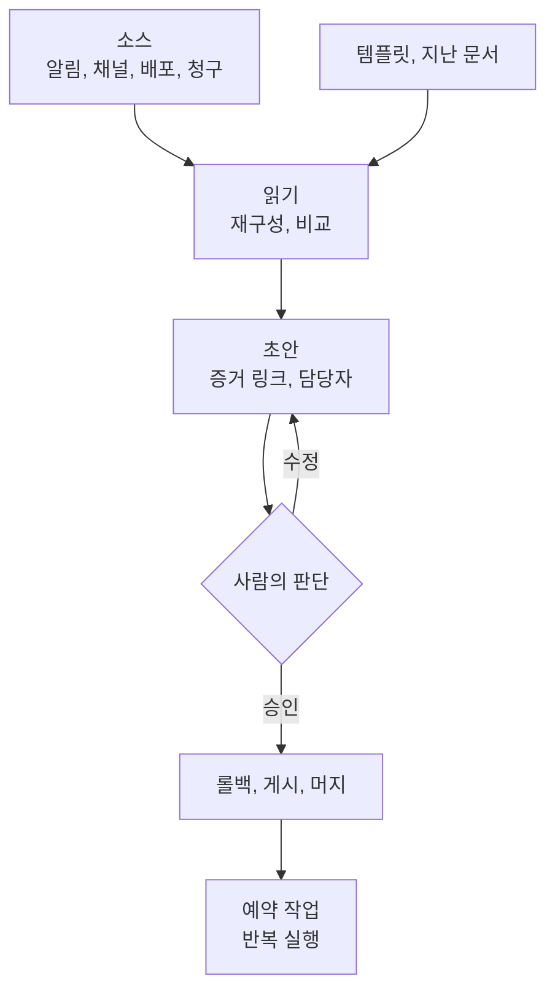

---

title: "[Claude Academy 9편] 엔지니어링 사용 사례 (온콜 분류, 포스트모템, 인수인계, 비용 이상, 버그 수정)"
date: 2026-10-29
categories: [AI, Claude]
tags: [AI, OnCall, Postmortem, SRE, ClaudeTag]
layout: post
toc: true
math: false
mermaid: true
series: claude-academy
series_order: 9

---

## 참고자료

- [Claude Academy - 엔지니어링 과정 목록](https://academy.claude.com/ko/all?department=engineering)
- Claude Academy 사용 사례: Triage on-call alerts and diagnose incidents, Draft the incident postmortem, Write the on-call handoff brief
- Claude Academy 사용 사례: Monthly cloud-cost anomaly report, Fix a reported bug with a draft PR, Write the design doc or RFC, Sprint retro and on-call handoff, Engineering performance reviews, Handle a request while away from your keyboard

---

## 배경

앞의 편들이 기능을 설명했다면, 사용 사례는 같은 기능이 실제 엔지니어링 업무에서 어떻게 묶이는지를 보여 준다. 엔지니어링 분야 사용 사례 아홉 개를 운영 업무 중심으로 정리한다. 사례 대부분은 Cowork에서 Engineering 플러그인의 스킬을 쓰거나, Slack의 Claude Tag에 채널 지시를 걸어 두는 두 가지 형태다.

1인 DevOps 입장에서 중요한 것은 두 가지다. 사람이 승인해야 하는 지점이 어디에 있는지, 그리고 증거 없는 서술이 어떻게 막히는지다. 알림 분류 사례는 [AI 10편](/posts/alertmanager-chatops-ai-diagnosis/), 진단 검토는 [AI 12편](/posts/rca-diagnosis-review-agents/)에서 직접 만든 구현과 비교할 수 있다.

정리하면서 확인하고 싶었던 것들이다.

- 알림을 자동 분류하고 조치까지 맡길 때 승인은 어디에 두는가?
- 포스트모템과 인수인계는 어떤 입력으로 어떻게 만드는가?
- 비용 이상과 버그 수정은 무엇을 기준으로 맡기는가?
- 설계 문서와 회고, 성과 리뷰에서 판단은 누가 하는가?
- 이 사례들에 공통된 구성은 무엇인가?

---

## 큰 그림

사례들은 같은 구조를 공유한다. 입력 소스를 읽고, 템플릿에 맞춰 초안을 만들고, 판단이 필요한 곳을 표시하고, 반복은 예약한다.

1절은 온콜 알림, 2절은 사후 문서, 3절은 비용과 버그, 4절은 문서와 리뷰, 5절은 공통 구성이다.

---

## 1. 온콜 알림 분류와 진단

첫 질문이다.

Claude Tag를 온콜 채널에 초대하고 모니터링, 호출, 코드 호스트를 연결하면 알림마다 조사 결과가 스레드에 올라온다. `@Claude what can you access from this channel?`로 연결된 도구를 먼저 확인한다. 도구는 Datadog이나 Grafana, Sentry, PagerDuty, 코드 저장소, 배포 또는 기능 플래그 도구다. 배포 도구가 없으면 Claude가 롤백 단계를 글로 쓰고 사람이 실행한다.

알림 연동의 메시지 템플릿에 `@Claude`를 넣고 `Respond automatically`를 켜면 사람이 태그하지 않아도 대응한다. 지시는 채널에 새 메시지로 한 번 올려 이후 모든 알림에 적용한다. **누구를 멘션할지와 롤백 전에 승인을 기다릴지를 지시에 명시한다.**

사례의 결과는 두 갈래다.

| 알림 | 판단 |
|---|---|
| 디스크 경고 | 매일 밤 압축 작업이라 조치가 필요 없다고 판단했다. |
| `checkout-api` 지연 | `tax-service` v3.12 배포가 연결 풀을 40에서 20으로 줄인 것이 원인이라고 확인했다. 담당자 승인 후 v3.11로 롤백하고 15분간 유지를 확인했다. 연결 풀 복원과 부하 시험을 추가한 초안 PR과 사고 요약을 올렸다. |

승인 전에 링크된 PR과 지연 대시보드를 열어 배포가 지연 증가보다 먼저인지 확인한다. 알림이 많은 채널에서는 조사할 게시물 유형과 무시할 유형을 지정한다. Claude가 직접 롤백할 수 있는지는 관리자가 연결에 준 접근 권한이 정한다. 스레드의 누구나 답글로 Claude를 교정할 수 있다.

대가는 자동화 범위가 넓을수록 잘못된 롤백의 영향이 커진다는 점이다. 권한을 좁게 주고 승인 대기를 지시에 넣는다. 후속 루틴으로 2시간마다 알림 대시보드를 이전 상태와 비교하는 점검과 월요일 인수인계 게시가 있다.

---

## 2. 포스트모템과 인수인계

두 번째 질문이다.

### 2.1 포스트모템

Cowork가 인시던트 채널 전체를 읽어 타임스탬프가 붙은 사건 순서, 고객 영향, 근본 원인과 기여 요인을 정리하고 팀 템플릿으로 초안을 쓴다. Engineering 플러그인의 `/incident-response`가 출발점이다.

| 입력 | 내용 |
|---|---|
| 채널 | 모든 타임스탬프, 결정, 상태 업데이트 |
| 알림 | 알림 타임라인, 호출 대상, 확인과 해결 시각 |
| 그래프 | 영향 시간대의 오류율과 지연 |
| 폴더 | 포스트모템 템플릿, 런북, 로그 내보내기 |

프롬프트의 요령은 세 가지다. **"요약"이 아니라 "재구성"을 요청**하면 타임라인이 기억이 아니라 증거로 만들어진다. 근본 원인과 기여 요인을 나눠 요청하면 한 줄짜리 희생양 대신 실제 인과 사슬이 나온다. 어조를 지정하면 서술이 사람이 아니라 시스템 동작에 머문다. 이것이 blameless(비난 없는) 서술이다. 모든 액션 아이템에는 담당자를 붙인다.

인시던트가 해결되면 `/schedule`로 평일 오후 6시에 PagerDuty에서 최근 24시간 내 해결된 인시던트를 찾아 `Incidents/<incident-id>/`에 초안을 쓰게 예약한다. 초안은 시작점이고, 사실 확인은 사람이 한다.

### 2.2 온콜 인수인계

근무 기간의 페이지, 인시던트 채널, 고객 지원 에스컬레이션, 프로덕션 배포를 모아 인수인계 문서를 쓴다. 항목마다 필드를 정한다.

| 필드 | 내용 |
|---|---|
| 상태 | resolved, monitoring, still open이다. |
| 원인 | 한 줄이다. |
| 다음 온콜이 볼 점 | 새벽 2시에도 바로 분류할 수 있는 구성이다. |

저장은 폴더와 `#oncall` 두 곳에 해서 기록과 가시성을 함께 확보한다. 지난 주 브리프를 입력에 포함하면 지난 교대에서 monitoring이던 항목이 빠지지 않고 이어진다. 3회를 넘게 울린 알림 목록과 열린 항목의 런북 링크도 요청할 수 있다. 매주 월요일 오전 9시에 지난 7일을 정리해 게시하도록 예약한다.

스프린트 회고와 인수인계는 목적이 다르므로 두 문서로 나눈다. 섞으면 둘 다 묻힌다. 회고는 논의할 대화 자료이고 인수인계는 운영 자료다. 티켓은 무엇이 움직였는지, Slack은 왜 그랬는지를 알려 주므로 두 소스를 함께 읽고, 각 섹션은 30분 회의 분량으로 제한한다.

---

## 3. 비용 이상과 버그 수정

세 번째 질문이다.

### 3.1 클라우드 비용 이상

이번 달 비용을 최근 3개월 평균과 서비스, 팀 태그별로 비교해 기준을 넘은 항목의 원인과 담당자를 정리한다. 기준은 정하는 이유가 있다. **한 달은 잡음이고 세 달은 기준선**이다. 임계값을 20% 초과로 두면 숫자 더미가 읽을 가치가 있는 짧은 목록이 된다.

이상 항목마다 원인 워크로드나 변경, 담당 팀, 권장 조치를 적게 하면 보고서가 할 일 목록이 된다. 상단에는 인프라 채널용 한 줄 요약을 둔다. 비용이 바뀐 날짜 전후에 서비스에 병합된 변경과 같은 시간대의 트래픽, 배포를 소스로 읽는다. 확신 없는 부분을 표시하라고 요청하면 먼저 확인할 곳을 알 수 있다. 매주 월요일 오전 7시에 새 월 청구 내보내기가 있으면 보고서를 쓰고 요약을 `#infra-cost`에 올리게 예약한다.

임계값과 이미 허용한 예외를 폴더에 두면 달마다 유지된다. 반대로 태그 매핑이 틀리면 담당자 지정도 틀린다.

### 3.2 버그 수정 초안 PR

버그 보고 스레드에 답글로 요청하면 Claude Tag가 재현하고 원인을 찾아 초안 PR을 연다. 요청에는 저장소 이름과 멈출 시점(초안 PR이 열리고 CI가 통과할 때)을 적는다. 첫 메시지 전에는 Claude에게 코드 사본이 없으므로 저장소 이름을 말해야 복제한다.

첫 답글은 작업하면서 수정되는 체크리스트이고, 완료하면 재현 커밋, 원인, 수정 내용, PR 번호를 보고한다. 예시 원인은 3월 1일 이후 레코드의 JSON 내보내기에 `created_at`이 빠지는 문제였다. 모델에는 필드가 추가됐으나 `export/schema.py`가 고쳐지지 않았다. 테스트는 수정 없이는 실패하고 수정 후 통과한다.

Claude는 자기 GitHub 계정으로 코드 사본에서 작업하므로 브랜치 보호와 리뷰가 적용되고 머지는 엔지니어가 정한다. 머지 전에 변경 코드를 읽고 새 테스트가 보고된 사례를 다루는지 확인한다. 스레드 안에서 접근을 수정하게 요청하면 같은 PR이 고쳐진다.

자리를 비운 상태에서는 Dispatch로 휴대폰에서 지시하고 컴퓨터의 파일을 찾아 Slack으로 보낸다. 컴퓨터가 켜져 있고 데스크톱 앱이 실행 중이어야 하며 keep-awake를 외출 전에 켠다. 전송 권한은 needs-approval로 두는 것이 안전하다.

---

## 4. 설계 문서, 회고, 성과 리뷰

네 번째 질문이다.

| 사례 | 입력 | 사람이 맡는 부분 |
|---|---|---|
| 설계 문서와 RFC | 위키와 과거 RFC에서 찾은 선행 사례, 코드와 ADR(Architecture Decision Record, 설계 결정 기록), 템플릿이다. | 직접 채울 부분과 최종 권고다. 접근법을 두세 가지 요구하면 홍보가 아니라 장단점 표가 나온다. |
| 스프린트 회고 | 닫힌 Linear 사이클, 팀 채널 2주치다. | 논의 주제 선택이다. |
| 성과 리뷰 | 병합된 PR, 남긴 코드 리뷰, 대응한 인시던트, 출하한 프로젝트다. | 평점이다. 모든 주장에 증거 링크를 요구하고 평점은 쓰지 않게 한다. |

설계 문서는 프롬프트에 템플릿 형식(문제, 목표와 비목표, 접근법, 권고안, 미해결 질문)을 지정한다. 예시 문서를 폴더에 넣으면 구조와 문체를 맞춘다.

성과 리뷰는 지난 리뷰의 성장 영역을 입력에 넣으면 이번 분기의 한 장면이 아니라 진척을 다룬다. 커리어 프레임워크를 주면 초안이 범용 사다리가 아니라 우리 팀의 레벨과 역량에 맞는다. **평점은 관리자의 몫이라고 밝히면 증거를 모아 정리하는 데서 멈춘다.** 같은 방식은 승진 패킷이나 캘리브레이션 준비에 쓸 수 있다고 소개한다.

대가는 초안에 대한 의존이다. 증거 링크가 있어도 링크가 주장을 뒷받침하는지는 사람이 확인해야 한다.

---

## 5. 공통 구성

다섯 번째 질문이다.

| 구성 요소 | 내용 |
|---|---|
| 출발 스킬 | Engineering 플러그인의 `/incident-response`, `/standup`, `/debug`, `/system-design`, `/tech-debt`다. |
| 작업 폴더 | 템플릿, 지난 문서, 런북을 한 폴더에 모아 Cowork 프로젝트로 만든다. 템플릿과 정의가 매번 유지된다. |
| 프롬프트 | 소스, 필드, 저장과 게시 위치를 구체적으로 지정한다. |
| 예약 | `/schedule`로 요일과 시각을 정한다. |
| 공유 | 스킬을 Share로 팀에 공유하면 누가 실행해도 같은 형식이 나온다. |

사례마다 "같은 방식을 인시던트 포스트모템, 릴리스 노트, 주간 현황 요약에 적용할 수 있다"로 끝난다. 스킬을 만든 뒤 한 번의 변경으로 다른 문서에 옮겨 쓰는 구조다. 관리자가 플러그인을 관리하는 조직에서는 `/system-design` 같은 스킬이 없을 수 있으나 나머지 단계는 플러그인 없이 가능하다.

모든 사례에서 사람이 남는 지점은 같다. 롤백 승인, PR 머지, 평점, 사실 확인이다.

---

## 정리하며

처음 던진 질문들에 대한 답이다.

**알림 분류와 승인.** 채널 지시에 멘션 대상과 롤백 전 승인 대기를 명시한다. 직접 롤백 여부는 연결에 준 권한이 정한다.

**포스트모템과 인수인계.** "재구성"으로 증거 기반 타임라인을 만들고, 근본 원인과 기여 요인을 나누고, 비난 없는 어조를 지정한다. 인수인계는 상태, 원인 한 줄, 다음 온콜이 볼 점으로 쓴다.

**비용 이상과 버그 수정.** 3개월 평균 대비 20% 초과만 담당자와 함께 올린다. 버그는 저장소와 멈출 시점을 정하고 초안 PR로 받는다.

**문서와 리뷰의 판단.** 설계는 직접 채울 부분, 회고는 논의 주제, 성과는 평점을 사람이 맡는다.

**공통 구성.** 소스, 템플릿 폴더, 증거 링크, 예약, 공유로 이뤄진다.

정리하고 나서 가장 크게 바뀐 인식은 **자동화의 품질이 프롬프트의 문장보다 입력 소스와 사람이 서명하는 지점을 얼마나 구체적으로 정했는가에서 갈린다**는 점이었다. 그래서 자동화를 만들 때 소스 목록과 승인 지점부터 적는다.
