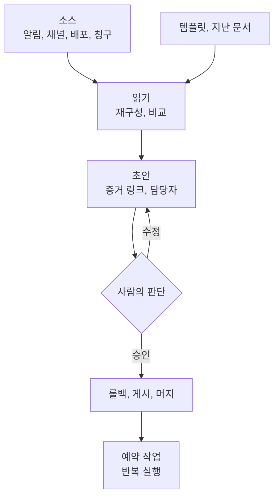

---

title: "[Claude Academy 9편] 엔지니어링 사용 사례 (온콜 분류, 포스트모템, 인수인계, 비용 이상, 버그 수정)"
date: 2026-10-29
categories: [AI, Claude]
tags: [AI, OnCall, Postmortem, SRE, ClaudeTag]
layout: post
toc: true
math: false
mermaid: true
series: claude-academy
series_order: 9

---

## 참고자료

- [Claude Academy - 엔지니어링 과정 목록](https://academy.claude.com/ko/all?department=engineering)
- Claude Academy 사용 사례: Triage on-call alerts and diagnose incidents, Draft the incident postmortem, Write the on-call handoff brief
- Claude Academy 사용 사례: Monthly cloud-cost anomaly report, Fix a reported bug with a draft PR, Write the design doc or RFC, Sprint retro and on-call handoff, Engineering performance reviews, Handle a request while away from your keyboard
- 수집 기준: Claude Academy 엔지니어링 목록의 2026-10-21 수집본이다. 베타와 미리보기 표기, 요금제 조건, 모델 이름은 이후 바뀔 수 있다.

---

## 배경

앞의 편들이 기능을 설명했다면, 사용 사례는 같은 기능이 실제 엔지니어링 업무에서 어떻게 묶이는지를 보여 준다. 엔지니어링 분야 사용 사례 아홉 개를 운영 업무 중심으로 정리한다. 사례 대부분은 Cowork에서 Engineering 플러그인의 스킬(Skill, 원문에서 Share로 팀에 공유하고 `/schedule`로 예약하는 작업 단위)을 쓰거나, Slack의 Claude Tag에 채널 지시를 걸어 두는 두 가지 형태다.

예외가 둘 있다. 성과 리뷰는 Human Resources 플러그인의 `/performance-review`를 출발점으로 쓰고, 자리를 비운 상태의 요청 처리는 휴대폰에서 컴퓨터의 Claude에 지시하는 Dispatch를 쓴다.

1인 DevOps 입장에서 중요한 것은 두 가지다. 사람이 승인해야 하는 지점이 어디에 있는지, 그리고 증거 없는 서술이 어떻게 막히는지다. 알림 분류 사례는 [AI 10편](/posts/alertmanager-chatops-ai-diagnosis/), 진단 검토는 [AI 12편](/posts/rca-diagnosis-review-agents/)에서 직접 만든 구현과 비교할 수 있다.

정리하면서 확인하고 싶었던 것들이다.

- 알림을 자동 분류하고 조치까지 맡길 때 승인은 어디에 두는가?
- 포스트모템과 인수인계는 어떤 입력으로 어떻게 만드는가?
- 비용 이상과 버그 수정은 무엇을 기준으로 맡기는가?
- 설계 문서와 회고, 성과 리뷰에서 판단은 누가 하는가?
- 이 사례들에 공통된 구성은 무엇인가?

---

## 큰 그림

사례들은 같은 구조를 공유한다. 입력 소스를 읽고, 템플릿에 맞춰 초안을 만들고, 판단이 필요한 곳을 표시하고, 반복은 예약한다.

1절은 온콜 알림, 2절은 사후 문서, 3절은 비용과 버그, 4절은 문서와 리뷰, 5절은 공통 구성, 6절은 사례별 예약과 연결 도구다.

---

## 1. 온콜 알림 분류와 진단

첫 질문이다.

Claude Tag를 온콜 채널에 초대하고 모니터링, 호출, 코드 호스트를 연결하면 알림마다 조사 결과가 스레드에 올라온다. 채널에는 `/invite @Claude`로 초대한다.

Claude는 알림이 실제인지, 무엇이 깨졌는지, 원인과 수정안이 무엇인지 알려 주고, 온콜 담당자가 승인하면 롤백을 실행한다. 이후 수정안을 초안 pull request(PR, 코드 변경 제안)로 열고 사고 요약을 게시한다.

`@Claude what can you access from this channel?`로 연결된 도구를 먼저 확인한다. 도구는 Datadog이나 Grafana, Sentry, PagerDuty, 코드 저장소, 배포 또는 기능 플래그 도구다. 배포 도구가 없으면 Claude가 롤백 단계를 글로 쓰고 사람이 실행한다.

알림 연동의 메시지 템플릿에 `@Claude`를 넣고 `Respond automatically`를 켜면 사람이 태그하지 않아도 대응한다. 지시는 채널에 새 메시지로 한 번 올려 이후 모든 알림에 적용한다. **누구를 멘션할지와 롤백 전에 승인을 기다릴지를 지시에 명시한다.**

사례의 결과는 두 갈래다.

| 알림 | 판단 |
|---|---|
| 디스크 경고 | 매일 밤 압축 작업이라 조치가 필요 없다고 판단했다. |
| `checkout-api` 지연 | `tax-service` v3.12 배포가 연결 풀을 40에서 20으로 줄인 것이 원인이라고 확인했다. 담당자 승인 후 v3.11로 롤백하고 15분간 유지를 확인했다. 연결 풀 복원과 부하 시험을 추가한 초안 PR(#377)과 사고 요약을 올렸다. |

승인 전에 링크된 PR과 지연 대시보드를 열어 배포가 지연 증가보다 먼저인지 확인한다. 알림이 많은 채널에서는 조사할 게시물 유형과 무시할 유형을 지정한다. Claude가 직접 롤백할 수 있는지는 관리자가 연결에 준 접근 권한이 정한다. 스레드의 누구나 답글로 Claude를 교정할 수 있다.

추측이지만 자동화 범위가 넓을수록 잘못된 롤백의 영향도 커질 수 있다. 원문에는 이 내용이 없고, 원문이 정한 장치는 지시에 적는 승인 대기와 관리자가 연결에 주는 접근 권한이다.

후속 루틴으로 2시간마다 알림 대시보드를 이전 상태와 비교하는 점검, 월요일 9시(동부 시간)의 온콜 인수인계 게시, 채널 루틴 목록 확인이 있다. 루틴 프롬프트에는 시간대를 명시한다.

---

## 2. 포스트모템과 인수인계

두 번째 질문이다.

### 2.1 포스트모템

Cowork가 인시던트 채널 전체를 읽어 타임스탬프가 붙은 사건 순서, 고객 영향, 근본 원인과 기여 요인을 정리하고 팀 템플릿으로 초안을 쓴다. Engineering 플러그인의 `/incident-response`가 출발점이다.

| 입력 | 내용 |
|---|---|
| 채널 | 모든 타임스탬프, 결정, 상태 업데이트 |
| 알림 | 알림 타임라인, 호출 대상, 확인과 해결 시각 |
| 그래프 | 영향 시간대의 오류율과 지연 |
| 폴더 | 포스트모템 템플릿, 런북, 로그 내보내기, 그래프 캡처 |

프롬프트의 요령은 세 가지다. **"요약"이 아니라 "재구성"을 요청**하면 타임라인이 기억이 아니라 증거로 만들어진다. 근본 원인과 기여 요인을 나눠 요청하면 한 줄짜리 희생양 대신 실제 인과 사슬이 나온다. 어조를 지정하면 서술이 사람이 아니라 시스템 동작에 머물러 리뷰를 통과하기 쉽다. 이것이 blameless(비난 없는) 서술이다. 모든 액션 아이템에는 담당자를 붙인다.

템플릿을 주면 섹션, 심각도 척도, 액션 아이템 형식에 그대로 들어간다.

인시던트가 해결되면 `/schedule`로 평일 오후 6시에 PagerDuty에서 최근 24시간 내 해결된 인시던트를 찾아 `Incidents/<incident-id>/`에 초안을 쓰게 예약한다. 

### 2.2 온콜 인수인계

근무 기간의 페이지, 인시던트 채널, 고객 지원 에스컬레이션, 프로덕션 배포를 모아 인수인계 문서를 쓴다. 출발점은 Engineering 플러그인의 `/standup` 등 인시던트와 운영 스킬이다.

소스는 근무 중 모든 페이지의 확인 시각과 해결 내용, 발생 알림, 인시던트 채널과 #support-escalations, 근무 중 나간 프로덕션 배포와 변경 요약이다. 인수인계 템플릿, 지난주 브리프, 런북 색인을 작업 폴더에 모아 Cowork 프로젝트로 만들면 템플릿, 채널 목록, 심각도 정의가 교대마다 유지된다.

프롬프트는 최근 7일의 페이지와 인시던트 채널, 고객 지원 에스컬레이션, 배포를 대상으로 지정한다. 항목마다 필드를 정한다.

| 필드 | 내용 |
|---|---|
| 상태 | resolved, monitoring, still open이다. |
| 원인 | 한 줄이다. |
| 다음 온콜이 볼 점 | 새벽 2시에도 바로 분류할 수 있는 구성이다. |

저장은 폴더와 `#oncall` 두 곳에 해서 기록과 가시성을 함께 확보한다. 지난 주 브리프를 입력에 포함하면 지난 교대에서 monitoring이던 항목이 빠지지 않고 이어진다. 3회를 넘게 울린 알림 목록과 열린 항목의 런북 링크도 요청할 수 있다. 매주 월요일 오전 9시에 지난 7일을 정리해 게시하도록 예약한다.

### 2.3 스프린트 회고와 인수인계

Cowork가 방금 닫힌 Linear 사이클과 2주치 팀 채널, 온콜 채널을 읽어 회고와 인수인계를 따로 쓴다. 출발점은 Engineering 플러그인의 `/tech-debt`와 `/standup`이다.

두 문서는 목적이 다르므로 나눈다. 섞으면 둘 다 묻힌다. 회고는 논의할 대화 자료이고 인수인계는 운영 자료다.

| 문서 | 담는 내용 |
|---|---|
| 회고 | 출하, 지연된 이유, 논의할 주제다. |
| 인수인계 | 열린 알림, 반복 업무(toil), 다음 교대가 볼 점이다. |

소스는 계획, 출하, 이월 항목과 이유를 담은 사이클, 팀과 온콜 채널의 맥락, 교대 기간의 모든 페이지다. 티켓은 무엇이 움직였는지, Slack은 왜 그랬는지를 알려 주므로 두 소스를 함께 읽는다. 반복 업무는 추정하지 않고 건수로 센다.

항목마다 이유를 요청한다. 회고는 목록이 아니라 이유를 다루므로 이유가 종합을 이끈다.

각 섹션은 30분 회의 분량으로 제한한다. 길이 제한이 모든 항목을 나열하는 목록 대신 논의할 가치가 있는 주제만 남긴다. 프롬프트에는 필요하면 인용을 넣으라고 적는다.

회고 템플릿, 열려 있는 액션 아이템 목록, 지난 스프린트 회고를 한 폴더에 두고 Cowork 프로젝트로 만들면 팀의 "출하" 정의와 논의 질문 형식이 매 사이클 유지된다.

---

## 3. 비용 이상과 버그 수정

세 번째 질문이다.

### 3.1 클라우드 비용 이상

이번 달 AWS 비용을 최근 3개월 평균과 서비스, `tag:team`별로 비교해 기준을 넘은 항목의 원인과 담당자를 정리한다. 출발점은 Engineering 플러그인의 `/debug`이고, Cost Explorer나 BigQuery 청구 내보내기를 읽어 기준선을 만들고 태그별 차이를 묶는다.

기준은 정하는 이유가 있다. **한 달은 잡음이고 세 달은 기준선**이다. 임계값을 20% 초과로 두면 숫자 더미가 읽을 가치가 있는 짧은 목록이 된다.

이상 항목마다 원인 워크로드나 변경, 담당 팀, 권장 조치를 적게 하면 보고서가 할 일 목록이 된다. 상단에는 인프라 채널용 한 줄 요약을 둔다. 비용이 바뀐 날짜 전후에 서비스에 병합된 변경과 같은 시간대의 트래픽, 배포, 작업을 소스로 읽는다. 비용과 사용량은 웨어하우스의 테이블에서 읽는다. 확신 없는 부분을 표시하라고 요청하면 먼저 확인할 곳을 알 수 있다. 매주 월요일 오전 7시에 새 월 청구 내보내기가 있으면 보고서를 쓰고 요약을 `#infra-cost`에 올리게 예약한다.

청구 CSV, 태그와 팀 매핑, 지난 분기 보고서를 한 폴더에 두면 기준선과 담당자 지도가 마련되고, 임계값과 이미 허용한 예외가 달마다 유지된다. 추측이지만 태그 매핑이 틀리면 담당자 지정도 틀릴 수 있다. 원문에는 이 내용이 없다.

결과 파일은 비용과 예산 비교 같은 후속 작업으로 이어 갈 수 있다.

### 3.2 버그 수정 초안 PR

버그 보고 스레드에 답글로 요청하면 Claude Tag가 재현하고 원인을 찾아 초안 PR을 연다. 작업 상황은 스레드에 올라오며 팀원 누구나 다른 접근을 요청할 수 있다.

준비 조건은 GitHub 연결이 있는 채널, 버그가 있는 저장소 연결, Claude의 채널 참여(`/invite @Claude`)다. 연결된 도구는 `@Claude what can you access from this channel?`로 확인한다.

요청에는 저장소 이름과 멈출 시점(초안 PR이 열리고 CI가 통과할 때)을 적는다. 첫 메시지 전에는 Claude에게 코드 사본이 없으므로 저장소 이름을 말해야 복제한다. 원문 프롬프트는 저장소(acme/data-pipeline)를 지정하고, 완료 기준으로 CI 통과와 PR이 스레드를 링크하는 것을 적는다.

첫 답글은 작업하면서 수정되는 체크리스트이고, 완료하면 재현 커밋, 원인, 수정 내용, PR 번호를 보고한다. 예시 원인은 3월 1일 이후 레코드의 JSON 내보내기에 `created_at`이 빠지는 문제였다. 모델에는 필드가 추가됐으나 `export/schema.py`가 고쳐지지 않았다.

수정에는 매핑 추가와 테스트가 포함된다. 테스트는 수정 없이는 실패하고 수정 후 통과한다. PR은 사람이 리뷰 준비로 표시하기 전까지 초안이다.

Claude는 자기 GitHub 계정으로 코드 사본에서 작업하므로 브랜치 보호와 리뷰가 적용되고 머지는 엔지니어가 정한다. 머지 전에 변경 코드를 읽고 새 테스트가 보고된 사례를 다루는지 확인한다.

후속 사용법은 다섯 가지다.

| 후속 사용 | 내용 |
|---|---|
| 접근 수정 | 스레드 안에서 코드 담당자가 `export/fields.py`에서 필드 목록을 읽도록 요청하면 같은 PR이 수정된다. |
| PR 감시 | PR을 감시하고 CI 결과를 게시한다. 실패 때만 호출하게 할 수 있다. |
| 새 보고에 자동 대응 | 채널의 Respond automatically를 켜고, 재현 시도 후 초안 PR 또는 시도 내용을 올리도록 한 번 지시한다. |
| 지시 목록 조회 | 채널에 저장된 지시 목록을 조회한다. |
| 원인 진단만 | 수정 없이 원인 진단만 요청한다. |

저장소 관례(파일 위치, PR에 반드시 넣을 항목)는 한 번 가르치면 이후 작업에서 따른다.

### 3.3 자리를 비운 상태의 요청 처리

Dispatch로 휴대폰에서 지시하면 Claude가 내 컴퓨터의 파일을 찾아 Slack으로 보낸다. 컴퓨터가 켜져 있고 Claude 데스크톱 앱이 실행 중이어야 동작한다. 파일은 클라우드에 올리지 않고 컴퓨터 안에서 읽은 뒤 연결된 도구로 전달하며, 원본 문서는 컴퓨터에 그대로 남는다.

Dispatch 설정의 keep-awake 토글을 외출 전에 켜야 컴퓨터가 잠들지 않아 요청에 응답한다. 노트북을 열기 불편한 상황에서도 짧은 지시를 보내 처리할 수 있다.

예시는 동료가 Slack으로 요청한 Q2 예산 스프레드시트를 Documents/Finance 폴더에서 찾아 #proj-planning 채널에 올리는 작업이다. 필요한 접근 권한은 로컬 파일과 Slack 커넥터 하나다. 프롬프트는 파일 위치와 이름 조건, 게시할 채널, 첨부 메모 내용을 구체적으로 지정한다.

Slack 전송 권한이 needs-approval이면 Claude가 게시 전에 메시지를 보여 주고 승인을 확인한다. Slack, Gmail 같은 커넥터는 전송 권한을 needs-approval로 두는 것이 안전하다.

후속 사용 예는 세 가지다.

- 승인 후 발송하는 답장 초안
- 책상 복귀 후 같은 대화에서 보낸 내역 확인
- 컴퓨터 사용(computer use)으로 데스크톱 앱 조작

컴퓨터 사용은 기본이 꺼져 있고 Dispatch 설정에서 따로 켜야 하며, 새 앱을 조작할 때마다 승인을 요청한다.

---

## 4. 설계 문서, 회고, 성과 리뷰

네 번째 질문이다.

| 사례 | 입력 | 사람의 역할(원문 서술) |
|---|---|---|
| 설계 문서와 RFC | 위키와 과거 RFC에서 찾은 선행 사례, 코드와 ADR(Architecture Decision Record, 설계 결정 기록), 템플릿이다. | 본인만 아는 부분은 직접 채우도록 표시한다. 접근법을 두세 가지 요구하면 홍보가 아니라 장단점 표가 나온다. |
| 스프린트 회고 | 닫힌 Linear 사이클, 팀 채널 2주치, 온콜 채널이다. | 원문에 사람의 역할 서술은 없다. 30분 길이 제한이 논의할 가치가 있는 주제만 남긴다. |
| 성과 리뷰 | 병합된 PR, 남긴 코드 리뷰, 대응한 인시던트, 팀원이 이끌거나 동료를 도운 스레드, 출하한 프로젝트와 에픽, 담당한 사이클 성과다. | 평점은 관리자가 맡는다. 모든 주장에 증거 링크를 요구하고 평점은 쓰지 않게 한다. |

설계 문서는 Engineering 플러그인의 `/system-design`이 출발점이고 RFC(Request for Comments, 설계 제안 문서) 템플릿 채우기와 위키 선행 사례 검색 구조를 갖췄다. 커넥터는 Atlassian Rovo(Confluence의 선행 RFC 조회와 문서 작성), 코드와 과거 ADR, RFC 템플릿과 설계 리뷰 데이터베이스다.

RFC 템플릿, 메모, 과거 RFC, 아키텍처 다이어그램을 한 작업 폴더에 모아 Cowork 프로젝트로 만들면 템플릿과 리뷰 체크리스트가 계속 붙어 있다. 프롬프트는 선행 사례와 제약 조사, 템플릿 형식(문제, 목표와 비목표, 접근법, 권고안, 미해결 질문), 직접 채울 부분 표시를 요청한다. 원문 예시는 이벤트 파이프라인을 배치에서 스트리밍으로 옮기는 설계 문서다.

직접 채울 부분을 밝히면 Cowork는 구조와 조회를 맡고 사람은 판단에 시간을 쓴다. 예시 문서를 폴더에 넣으면 구조와 문체를 맞추고, 확신 없는 부분을 표시하라고 하면 먼저 확인할 곳을 알 수 있다.

성과 리뷰는 Human Resources 플러그인의 `/performance-review`가 출발점이며 한 팀원의 기간 작업을 모아 프레임워크 기준으로 리뷰를 쓴다.

커리어 프레임워크, 리뷰 템플릿, 지난 사이클 리뷰, 팀 명단을 한 폴더에 두고 Cowork 프로젝트로 만들면 프레임워크와 문체가 유지되고 팀원마다 초안 한 개가 폴더에 저장된다. 프롬프트는 팀 명단의 엔지니어별로 프레임워크 형식의 분기 리뷰를 쓰되 증거 링크, 지난 리뷰의 성장 영역 포함, 판단 지점 표시, 평점 작성 금지를 지정한다.

모든 주장에 증거 링크를 요구하면 캘리브레이션에서 방어 가능한 초안이 나온다. 지난 리뷰의 성장 영역을 입력에 넣으면 이번 분기의 한 장면이 아니라 진척을 다룬다. 커리어 프레임워크를 주면 초안이 범용 사다리가 아니라 우리 팀의 레벨과 역량에 맞는다. **평점은 관리자의 몫이라고 밝히면 증거를 모아 정리하는 데서 멈춘다.**

추측이지만 증거 링크가 있어도 링크가 주장을 뒷받침하는지는 사람이 확인해야 할 수 있다. 원문에는 이 내용이 없다.

---

## 5. 공통 구성

다섯 번째 질문이다.

| 구성 요소 | 내용 |
|---|---|
| 출발 스킬 | Engineering 플러그인의 `/incident-response`, `/standup`, `/debug`, `/system-design`, `/tech-debt`와 Human Resources 플러그인의 `/performance-review`다. |
| 작업 폴더 | 템플릿, 지난 문서, 런북을 한 폴더에 모아 Cowork 프로젝트로 만든다. 템플릿과 정의가 매번 유지된다. |
| 프롬프트 | 소스, 필드, 저장과 게시 위치를 구체적으로 지정한다. |
| 예약 | `/schedule`로 요일과 시각을 정한다. |
| 공유 | 스킬을 Share로 팀에 공유하면 누가 실행해도 같은 형식이 나온다. |

원문은 사례마다 스킬 공유 효과와 같은 방식을 적용할 수 있는 다른 문서를 적는다. 온콜 알림 분류, 버그 수정, 자리를 비운 상태의 요청 처리는 해당 항목이 없다.

| 사례 | 공유 효과 | 적용할 수 있는 다른 문서 |
|---|---|---|
| 포스트모템 | 온콜 엔지니어 누구나 같은 형식으로 쓰고 리뷰 회의가 정확성 확인부터 시작된다. | 온콜 인수인계, 런북 수정, 스프린트 회고 |
| 온콜 인수인계 | Skills 메뉴의 Share로 교대에 참여하는 팀원 전체에 공유하면 같은 형식의 브리프가 나온다. | 인시던트 포스트모템, 릴리스 요약, 주간 운영 리뷰 |
| 온콜 알림 분류 | 해당 항목 없음. | 해당 항목 없음. |
| 비용 이상 | 월중에 이상이 보일 때 인프라 엔지니어 누구나 같은 분석을 돌린다. | 다른 클라우드 제공자, SaaS 도구 비용, 팀별 예산 점검 |
| 설계 문서 | Skills 메뉴의 Share로 팀원이나 워크스페이스 전체에 공유한다. 예약 작업과 함께 모든 테크 리드가 같은 형식으로 RFC를 올리게 한다. | API 변경, 스키마 마이그레이션, 아키텍처 결정 |
| 스프린트 회고 | 모든 스쿼드가 같은 방식으로 회고를 준비한다. | 인시던트 포스트모템, 릴리스 노트, 주간 현황 요약 |
| 성과 리뷰 | 동료 관리자에게 공유하면 같은 사다리로 초안을 쓰므로 캘리브레이션에서 비교가 쉽다. | 승진 패킷, 캘리브레이션 준비, 동료 피드백 요약 |

플러그인 관련 주의사항은 설계 문서 사례에만 있다. 관리자가 플러그인을 관리하는 조직에서는 `/system-design`이 아직 없을 수 있으나 나머지 단계는 플러그인 없이 가능하다.

사람의 확인을 명시하는 지점은 사례마다 다르다. 알림 분류는 롤백 전 담당자 승인, 버그 수정은 엔지니어의 머지 결정, 성과 리뷰는 관리자의 평점, 설계 문서는 본인만 아는 부분의 직접 작성이다. 자리를 비운 상태의 요청 처리는 Slack 전송 권한이 needs-approval일 때 게시 전 승인이다.

---

## 6. 보완: 사례별 예약과 연결 도구

원문 사례의 예약 설정과 연결 도구를 그대로 모았다. 표현은 요약본 기준이다.

| 사례 | 예약과 루틴 | 연결 도구 |
|---|---|---|
| 인시던트 포스트모템 초안 작성하기 | `/schedule`로 평일 오후 6시에 PagerDuty에서 최근 24시간 내 해결된 인시던트를 찾아 `/incident-response`를 돌리고 `Incidents/<incident-id>/`에 초안을 작성한다. | 연결 도구는 Slack 인시던트 채널, PagerDuty, 오류율과 지연 그래프, 작업 폴더이다. |
| 온콜 인수인계 브리프 작성하기 | `/schedule`로 매주 월요일 오전 9시에 지난 7일을 정리해 `Platform/Oncall/<week>.md`에 쓰고 #oncall에 게시한다. | 연결 도구는 알림 관리 도구, 인시던트 채널과 #support-escalations(Slack), 배포 기록, 작업 폴더이다. |
| 온콜 알림 분류와 장애 진단 | 후속으로 2시간마다 알림 대시보드를 이전 상태와 비교하는 루틴, 월요일 9시(동부 시간) 온콜 인수인계 게시 루틴, 채널 루틴 목록 확인이 있다. 루틴 프롬프트는 알림 대시보드 주기 점검과 월요일 인수인계 게시를 맡기며 시간대를 명시한다. | 연결 도구는 Slack의 Claude Tag, 모니터링, PagerDuty, 코드 호스트, 배포 도구이다. |
| 월간 클라우드 비용 이상 보고서 만들기 | `/schedule`로 매주 월요일 오전 7시에 새 월 청구 내보내기가 있으면 `/debug`를 돌려 보고서를 쓰고 #infra-cost에 요약을 게시한다. | 연결 도구는 웨어하우스(비용 테이블), 코드 저장소, 청구 내보내기와 태그 매핑이 든 작업 폴더이다. |
| 보고된 버그를 초안 PR로 고치기 | 해당 없음. | 연결 도구는 Slack 채널의 Claude Tag와 GitHub 저장소 연결이다. 오류 원인을 읽으려면 에러 추적 도구도 연결하면 된다. |
| 설계 문서와 RFC 작성하기 | `/schedule`로 평일 오전 9시에 RFCs/inbox의 새 한 장짜리 메모를 `/system-design`으로 구조화된 초안으로 바꿈. | 연결 도구는 Atlassian Rovo(Jira, Confluence), 코드 저장소, 작업 폴더이다. |
| 스프린트 회고와 온콜 인수인계 작성하기 | `/schedule`로 매주 금요일 오후 3시에 닫힌 사이클에 `/tech-debt`, 최근 2주에 `/standup`을 돌려 `Platform/retros/<sprint>/`에 쓰고 #oncall-platform에 인수인계를 게시한다. | 연결 도구는 Linear, Slack(팀 채널, 온콜 채널), 알림 도구, 작업 폴더이다. |
| 엔지니어 성과 리뷰 초안 작성하기 | `/schedule`로 매주 월요일 오전 9시에 Reviews 아래 새 분기 폴더가 생겼는지 확인하고, 있으면 team-roster.md의 모든 팀원에게 `/performance-review`를 돌려 초안을 `Reviews/<quarter>/<name>.md`에 작성한다. | 연결 도구는 GitHub, Linear, Slack, 작업 폴더이다. |
| 자리를 비운 상태에서 요청 처리하기 | 해당 없음. | 연결 도구는 로컬 파일과 Slack 커넥터이며, 실행은 데스크톱 앱과 모바일 앱의 Dispatch로 한다. |

포스트모템 사례는 팀 템플릿, 심각도 정의, 비난 없는 표현 가이드를 프로젝트에 두고, 인수인계 사례는 이전 버전을 포함해 지난 교대의 monitoring 항목을 잇는다. 성과 리뷰는 병합된 PR, 남긴 코드 리뷰, 대응한 인시던트, 출하한 프로젝트와 에픽, 담당한 사이클 성과를 소스로 읽는다.

---

## 내 자산에 적용

점검 대상은 알림 연동, 인시던트 문서화 절차, 인수인계 문서, 비용 점검, `postmortem-writer`나 `mis-troubleshooter` 같은 장애 대응용 에이전트와 스킬이다.

| 점검 | 개선 |
|---|---|
| 포스트모템 에이전트가 "요약"을 요청하는가? | "재구성"으로 바꿔 채널의 타임스탬프, 알림 타임라인, 확인과 해결 시각에서 증거 기반 타임라인을 만든다. |
| 근본 원인과 기여 요인이 한 줄로 합쳐지는가? | 둘을 나눠 요청한다. |
| 서술이 사람을 향하는가? | 시스템 동작을 서술하는 blameless 어조를 지정하고 모든 액션 아이템에 담당자를 붙인다. |
| 진단 에이전트가 승인 없이 조치하는가? | 지시에 롤백 전 승인 대기와 멘션 대상을 명시한다. 직접 실행 권한은 연결 권한으로 제한한다. |
| 승인 전 근거를 확인하지 않는가? | 링크된 PR과 지연 대시보드를 열어 배포가 증상보다 먼저인지 확인한다. |
| 인수인계 문서에 형식이 없는가? | 항목마다 상태(resolved, monitoring, still open), 원인 한 줄, 다음 담당자가 볼 점을 필드로 둔다. 지난 문서를 입력에 포함한다. |
| 비용 점검의 기준이 불명확한가? | 3개월 평균 대비 20% 초과 같은 임계값을 정하고, 항목마다 담당자와 권장 조치를 적게 한다. 허용한 예외를 폴더에 둔다. |
| 장애 분석을 처음부터 쓰는가? | 템플릿, 런북, 로그 내보내기를 한 폴더에 두고 프로젝트로 만든다. |
| 버그 수정 요청이 모호한가? | 저장소 이름과 멈출 시점(초안 PR이 열리고 CI가 통과할 때)을 적는다. |

연습할 것은 자동화를 만들기 전에 읽을 소스 목록과 사람이 서명하는 지점부터 적는 습관이다.

전수 점검의 순서와 지시문은 [11편](/posts/claude-academy-improvement-guide/)에 있다.

---

## 정리하며

처음 던진 질문들에 대한 답이다.

**알림 분류와 승인.** 채널 지시에 멘션 대상과 롤백 전 승인 대기를 명시한다. 직접 롤백 여부는 연결에 준 권한이 정한다.

**포스트모템과 인수인계.** "재구성"으로 증거 기반 타임라인을 만들고, 근본 원인과 기여 요인을 나누고, 비난 없는 어조를 지정한다. 인수인계는 상태, 원인 한 줄, 다음 온콜이 볼 점으로 쓴다.

**비용 이상과 버그 수정.** 3개월 평균 대비 20% 초과만 담당자와 함께 올린다. 버그는 저장소와 멈출 시점을 정하고 초안 PR로 받는다.

**문서와 리뷰의 판단.** 설계 문서는 본인만 아는 부분을 직접 채우도록 표시하고, 성과 리뷰는 평점을 관리자가 맡는다. 회고는 원문에 사람의 역할 서술이 없고 30분 길이 제한이 주제를 추린다.

**공통 구성.** 소스, 템플릿 폴더, 증거 링크, 예약, 공유로 이뤄진다.

정리하고 나서 가장 크게 바뀐 인식은 **자동화의 품질이 프롬프트의 문장보다 입력 소스와 사람이 서명하는 지점을 얼마나 구체적으로 정했는가에서 갈린다**는 점이었다. 그래서 자동화를 만들 때 소스 목록과 승인 지점부터 적는다.
