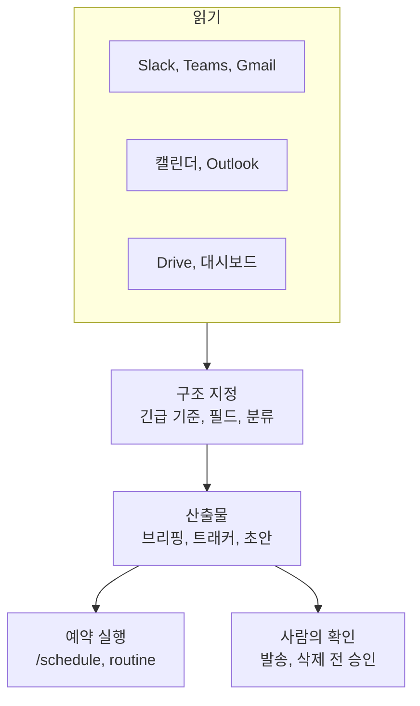

---

title: "[Claude Academy 10편] 업무 자동화 사용 사례와 웨비나 (브리핑, 메시지 정리, 현황 보고, 비교 분석)"
date: 2026-10-29
categories: [AI, Claude]
tags: [AI, Cowork, Automation, Briefing, Webinar]
layout: post
toc: true
math: false
mermaid: true
series: claude-academy
series_order: 10

---

## 참고자료

- [Claude Academy - 엔지니어링 과정 목록](https://academy.claude.com/ko/all?department=engineering)
- Claude Academy 사용 사례: Build a daily briefing across your tools, Morning and evening briefing, Message sweep, Week-ahead prep, Quickly Prep for Your Week, Prepare and plan from your calendar
- Claude Academy 사용 사례: Thread to decision, My voice, Ask the company, Generate project status reports, Weekly status posts from the team's channels and tracker
- Claude Academy 사용 사례: Compare and analyze competing options, Size a market using your research, Source Insights from Your Tools to Build a Deck, Create a company newsletter, Create a process flowchart, Create interactive PDF forms, Turn emails into an event tracker, Clean up promotional emails, Explore what Claude can do for you
- Claude Academy 웨비나 목록(2026년 9월에서 10월)
- 수집 기준: Claude Academy 엔지니어링 목록의 2026-10-21 수집본이다. 베타와 미리보기 표기, 요금제 조건, 모델 이름은 이후 바뀔 수 있다.

---

## 배경

[9편](/posts/claude-academy-use-cases-engineering/)이 장애, 온콜, 코드처럼 엔지니어링 업무에 한정된 사례였다.

이 글은 그 밖의 업무 사례 스무 개를 묶는다. 하루 일정 준비, 메시지 정리, 현황 보고, 문서 비교, 양식과 트래커 만들기다. 직무와 상관없이 반복되는 업무라서 1인 운영자에게도 시간이 드는 일이다.

사례를 하나씩 보면 서로 다른 일 같지만, 구성은 **몇 가지 패턴**으로 모인다. 이 글은 패턴을 먼저 세우고 사례를 그 아래에 놓는다. 마지막에는 같은 시기에 게시된 웨비나 목록을 표로 남긴다.

웨비나는 영상이라 카드의 제목과 설명만 수집했고 본문은 확인하지 못했다.

정리하면서 확인하고 싶었던 것들이다.

- 일정과 메시지 정리 사례는 어떤 구성으로 만드는가?
- 현황 보고와 결정 기록은 증거를 어떻게 남기는가?
- 비교와 분석 사례는 무엇을 입력하고 무엇을 확인하는가?
- 결과물을 만드는 사례(뉴스레터, 흐름도, 양식, 트래커)의 요령은 무엇인가?
- 웨비나는 어떤 주제를 다뤘는가?

---

## 큰 그림

대부분의 사례는 세 단계다. 여러 도구에서 읽고, 지정한 구조로 묶고, 일정에 맞춰 반복한다. 어느 도구를 쓰는지에 따라 실행 환경만 달라진다.

1절은 일정과 메시지, 2절은 현황과 결정 기록, 3절은 비교와 분석, 4절은 결과물 만들기, 5절은 웨비나, 6절은 사례별 예약과 연결 도구다.

---

## 1. 일정과 메시지 정리

첫 질문이다.

| 사례 | 입력 | 산출물 |
|---|---|---|
| 일일 브리핑 | Slack, Notion, 대시보드(Chrome 커넥터로 탭을 직접 읽음)다. | 대시보드 긴급 항목, 내가 언급된 Slack 스레드, 내가 없지만 알아야 할 스레드(내가 언급되지 않았지만 알아야 할 스레드), 이번 주 마감 작업과 막힌 요인 순의 브리핑이다. |
| 아침과 저녁 | 평일 오전 8시와 오후 6시의 두 실행이다. | 아침은 급한 일, 마감, 나를 기다리는 사람, 가장 먼저 할 세 가지다. 저녁은 한 일, 밀린 일, 내일의 시작점이다. |
| 메시지 정리 | Slack DM과 멘션, Teams 피드, Gmail의 최근 24시간 안 읽은 메시지다. | 앱이 아니라 주제별로 묶고 답장 필요, 읽을 것, 참고용으로 분류한다. 답장 필요 항목에는 초안을 붙인다. |
| 다음 주 회의 | 다음 주 캘린더다. | 회의별 한 문단 안건과 가장 준비가 필요한 세 건 표시다. 일요일 밤용 문서 한 개다. |
| 주간 개요 | Outlook 캘린더와 받은편지함(Microsoft 365 커넥터)이다. | 준비가 필요한 회의, 긴급 이메일, 과예약 구간, 집중 시간이다. |
| 내일 회의 점검 | Google Calendar와 Gmail(Chrome)이다. | 내부와 외부 회의를 구분하고 관련 스레드를 찾고 회의실이나 화상 링크 누락을 채운다. |

일일 브리핑은 **프롬프트에서 브리핑 구조와 긴급 기준을 직접 지정**한다. 대시보드의 빨간색이나 하락 추세 항목이 긴급이다.

긴급 항목은 관련자, 논의 내용, 미해결 사항까지 깊게 가져온다. 결과 예는 파이프라인 속도 15% 하락과 `#sales` 스레드를 한 항목으로 묶은 형태다.

예약하면 **Anthropic 서버에서 돌아 노트북이 꺼져 있어도** 결과가 준비된다. 이 예약 브리핑은 기본적으로 원격 세션(베타)에서 실행된다.

아침과 저녁 두 실행은 **`Daily` 폴더의 날짜별 파일로 이어져서** 이월 항목이 빠지지 않는다.

다음 주 회의 준비의 회의별 맥락은 지난 만남, 관련 Slack 스레드, 첨부나 언급된 문서, 내가 상대에게 빚진 미결 사항이다. 결과는 주간 폴더에 쌓여 금요일 회고에서 그대로 읽을 수 있다.

**읽는 범위가 넓으면 느려질 수 있다**는 점은 추측이다. 작업 패널에서 어느 커넥터가 느린지 실시간으로 확인할 수 있다. 후속 질문은 같은 대화에서 하면 전체를 다시 조회하지 않고 다듬는다.

내 문체 프로필 사례는 이 흐름에 붙는다. 보낸 메시지를 읽어 어조와 문체를 분석하고 `/my-voice` 스킬(작업 절차를 묶은 Claude Code 폴더)로 저장하면 이후 초안이 내 말투에 맞는다.

첫 프로필은 한 시점의 스냅숏이므로 초안을 고칠 때마다 수정 내용을 스킬에 **규칙으로 더한다.** 수 주가 지나면 초안을 거의 고치지 않아도 된다.

### 1.1 브리핑과 일정 준비 세부

위 표에 담지 못한 원문 사실이다.

| 사례 | 항목 | 내용 |
|---|---|---|
| 일일 브리핑 | 필요 환경 | Claude Desktop 또는 원격 세션(베타)이 되는 Claude.ai, Slack과 Notion 커넥터, Claude in Chrome 커넥터다. |
| 일일 브리핑 | 프롬프트 | 아침 브리핑 요청, 출처(Slack, Notion, 대시보드 URL), 4단 구조, 긴급 항목의 심층 맥락 수집을 한 번에 지정한다. |
| 일일 브리핑 | 첫 요청 뒤 | Claude가 중요한 채널, 기간, 형식을 되물을 수 있고 사이드바에 계획을 표시한다. |
| 일일 브리핑 | 후속 프롬프트 | 지표 하락 심층 조사, 스레드 맥락을 넣은 답장 초안, 한 주제의 전체 언급 모음을 요청할 수 있다. |
| 아침과 저녁 | 출발점 | Productivity 플러그인의 `/start`와 `/update`이며 캘린더와 채널을 읽어 중요도를 매기는 구조를 갖춘다. |
| 아침과 저녁 | 파일 | `Daily` 폴더를 지정하면 아침 브리핑과 저녁 마무리가 `YYYY-MM-DD.md`로 저장된다. 저녁 실행이 아침 계획을 읽고 월요일 브리핑이 지난주를 돌아볼 수 있다. |
| 아침과 저녁 | 프로젝트 | 폴더로 Cowork 프로젝트를 만들어 우선순위, 알림 끄기 목록, 어조가 유지되게 한다. |
| 아침과 저녁 | 형식 | 급한 일, 마감, 나를 기다리는 사람, 상위 세 가지는 30초 안에 훑는 고정된 틀이다. 한 페이지 이내로 제한해 또 하나의 받은편지함이 되지 않게 한다. |
| 아침과 저녁 | 이월 | 저녁 마무리가 다음 날 브리핑으로 이어지고 각 실행이 전날 파일을 읽어 맥락이 쌓이므로 다시 설명할 필요가 없다. |
| 아침과 저녁 | 공유와 적용 | 스킬을 Share로 공유하면 팀 누구나 같은 한 페이지 리듬으로 하루를 시작하고 끝낸다. 주간 전망, 회의 전 브리프, 프로젝트 현황 점검에도 적용할 수 있다. |
| 다음 주 회의 | 출발점 | Productivity 플러그인의 `/start`이며 캘린더를 훑어 일정별 맥락을 모으는 구조를 갖춘다. |
| 다음 주 회의 | 폴더 | `Week-of-<날짜>` 폴더를 지정하면 주간 문서, 회의별 안건, 주중에 더하는 준비 노트가 한곳에 모인다. 매주 반복하면 상위 폴더로 Cowork 프로젝트를 만들어 안건 형식과 준비 선호가 유지되게 한다. |
| 다음 주 회의 | 프롬프트 효과 | 지난 만남, Slack 스레드, 문서, 미결 사항을 명시하면 회의마다 찾을 소스가 정해져 일반론이 아닌 출처가 있는 브리프가 나온다. 가장 준비가 필요한 세 건 표시를 요청하면 모든 회의를 같은 비중으로 두지 않는다. |
| 다음 주 회의 | 문서와 회고 | 하나의 주간 문서로 요청하면 일요일에 위에서 아래로 읽을 수 있다. 폴더를 매주 재사용하면 브리핑, 안건, 개인 노트가 쌓여 금요일 회고가 바로 읽힌다. |
| 다음 주 회의 | 공유 | 스킬을 Share로 부하 직원이나 비서와 공유하면 같은 형식의 브리핑이 나오고, 대신 맡은 사람도 같은 맥락으로 월요일을 시작한다. 건너뛸 목록, 준비 단계, 안건 형식을 스킬에 저장한다. |
| 주간 개요 | 프롬프트 | 분석할 날짜, 검색할 도구, 문서 형식을 지정한다. 캘린더에서 준비가 필요하거나 결정이 걸린 회의를 찾고, 받은편지함에서 주말 이메일과 방치 시 긴급해질 스레드를 요약하게 한다. 마지막에 해야 할 작업, 하루 구조, 집중 시간, 이메일 분류를 담은 개요 문서를 만들게 한다. |
| 주간 개요 | 연결 | Settings, Connectors의 Microsoft 365 커넥터로 Outlook 캘린더, 이메일, SharePoint, OneDrive, Teams 대화에 접근시킨다. |
| 주간 개요 | 이메일 분류 | 긴급, 이번 주 우선, 목요일에 일괄 처리할 중간 순위로 나눈다. 월요일에 처리하지 않으면 수요일에 긴급해질 스레드를 짚는다. |
| 주간 개요 | 회의와 이메일 연결 | 이사회 준비 시간이 화요일에 없다는 식의 공백을 찾아 조치 항목으로 정리한다. |
| 주간 개요 | 후속 프롬프트 | 긴급 답장 3건 초안, 회의용 한 페이지 브리프, 간격과 글꼴 같은 형식 조정을 요청한다. |
| 주간 개요 | 범위와 출력 | 개인 도구만 연결하면 개인 파일과 메시지만 검색하며, 회사 전체 정보는 관리자가 만든 "Ask [회사 이름]" 프로젝트를 사용한다. 결과는 Word 외에 스프레드시트, Notion, Slack 메시지로도 출력하고 다듬은 흐름은 스킬로 저장한다. |
| 주간 개요 | 주의 | "내 한 주 계획"처럼 막연하면 모든 회의와 이메일을 검색하므로 우선할 주제를 지정하면 정확도가 오른다. 날짜가 예시 프롬프트와 결과 화면에서 다르므로 실제 주간 날짜를 직접 지정한다. |
| 내일 회의 점검 | 판별 | 참석자 도메인을 보고 내부 회의와 외부 회의를 구분한다. 참석자와 주고받은 최근 이메일 스레드를 찾아 회의 주제와 연결한다. |
| 내일 회의 점검 | 누락 처리 | 대면 회의에 회의실이 없거나 원격 회의에 화상 링크가 없으면 표시하고 배정한다. 외부 회의는 첨부 문서나 관련 이메일처럼 미리 읽을 자료를 안내한다. |
| 내일 회의 점검 | 결과와 환경 | 준비가 필요한 회의, 누락된 항목, 문제없는 회의로 나뉜 하루 준비 요약이 나온다. 내일 날짜의 Google Calendar 탭과 Gmail 탭이 필요하고 두 곳 모두 로그인되어 있어야 한다. |
| 내일 회의 점검 | 권한 | 새 사이트를 방문하기 전에 권한을 요청하며 신뢰하는 도메인은 사이트 단위로 허용할 수 있다. 전송, 게시, 제출 같은 버튼을 누르기 전에 승인을 요청한다. shortcut은 성공한 프롬프트 아래 아이콘으로 저장하거나 "/"를 입력해 실행한다. |

### 1.2 메시지 정리와 문체 세부

| 사례 | 항목 | 내용 |
|---|---|---|
| 메시지 정리 | 출발점 | Productivity 플러그인의 `/start`이며 여러 앱을 읽어 긴급도로 정렬하는 구조를 갖춘다. Microsoft 쪽은 커넥터로 Teams 채팅과 Outlook 스레드까지 읽어 일일 요약에 포함한다. |
| 메시지 정리 | 작업 폴더 | 거의 커넥터만으로 돌아가므로 작업 폴더는 선택 사항이다. 노트 폴더를 지정하면 매일의 정리가 검색 가능한 파일로 남는다. |
| 메시지 정리 | 주제별 묶음 | 같은 대화가 Slack 스레드, Teams 알림, 이메일에 걸쳐 있어도 앱별이 아니라 주제별로 묶으면 한 항목이 되어 답장을 한 번만 한다. |
| 메시지 정리 | 분류와 초안 | 필요한 행동으로 분류하면 답장 초안은 직접 입력할 곳에만 붙고 나머지는 훑어보기만 하면 된다. 초안을 세 문장 이하로 제한하면 빠르게 고쳐 보낼 답장이 나온다. |
| 메시지 정리 | 실시간 | Slack, Teams, Gmail을 커넥터로 실시간으로 읽으므로 오래된 내보내기가 아니라 지금 안 읽은 상태가 나온다. |
| 메시지 정리 | 공유 | 스킬을 Share로 공유하면 같은 채널을 쓰는 팀원이 같은 방식으로 정렬된 아침을 맞고, 신규 입사자도 첫날 감시 목록을 이어받는다. 채널 목록, 우선 발신자, 건너뛸 규칙을 스킬에 저장하면 매번 다시 설명하지 않아도 된다. |
| 내 문체 | 기반 | Productivity 플러그인의 `/memory-management`는 Cowork가 작업 방식에 대해 배운 것을 저장하며, 그 위에 `/my-voice`를 직접 만든다. |
| 내 문체 | 프롬프트 | 짧고 열려 있어야 한다. "보낸 메시지를 읽고 어조와 문체를 알려 달라"는 한 줄로 첫 해석이 빠르게 나오고 이후 다듬는다. |
| 내 문체 | 입력 | 엄선한 글이 아니라 실제로 보낸 글을 읽어야 진짜 습관이 프로필에 들어간다. 메일을 연결하지 않으려면 보낸 메일과 자랑스러운 문서 같은 글쓰기 샘플 폴더를 내보내 지정한다. |
| 내 문체 | 수정 사례 | `Hope you're well`로 시작하지 않기, "team" 대신 "folks" 쓰기, 맥락보다 요청을 먼저 쓰기, 내부 메일 서명은 이름 첫 글자만 쓰기다. |
| 내 문체 | 누적 | 수정한 초안을 예시로 추가하면 이후 초안이 그에 맞춰진다. 고칠 때마다 "그것을 /my-voice에 추가해 달라"고 끝맺는 습관이 격차를 줄인다. 프로필과 이후 수정 내용이 붙어 있도록 Cowork 프로젝트로 만든다. |
| 내 문체 | 공유와 갱신 | `/my-voice`는 개인용이지만 프로필을 뺀 기본 스킬을 공유하면 팀원이 한 번의 프롬프트로 각자 만들 수 있다. 대신 초안을 쓰는 비서나 커뮤니케이션 담당자에게는 사용자의 버전을 공유할 수 있다. 역할이 바뀌면 문체도 바뀌므로 프로필을 정기적으로 다시 읽혀야 한다. |

---

## 2. 현황 보고와 결정 기록

두 번째 질문이다.

### 2.1 현황 보고

Gmail, Slack, Drive, 캘린더에서 프로젝트 정보를 모아 Excel 트래커로 만든다.

예시 프로젝트는 Gmail 147건, Slack 312건, Drive 문서 23건, 회의 18건을 조회해 25개 작업을 담았다. 작업별 확인 항목은 담당자와 작업 중인 일, 현재 상태(시작 전, 작업 중, 막힘, 완료), 막힌 사유와 기간, 업데이트 메모다.

**출처 간 모순을 조정하는 것이 핵심**이다. 한 사람이 Slack에서 "80% 완료"라고 했는데 1대1 노트에 복잡성이 언급돼 트래커에는 45%로 기록됐다.

이와 별개로 프롬프트에는 **정보가 없을 때는 조용히 메우지 말고 "기록된 진척 없음"으로 표시하라**고 적는다. 셀 메모에 출처 맥락을 붙이면 마우스를 올려 근거를 확인한다.

팀 채널에서는 Claude Tag에 트래커를 연결하고 routine을 설정해 매주 정해진 시각에 주간 요약 초안을 올린다. 스레드의 결정 사항과 트래커의 미해결 항목을 대조한다. 팀원 누구나 게시물 아래에서 내용을 바로잡고 프로젝트 리드가 수정된 글을 전달한다.

### 2.2 결정 기록과 사내 질의

긴 스레드나 이메일 체인을 읽어 실제로 결정된 내용, 다음 단계 담당자와 약속 날짜, 아직 열려 있거나 논쟁 중인 사항을 결정 로그에 추가한다. 각 항목에 **원본 메시지 링크**를 붙여 한 줄에서 대화로 바로 이동한다.

토론 과정은 빼고 기록만 남기게 지시한다.

사내 질문에 답하는 에이전트는 위키, 코드, 데이터 웨어하우스를 가로질러 출처와 함께 답한다. 확신이 없으면 담당 팀이나 채널을 알리게 해서 **추측 대신 문의처 안내**가 나온다.

서비스 카탈로그, 팀 디렉터리, 용어집을 작업 폴더에 모아 검색 전의 안내표로 쓴다. 좋은 답 하나를 만든 뒤 스킬로 바꿔 공유한다.

**소스가 많을수록 출처 간 모순이 늘어난다**는 점은 추측이다. 결정 로그는 항목마다 원본 링크가 있어서 사람이 원문을 바로 확인할 수 있다.

### 2.3 현황 보고와 주간 게시물 세부

| 사례 | 항목 | 내용 |
|---|---|---|
| 프로젝트 상태 보고서 | 프롬프트 | 조회 출처는 Gmail 최근 2주의 "Project Hermes" 검색, Slack #hermes-sprint, Drive 폴더, 최근 회의다. 작업별 필요 항목을 나열하고 문제와 도움이 필요한 사람이 한눈에 보이게 요청한다. |
| 프로젝트 상태 보고서 | 트래커 기능 | 상태 표시 아이콘, 출처 맥락을 담은 셀 메모(마우스를 올려 확인), 상태와 우선순위 드롭다운, 완료율 데이터 막대다. |
| 프로젝트 상태 보고서 | 조정 예시 | Sarah는 Slack에서 80% 완료라 했으나 1대1 노트에 복잡성이 언급돼 45%로 기록됐다. Mike는 API 명세에서 4일째 막혀 있다. |
| 프로젝트 상태 보고서 | 에스컬레이션 | Lisa의 승인은 이메일 3회 에스컬레이션(상위 담당자에게 올리는 일) 끝에 VP Engineering에게 올라갔다. 스탠드업에서 데이터 마이그레이션이 최고 위험으로 합의됐다. |
| 프로젝트 상태 보고서 | 후속 프롬프트 | 막힌 사안의 Slack, 이메일, 회의 노트 전체 이력 조회, 경영진용 1페이지 상태 보고서(전체 진척률, 막힘 수, 위험 워크스트림(병행하는 작업 묶음), 주목 항목 3개) 생성을 요청한다. |
| 프로젝트 상태 보고서 | 정기 보고와 디자인 | 정기 보고서는 스킬로 만들어 이름이나 설명으로 불러 실행한다. 디자인은 "표준 파랑과 회색을 피한 독특한 색상", "현대적이고 자신감 있는 타이포"처럼 구체적으로 요청해야 기본 출력과 달라진다. |
| 주간 현황 게시물 | 전제 | 주간 현황은 이미 어딘가에 적혀 있고, 수고는 스레드와 트래커를 모아 맞춰 보는 데 든다. |
| 주간 현황 게시물 | 설정 위치 | routine 설정 메시지는 팀 채널에 새 메시지로 보내야 요약이 팀이 일하는 곳에 올라온다. |
| 주간 현황 게시물 | 초대와 확인 | Claude가 채널에 초대되어 있어야 한다. `/invite @Claude`로 초대하고 `@Claude what can you access from this channel?`로 연결된 도구를 확인한다. |
| 주간 현황 게시물 | 프롬프트 | 매주 금요일 오후 3시(동부 시간)에 채널의 한 주를 결정됨, 열림, 대기로 분류해 게시하도록 요청한다. |
| 주간 현황 게시물 | 구조 | 결정됨(Decided), 아직 열림(Still open), 남을 기다리는 중(Waiting on someone) 세 구역으로 나뉘고 항목마다 스레드, PR(풀 리퀘스트), 티켓 출처가 붙는다. |
| 주간 현황 게시물 | 조정과 수정 | 요일, 시간대, 구역은 팀이 정하며 소스는 다른 채널이나 병합된 PR을 나중에 추가할 수 있다. 팀원이 게시물 아래에 답글로 수정하거나 한 항목의 감시를 요청하면 다음 요약에 들어간다. |
| 주간 현황 게시물 | 연결 도구 | Slack 채널의 Claude Tag, 트래커(티켓), 선택 사항으로 GitHub PR이다. |
| 주간 현황 게시물 | 주의 | 전달 전에 아직 열림 항목의 티켓을 열어 실제 상태를 확인한다. 요약 하단의 티켓 상태는 게시 시각 기준이다. routine은 채널의 누군가가 바꾸거나 멈추기 전까지 매주 게시되므로, 목록에 표시된 예약 시각으로 시간대가 맞는지 확인한다. |

### 2.4 결정 기록과 사내 질의 세부

| 사례 | 항목 | 내용 |
|---|---|---|
| 결정 기록 | 출발점 | Productivity 플러그인의 `/task-management`이며 스레드에서 결정과 논의를 분리하고 담당자를 지정하는 구조를 갖춘다. |
| 결정 기록 | 커넥터가 없을 때 | `Decisions/` 폴더에 내보낸 이메일 체인이나 붙여넣은 스레드를 두면 Cowork가 기존 결정 로그 옆에 새 항목을 작성한다. 팀이 결정을 정기적으로 기록하면 폴더로 Cowork 프로젝트를 만들어 로그 형식과 담당자 명단이 유지되게 한다. |
| 결정 기록 | 프롬프트 형식 | 결정 내용, 단계별 담당자와 약속 날짜, 열린 사항을 구분하고 결정, 담당자, 미해결 질문, 원본 링크 형식으로 로그에 추가하되 해설은 뺀다. |
| 결정 기록 | 프롬프트 효과 | "실제로 결정된 것"을 요청하면 토론 대신 결과, 담당자, 미해결 질문만 남는다. 담당자와 약속 날짜를 요구하면 모호한 합의가 추적 가능한 항목으로 바뀐다. "열려 있거나 논쟁 중인 것"을 따로 적게 하면 이견을 덮지 않고 팀이 판단할 부분이 분명해진다. |
| 결정 기록 | 링크와 공유 | 항목마다 원본 링크를 붙이면 모든 줄이 출처가 된 대화에서 클릭 한 번 거리에 있다. 스킬을 Share로 공유하면 누가 기록해도 로그 형식이 일정하다. 회의록, 인시던트 리뷰, 프로젝트 회고에도 적용할 수 있다. |
| 사내 질의 | 출발점 | Engineering 플러그인의 `/documentation`이며 여러 소스 탐색, 출처 인용, 담당자 지목 구조를 이미 갖춘다. |
| 사내 질의 | 커넥터 | Confluence(Atlassian Rovo 커넥터), 코드와 README와 CODEOWNERS(저장소 경로별 담당자를 적은 파일), 웨어하우스 조회다. |
| 사내 질의 | 작업 폴더 | 서비스 카탈로그, 팀 디렉터리, 용어집, 온보딩 문서를 모으면 검색 전에 참고하는 안내표 역할을 한다. 이 폴더로 Cowork 프로젝트를 만든다. |
| 사내 질의 | 프롬프트 | 무엇이든 묻는 에이전트 구축, 방법 질문, 소유 조회, 지표 원인 질문 세 유형의 예시, 출처 인용, 불확실 시 담당자 안내, 공유 스킬 전환을 요청한다. |
| 사내 질의 | 출처 | 매 답변에 출처를 인용하게 해서 사용자가 링크로 확인한다. 불확실하면 담당 팀이나 채널을 알리게 해서 추측 대신 문의처 안내가 나온다. |
| 사내 질의 | 스킬과 아티팩트 | 답이 만족스러우면 "지금까지 한 일을 스킬로 만들어 달라"고 요청해 우리 조직용 스킬로 다듬는다. 아티팩트로 게시하면 조직 전체가 링크 하나로 질문하고, 스킬은 플랫폼 팀이 관리한다. |
| 사내 질의 | 공유 | Skills 메뉴에서 `/documentation`을 열고 Share로 워크스페이스 전체를 선택한다. |
| 사내 질의 | 주의와 적용 | 관리자가 플러그인을 관리하는 경우 `/documentation`이 아직 없을 수 있으나 나머지 단계는 플러그인 없이도 가능하다. 온콜 런북 조회, 데이터 카탈로그 검색, 신규 입사자 온보딩에도 적용할 수 있다. |

---

## 3. 비교와 분석

세 번째 질문이다.

| 사례 | 입력 | 산출물과 확인 |
|---|---|---|
| 공급업체 비교 | 공급업체 3곳의 제안서 PDF와 마감일, 발표 대상(CFO)이다. | 가격 비교, 기능 매트릭스, 계약 조건, 연동과 지원 네 탭이다. 첫해 총액과 직원당 비용을 계산한다. 숨은 비용과 우려되는 계약 조건을 별도로 표시한다. |
| 시장 규모 | 기존 리서치나 회사 데이터다. | TAM, SAM, SOM을 계산한 PowerPoint, Excel, 출처 문서 세 가지다. |
| 이사회 덱 | 시작 자료 하나에서 사람, 채널, 문서를 따라간다. | 덱과 부속 문서다. 출처 간 숫자가 다르면 하나를 골라 부록에 차이를 적는다. |

예시 결과는 TAM 124억 달러(2024년, 연 11.2% 성장), SAM 48억 달러(엔터프라이즈 부문), SOM 7.2억 달러이다. 결과물은 10~12장 임원용 PowerPoint, 계산 내용을 담은 Excel 워크북, 모든 인용을 담은 Markdown 출처 문서다.

이메일 트래커 예시는 45명 초대 중 38명 확정, 32개 세션, 바이오와 사진 미제출 11명이다. 주간 개요 예시는 예약률 65%와 준비 시간을 포함한 실제 85%, 90분 집중 구간 위치를 보인다.

경쟁 옵션 비교는 손익분기 직원 수와 20명에서 50명까지의 총비용 차트를 요청한다. TAM, SAM, SOM은 각각 전체 시장(Total Addressable Market), 접근 가능한 시장(Serviceable Available Market), 실제로 확보할 수 있는 시장(Serviceable Obtainable Market)이다.

비교 사례의 위험 신호는 24개월 계약에 90일 해지 통지, 제안서 8쪽에 숨은 $500 구현비, 최소 5명 조건이다.

추천은 숫자 기준으로만 제시된다. 유연성이 우선이면 한 업체, 30명 이상 확장이 확실하면 다른 업체로 갈린다. 후속으로 CFO용 추천 메모, 업체 미팅 질문 목록, 손익분기 직원 수 차트를 요청할 수 있다.

이사회 덱 사례는 의사결정 질문, 따라갈 경로, 원하는 결과물 이름을 프롬프트에 명시한다.

**출처 간 숫자가 다르면 Claude가 하나를 고르므로 사용자가 부록의 차이를 직접 확인해야 한다.** 발표 전에 부록의 매출 대조 탭을 열어 Claude가 고른 값이 기준 시스템 값과 같은지 확인한다. 해당 슬라이드는 표본으로 점검한다.

채팅 미리보기에는 **기본 구조만 보이므로** Excel 파일을 열어 색상, 셀 메모, 서식을 확인한다. 소프트웨어 업체, 보험 견적, 시공 입찰에도 같은 방식이 적용된다.

### 3.1 사례별 세부

| 사례 | 항목 | 내용 |
|---|---|---|
| 공급업체 비교 | 예시 상황 | 급여 대행 업체 3곳(PayFlow Pro, TeamSync HR, WorkForce Central)을 금요일까지 결정한다. |
| 공급업체 비교 | 비교 항목 | 월 기본 비용과 수수료, 도입 기간, 계약 기간과 조건, 주요 기능 차이, 지원 옵션이다. |
| 공급업체 비교 | 프롬프트 | 마감일, 비교 항목, 발표 대상(CFO)을 밝히고 숨은 비용, 계약 조건, 기능 공백을 짚어 달라고 요청한다. |
| 공급업체 비교 | 가격 탭 | 구성 요소별 월 비용, 도입비를 포함한 첫해 총액, 직원당 비용을 계산한다. |
| 공급업체 비교 | 기능 탭 | 기본 포함과 유료 추가를 구분한다. PayFlow Pro는 복리후생 관리가 기본 포함이고 TeamSync HR은 직원당 $5가 추가된다. |
| 공급업체 비교 | 계약 탭 | 계약 기간(월 단위, 12개월, 24개월), 해지 통지 기간, 중도 해지 위약금, 가격 고정 보장을 정리한다. |
| 공급업체 비교 | 추천 | 숫자 기준으로만 제시한다. 유연성 우선이면 PayFlow Pro, 30명 이상 확장이 확실하면 WorkForce Central로 갈린다. |
| 시장 규모 | 프롬프트 | 대상 시장은 북미 엔터프라이즈 프로젝트 관리 소프트웨어다. TAM, SAM, SOM 계산과 방법론, 시장 동인과 성장 전망, 경쟁 구도, 투자 시사점을 포함하고 세 가지 형식의 결과물과 모든 주장의 출처 표기를 요청한다. |
| 시장 규모 | 입력 | 기존 리서치나 회사 데이터를 넣어도 되고 처음부터 시작해도 된다. 채팅 입력줄의 Work in a folder로 리서치, 회사 데이터, 템플릿 폴더를 연결하거나 + 버튼으로 파일을 추가한다. |
| 시장 규모 | 실행 | 로컬에서 실행하면 컴퓨터의 파일을 직접 읽고 결과물을 컴퓨터에 저장한다. 시작 직후 Claude가 시장 초점, 지리적 범위, 기간, 기존 가정을 되묻고 사이드바에 계획을 표시한다. |
| 시장 규모 | 후속 요청 | 중견기업 부문 심층 분석, 가정을 조절하는 민감도 모델, 상위 5개 경쟁사 프로필이다. |
| 시장 규모 | 주의 | 작업이 도는 동안 사이드바에서 새 세션을 열어 다른 일을 할 수 있고, 주의가 필요하면 회색 점이 표시된다. 데이터를 가져오기 전에 사이드바의 리서치 계획이 맞는 부문, 지역, 프레임워크를 다루는지 확인한다. 상향식 계산은 애널리스트 보고서와 교차 확인하며, Claude는 데이터를 보여 주고 의미 판단은 사용자가 한다. |
| 이사회 덱 | 실행 환경 | Cowork에서 Opus 4.6을 사용한다. |
| 이사회 덱 | 프롬프트 | Q3 프로젝트 트래커에서 시작해 사람별 채널, 이메일, 참조 문서를 따라가고 재무 보고서와 Looker 매출을 대조하며 Delighted의 NPS를 가져오게 한다. 덱, Excel 부록, Word 브리프를 요청하고 요약이 아닌 주장을 만들게 한다. |
| 이사회 덱 | 필요한 연결 | 로컬 파일과 Slack, Google Drive, 이메일 중 최소 하나의 연결이 필요하다. Claude in Chrome은 Looker와 Delighted 같은 실시간 대시보드 확인에 쓴다. 한 번 더 고쳐 쓰기보다 읽을 수 있는 출처를 하나 더 연결하는 편이 덱을 더 개선한다. |
| 이사회 덱 | 따라간 경로 | 프로젝트 트래커에서 시작해 Slack 채널, 담당자별 업데이트, 로컬 계약서, 이탈 고객 CSV와 이메일 스레드를 따라간다. |
| 이사회 덱 | 숫자 불일치 예시 | 재무 보고서의 매출 4.2M과 Looker의 4.6M이 달랐다. Apex 매출이 보고서 마감 후 확정된 차이로 판단해 4.6M을 채택하고 부록에 기록했다. |
| 이사회 덱 | 결과물 | 14슬라이드 PowerPoint(발표자 노트와 예상 질문 포함), 6개 탭 Excel 부록, 2쪽 Word 브리프다. |
| 이사회 덱 | 후속 프롬프트 | 10슬라이드 축소, 이사회 구성원별 맞춤 Slack 메시지, 반대 질문 3개와 대응 노트를 요청한다. |
| 이사회 덱 | 주의 | 출처가 서로 다를 때 Claude의 선택 이유가 맞는지 직접 판단한다. 지난 분기 덱을 로컬 파일에 넣으면 이사회가 본 구조와 지표 비교 기준을 유지한다. |

---

## 4. 결과물 만들기

네 번째 질문이다.

| 사례 | 요령 |
|---|---|
| 사내 뉴스레터 | 대상 주간과 조회할 Slack 채널을 밝히고 Drive의 공식 정보와 Gmail, Slack의 비공식 논의를 함께 읽는다. 상호작용형 HTML 아티팩트로 만든다. 디자인 문구가 없으면 기본 서식으로 나온다. |
| 프로세스 흐름도 | 42쪽 온보딩 문서를 Sankey 흐름도(흐름의 양을 띠 너비로 보이는 도표)로 바꾼다. 띠의 너비가 고객 수를 나타내고 단계는 클릭 가능한 카드다. Mermaid로 변환하면 편집 가능한 공유 링크와 문서나 다른 플랫폼에 넣을 코드를 얻는다. |
| 대화형 PDF 양식 | 수집할 정보와 작성자를 설명하면 드롭다운, 체크박스, 텍스트 필드가 있는 양식을 만든다. 채팅 미리보기에는 디자인만 보이므로 PDF를 내려받아 필드 클릭, 드롭다운, 탭 순서를 확인한 뒤 배포한다. |
| 이메일 트래커 | Gmail의 참석 확인 메일에서 정보를 추출해 수식이 있는 스프레드시트로 만든다. 제목이 제각각인 회신도 문맥으로 찾는다. |
| 프로모션 메일 정리 | Chrome이 받은편지함을 훑어 발신자별 목록을 만들고 사용자가 승인해야 일괄 삭제한다. |

**전송, 게시, 제출 버튼은 승인 후에만 실행한다.** Claude가 이 버튼을 누르기 전에 승인을 요청하고, 일괄 삭제도 사용자가 목록을 확인하고 승인해야 한다.

프롬프트에는 프로모션 메일 정리에서 **남길 대상**(실제 사람이 보낸 메일, 첨부 파일이 있는 메일, 회사 도메인 메일)을 지정한다. 예시에서 조건에 맞는 메일 847통이 유통사 312통, 열지 않은 뉴스레터 203통, 자동 알림 198통, SaaS 마케팅 134통으로 나뉘었다.

흐름도 사례는 문서 형식이 정돈되지 않아도 서술문, 글머리표, 흩어진 이메일, 단계별 지침에서 분기와 병렬 흐름, 조건을 찾아낸다.

프로세스 매핑 전용 Project를 만들어 두면 순서가 바뀔 때 해당 부분만 일관되게 고친다. 양식은 단순하면 Haiku 4.5, 복잡한 레이아웃이나 독특한 디자인은 Sonnet 4.5가 적합하다고 안내한다.

이 사례들도 Claude가 할 수 있는 일을 막연히 묻지 말고 **직무와 시간이 드는 일을 구체적으로 말하는 것**으로 시작한다. "상태 보고에 몇 시간을 쓴다"처럼 말하면 해당 문제를 푸는 기능이 먼저 제안된다.

### 4.1 사례별 세부

| 사례 | 항목 | 내용 |
|---|---|---|
| 사내 뉴스레터 | 결과물 | 신문 스타일 주간 다이제스트를 상호작용형 HTML 아티팩트로 만든다. 요약할 주간과 중요한 채널이나 주제를 알려 주면 주요 논의를 골라 주제별 섹션으로 정리한다. 링크로 공유하거나 PDF로 변환하거나 Slack에 축약본으로 올릴 수 있다. |
| 사내 뉴스레터 | 조회 채널 | #company-announcements, #product-updates, #leadership 등 주요 결정이 나온 채널이다. |
| 사내 뉴스레터 | 예시 구성 | 3단 제목 구조의 머리기사와 주요 지표, 섹션 내비게이션(Briefing, Product, Customers, Company, Outlook)이다. 부서 표기와 읽는 시간이 붙은 기사 요약, 매출과 파이프라인을 보이는 지표 카드, 성사, 협상 중, 실패로 나뉜 거래 카드도 포함한다. |
| 사내 뉴스레터 | 시각 자료 | Chart.js(자바스크립트 차트 라이브러리)로 Q3와 Q4 기능 요청 추세를 비교하는 막대 차트와 고객 피드백 추이 선 차트를 넣는다. |
| 사내 뉴스레터 | 프롬프트 | 대상 주간(10월 14일에서 20일)과 조회할 Slack 채널을 밝히고 조밀하지만 읽기 쉬운 레이아웃과 시각 자료를 요청한다. 디자인 문구로 영국 신문 미감(그라디언트, 그림자, 둥근 모서리, 밝은 색 없음), 리드문, 왼쪽 테두리 인용문, 부서 표기, 출처가 붙은 Chart.js 차트를 지정한다. |
| 사내 뉴스레터 | 디자인 문구 효과 | "Print-like typography", "Institutional publishing elements" 같은 표현이 신문 같은 디자인을 유도하며, 없으면 기본 서식으로 나온다. |
| 사내 뉴스레터 | 후속 프롬프트 | 부서별 섹션과 전체 기사를 갖춘 완전한 온라인 간행물로 확장, 고객 감성과 엔지니어링 속도와 파이프라인 단계별 금액의 Chart.js 시각 자료 추가다. |
| 사내 뉴스레터 | 공유 | 공유 링크로 보낼 때 초대받는 사람은 Claude 계정이 필요하고, 변경 요청이 오면 Claude에게 아티팩트 수정을 맡긴다. 선호하는 서식과 효과적인 채널이 정해지면 피드백을 주고 스킬로 저장한다. |
| 프로세스 흐름도 | 입력 | 42쪽 분량의 고객 온보딩 순서 문서이며 기업 소프트웨어 도입 플레이북이다. 데이터 품질, 연동 능력, 자원, 배포 준비도에 따라 경로가 갈린다. |
| 프로세스 흐름도 | 결과 | 의사결정 지점, 대체 경로, 경로별 고객 비율이 한 화면에 보인다. 예시 비율은 기본 경로 62%, 대체 경로 23%, 강화 경로 12%, 이탈 경로 3%다. |
| 프로세스 흐름도 | 단계 카드 | 눌러서 원본 문서의 세부 내용을 확인한다. 프로세스 개요와 자격 기준, 주요 활동과 결과물, 흔한 문제와 성공 요인, 일정과 자원 요건이 담긴다. |
| 프로세스 흐름도 | 프롬프트 | 문서 분량과 분기 기준을 밝히고 전체 시스템을 한 화면에서 보며 경로별 고객 분포를 알려 달라고 요청한다. 디자인 문구로 곡선 경로의 Sankey, 굵은 타이포, 자연색 팔레트, 확대와 이동, 베지어 곡선(부드러운 곡선을 그리는 수학적 방식), Tufte 수준의 정보 디자인을 지정한다. 원문에 Tufte가 누구인지 풀이가 없어 인물 설명은 확인이 필요하다. |
| 프로세스 흐름도 | 후속 프롬프트 | Mermaid Chart 커넥터로 Mermaid.js 변환, 한 단계(기술 탐색부터 교육까지 6개) 세분화, 흐름 방향을 좌에서 우로 바꾸고 팀별 색상 구분이다. |
| 프로세스 흐름도 | Project | 프로세스 매핑 전용 Project를 만들어 문서와 플로우차트 기준을 Project Knowledge에 올려 둔다. 순서가 바뀌면 새 대화에서 Project 맥락을 이어 가므로 처음부터 다시 만들 필요가 없다. |
| 대화형 PDF 양식 | 예시 | 3일 일정의 Innovation Summit 2025 참가 등록 양식이다. 받는 사람은 PDF 리더에서 입력해 회신하며 입력 내용은 PDF와 함께 저장된다. |
| 대화형 PDF 양식 | 섹션 | 참석자 정보(이름과 이메일은 반드시 입력, 회사와 직책은 선택), 등록 정보, 관심 세션, 연락 선호의 네 섹션이다. |
| 대화형 PDF 양식 | 등록 정보 | 티켓 유형 드롭다운(Full Conference Pass $899, Single Day Pass $349, Virtual Access $199, Student Pass $99), 식단 체크박스, 추가 식단 텍스트가 포함된다. |
| 대화형 PDF 양식 | 관심 세션 | AI & Machine Learning, Sustainability, Leadership, Product Innovation, Design & UX, Data Science 체크박스다. |
| 대화형 PDF 양식 | 결과물과 프롬프트 | 행사 정보가 담긴 브랜드 헤더, 입력 유형에 맞는 필드, 입력 의무 표시, 통일된 색상, 하단 연락처를 갖춘다. 프롬프트는 행사명, 일정, 장소, 연락처와 섹션별 필드를 항목 단위로 지정하고 전문적인 색상과 브랜드 헤더를 요청한다. |
| 대화형 PDF 양식 | 배포 전 확인 | 채팅 미리보기에는 디자인만 보이므로 PDF를 내려받아 필드 클릭, 드롭다운, 탭 순서를 확인한 뒤 배포한다. |
| 대화형 PDF 양식 | 후속 프롬프트 | 로고와 브랜드 색 적용, 작성된 양식을 읽어 참석자별 한 행인 Excel과 요약 탭 생성, 스페인어 번역판 생성이다. 기존의 정적 양식을 올려 입력 요소를 일괄 추가할 수도 있다. |
| 이메일 트래커 | 추출 항목 | 이름과 회사, 확정한 세션 주제, 희망 시간, A/V(음향과 영상 장비) 요구사항, 이동 계획, 바이오와 사진 제출 상태다. |
| 이메일 트래커 | 프롬프트 | 상황(3월 행사, 약 3주 전 45명 초대), 추출 항목, 일정(다음 주 확정), 결과물 형식을 모두 적는다. 디자인 문구로 부티크 디자인 스튜디오 수준의 서식, 고정 헤더, 정렬 가능한 열, 작동하는 수식을 요구한다. |
| 이메일 트래커 | 검색 지시 | "중요한 메일 찾기"보다 "연사가 보낸 세션 요구사항 메일"처럼 구체적으로 써야 정확하다. 제목이 제각각인 회신과 기존 스레드 답장도 문맥으로 찾는다. |
| 이메일 트래커 | 탭 구성 | 연사 명단, 제작 개요, 기술 제작, 자료 추적의 네 탭이다. 연사 명단 탭은 바이오 상태를 색으로 구분한다(제출 녹색, 대기 노랑). |
| 이메일 트래커 | 제작 탭 | 제작 개요 탭은 시간대별 세션 수를 자동 수식으로 집계하고 기술 요구사항을 복잡도 3단계로 나눈다. 기술 제작 탭은 A/V 업체에 바로 보낼 수 있는 형식이며 리허설이 필요한 8개 세션을 정리한다. |
| 이메일 트래커 | 자료 추적 탭 | 바이오 미제출 연사를 발표 순서대로 정렬해 1일차 연사부터 독촉하게 한다. |
| 이메일 트래커 | 후속 프롬프트 | 캘린더 이벤트 생성(Google Calendar를 추가로 연결), 바이오 미제출 연사와 복잡한 A/V 세션용 후속 메일 초안, 하드코딩된 합계를 `=COUNTIF()`(조건에 맞는 셀 수를 세는 수식)와 `=SUMIF()`(조건에 맞는 셀의 합을 구하는 수식)로 교체하는 요청이다. |
| 이메일 트래커 | 주의 | 채팅 미리보기에는 기본 구조만 보이므로 실제 파일을 내려받아 열어야 수식, 색상, 서식을 확인한다. 후속 메일은 Claude가 초안을 쓰고 사용자가 읽고 개인화한 뒤 직접 보낸다. |
| 프로모션 메일 정리 | 삭제 후보 | 유통사와 브랜드의 프로모션, 3개월 넘게 열지 않은 뉴스레터, 자동 알림(배송 완료, 지난 캘린더 알림), SaaS 마케팅 메일이다. |
| 프로모션 메일 정리 | 동작 방식 | Claude는 Gmail 세션 안에서 메일 내용, 발신자, 열람 상태를 읽고 사용자가 확인할 때만 동작한다. Claude in Chrome 세션을 시작하기 전에 Gmail에 로그인해 둔다. |
| 프로모션 메일 정리 | 후속 요청 | 일부 발신자를 남기고 삭제하기, 삭제 대신 수신 거부하기, 정기 결제 메일을 찾아 잊은 구독 확인하기다. |
| 프로모션 메일 정리 | 실행 환경 | 다른 탭으로 옮겨도 Chrome이 열려 있으면 Claude가 계속 작업한다. 확장 프로그램 설정에서 알림을 켜면 완료나 승인 요청을 바탕화면 알림으로 확인한다. Claude in Chrome은 모든 유료 플랜 사용자가 쓸 수 있다. |
| 할 수 있는 일 탐색 | 방식 | 직무를 알려 주면 그 직무에 맞는 기능과 바로 써 볼 예시 프롬프트를 제안한다. 연결 없이 직무 설명만으로 동작하고, Google Drive를 연결하면 실제 문서를 기준으로 맞춤 제안이 나온다. |
| 할 수 있는 일 탐색 | 예시와 프롬프트 | B2B SaaS 스타트업 제품 관리자가 5가지 예시를 받는 흐름이다. 직무(로드맵 우선순위와 고객 조사 담당)와 Claude 초보라는 상황을 밝히고 5가지 예시와 그중 하나의 깜짝 제안을 요청하며, 문서 접근을 줬다고 알려 실제 업무에 맞춘 예시를 유도한다. |
| 할 수 있는 일 탐색 | 맞춤 | 업종, 팀 규모, 일상 업무를 덧붙이면 우선순위가 더 정확해진다. 문서를 공유하면 실제 프로젝트(온보딩 개선, 활성화와 유지)를 읽고 예시를 만든다. "제품 관리자"라는 직함만으로는 일반적인 제안이 나오므로 로드맵, 인터뷰 노트, 전략 문서를 올려야 한다. |
| 할 수 있는 일 탐색 | 예시 제안 | 고객 인터뷰 주제 종합, 우선순위 약점 점검, 경쟁사 분석 초안, 거친 메모를 1페이지 결정 문서로 정리, 인터뷰 노트 즉석 분석(깜짝 제안)이다. |
| 할 수 있는 일 탐색 | 후속 프롬프트 | 실제 결과 문서 작성(경영진용 1페이지), Claude가 사용자에게 인터뷰하며 문제 틀 잡기, 채팅 밖 기능 안내 요청이다. |
| 할 수 있는 일 탐색 | 생각 파트너 | "이 결정을 같이 생각해 달라", "내가 놓친 것은 무엇인가"라고 묻는다. 구조화된 학습을 원하면 Claude 101 무료 과정이 안내되며 수료 배지가 제공된다. |

---

## 5. 웨비나

다섯 번째 질문이다.

웨비나는 영상이라 목록 카드의 제목, 설명, 날짜만 정리했다. 카드의 날짜에는 연도가 없고 영상 내용은 확인하지 못했다.

아래는 날짜순 최신 녹화 11건이다. 같은 제목의 다른 회차인 9/30 Google Cloud 비용 통제와 9/29 Foundry는 중복이라 뺐다. 전체 목록은 [12편](/posts/claude-academy-webinars/)에 있다.

| 날짜 | 제목 | 내용 |
|---|---|---|
| 10/15 | Claude Tag on-call | Slack 인시던트 채널에서 로그 확인부터 수정안 초안까지 맡는 방식이다. |
| 10/14 | Cyber Verification Program | 보안팀을 위한 접근 등급 3단계와 인증 순서, 마이그레이션이다. |
| 10/13 | Measuring AI Fluency at Your Organization | 사용량 지표를 넘어 조직의 AI 역량을 측정하는 프레임워크다. |
| 10/8 | AI as an Engineering Leadership Multiplier | 판단과 책임을 넘기지 않으면서 엔지니어링 리더십에 AI를 쓰는 방법이다. |
| 10/8 | Claude Corps Cohort 2: How to Become a Host Organization | AI 교육을 받은 Claude Corps 펠로를 맞는 호스트 기관이 되는 방법이다. 2기 일정, 개정된 인터뷰, 선발과 매칭, 지원금과 계약을 다룬다. |
| 10/1 | Building with the Claude 5.5 Family | 모델 구성과 평가로 모델을 고르는 법, 캐싱과 오케스트레이션으로 비용을 줄이는 방법이다. |
| 10/1 | Claude Code on Google Cloud 비용 통제와 ROI | Claude apps gateway로 지출과 접근을 통제하고 사용 데이터로 ROI 자료를 만든다. |
| 9/30 | Enterprise Transformation with Claude on AWS | Platform API, Bedrock, Enterprise, Desktop까지 AWS 운영 경로다. |
| 9/30 | Claude in Microsoft Foundry | tool search, MCP connector, web search, structured outputs로 에이전트를 만든다. |
| 9/25 | Opus 5.5 for Work | 신기능과 글쓰기, 분석, 협업 업무 사례다. |
| 9/24 | Modernizing Legacy Code with Claude Code | 모더나이제이션 플러그인으로 COBOL-to-Java 이전, 50만 줄 Java 업그레이드를 시연한다. |

예정 웨비나는 4건이다.

- 10/21 AWS에서의 Claude 지출 통제(Tokenomics)
- 10/22 Rearview Roadmap Review
- 10/28 Chat과 Cowork가 하나의 Claude로 합쳐질 때 관리자에게 생기는 변화
- 10/29 사모펀드의 포트폴리오 전반 Claude 확대

관리자와 비용 주제는 [8편](/posts/claude-academy-tag-and-enterprise/), 모델 선택은 [2편](/posts/claude-academy-platform-and-cloud/)과 이어진다.

---

## 6. 보완: 사례별 예약과 연결 도구

| 사례 | 예약과 루틴 | 연결 도구 |
|---|---|---|
| 사내 질문에 답하는 에이전트 만들기 | `/schedule`로 매주 금요일 오후 4시에 답하지 못한 질문을 주제별로 묶어 파일에 기록하게 한다. | 연결 도구는 Atlassian Rovo(Jira, Confluence), 코드 저장소, 웨어하우스, 작업 폴더이다. |
| 여러 도구에 걸친 일일 브리핑 만들기 | 예약 브리핑은 기본적으로 원격 세션(베타)에서 실행된다. | 연결 도구는 Slack, Notion, Claude in Chrome 커넥터이다. |
| 프로모션 이메일 정리하기 | 잘 되는 프롬프트는 shortcut 버튼으로 저장하고 "/"로 불러내거나 자동 실행을 예약한다. | 연결 도구는 Claude in Chrome 확장 프로그램과 로그인된 Gmail이다. |
| 경쟁 옵션 비교와 분석 | 해당 없음. | 연결 도구는 없고 채팅의 (+) 버튼으로 제안서 파일을 올리거나 끌어다 놓으며, 문서를 미리 정리할 필요가 없다. 디자인 문구("expert-grade execution", "surgical precision and craft")는 기본 출력보다 완성도 높은 결과를 유도한다. |
| 사내 뉴스레터 만들기 | 해당 없음. | 연결 도구는 Settings, Connectors에서 켠 Slack, Google Drive, Gmail이다. |
| 프로세스 플로우차트 만들기 | 해당 없음. | 연결 도구는 없고 채팅의 (+) 버튼이나 끌어다 놓기로 문서를 올린다. 변환 후속 작업에는 Mermaid Chart 커넥터를 사용한다. |
| 대화형 PDF 양식 만들기 | 해당 없음. | 연결 도구는 없고, 브랜드 자료와 스타일 선호 파일을 올리면 색상과 레이아웃을 맞춘다. 선택 사항으로 Extended Thinking을 켜면 파일 품질이 오른다. |
| Claude가 할 수 있는 일 탐색하기 | 해당 없음. | 연결 도구는 선택 사항인 Google Drive이며 반드시 연결할 도구는 없다. |
| 프로젝트 상태 보고서 만들기 | 해당 없음. | 연결 도구는 Google Drive, Gmail, Google Calendar, Slack이며 채팅 입력줄 설정에서 켜 두어야 한다. |
| 여러 앱의 메시지 훑어보기 | `/schedule`로 평일 오전 8시에 `/start`를 돌려 주제별 정리와 초안을 Slack DM으로 보낸다. | 연결 도구는 Slack, Microsoft Teams, Gmail(Outlook) 커넥터이다. |
| 아침 브리핑과 저녁 마무리 만들기 | `/schedule`로 `/start`는 평일 오전 8시, `/update`는 평일 오후 6시에 돌려 `Daily/<오늘>.md`에 작성한다. | 연결 도구는 Calendar, Slack, Gmail과 `Daily` 작업 폴더이다. |
| 내 문체 프로필 만들기 | `/schedule`로 정기적으로 최근 90일의 보낸 메일과 Slack을 다시 읽어 새 내용을 합치되, 직접 더한 규칙은 그대로 유지한다. | 연결 도구는 메일과 Slack 커넥터 또는 글쓰기 샘플 폴더이다. |
| 캘린더로 준비와 계획하기 | 후속 요청으로 회의실 예약과 링크 추가 승인, 외부 회의 상대와의 최근 이메일 요약을 할 수 있다. 같은 프롬프트를 shortcut으로 저장해 매일 저녁 6시에 "Prep tomorrow"로 실행하도록 예약할 수 있다. | 연결 도구는 Claude in Chrome 확장 프로그램, Google Calendar, Gmail이다. |
| 한 주 일정 빠르게 준비하기 | 결과 예시는 회의 10건 목록, 준비 메모, 예약률 65%와 준비 시간 포함 실제 85%, 90분 집중 구간 위치를 보인다. | 연결 도구는 Microsoft 365(Outlook, SharePoint, OneDrive, Teams)이다. |
| 보유한 리서치로 시장 규모 산정하기 | 해당 없음. | 연결 도구는 Claude Desktop의 Cowork, 로컬 폴더와 파일이며 별도 커넥터는 쓰지 않는다. |
| 연결된 도구에서 통찰을 모아 덱 만들기 | 해당 없음. | 연결 도구는 Cowork 로컬 파일, Slack, Google Drive, 이메일 커넥터, Claude in Chrome이다. 선택 자료는 지난 분기 이사회 덱이다. |
| 긴 스레드를 결정 기록으로 바꾸기 | `/schedule`로 평일 오후 5시에 #product-decisions와 #leadership에서 마지막 실행 이후 :decided: 반응이 붙은 스레드를 찾아 `/task-management`를 돌리고 `decision-log.md`에 추가한다. 스레드가 답글 50개를 넘으면 결정이 묻히므로 예약 실행으로 미리 기록한다. | 연결 도구는 Slack, 이메일, 작업 폴더의 `Decisions/`이다. |
| 이메일을 행사 트래커로 바꾸기 | 해당 없음. | 연결 도구는 Settings의 Connectors에서 켠 Gmail이며 채팅 입력줄에서도 켜져 있어야 한다. 캘린더 이벤트 생성에는 Google Calendar를 추가로 연결한다. |
| 다음 주 회의 준비하기 | `/schedule`로 매주 일요일 오후 5시에 `/start`를 돌려 Planning 아래 새 Week-of 폴더를 만들고 주간 문서와 회의별 안건을 작성한다. | 연결 도구는 Calendar, Slack, Gmail, Drive이다. |
| 팀 채널과 트래커로 주간 현황 게시물 만들기 | routine 설정 메시지는 팀 채널에 새 메시지로 보내야 요약이 팀이 일하는 곳에 올라온다. 변경은 설명 메시지로 하며 다음 실행부터 적용되고, routine 목록 조회와 중단(`@Claude disable the Friday digest.`)도 메시지 한 줄로 할 수 있다. | 연결 도구는 채널 스레드에 링크된 티켓과 팀 계획을 확인하는 트래커, 연결 시 한 주간 병합된 풀 리퀘스트(PR) 목록이다. |

---

## 내 자산에 적용

점검 대상은 일일 브리핑, 알림 정리, 보고서 생성, 비교 분석처럼 반복하는 업무용 프롬프트와 예약 작업이다.

| 점검 | 개선 |
|---|---|
| 브리핑의 긴급 기준이 모호한가? | 프롬프트에 구조와 긴급 기준(빨간색, 하락 추세)을 직접 지정한다. |
| 소스 간 숫자가 다른가? | 한 값을 조용히 고르게 하지 말고 부록에 차이를 적게 하고 사람이 확인한다. |
| 정보가 없을 때 채우는가? | "기록된 진척 없음"으로 표시하게 한다. |
| 결정 기록에 근거가 없는가? | 각 항목에 원본 메시지 링크를 붙이고 토론 과정은 빼게 한다. |
| 삭제와 발송이 자동인가? | 승인 후에만 실행한다. |
| 산출물을 열어 보지 않는가? | Excel은 색상, 셀 메모, 서식을, PDF 양식은 필드 클릭, 드롭다운, 탭 순서를 파일을 직접 열어 확인한다. |
| 매일 같은 요청을 새로 쓰는가? | 스킬로 만들고 `/schedule`로 예약한다. 아침과 저녁 실행은 날짜별 파일로 이어 이월 항목을 잇는다. |
| 읽는 범위가 넓어 느린가? | 작업 패널에서 느린 커넥터를 찾아 범위를 줄인다. |
| 말투가 매번 어긋나는가? | 보낸 메시지로 문체 프로필 스킬을 만들고 고칠 때마다 규칙을 더한다. |

연습할 것은 **자동화마다 확인 지점 한 곳을 정하는 습관**이다. 직무와 시간이 드는 일을 구체적으로 말하면 맞는 기능이 먼저 제안된다.

전수 점검의 순서와 지시문은 [11편](/posts/claude-academy-improvement-guide/)에 있다.

---

## 정리하며

처음 던진 질문들에 대한 답이다.

**일정과 메시지 정리.** 읽을 소스, 긴급 기준, 분류 필드를 프롬프트에 지정하고 `/schedule`로 예약한다. 아침과 저녁 실행은 날짜별 파일로 이월 항목을 잇는다.

**현황 보고와 결정 기록.** 출처 간 모순은 조정하되, 정보가 없으면 "기록된 진척 없음"으로 표시한다. 결정 로그에는 원본 링크를 붙인다.

**비교와 분석.** 비교 항목과 발표 대상을 밝히고 숨은 비용을 표시하게 한다. 출처 간 숫자가 다르면 부록의 차이를 사람이 확인한다.

**결과물 만들기.** 디자인 문구와 필드를 구체적으로 지정하고, 삭제와 발송은 승인 후 실행한다. 결과 파일은 직접 열어 확인한다.

**웨비나.** 온콜, 비용 통제, 조직 AI 역량 측정, 모델 선택, 레거시 코드 이전이 주제였고 본문은 미확인이다.

정리하고 나서 가장 크게 바뀐 인식은 **자동화 사례의 차이가 도구보다 입력 소스와 확인 지점의 지정에서 나온다**는 점이었다. 그래서 새 업무를 자동화하기 전에 읽을 소스와 사람이 확인할 단계를 먼저 적는다.
