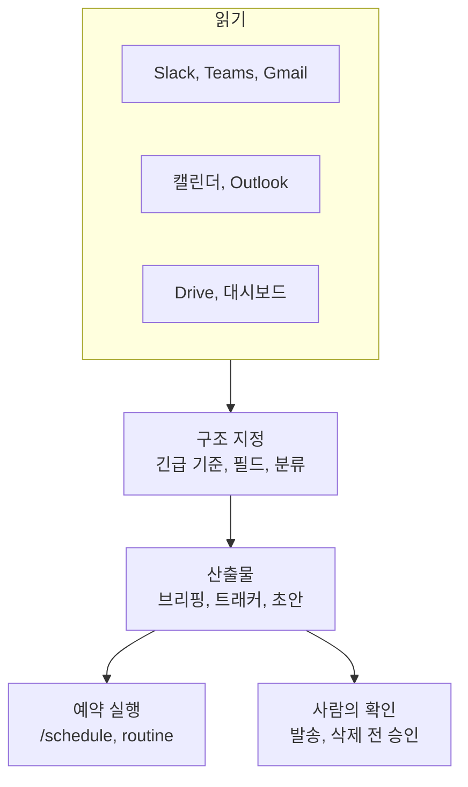

---

title: "[Claude Academy 10편] 업무 자동화 사용 사례와 웨비나 (브리핑, 메시지 정리, 현황 보고, 비교 분석)"
date: 2026-10-29
categories: [AI, Claude]
tags: [AI, Cowork, Automation, Briefing, Webinar]
layout: post
toc: true
math: false
mermaid: true
series: claude-academy
series_order: 10

---

## 참고자료

- [Claude Academy - 엔지니어링 과정 목록](https://academy.claude.com/ko/all?department=engineering)
- Claude Academy 사용 사례: Build a daily briefing across your tools, Morning and evening briefing, Message sweep, Week-ahead prep, Quickly Prep for Your Week, Prepare and plan from your calendar
- Claude Academy 사용 사례: Thread to decision, My voice, Ask the company, Generate project status reports, Weekly status posts from the team's channels and tracker
- Claude Academy 사용 사례: Compare and analyze competing options, Size a market using your research, Source Insights from Your Tools to Build a Deck, Create a company newsletter, Create a process flowchart, Create interactive PDF forms, Turn emails into an event tracker, Clean up promotional emails, Explore what Claude can do for you
- Claude Academy 웨비나 목록(2026년 9월에서 10월)

---

## 배경

[9편](/posts/claude-academy-use-cases-engineering/)이 장애, 온콜, 코드처럼 엔지니어링 업무에 한정된 사례였다면, 이 글은 그 밖의 업무 사례 스무 개를 묶는다. 하루 일정 준비, 메시지 정리, 현황 보고, 문서 비교, 양식과 트래커 만들기다. 직무와 상관없이 반복되는 업무라서 1인 운영자에게도 시간이 드는 일이다.

사례를 하나씩 보면 서로 다른 일 같지만, 구성은 몇 가지 패턴으로 모인다. 이 글은 패턴을 먼저 세우고 사례를 그 아래에 놓는다. 마지막에는 같은 시기에 게시된 웨비나 목록을 표로 남긴다. 웨비나는 영상이라 카드의 제목과 설명만 수집했고 본문은 확인하지 못했다.

정리하면서 확인하고 싶었던 것들이다.

- 일정과 메시지 정리 사례는 어떤 구성으로 만드는가?
- 현황 보고와 결정 기록은 증거를 어떻게 남기는가?
- 비교와 분석 사례는 무엇을 입력하고 무엇을 확인하는가?
- 결과물을 만드는 사례(뉴스레터, 흐름도, 양식, 트래커)의 요령은 무엇인가?
- 웨비나는 어떤 주제를 다뤘는가?

---

## 큰 그림

대부분의 사례는 세 단계다. 여러 도구에서 읽고, 지정한 구조로 묶고, 일정에 맞춰 반복한다. 어느 도구를 쓰는지에 따라 실행 환경만 달라진다.

1절은 일정과 메시지, 2절은 현황과 결정 기록, 3절은 비교와 분석, 4절은 결과물 만들기, 5절은 웨비나다.

---

## 1. 일정과 메시지 정리

첫 질문이다.

| 사례 | 입력 | 산출물 |
|---|---|---|
| 일일 브리핑 | Slack, Notion, 대시보드(Chrome 커넥터로 탭을 직접 읽음)다. | 긴급 항목, 내가 언급된 스레드, 알아야 할 스레드, 이번 주 마감 순의 브리핑이다. |
| 아침과 저녁 | 평일 오전 8시와 오후 6시의 두 실행이다. | 아침은 급한 일, 마감, 나를 기다리는 사람, 가장 먼저 할 세 가지다. 저녁은 한 일, 밀린 일, 내일의 시작점이다. |
| 메시지 정리 | Slack DM과 멘션, Teams 피드, Gmail의 최근 24시간 안 읽은 메시지다. | 앱이 아니라 주제별로 묶고 답장 필요, 읽을 것, 참고용으로 분류한다. 답장 필요 항목에는 초안을 붙인다. |
| 다음 주 회의 | 다음 주 캘린더다. | 회의별 한 문단 안건과 가장 준비가 필요한 세 건 표시다. 일요일 밤용 문서 한 개다. |
| 주간 개요 | Outlook 캘린더와 받은편지함(Microsoft 365 커넥터)이다. | 준비가 필요한 회의, 긴급 이메일, 과예약 구간, 집중 시간이다. |
| 내일 회의 점검 | Google Calendar와 Gmail(Chrome)이다. | 내부와 외부 회의를 구분하고 관련 스레드를 찾고 회의실이나 화상 링크 누락을 채운다. |

일일 브리핑은 **프롬프트에서 브리핑 구조와 긴급 기준을 직접 지정**한다. 대시보드의 빨간색이나 하락 추세 항목이 긴급이다. 긴급 항목은 관련자, 논의 내용, 미해결 사항까지 깊게 가져온다. 결과 예는 파이프라인 속도 15% 하락과 `#sales` 스레드를 한 항목으로 묶은 형태다. 예약하면 Anthropic 서버에서 돌아 노트북이 꺼져 있어도 결과가 준비되고, 기본적으로 원격 세션(베타)에서 실행된다.

아침과 저녁 두 실행은 `Daily` 폴더의 날짜별 파일로 이어져서 이월 항목이 빠지지 않는다. 다음 주 회의 준비의 회의별 맥락은 지난 만남, 관련 Slack 스레드, 첨부나 언급된 문서, 내가 상대에게 빚진 미결 사항이다. 결과는 주간 폴더에 쌓여 금요일 회고에서 그대로 읽을 수 있다.

대가는 읽는 범위가 넓을수록 느린 커넥터가 병목이 된다는 점이다. 작업 패널에서 어느 커넥터가 느린지 실시간으로 확인할 수 있다. 후속 질문은 같은 대화에서 하면 전체를 다시 조회하지 않고 다듬는다.

내 문체 프로필 사례는 이 흐름에 붙는다. 보낸 메시지를 읽어 어조와 문체를 분석하고 `/my-voice` 스킬로 저장하면 이후 초안이 내 말투에 맞는다. 첫 프로필은 한 시점의 스냅숏이므로 초안을 고칠 때마다 수정 내용을 스킬에 규칙으로 더한다. 수 주가 지나면 초안을 거의 고치지 않아도 된다.

---

## 2. 현황 보고와 결정 기록

두 번째 질문이다.

### 2.1 현황 보고

Gmail, Slack, Drive, 캘린더에서 프로젝트 정보를 모아 Excel 트래커로 만든다. 예시 프로젝트는 Gmail 147건, Slack 312건, Drive 문서 23건, 회의 18건을 조회해 25개 작업을 담았다. 작업별 확인 항목은 담당자, 현재 상태(시작 전, 작업 중, 막힘, 완료), 막힌 사유와 기간, 업데이트 메모다.

출처 간 모순을 조정하는 것이 핵심이다. 한 사람이 Slack에서 "80% 완료"라고 했는데 1대1 노트에 복잡성이 언급돼 트래커에는 45%로 기록됐다. 그래서 **정보가 없을 때는 조용히 메우지 말고 "기록된 진척 없음"으로 표시하라**고 프롬프트에 적는다. 셀 메모에 출처 맥락을 붙이면 마우스를 올려 근거를 확인한다.

팀 채널에서는 Claude Tag에 트래커를 연결하고 routine을 설정해 매주 정해진 시각에 주간 요약 초안을 올린다. 스레드의 결정 사항과 트래커의 미해결 항목을 대조한다. 팀원 누구나 게시물 아래에서 내용을 바로잡고 프로젝트 리드가 수정된 글을 전달한다.

### 2.2 결정 기록과 사내 질의

긴 스레드나 이메일 체인을 읽어 실제로 결정된 내용, 다음 단계 담당자와 약속 날짜, 아직 열려 있거나 논쟁 중인 사항을 결정 로그에 추가한다. 각 항목에 원본 메시지 링크를 붙여 한 줄에서 대화로 바로 이동한다. 토론 과정은 빼고 기록만 남기게 지시한다.

사내 질문에 답하는 에이전트는 위키, 코드, 데이터 웨어하우스를 가로질러 출처와 함께 답한다. 확신이 없으면 담당 팀이나 채널을 알리게 해서 추측 대신 문의처 안내가 나온다. 서비스 카탈로그, 팀 디렉터리, 용어집을 작업 폴더에 모아 검색 전의 안내표로 쓴다. 좋은 답 하나를 만든 뒤 스킬로 바꿔 공유한다.

대가는 소스가 많을수록 출처 간 모순이 늘어난다는 점이다. 결정 로그도 스레드에서 무엇이 결정이었는지 판단을 모델이 하므로 원본 링크로 사람이 확인한다.

---

## 3. 비교와 분석

세 번째 질문이다.

| 사례 | 입력 | 산출물과 확인 |
|---|---|---|
| 공급업체 비교 | 제안서 PDF 3개와 마감일, 발표 대상(CFO)이다. | 가격 비교, 기능 매트릭스, 계약 조건, 연동과 지원 네 탭이다. 첫해 총액과 직원당 비용을 계산한다. 숨은 비용과 우려되는 계약 조건을 별도로 표시한다. |
| 시장 규모 | 기존 리서치나 회사 데이터다. | TAM, SAM, SOM을 계산한 PowerPoint, Excel, 출처 문서 세 가지다. |
| 이사회 덱 | 시작 자료 하나에서 사람, 채널, 문서를 따라간다. | 덱과 부속 문서다. 출처 간 숫자가 다르면 하나를 골라 부록에 차이를 적는다. |

TAM, SAM, SOM은 각각 전체 시장(Total Addressable Market), 접근 가능한 시장(Serviceable Available Market), 실제로 확보할 수 있는 시장(Serviceable Obtainable Market)이다.

비교 사례의 위험 신호는 24개월 계약에 90일 해지 통지, 제안서 8쪽에 숨은 $500 구현비, 최소 5명 조건이다. 추천은 숫자 기준으로만 제시된다. 유연성이 우선이면 한 업체, 30명 이상 확장이 확실하면 다른 업체로 갈린다. 후속으로 CFO용 추천 메모, 업체 미팅 질문 목록, 손익분기 직원 수 차트를 요청할 수 있다.

이사회 덱 사례는 의사결정 질문, 따라갈 경로, 원하는 결과물 이름을 프롬프트에 명시한다. **출처 간 숫자가 다르면 Claude가 하나를 고르므로 사용자가 부록의 차이를 직접 확인해야 한다.** 결과를 그대로 이사회에 내면 위험하다.

채팅 미리보기에는 기본 구조만 보이므로 Excel 파일을 열어 서식과 셀 메모를 확인한다. 소프트웨어 업체, 보험 견적, 시공 입찰에도 같은 방식이 적용된다.

---

## 4. 결과물 만들기

네 번째 질문이다.

| 사례 | 요령 |
|---|---|
| 사내 뉴스레터 | 대상 주간과 조회할 Slack 채널을 밝히고 Drive의 공식 정보와 Gmail, Slack의 비공식 논의를 함께 읽는다. 상호작용형 HTML 아티팩트로 만든다. 디자인 문구가 없으면 기본 서식으로 나온다. |
| 프로세스 흐름도 | 42쪽 온보딩 문서를 Sankey 흐름도로 바꾼다. 띠의 너비가 고객 수를 나타내고 단계는 클릭 가능한 카드다. Mermaid로 변환하면 편집 가능한 링크와 코드를 얻는다. |
| 대화형 PDF 양식 | 수집할 정보와 작성자를 설명하면 드롭다운, 체크박스, 텍스트 필드가 있는 양식을 만든다. PDF를 내려받아 필드 클릭과 탭 순서를 확인한 뒤 배포한다. |
| 이메일 트래커 | Gmail의 참석 확인 메일에서 정보를 추출해 수식이 있는 스프레드시트로 만든다. 제목이 제각각인 회신도 문맥으로 찾는다. |
| 프로모션 메일 정리 | Chrome이 받은편지함을 훑어 발신자별 목록을 만들고 사용자가 승인해야 일괄 삭제한다. |

**삭제와 발송 같은 되돌리기 어려운 버튼은 승인 후에만 실행한다.** 프로모션 메일 정리에서 남길 대상(실제 사람이 보낸 메일, 첨부 파일이 있는 메일, 회사 도메인 메일)을 프롬프트에 지정한다. 예시에서 조건에 맞는 메일 847통이 유통사, 열지 않은 뉴스레터, 자동 알림, SaaS 마케팅으로 나뉘었다.

흐름도 사례는 문서 형식이 정돈되지 않아도 서술문, 글머리표, 흩어진 이메일에서 분기와 병렬 흐름을 찾아낸다. 프로세스 매핑 전용 Project를 만들어 두면 순서가 바뀔 때 해당 부분만 일관되게 고친다. 양식은 단순하면 Haiku, 복잡한 레이아웃은 Sonnet이 맞는다고 안내한다.

이 사례들도 Claude가 할 수 있는 일을 막연히 묻지 말고 직무와 시간이 드는 일을 구체적으로 말하는 것으로 시작한다. "상태 보고에 몇 시간을 쓴다"처럼 말하면 해당 문제를 푸는 기능이 먼저 제안된다.

---

## 5. 웨비나

다섯 번째 질문이다.

웨비나는 영상이라 목록 카드의 제목, 설명, 날짜만 정리했다. 카드의 날짜에는 연도가 없고 영상 내용은 확인하지 못했다.

| 날짜 | 제목 | 내용 |
|---|---|---|
| 10/15 | Claude Tag on-call | Slack 인시던트 채널에서 로그 확인부터 수정안 초안까지 맡는 방식이다. |
| 10/14 | Cyber Verification Program | 보안팀을 위한 접근 등급 3단계와 인증 순서, 마이그레이션이다. |
| 10/13 | Measuring AI Fluency at Your Organization | 사용량 지표를 넘어 조직의 AI 역량을 측정하는 프레임워크다. |
| 10/8 | AI as an Engineering Leadership Multiplier | 판단과 책임을 넘기지 않으면서 엔지니어링 리더십에 AI를 쓰는 방법이다. |
| 10/1 | Building with the Claude 5.5 Family | 모델 구성과 평가로 모델을 고르는 법, 캐싱과 오케스트레이션으로 비용을 줄이는 방법이다. |
| 10/1 | Claude Code on Google Cloud 비용 통제와 ROI | Claude apps gateway로 지출과 접근을 통제하고 사용 데이터로 ROI 자료를 만든다. |
| 9/30 | Enterprise Transformation with Claude on AWS | Platform API, Bedrock, Enterprise, Desktop까지 AWS 운영 경로다. |
| 9/30 | Claude in Microsoft Foundry | tool search, MCP connector, web search, structured outputs로 에이전트를 만든다. |
| 9/25 | Opus 5.5 for Work | 신기능과 글쓰기, 분석, 협업 업무 사례다. |
| 9/24 | Modernizing Legacy Code with Claude Code | 모더나이제이션 플러그인으로 COBOL-to-Java 이전, 50만 줄 Java 업그레이드를 시연한다. |

예정 웨비나는 4건이다. 10/21 AWS에서의 Claude 지출 통제(Tokenomics), 10/22 Rearview Roadmap Review, 10/28 Chat과 Cowork가 하나의 Claude로 합쳐질 때 관리자에게 생기는 변화, 10/29 사모펀드의 포트폴리오 전반 Claude 확대다. 관리자와 비용 주제는 [8편](/posts/claude-academy-tag-and-enterprise/), 모델 선택은 [2편](/posts/claude-academy-platform-and-cloud/)과 이어진다.

---

## 정리하며

처음 던진 질문들에 대한 답이다.

**일정과 메시지 정리.** 읽을 소스, 긴급 기준, 분류 필드를 프롬프트에 지정하고 `/schedule`로 예약한다. 아침과 저녁 실행은 날짜별 파일로 이월 항목을 잇는다.

**현황 보고와 결정 기록.** 출처 간 모순은 조정하되, 정보가 없으면 "기록된 진척 없음"으로 표시한다. 결정 로그에는 원본 링크를 붙인다.

**비교와 분석.** 비교 항목과 발표 대상을 밝히고 숨은 비용을 표시하게 한다. 출처 간 숫자가 다르면 부록의 차이를 사람이 확인한다.

**결과물 만들기.** 디자인 문구와 필드를 구체적으로 지정하고, 삭제와 발송은 승인 후 실행한다. 결과 파일은 직접 열어 확인한다.

**웨비나.** 온콜, 비용 통제, 조직 AI 역량 측정, 모델 선택, 레거시 코드 이전이 주제였고 본문은 미확인이다.

정리하고 나서 가장 크게 바뀐 인식은 **자동화 사례의 차이가 도구보다 입력 소스와 확인 지점의 지정에서 나온다**는 점이었다. 그래서 새 업무를 자동화하기 전에 읽을 소스와 사람이 확인할 단계를 먼저 적는다.
